## 어떤 정보를 읽어 다음 표현을 만드는가? {#chapter-opening}

길이가 다른 문장을 처리하려면 어느 위치의 정보를 얼마나 가져올지 정해야 한다. Transformer는 요청하는 표현과 정보를 제공하는 표현을 비교하고, 읽을 수 있는 위치에서 값을 집계한 뒤 각 위치의 표현을 갱신한다. 이 장에서는 이 계산을 작은 가중합에서 시작해 학습하고 토큰을 생성하는 전체 모델까지 연결한다.

처음 읽을 때는 가중 집계에서 점수와 허용 관계로, Self/Cross의 출처에서 여러 Head와 위치로, 그리고 Block·구조·생성·효율화로 차례로 진행하자. 마지막 절에서는 앞서 배운 계산을 실제 두 구조와 새 종합 과제에서 회수한다. 계산 예제를 직접 따라간 뒤 유제와 절 종료 연습을 풀고, 상세 해설에서 다른 값이 처음 생긴 연산을 찾으면 된다.

### 진입과 복습

벡터의 좌표별 합·내적, 행렬곱의 크기와 행/열, 지수·로그, 평균·분산을 계산할 수 있어야 한다. 부족한 계산은 해당 절의 짧은 복습과 좌표 전개를 따라 확인하자. 코드 실습에는 Python의 배열·함수·클래스와 PyTorch의 Tensor·자동미분을 사용한다. 기호는 식 주변에서 정의하며, 같은 글자가 서로 다른 절의 지역 계산에서 쓰이면 해당 입력과 크기를 먼저 읽는다.

이 장에서 점수와 계수의 행은 요청 위치, 열은 제공 위치다. Boolean 허용표의 True는 읽기 허용이다. 배열 순서와 원래 위치를 구별하고, Attention 결과·Block 반환·최종 Logit도 구별하자. 손계산 매개변수는 교육용 값이며 학습한 모델의 의미를 붙이지 않는다. Post-LN과 Pre-LN, Absolute 위치 가산과 RoPE, Full Softmax와 별도 특징Kernel은 각각 명시한 계산을 따른다.

### 두 번의 읽기

첫 읽기에서는 핵심 예제와 ★ 문제를 따라 정보 요구·출처·크기·반환을 연결한다. 두 번째 읽기에서는 정리의 가정·반례·심화문제와 전체 구현 부록을 살펴보며 어떤 변경이 계산을 보존하는지 따져 보자. 핵심 코드 발췌는 설명 옆에 남아 있고, 긴 전체 구현은 장 끝의 부록에 모았다. 전체 모델의 학습·생성·Cache 경로는 부록 A에서 실행할 수 있다.


\clearpage

## 10.1 필요한 정보를 어떻게 골라 가져오는가? {#sec-retrieval}

### 같은 문장에서도 필요한 정보가 바뀐다 {#reading-request}

“민지는 책을 동생에게 돌려주었다.” 이 문장을 영어로 옮기는 사람이 ‘돌려주었다’라는 말에 도착했다고 하자. 그 동작을 표현하는 데에는 물건을 돌려주었다는 사실이 필요하다. 그런데 그다음에 무엇을 돌려주었는지 쓰려면 ‘책’을, 누구에게 돌려주었는지 쓰려면 ‘동생’을 다시 살펴야 한다. 문장은 그대로인데, 지금 쓰려는 내용에 따라 읽어야 할 곳이 바뀐다. ‘책’과 ‘동생’을 모두 기억하더라도, 매 순간 똑같은 비율로 참고할 이유는 없다.

문장의 위치 하나가 다른 위치의 정보를 필요로 하는 일은 번역에만 생기지 않는다. “민지는 책을 빌렸다. 며칠 뒤 그 책을 …”에서 다음 말을 예상하려면 바로 앞의 ‘책을’뿐 아니라 앞 문장의 ‘빌렸다’도 단서가 된다. 지금 계산하는 위치에 필요한 정보가 모두 들어 있지 않으면, 앞의 정보를 다시 가져와야 한다. 이 절에서는 **한 위치의 요청에 따라 여러 위치의 내용을 다른 비율로 가져와 하나의 벡터로 만드는 과정**을 배운다. 다음 말을 실제로 선택하는 전체 모델은 뒤에서 다룬다. 여기서 만들 출력은 다음 계산에 넘길 정보다.

모델이 문장을 처리하는 단위를 **토큰(token)**이라고 한다. 토큰 하나가 반드시 단어 하나인 것은 아니다. ‘민지’, ‘책’, ‘동생’을 세 위치로 부르는 것은 계산을 작게 하기 위한 교육용 단순화다. 실제 모델은 더 많은 토큰과 훨씬 많은 좌표를 사용하며, 한 위치의 **신경망 표현(representation)**에 주변 내용이 이미 반영되어 있을 수도 있다. 위치 이름은 벡터의 출처를 따라가기 위한 표지다. 한 벡터가 해당 단어의 사전 뜻만 저장한다고 생각하지 말자.

번역기라면 원문을 읽는 Encoder가 위치마다 표현을 남기고, 번역문을 만드는 Decoder가 필요할 때 그 표현을 참고할 수 있다.[^architecture] 그림의 가운데 연결에서 정보를 가져오는 계산을 확대해 보자. 정보를 제공하는 위치는 여러 개지만, 지금 정보를 받는 위치는 하나일 수 있다. 받는 위치가 늘어나면 같은 제공 위치들에 서로 다른 요청을 보낼 수 있다.

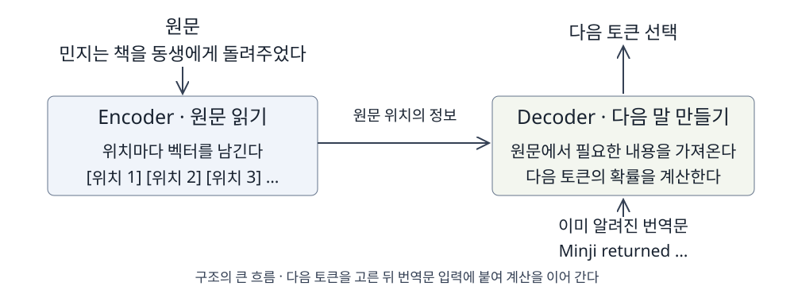{width=100% #fig-overview}

이 절을 읽을 때에는 벡터의 스칼라배와 좌표별 덧셈, 합 기호를 펼치는 법이 필요하다. 예를 들어 $0.5[2,4]=[1,2]$이고 $[1,2]+[3,1]=[4,3]$이다. $\sum_{j=1}^3 b_jv_j$는 $b_1v_1+b_2v_2+b_3v_3$라는 세 항의 합이다. 이 계산이 낯설면 수학 기초의 합과 선형대수의 벡터 연산을 복습하자. 행렬곱은 이 절에서 작은 셀 계산부터 다시 설명한다. 내적의 구체적 Attention 공식이나 미분을 미리 알아야 할 필요는 없다.

### 평균과 한 위치의 복사로는 무엇이 부족할까? {#reading-baselines}

세 제공 위치의 내용이 $v_1,v_2,v_3$라는 벡터에 들어 있다고 하자. 가장 간단한 방법은 세 벡터를 더해 3으로 나누는 것이다. 이 평균에는 세 위치가 똑같이 기여한다. 같은 내용을 언제나 같은 평균으로 보내면 구현은 쉽다. 그러나 ‘무엇을 돌려주었는가?’라는 요청과 ‘누가 받았는가?’라는 요청에 같은 벡터가 도착한다. 요청이 변해도 제공 내용이 같으면 계산 결과가 바뀌지 않는다. 필요한 정보를 선택해서 강조하는 통로가 없는 것이다.

평균이 언제나 나쁜 방법이라는 뜻은 아니다. 전체 자료의 평균 자체가 필요한 과제라면 같은 비율이 적합하다. 문제는 요청마다 다른 정보를 가져와야 하는 상황이다. 평균만 보내는 구조에서는 받는 쪽이 각 출처의 비율을 바꿀 수 없다. 뒤의 다른 계산이 차이를 만들 수는 있겠지만, 지금 살펴보는 정보 전달 연산 자체는 요청에 반응하지 않는다.

그러면 필요한 위치 하나를 골라 그 벡터를 그대로 복사하면 어떨까? 물건만 필요할 때 ‘책’의 표현을 선택하는 것은 자연스러워 보인다. 하지만 동작과 받는 사람이 함께 필요하거나, 두 위치의 단서가 모두 유용하거나, 어느 위치가 맞는지 아직 확실하지 않은 경우에는 한 위치로 제한하는 것이 지나치다. 단일 선택은 선택한 벡터를 온전히 보내지만 나머지 벡터의 기여를 0으로 만든다. 여러 단서를 조금씩 반영하는 중간 선택을 표현하지 못한다.

여러 위치를 반영하면서도 요청에 따라 비율을 바꾸려면, 위치마다 곱할 수를 정한 뒤 더하면 된다. 모든 비율이 같으면 평균을, 한 비율만 1이고 나머지가 0이면 단일 복사를 얻는다. 그 사이의 비율도 사용할 수 있다. **가중합(weighted sum)**은 평균과 복사를 포함하는 계산 방식이며, Attention은 요청과 제공 위치의 비교로 그 가중치를 정한다.[^roles]

#### 이해 확인 — 두 요청 {#check-two-requests}

같은 세 값 벡터에 단순 평균을 적용했을 때, 요청 문장만 바꾸어 결과를 달리할 수 있는가? 잠깐 멈추고 이유를 한 문장으로 써 보자. 먼저 답을 적은 뒤 별도 해설서의 [‘두 요청’ 해설](SOLUTIONS.md#solution-check-two-requests)과 비교하자.

### 비율 하나가 벡터 전체에 하는 일 {#reading-weighted}

벡터를 $[x,y]$로 쓰면 $x$와 $y$는 서로 다른 두 좌표다. 한 위치가 보내는 내용은 이 두 좌표를 함께 가진 벡터다. 위치의 가중치가 0.2이면 첫 좌표만 20% 가져오는 것이 아니라 두 좌표 모두에 0.2를 곱한다. 가중치는 제공 위치에 붙고, 좌표별 내용은 값 벡터에 들어 있다. 이 둘을 구분해야 뒤에서 “어느 위치가 얼마나 기여했는가?”를 계산할 수 있다.

### 정의 10.1.1 한 요청의 정규화된 가중 집계 {#def-weighted}

값 벡터 $v_1,\ldots,v_n\in\mathbb R^{d_v}$에 대한 **한 요청의 정규화된 가중 집계 출력** $o$를 다음과 같이 정의한다.

$$
o=\sum_{j=1}^{n}a_jv_j,\qquad
a_j\geq0,\qquad \sum_{j=1}^{n}a_j=1.
\tag{ 10.1.1 }\label{eq-weighted}
$$

여기서 $n$은 정보를 제공하는 위치 수, $j=1,\ldots,n$은 그 위치를 세는 첨자, $d_v$는 한 값 벡터의 좌표 수다. $v_j$는 위치 $j$의 값 벡터이고 $a_j$는 그 위치에 줄 실수 비율 하나다. 출력 $o\in\mathbb R^{d_v}$도 $d_v$개의 좌표를 가진다. 제공 위치가 세 개라고 출력 좌표가 세 개가 되는 것은 아니다. 가중합이라는 연산 일반에는 음수 계수나 합이 1이 아닌 계수도 가능하지만, 이 절의 ‘정규화된 가중 집계’는 위 조건을 둔다. 뒤의 성질은 이 조건을 사용한다.

출력의 좌표를 더 세밀하게 보자. $v_{j,r}$는 위치 $j$의 값 벡터에서 좌표 $r$의 수다. 출력 좌표 $o_r$는 $\sum_j a_jv_{j,r}$다. 좌표 $r$을 고정하고 위치 $j$를 바꾸어 더한다. 좌표끼리 뒤섞는 연산이 아니다. 값 벡터의 같은 좌표끼리 합친 결과가 출력의 같은 좌표에 놓인다.

### 예제 10.1.1 돌려준 물건을 표현하려는 요청 {#ex-language}

언어적 상황에서 가중합으로 넘어가 보자. ‘민지’, ‘책’, ‘동생’의 세 위치가 보낼 값을 각각

$$
v_1=[2,0],\qquad v_2=[0,4],\qquad v_3=[2,4]
$$

로 직접 정한다. 요청을 ‘무엇을 돌려주었는지 표현할 정보’라고 부르고, 그 요청에 대한 비율을 $[0.2,0.6,0.2]$로 정하자. 둘째 위치를 더 많이 참고한다는 상황을 계산으로 표현한 것이다. 이 수치는 학습된 번역기에서 측정한 것이 아니다. 첫 좌표가 사람, 둘째 좌표가 물건이라는 해석도 부여하지 않는다. 독자가 따라갈 것은 **출처와 비율과 이동하는 수**다.

먼저 각 위치가 보낼 기여 벡터를 따로 계산한다.

$$
\begin{aligned}
0.2v_1&=[0.4,0],\\
0.6v_2&=[0,2.4],\\
0.2v_3&=[0.4,0.8].
\end{aligned}
$$

셋째 위치가 20%만 받더라도 둘째 좌표에 0.8을 보낸다. 둘째 위치의 비율 0.6이 가장 크다는 사실만 보고 다른 위치를 계산에서 지우면 결과가 달라진다. 세 기여를 같은 좌표끼리 더하면

$$
\begin{aligned}
o&=[0.4+0+0.4,\;0+2.4+0.8]\\
 &=[0.8,3.2]
\end{aligned}
$$

가 된다. 출력의 둘째 좌표 3.2는 둘째 위치만의 값이 아니다. 둘째 위치가 보낸 2.4와 셋째 위치가 보낸 0.8의 합이다. 그 좌표에서 둘째 위치의 수치 기여가 75%인 것은 $2.4/3.2=0.75$이기 때문이다. 위치에 준 가중치 60%와 한 출력 좌표의 기여 비중 75%는 서로 다른 계산이다. 출력 좌표가 0이거나 기여에 양수·음수가 섞이면 이런 ‘기여 비중’을 그대로 의미적 비율로 읽는 것도 적절하지 않다.

같은 값들의 단순 평균은 $[4/3,8/3]$이고, 둘째 위치만 복사하면 $[0,4]$다. 가중합 $[0.8,3.2]$는 이 둘과 다르다. 요청에 맞추어 둘째 위치를 강조하면서도 첫째·셋째 위치를 함께 반영했다. 처음 질문에 대한 답은 정답 영어 단어가 아니라, 지금 쓰려는 내용에 맞게 정보의 혼합을 바꿀 수 있다는 것이다. 이 벡터를 받은 다음 연산이 실제 출력 표현을 만든다.

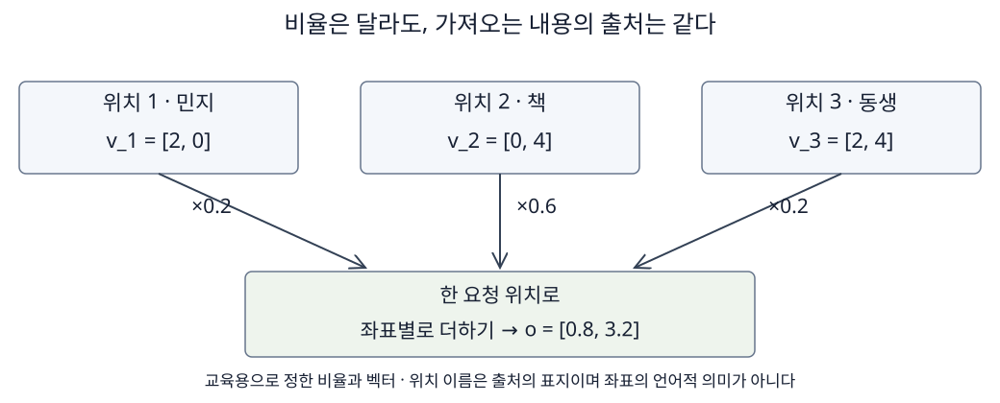{width=100% #fig-weighted}

### 유제 10.1.1 받는 사람을 표현하려는 요청 {#u-weighted}

[예제 10.1.1](#ex-language)의 세 값 벡터를 그대로 두고, ‘누가 받았는지 표현할 정보’라는 새 요청에 비율 $[0.2,0.2,0.6]$을 준다. 각 위치의 기여 벡터와 최종 출력을 계산하라. 앞 요청에 비해 어느 좌표가 바뀌고 어느 좌표가 같은지, 그 이유를 두 값 벡터의 좌표를 비교하여 설명하라. 두 요청이 같은 값을 읽어도 다른 결과를 얻는 까닭을 계산과 연결하라.

### 비교 기준과 전달할 내용을 나누기 {#reading-qkv}

지금까지는 비율을 직접 정했다. 실제로 요청이 계속 바뀌는데 사람이 매번 비율을 써 넣을 수는 없다. 요청을 수로 나타내고, 각 제공 위치가 그 요청과 얼마나 맞는지 비교해야 한다. 그런데 비교할 때 유용한 특징과, 선택된 뒤 보내야 하는 내용은 같아야 할까?

도서관에서 자료를 찾는 상황을 생각해 보자. 요청이 ‘특정 해의 기후 관측 자료’라면 제목·주제·연도를 보고 요청과의 적합성을 비교할 수 있다. 선택한 뒤 필요한 것은 제목 문자열의 평균이 아니라 관측 값이나 자료의 내용이다. ‘어떤 자료를 찾는가’, ‘무엇을 기준으로 찾을 수 있는가’, ‘찾은 뒤 무엇을 전달하는가’라는 세 역할이 나뉜다. 이 비유는 신경망이 제목이나 문서를 문자 그대로 저장한다는 뜻이 아니다. 비교 기준과 전달 내용이 달라도 된다는 구조를 이해하기 위한 예다.

### 정의 10.1.2 질의·키·값의 역할 {#def-qkv}

정보를 요청하고 비교하고 전달하는 세 역할을 **어텐션 질의(attention query)** $q_i$, **키 벡터(attention key)** $k_j$, **값 벡터(attention value)** $v_j$로 구별한다. 질의와 키의 비교 점수를 주어진 규칙으로 정규화된 비음수 가중치로 바꿀 때, 요청 $i$의 집계 출력은 다음과 같이 정의한다.

$$
o_i=\sum_{j=1}^{n}a_{ij}v_j,\qquad
a_{ij}\geq0,\qquad \sum_{j=1}^{n}a_{ij}=1.
$$

여기서 $q_i$는 정보를 받는 위치 $i$가 내보내는 질의, $k_j$는 제공 위치 $j$에서 질의와 비교할 벡터, $v_j\in\mathbb R^{d_v}$는 그 위치가 실제로 전달할 내용이다. $n$은 제공 위치 수다. $q_i$와 $k_j$의 비교 결과가 점수 $s_{ij}$이고, 이를 변환한 $a_{ij}$가 요청 $i$에 대한 위치 $j$의 비율이다. 비교식과 변환 규칙은 사용할 구성에 맞게 지정한다. 문맥이 분명하면 질의·키·값이라고 줄여 부른다.

아래첨자 $i$는 받는 위치, $j$는 제공하는 위치다. $a_{23}$은 둘째 요청이 셋째 제공 위치에 준 비율이다. 셋째 요청이 둘째 위치에 준 비율이 아니다. 한 요청을 설명할 때에는 $i$를 고정하고 $a_j$로 줄여 썼지만, 여러 요청에서는 두 아래첨자가 필요하다. 값 $v_j$에는 받는 위치 $i$가 붙지 않는다. 같은 제공 값을 여러 요청이 다른 비율로 사용할 수 있기 때문이다.

질의와 키는 **얼마나 가져올지 정하는 비교**에 참여하고, 값은 **무엇을 가져오는지** 결정한다.[^roles] 질의의 좌표 자체를 값 대신 합하는 것이 아니다. 키를 평균하는 것도 아니다. 예를 들어 키에 자료의 주제와 시점에 대응하는 비교 특징을 두고 값에는 관측 내용을 둘 수 있다. 값의 좌표 수가 키와 달라도 된다. 역할을 분리하면 내용의 폭을 늘려도 비교 기준의 폭을 반드시 늘릴 필요가 없다.

역할을 나누었다고 세 벡터가 항상 다른 수를 가져야 하는 것은 아니다. 단순한 교육 예에서는 우연히 $k_j=v_j$일 수도 있다. 그때에도 비교에 쓰이는 자리와 전달에 쓰이는 자리는 구별된다. 반대로 같은 원래 표현에서 만들었다고 $q,k,v$가 같아야 하는 것도 아니다. 어떻게 만들었는지와 어떤 역할로 쓰이는지는 서로 다른 질문이다.

#### 이해 확인 — 내용을 바꾼 경우 {#check-value-change}

지금의 계산에서 $q_i$, 모든 $k_j$, 점수를 가중치로 바꾸는 규칙을 고정하고 $v_2$만 바꾼다. 가중치가 바뀌는가? 출력도 함께 생각해 보고, 어떤 고정 조건을 사용했는지 적어 보자. [‘내용을 바꾼 경우’ 해설](SOLUTIONS.md#solution-check-value-change)과 비교하자.

### 예제 10.1.2 두 요청이 같은 제공 위치를 다르게 읽기 {#ex-score}

구체적인 점수 계산식을 아직 선택하지 않고도 Q/K/V의 흐름을 추적할 수 있다. 이 예에서는 질의 $q_1,q_2$와 세 키를 비교한 결과가 다음 점수표로 주어졌다고 하자. 점수는 비음수이고 각 행의 합이 양수다. **이번 예의 변환 규칙**은 점수를 같은 행의 합으로 나누는 것이다. 음수·합 0에는 그대로 적용할 수 없다. 실제 Transformer에서 사용할 scaled dot-product와 softmax는 [10.2절](#sec-scoring)의 대상이며, 이 작은 규칙과 혼동하지 말자.

| 비교 대상 | 첫째 제공 위치 | 둘째 제공 위치 | 셋째 제공 위치 |
| --- | ---: | ---: | ---: |
| 첫 요청 $q_1$의 점수 | 1 | 3 | 1 |
| 둘째 요청 $q_2$의 점수 | 1 | 1 | 3 |

첫 행의 점수 합은 $1+3+1=5$이므로 가중치는 $[1/5,3/5,1/5]$다. 둘째 행도 합은 5지만 점수의 배치가 다르므로 $[1/5,1/5,3/5]$를 얻는다. 서로 다른 요청끼리 합해서 10으로 나누지 않는다. 각 요청은 자기가 읽을 제공 위치들 사이에서 비율을 정한다.

값을 [예제 10.1.1](#ex-language)와 같게 두면 첫 요청의 출력은 $o_1=[0.8,3.2]$, 둘째 요청의 출력은 $o_2=[1.6,3.2]$다. 둘째 출력은 $0.2[2,0]+0.2[0,4]+0.6[2,4]=[0.4+0+1.2,0+0.8+2.4]$로 계산한다. 첫 좌표의 차이 0.8은 둘째 위치의 비율 0.4를 셋째 위치로 옮긴 효과다. 셋째 값의 첫 좌표가 2이고 둘째 값의 첫 좌표가 0이기 때문이다. 두 값의 둘째 좌표는 모두 4라서 그 좌표의 총 기여는 변하지 않았다.

처음 질문으로 돌아가면, 제공 내용이 같아도 요청별 비교 점수의 차이가 비율의 차이를 만들고, 비율의 차이가 집계 내용의 차이로 이어진다. 다만 점수표를 주었으므로 ‘이 질의 벡터의 어느 좌표 때문에 점수가 3이 되었는가?’까지 알아낸 것은 아니다. 구체적 비교식은 별도로 지정해야 한다. 역할을 이해하는 일과 특정 비교식을 계산하는 일을 구분하자.

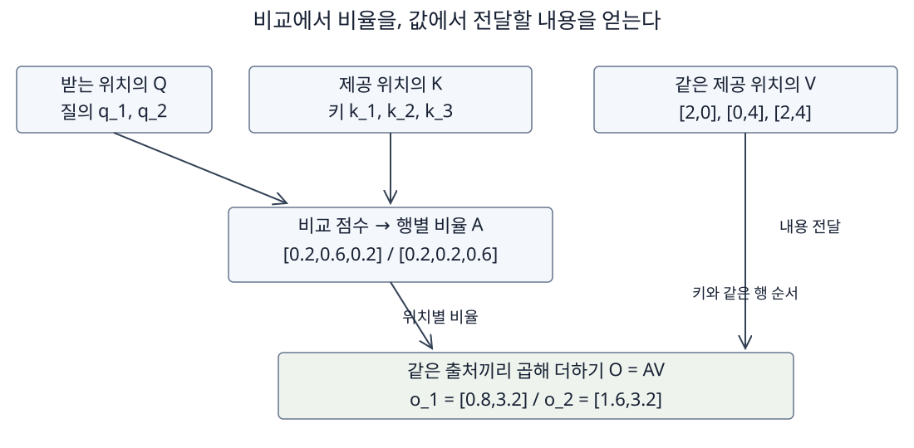{width=100% #fig-qkv}

### 유제 10.1.2 주어진 규칙의 적용 조건 {#u-rule}

한 요청의 점수 $[2,0,2]$와 값 $[2,0],[0,4],[2,4]$가 주어진다. [예제 10.1.2](#ex-score)의 ‘행 합으로 나누기’ 규칙으로 가중치와 출력을 계산하라. 점수 $[-1,2,-1]$에는 같은 규칙을 적용할 수 있는지, 분모와 비음수 조건을 확인하여 설명하라. 새로운 규칙을 발명할 필요는 없다.

### 여러 요청을 행렬에 넣어도 위치와 좌표는 다르다 {#reading-matrix}

한 요청의 비율을 한 행에, 한 제공 위치의 값을 한 행에 적으면 여러 요청을 동시에 계산할 수 있다. 행렬 $A$에서 행은 요청, 열은 제공 위치다. 행렬 $V$에서 행은 제공 위치, 열은 값의 좌표다. $A$의 열과 $V$의 행이 같은 출처 순서를 가리켜야 한다.

### 정의 10.1.3 요청별 집계 행렬 {#def-matrix}

요청별 가중치 행렬 $A$와 값 행렬 $V$의 집계 출력 행렬 $O$를 다음과 같이 정의한다.

$$
O=AV,\qquad O_{ir}=\sum_{j=1}^{n}A_{ij}V_{jr},\qquad
\underbrace{A}_{m\times n}\underbrace{V}_{n\times d_v}
=\underbrace{O}_{m\times d_v}.
\tag{ 10.1.2 }\label{eq-matrix}
$$

여기서 $m$은 요청 수, $n$은 제공 위치 수, $d_v$는 값의 좌표 수이며 $A\in\mathbb R^{m\times n}$, $V\in\mathbb R^{n\times d_v}$다. $A_{ij}=a_{ij}$는 요청 $i$가 위치 $j$에 준 비율이고, 각 행은 앞 정의의 비음수·합1 조건을 만족한다. $V$의 $j$번째 행은 $v_j$이고 $V_{jr}$는 그 값의 좌표 $r$이다. $O$의 $i$번째 행은 $o_i$이며 $O_{ir}$는 그 출력의 좌표 $r$이다.

행렬곱에서 안쪽 크기 $n$이 맞는 이유는, 비율 하나가 가리키는 제공 위치와 값 한 행의 출처를 하나씩 대응시켜야 하기 때문이다. 곱해서 더하는 축은 제공 위치다. 출력의 행은 요청마다 하나, 열은 값의 좌표마다 하나다. 세 위치를 읽는 두 요청이라면 출력은 두 행을 가진다. 제공 위치 수만큼 행을 반환하는 연산이 아니다.

[예제 10.1.2](#ex-score)를 행렬로 적으면

$$
A=\begin{bmatrix}0.2&0.6&0.2\\0.2&0.2&0.6\end{bmatrix},\quad
V=\begin{bmatrix}2&0\\0&4\\2&4\end{bmatrix},\quad
O=\begin{bmatrix}0.8&3.2\\1.6&3.2\end{bmatrix}.
$$

첫 행·둘째 열을 직접 계산하면 $A_{11}V_{12}+A_{12}V_{22}+A_{13}V_{32}=0.2\times0+0.6\times4+0.2\times4=3.2$다. 요청은 첫째로 고정하고 값의 둘째 좌표를 따라 세 출처의 기여를 더했다. 셀을 하나씩 계산하면 행렬곱은 앞의 벡터 계산을 묶은 표기일 뿐이라는 것을 확인할 수 있다.

#### 이해 확인 — 크기 {#check-shapes}

네 요청이 다섯 제공 위치의 세 좌표 값을 읽는다. $A,V,O$의 크기를 써 보자. 각 행과 열이 무엇을 나타내는지도 함께 적고 [‘크기’ 해설](SOLUTIONS.md#solution-check-shapes)과 비교하자.

### 실제 모델에서는 Q/K/V를 어떻게 만들까? {#reading-projection}

교육용 점수표와 실제 학습된 모델을 연결하려면, 수를 어디서 얻는지도 알아야 한다. 받는 위치의 표현을 행으로 모은 행렬을 $H$, 제공 위치의 표현을 모은 행렬을 $Z$라고 하자. 한 Attention 구성에서는 다음 **선형사상(linear map)**으로 역할별 좌표를 만든다.[^projection]

$$
Q=HW_Q,\qquad K=ZW_K,\qquad V=ZW_V.
\tag{ 10.1.3 }\label{eq-projection}
$$

$W_Q,W_K,W_V$는 학습 과정에서 조정되는 서로 다른 매개변수 행렬이다. 입력 표현도 앞의 모델 계산과 학습에 의존한다. 학습은 과제의 손실을 줄이는 방향으로 이 수들을 바꾼다. 사람이 ‘책’ 위치의 비율을 언제나 0.6으로 지정하는 방식이 아니다. 위 식은 편향을 생략한 한 가지 구성이다. 모든 Attention 변형이 반드시 이 세 선형식만 사용한다는 주장은 하지 않는다.

$H$의 한 행에 $W_Q$를 곱하면 그 받는 위치의 질의가 된다. $Z$의 같은 행에 $W_K$와 $W_V$를 각각 곱하면 같은 제공 위치의 키와 값이 된다. 같은 원래 표현을 사용해도 행렬이 다르면 결과가 다르다. 두 역할에 같은 좌표계를 강제하지 않고 과제에 맞는 비교·내용 좌표를 학습할 여지를 주는 것이다. 실제 좌표를 사람이 읽을 수 있는 의미 목록으로 나누어 배정한다는 뜻은 아니다.

수치로 작은 한 행만 계산해 보자. 제공 표현 $z=[1,2]$에 $W_K=\begin{bmatrix}1\\0\end{bmatrix}$를 곱하면 키는 한 좌표 $[1]$이다. $W_V=\begin{bmatrix}2&0\\0&1\end{bmatrix}$를 곱하면 값은 두 좌표 $[2,2]$다. 같은 $z$에서 만들었지만 키는 비교용 한 좌표, 값은 전달용 두 좌표다. 여기서 쓴 행렬 역시 교육용으로 직접 정했다. 학습한 가중치가 어떤 값이어야 하는지는 이 손계산으로 보장하지 않는다.

이 절의 일반적인 비교 함수는 $q_i,k_j$를 입력으로 받아 점수 하나를 만든다. 내적을 사용하는 구성에서는 질의와 키의 폭이 같아야 한다. 값의 폭은 그 비교에 참여하지 않으므로 달라도 된다. 다른 비교 함수의 입력 조건은 그 함수에 맞추어 확인해야 한다. 같은 표현 집합에서 Q/K/V를 만드는 방식과 다른 집합에서 만드는 방식의 자세한 차이는 [10.4절](#sec-sources)에서 다룬다. 여기서는 출처 표지를 정확히 유지하는 것으로 충분하다.

### 값을 바꾸거나 비율을 옮기면 어떤 변화가 생길까? {#reading-change}

가중합은 변화의 이유를 계산으로 분해하기 쉽다. 가중치를 고정하고 값 하나만 바꾸면 그 위치의 기여만 바뀐다. 반대로 값을 고정하고 가중치를 바꾸면, 같은 내용을 얼마만큼 보내는지가 달라진다. 두 조건을 섞지 않고 한 번에 하나씩 바꾸어 보자.

### 예제 10.1.3 한 값의 변경과 두 위치 사이의 비율 이동 {#ex-change}

[예제 10.1.1](#ex-language)의 $a=[0.2,0.6,0.2]$와 세 값을 사용한다. 먼저 $v_2$만 $[1,3]$으로 바꾼다. 이전 $v_2=[0,4]$와의 차이는 $\Delta v_2=[1,-1]$다. 다른 값과 비율을 고정했으므로

$$
o'-o=0.6\Delta v_2=[0.6,-0.6].
$$

이전 출력 $[0.8,3.2]$에 이 차이를 더하면 새 출력은 $[1.4,2.6]$이다. 전체를 다시 계산해도 $[0.4,0]+[0.6,1.8]+[0.4,0.8]=[1.4,2.6]$로 같다. 값이 바뀌어 전달 내용이 달라졌지만, 비교 단계를 고정했으므로 비율은 바뀌지 않았다.

이번에는 원래 세 값으로 돌아가고 비율 0.1을 둘째 위치에서 첫째 위치로 옮긴다. 새 비율은 $[0.3,0.5,0.2]$다. 첫째 값은 0.1만큼 더 받고 둘째 값은 0.1만큼 덜 받으므로

$$
o'-o=0.1v_1-0.1v_2=0.1(v_1-v_2)=[0.2,-0.4].
$$

새 출력은 $[1.0,2.8]$이다. 제공 내용이 변한 것이 아니라 읽는 비율이 변했다. 이 방법은 어떤 출력 좌표가 증가할지도 알려 준다. 비율을 더 받는 값의 해당 좌표가 덜 받는 값보다 크면 증가하고, 작으면 감소한다.

일반적으로 비율 $\delta$를 위치 $s$에서 위치 $t$로 옮기면 $\Delta o=\delta(v_t-v_s)$다. 비음수 조건을 유지하려면 $0\leq\delta\leq a_s$여야 한다. 두 값이 같으면 가중치가 달라져도 출력은 보존된다. 두 값이 다르더라도 여러 위치의 변화가 서로 상쇄하면 같은 출력이 나올 수 있다. 따라서 요청이 달라졌다고 출력이 반드시 달라지는 것은 아니다. Attention은 요청에 따른 다른 집계를 가능하게 하지만, 주어진 값들이 그 차이를 출력에 남기는지도 함께 확인해야 한다.

### 유제 10.1.3 가중치가 같아도 출력이 다른 경우 {#u-change}

가중치 $[0.2,0.6,0.2]$를 고정하고 세 값 $[2,0],[0,4],[2,4]$ 중 $v_1$만 $[7,0]$으로 바꾼다. 변화량을 먼저 계산하고 새 출력을 구하라. “가중치가 변하지 않았으므로 출력도 그대로다”라는 주장의 오류를 한 문장으로 설명하라.

### 출력이 값들 사이에 머무는 조건 {#reading-convex}

비율은 음수가 아니고 합이 1이다. 이 조건은 단순히 보기 좋은 표를 만들기 위한 것이 아니다. 출력이 값들 사이의 혼합으로 남게 하는 수학적 조건이다. 두 값의 경우 $o=(1-t)v_1+tv_2$이고 $0\leq t\leq1$이면 두 점을 잇는 선분 위를 움직인다. $t=0$이면 첫 값, $t=1$이면 둘째 값, $t=1/2$이면 중점이다. 세 값에서는 세 점이 만드는 삼각형 내부나 경계에 놓일 수 있다. 값들이 한 직선에 있으면 그 삼각형이 납작해져 선분이 된다.

비음수 계수의 합이 1인 선형결합을 **볼록결합(convex combination)**이라고 한다. 따라서 앞에서 정의한 정규화된 비음수 가중 집계는 정의상 값들의 볼록결합이다. 이제 이 조건으로 보장되는 좌표별 범위를 증명하자.

### 정리 10.1.1 정규화된 비음수 집계의 좌표별 범위 {#th-convex}

$v_1,\ldots,v_n\in\mathbb R^{d_v}$, $a_j\geq0$, $\sum_ja_j=1$이고 $o=\sum_ja_jv_j$라 하자. 각 좌표 $r=1,\ldots,d_v$에서

$$
\min_j v_{j,r}\leq o_r\leq\max_j v_{j,r}
$$

가 성립한다. 이 정리는 Attention 집계 $o$에 대한 것이며, 그 뒤의 선형 변환·덧셈을 거친 모든 모델 출력에 같은 범위를 주장하지 않는다.

**증명.** $L_r=\min_jv_{j,r}$, $U_r=\max_jv_{j,r}$라고 놓으면 모든 $j$에 대해 $L_r\leq v_{j,r}\leq U_r$다. $a_j$가 비음수이므로 양변에 곱해도 부등호 방향이 바뀌지 않는다. 이를 위치 전체에 대해 더하면

$$
L_r\sum_ja_j\leq\sum_ja_jv_{j,r}\leq U_r\sum_ja_j.
$$

양 끝의 가중치 합이 1이고 가운데 합이 $o_r$이므로 원하는 부등식이 된다. 비음수 조건은 부등호를 보존하는 단계에, 합 1 조건은 양 끝을 $L_r,U_r$로 되돌리는 단계에 각각 쓰였다. $\square$

증명에서 어느 조건이 어디 쓰였는지를 알면 실패 사례도 찾을 수 있다. 값이 $[0],[2]$인데 가중치를 $[-1,2]$로 놓으면 합은 1이어도 출력은 $[4]$다. 음수 비율 때문에 범위 밖으로 나간다. 같은 값에 $[1,1]$을 주면 합이 2이고 값 $[2]$가 나오는데 우연히 범위 안이다. 그렇다고 합 1 조건이 불필요한 것은 아니다. 값을 $[1],[2]$로 바꾸면 출력 $[3]$으로 범위를 벗어난다. 조건을 제거하면 항상 실패한다는 뜻이 아니라, 더는 일반적인 보장을 할 수 없다는 뜻이다.

좌표별 범위 안에 있다는 사실만으로 볼록결합임을 역으로 결론 내릴 수도 없다. 값이 $[0,0],[2,2]$이면 두 좌표의 범위는 모두 0에서 2다. $[0,2]$는 이 직사각형 안이지만 두 값을 섞어 만들 수 없다. 두 값을 섞으면 언제나 두 좌표가 같아지기 때문이다. 볼록결합은 각 좌표마다 별도 비율을 선택하는 것이 아니라, 한 위치의 비율을 모든 좌표에 같이 적용한다.

### 예제 10.1.4 원하는 출력이 가능한지 거꾸로 확인하기 {#ex-feasible}

값이 $v_1=[0,0]$, $v_2=[2,0]$, $v_3=[0,2]$다. 정규화된 비음수 비율로 $o=[0.5,1]$을 만들 수 있는가? 첫 좌표는 $2a_2$이므로 $a_2=0.25$여야 한다. 둘째 좌표는 $2a_3$이므로 $a_3=0.5$여야 한다. 합이 1이 되어야 하므로 $a_1=1-0.25-0.5=0.25$다. 모두 비음수이므로 가능하며, 대입하면 $0.25[0,0]+0.25[2,0]+0.5[0,2]=[0.5,1]$이다.

이번에는 $[1.5,1.5]$를 요구하면 $a_2=a_3=0.75$가 강제되고 $a_1=-0.5$가 된다. 좌표 각각은 0과 2 사이지만 같은 비율을 두 좌표에 동시에 쓰고 합을 1로 맞출 수 없다. 이 예에서 가능한 출력 $[x,y]$는 $x\geq0$, $y\geq0$, $x+y\leq2$를 만족한다. 식을 계산한 뒤 음수·합 1을 점검해야 하는 이유가 드러난다. 단순히 출력 좌표의 최댓값·최솟값만 보고 가능하다고 답하면 놓치는 조건이다.

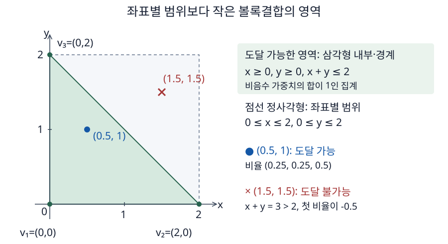{#fig-convex width=86%}

[그림 10.1.4](#fig-convex)에서 각 좌표가 0과 2 사이인 점들은 정사각형 전체에 들어간다. 그러나 세 값을 같은 비율로 섞어 도달할 수 있는 영역은 $x+y\leq2$인 삼각형이다. 그림의 영역은 방금 구한 공동 조건을 보여 주며, [정리 10.1.1](#th-convex)의 증명이나 비율 계산을 대신하지 않는다.

### 유제 10.1.4 두 점 사이에서 가능한 출력 {#u-feasible}

두 값 $v_1=[1,3]$, $v_2=[5,1]$과 비율 $[1-t,t]$, $0\leq t\leq1$을 사용한다. 출력의 두 좌표를 $t$의 식으로 적고, $[3,2]$와 $[3,3]$이 각각 가능한지 같은 $t$를 두 좌표에 대입해 판단하라. 가능하면 그 비율을, 불가능하면 모순을 제시하라.

#### 이해 확인 — 합 1만 확인하면 되는가? {#check-sum-one}

$[-0.5,1.5]$는 합이 1이다. 이것만으로 두 값의 볼록결합에 사용할 비율이라 할 수 있는가? 정의의 조건을 대조해 이유를 적고 [‘합 1만 확인하면 되는가?’ 해설](SOLUTIONS.md#solution-check-sum-one)과 비교하자.

### 출처 순서를 바꿀 때 무엇을 함께 옮겨야 할까? {#reading-order}

행렬에는 내용뿐 아니라 대응 관계가 들어 있다. 둘째 키를 보고 비율 0.6을 주었다면 0.6을 곱할 값은 둘째 키와 같은 제공 위치의 값이어야 한다. 자료를 정렬하면서 키만 옮기고 값은 그대로 두면, 비교에서 골랐던 자료와 실제로 전달한 자료가 달라진다. 행 수나 전체 크기는 맞을 수 있어 배열의 크기 검사만으로 발견하지 못하는 오류다.

### 정리 10.1.2 가중치와 값의 대응을 함께 재배열하면 출력이 보존된다 {#th-order}

$\pi$가 $1,\ldots,n$의 순열, 즉 각 위치를 한 번씩 다시 나열하는 대응이라고 하자. 한 요청의 비율과 값을 $a'_j=a_{\pi(j)}$, $v'_j=v_{\pi(j)}$로 함께 재배열하면 $\sum_ja'_jv'_j=\sum_ja_jv_j$다.

**증명.** 새 출력은 $\sum_ja_{\pi(j)}v_{\pi(j)}$다. 순열은 원래 위치를 빠뜨리거나 중복하지 않으므로, $\ell=\pi(j)$로 합의 이름을 바꾸면 각 $\ell=1,\ldots,n$이 정확히 한 번 나타난다. 따라서 합은 $\sum_\ell a_\ell v_\ell$이고 원래 출력과 같다. 이 증명에는 비음수·합 1 조건이 필요하지 않다. 핵심은 같은 항들의 순서를 함께 바꾸었다는 것이다. $\square$

이 정리는 **이미 계산한 가중치와 고정된 값을 함께 옮기는 집계**에 대한 명제다. 키까지 다시 배열하여 가중치를 재계산할 때에도, 비교가 제공 위치의 나열에 의존하지 않고 점수 변환이 순열을 따라 같은 방식으로 바뀌어야 한다. 위치에 붙은 추가 편향이나 접근 제한이 있다면 그것도 대응을 맞춰야 한다. 자연어 단어 순서를 실제로 바꿔 모델 입력을 새로 계산하는 일은 이 명제의 조건과 다르다. 그때에는 표현·위치 정보·접근 조건이 달라질 수 있다.

### 예제 10.1.5 키·값의 대응이 어긋난 정렬 {#ex-order}

원래 $a=[0.2,0.6,0.2]$, $V$의 행은 $[2,0],[0,4],[2,4]$다. 제공 위치를 ‘둘째, 첫째, 셋째’ 순으로 다시 나열한다. 대응을 함께 옮기면 비율은 $a'=[0.6,0.2,0.2]$, 값의 행은 $[0,4],[2,0],[2,4]$다. 새 출력은 $[0,2.4]+[0.4,0]+[0.4,0.8]=[0.8,3.2]$로 같다.

그런데 정렬한 키를 따라 가중치만 $[0.6,0.2,0.2]$가 되고 값 행은 원래대로 남았다고 하자. 계산은 $0.6[2,0]+0.2[0,4]+0.2[2,4]=[1.6,1.6]$이 된다. 높은 비율이 ‘책’ 위치에 배정되었지만 첫 값 ‘민지’의 수에 곱해졌다. 수식과 행렬 크기는 유효해도 요청이 고른 출처의 내용이 전달되지 않는다. 오류를 고치려면 가중치의 열 표지와 값 행의 출처 표지를 대조해야 한다.

### 유제 10.1.5 잘못 옮긴 값 찾기 {#u-order}

세 값은 $[1,0],[0,2],[3,1]$, 비율은 $[0.1,0.7,0.2]$다. 제공 위치를 ‘셋째, 첫째, 둘째’로 재배열한 값 행에 원래 비율을 그대로 곱한 출력과, 비율도 함께 옮긴 출력을 각각 구하라. 원래 출력이 어느 쪽과 같은지 확인하고, 비율의 각 열이 가리키는 출처를 써서 수정하라.

### 합친 출력으로 원래 자료를 모두 알 수 있을까? {#reading-loss}

출력은 여러 기여가 더해진 벡터다. 각 출처의 원래 벡터가 별도 칸에 보존되는 것은 아니다. 예를 들어 비율 $[0.5,0.5]$에 값 $[0],[2]$를 주면 출력은 $[1]$이다. 값 $[-1],[3]$을 주어도 출력은 $[1]$이다. 비율까지 알고 있더라도 출력 하나만으로 어느 두 원래 값이었는지 알 수 없다. 두 번째 쌍은 첫 번째 쌍에서 첫 값을 1만큼 줄이고 둘째 값을 1만큼 늘려 총합을 보존한 것이다.

복원이 불가능하다는 말의 범위를 정확히 하자. **한 집계 출력만으로 여러 미지의 값 벡터 전체를 일반적으로 유일하게 복원할 수 없다.** 모든 경우의 복원을 부정하는 것은 아니다. 값이 하나이고 비율이 1이면 그대로 복원한다. 여러 요청의 출력과 가중치 행렬을 충분히 알고 그 행렬이 값들을 구별할 수 있는 조건을 갖추면 복원이 가능할 수도 있다. 이 절의 심화 문제에서 작은 반례를 계산한다. 원래 값 자체를 별도로 저장해 놓은 모델을 출력 하나만 관측한 상황과 혼동하지 말자.

또 다른 비유일성도 있다. 값들을 알고 있어도 같은 출력에 서로 다른 가중치가 대응할 수 있다. 값이 $[0],[1],[2]$라면 $[0,1,0]$과 $[0.5,0,0.5]$는 둘 다 출력 $[1]$을 만든다. 가중치와 값 중 무엇을 알고 무엇을 추정하려는지에 따라 문제가 다르다. ‘출력이 같으므로 가중치가 같다’도, ‘가중치가 같으므로 값이 같다’도 일반적으로 성립하지 않는다.

### 높은 가중치를 의미나 인과적 설명으로 단정하지 않기 {#reading-interpretation}

집계에서 가중치가 높은 위치는 그 요청에 더 큰 **계수**를 받는다. 그러나 실제로 보내는 수는 계수와 값의 곱이다. 값 $v_1=[0,0]$이 비율 0.9를 받더라도 그 위치의 수치 기여는 $[0,0]$이다. 값 $v_2=[10,0]$이 비율 0.1을 받으면 기여는 $[1,0]$이다. 높은 가중치가 큰 수치 기여를 항상 뜻하지 않으며, 큰 수치 기여도 그 자체로 언어 의미나 모델의 정답 근거를 증명하지 않는다.

실제 언어모델의 한 위치 표현에는 다른 위치에서 받은 내용이 이미 들어 있을 수 있고, 여러 연산 경로가 뒤의 출력을 바꾼다. ‘동생’ 위치에 큰 비율이 보였다는 것만으로 모델이 문법상의 간접목적어를 정확히 이해했다거나, 그 단어가 최종 결정의 유일한 원인이라고 결론 내릴 수 없다. Attention 가중치와 설명 사이의 관계는 별도의 검증 대상이다. 특정 과제와 모델에서 가중치가 유용한 단서일 수 있다는 가능성을 배제하지는 않지만, 가중치 표 하나로 의미·인과적 설명을 확정하는 것은 과도하다.[^explanation]

이 한계는 앞의 복원 문제와 다르다. 복원 문제는 한 합에 서로 다른 자료가 대응한다는 대수적 비유일성이다. 설명 문제는 관찰한 계수가 언어 의미나 최종 결과의 원인을 얼마나 뒷받침하는지에 관한 문제다. 전자는 값을 직접 구성해 증명할 수 있고, 후자는 모델의 다른 경로와 실제 변화 실험 등을 함께 살펴야 한다. 교육용 수치에서 값을 따로 바꾸는 실험은 이 집계의 변화만 확인한다. 실제 단어를 바꾸어 모델 전체를 다시 실행하는 실험에서는 표현·가중치가 함께 변할 수 있다.

#### 이해 확인 — 세 문장 {#check-three-claims}

“0.8의 가중치를 받았다”, “출력의 첫 좌표에 0.8을 기여했다”, “정답의 원인이다”는 같은 주장인가? 각 주장을 확인하려면 어떤 자료나 계산이 필요한지 생각해 보자. [‘세 문장’ 해설](SOLUTIONS.md#solution-check-three-claims)과 비교하자.

### NumPy로 행과 출처를 확인하기 {#reading-code}

수식의 $A,V,O$를 그대로 배열에 옮겨 보자. 핵심 계산은 두 단계다. 먼저 각 요청의 비음수 점수 행을 그 행의 양수 합으로 나누어 가중치를 만든다. 다음으로 가중치 행렬과 값 행렬을 곱해 출처별 기여를 더한다.

| 수학적 단계 | 실제 파일의 핵심 코드 | 합하는 대상 |
| --- | --- | --- |
| $a_{ij}=s_{ij}/\sum_{\ell=1}^{n}s_{i\ell}$ | `totals = scores.sum(axis=1, keepdims=True)` 다음 `return scores / totals` | 한 요청의 제공 위치 점수 |
| $O=AV$, $O_{ir}=\sum_jA_{ij}V_{jr}$ | `return a @ v` | 한 출력 좌표에 들어올 제공 위치별 기여 |

첫 단계는 앞 예제의 교육용 행합 규칙이며 Transformer의 softmax와 같은 변환이 아니다. 두 번째 단계에서는 요청 행과 값 좌표를 고정하고 **제공 위치 축을 따라 곱해 더한다**. `a * v`처럼 같은 셀만 곱하면 이 합이 이루어지지 않는다.

아래 전체 함수 발췌에서 입력 검사는 이 두 연산의 앞에 놓여 있다. 비음수·양수 행합·행별 합1·출처 수 일치라는 적용 조건을 지키지 않은 입력으로 다른 계산을 하는 일을 막기 위해서다. 검사가 핵심 집계를 대신하는 것은 아니다. 먼저 위 두 줄을 찾고, 그 앞의 검사들이 수식의 어떤 조건을 확인하는지 읽어 보자. 발췌는 실제 학습 소스의 원본 줄 번호를 따른다. [장 끝 부록 B](#s01-appendix)에 핵심 구현 전체를 수록한다.

```{.python .numberLines source-root="section-10-1" source="learning-source/aggregate.py" source-start="7" source-end="33" source-revision="section-source-v0.1"}
```

`axis=1`은 같은 요청 행의 제공 위치 점수를 더한다. `keepdims=True`를 두면 합이 `(요청 수, 1)` 모양으로 남아 각 행의 점수에 대응하는 분모가 된다. 행 합을 계산한 뒤 가중치를 만들고, `a @ v`에서 제공 위치를 합한다. 배열 곱 `a * values`는 이 합을 대신하지 않는다. 두 배열의 모양이 우연히 같더라도 수학적으로 다른 연산이다.

실행용 파일에서 입력을 직접 지정하고 `demo.py`를 실행하면 다음을 얻는다.

```text
가중치
[[0.2 0.6 0.2]
 [0.2 0.2 0.6]]
출력
[[0.8 3.2]
 [1.6 3.2]]
```

저장소 루트 디렉터리에서 다음 명령을 실행한다. 첫 명령 이후의 작업 디렉터리는 이 절의 `learning-source`다.

```bash
cd chapters/transformer/section-10-1/learning-source
uv sync --locked
uv run python demo.py
uv run python verify.py
```

기여를 보고 싶으면 첫 요청에 대해 `a[0, :, None] * values`를 계산한다. `None`으로 길이 1의 좌표 축을 덧붙여 위치별 비율을 같은 위치의 모든 좌표에 곱한다. 그 결과의 행은 출처별 기여다. `sum(axis=0)`으로 위치 행을 더하면 출력 한 행이 된다. 두 요청 전체를 한꺼번에 보려면 기여 배열은 `(요청, 제공 위치, 값 좌표)` 세 축이 필요하다. 값의 내용 좌표와 제공 위치를 다른 축으로 유지해야 출처 오류를 찾을 수 있다.

계산 파일은 비음수·행 합 1·출처 수 일치를 검사한다. 그러나 값 행을 잘못 정렬해도 출처 표지를 배열 밖에서 잃어버리면 크기 검사만으로 알아낼 수 없다. 계산 전후의 출처표도 확인해야 한다. 올바른 모양을 갖는 배열과 올바른 정보를 전달하는 배열은 같은 검사가 아니다.

### 이 절을 마친 뒤 해 볼 일

여러 위치에서 정보를 가져올 때 모든 위치의 평균이나 한 위치의 복사만으로는 요청에 따라 여러 단서를 섞는 기능을 충분히 표현하기 어렵다. 질의·키의 비교가 위치별 비율을 정하고, 값 벡터가 그 비율로 보낼 내용을 제공한다. 각 요청은 자기 비율로 같은 제공 값들을 읽는다. 출력이 값들 사이의 볼록결합으로 남는 조건과, 출처 재배열에도 보존되는 조건을 확인했으며, 출력의 정보 손실과 가중치 해석의 한계를 구별했다.

다음 문제에서는 이 원리를 스스로 계산하고 바꾸고 진단해 보자. 틀렸다면 해설의 복습 위치로 돌아가 해당 계산을 다시 펼친 뒤 같은 문제를 풀어 본다. 가중치와 출력이 다른 양이라는 점이 아직 흐리면 [예제 10.1.1](#ex-language), 두 아래첨자가 헷갈리면 [정의 10.1.3](#def-matrix), 가능한 출력의 조건이 헷갈리면 [정리 10.1.1](#th-convex)부터 다시 읽자. 다음 [10.2절](#sec-scoring)에서는 Q/K의 실제 내적 점수, 크기 조정과 행별 softmax가 어떻게 가중치를 만드는지 다룬다. 그 식을 먼저 외우기보다 지금은 가중치를 얻은 뒤 무슨 일이 일어나는지 설명할 수 있어야 한다.

\clearpage

### 절 종료 연습문제 {#section-practice}

독립 연습은 아래 18문항이다. 앞의 예제·유제·이해 확인은 이 수에 포함하지 않는다. 계산 결과뿐 아니라 조건과 출처를 남겨 보자. 여러 답이 가능한 문제는 요구한 조건을 만족하는 이유까지 써야 한다.

#### 기여 계산과 집계의 변화

### 연습문제 10.1.1 출력 좌표의 기여 비교 {#p-contribution}

가중치는 $[0.6,0.3,0.1]$, 값은 순서대로 $[1,4],[5,0],[-2,2]$다. 각 기여 벡터와 출력을 계산하라. 첫 출력 좌표에 가장 큰 양의 기여를 한 위치는 어디인가? 가장 큰 가중치를 받은 위치와 비교하라. 음수 값의 기여를 버리지 말라.

### 연습문제 10.1.2 요청마다 주어진 점수를 비율로 바꾸기 {#p-rule}

두 요청의 점수 행은 $[0,2,6]$, $[3,1,0]$이며, 각 행 합으로 나누는 규칙을 사용한다. 값 행은 $[2,1],[0,3],[4,-1]$이다. 가중치 행렬과 출력 행렬을 계산하라. 출력의 어느 행이 어느 요청에 대응하는지도 적어라.

### 연습문제 10.1.3 전체를 다시 계산하지 않고 변화 예측 {#p-change}

원래 비율은 $[0.5,0.25,0.25]$, 값은 $[2,2],[6,0],[0,4]$다. 둘째 값만 $[8,-2]$로 바꾼다. 원래 출력, 변화량, 새 출력을 구하라. 점수 계산을 고정했다는 조건이 왜 필요한지 설명하라.

### 연습문제 10.1.4 같은 출력 좌표와 다른 출력 좌표 {#p-transfer}

값은 $[1,5],[4,5],[2,-1]$, 원래 비율은 $[0.4,0.4,0.2]$다. 첫째 위치에서 둘째 위치로 비율 $\delta$를 옮긴다. 허용되는 $\delta$의 범위와 출력 변화식을 구하고, 어떤 좌표가 보존되는지 이유를 설명하라. $\delta=0.1$의 결과도 구하라.

### 연습문제 10.1.5 값의 폭을 늘리기 {#p-width}

세 제공 위치를 읽는 두 요청의 비율이 $[0.5,0.5,0]$과 $[0,0.25,0.75]$다. 값은 $[1,0,2],[3,4,0],[0,2,6]$이다. $A,V,O$의 크기를 쓰고 두 출력을 구하라. 비교용 Q/K가 한 좌표 벡터여도 값이 세 좌표인 집계가 가능한지 역할을 근거로 답하라. 비교 점수는 이미 주어졌다고 가정한다.

#### 목표 출력과 역할의 조건

### 연습문제 10.1.6 목표 출력의 비율 찾기 {#p-inverse}

값 $[0,0],[4,0],[0,2]$를 비음수·합 1의 비율로 섞는다. 목표 출력 $[1,1]$을 만드는 비율을 구하라. 같은 값에서 $[3,1]$은 가능한지 판단하고, 좌표별 범위 검사만으로 충분한지 설명하라.

### 연습문제 10.1.7 합 1 조건을 빠뜨린 코드의 반례 {#p-range}

“계수가 모두 비음수이면 출력은 모든 입력 값의 좌표별 범위 안에 있다”는 주장이 틀렸음을 스칼라 값 두 개와 계수 두 개로 보이라. 모든 입력 값이 양수인 예를 만들고, 빠진 조건이 증명의 어느 단계에서 필요한지 적어라.

### 연습문제 10.1.8 어떤 양이 바뀌는가? {#p-qkv}

질의와 키의 비교만으로 점수를 만들고 고정 규칙으로 가중치를 만든다. (가) 값 하나만 변경, (나) 질의만 변경, (다) 키 하나만 변경의 세 경우에 가중치와 출력이 각각 ‘반드시 불변’, ‘바뀔 수 있음’ 중 어디에 해당하는지 설명하라. 바뀔 수 있다는 말이 반드시 바뀐다는 말과 다른 이유도 제시하라.

#### 출처·축·구현의 오류 진단

### 연습문제 10.1.9 크기는 맞지만 출처가 틀린 집계 {#p-source}

제공 위치 A/B/C의 스칼라 값은 $[10],[20],[100]$이고, 이 순서의 비율은 $[0.2,0.5,0.3]$다. 값을 C/A/B 순으로 정렬한 뒤 원래 비율을 그대로 곱했다. 잘못된 출력과 올바른 출력을 구하고, 정렬된 값과 함께 사용할 비율을 제시하라.

### 연습문제 10.1.10 요청 축과 제공 위치 축의 혼동 {#p-axis}

점수표는 $S=\begin{bmatrix}1&3\\3&1\end{bmatrix}$다. 한 구현이 표 전체 합 8로 모든 점수를 나누어 $A=S/8$로 만들었다. 정상적인 행별 규칙과 비교하여 각 요청의 가중치 합과 출력을 구하라. 값은 $[2],[6]$이다. 표 전체 합 1이 왜 요청별 합 1을 대신할 수 없는지 설명하라.

### 연습문제 10.1.11 원소별 곱을 집계로 착각한 구현 수정 {#p-numpy}

$A=\begin{bmatrix}0.25&0.75\\0.5&0.5\end{bmatrix}$, $V=\begin{bmatrix}2&0\\0&4\end{bmatrix}$다. NumPy 코드 `wrong = A * V`가 반환하는 배열을 쓰고, 올바른 출력으로 수정하는 한 줄을 제시하라. 수정한 배열의 첫 행을 손계산과 대조하라. 두 배열의 모양이 같아도 답이 틀리는 이유를 설명하라.

### 연습문제 10.1.12 출처별 기여를 반환하는 함수 만들기 {#p-implementation}

NumPy 배열 $A$의 모양은 `(m,n)`, $V$의 모양은 `(n,d)`다. 모든 요청·출처의 기여를 담는 `(m,n,d)` 배열 $C$와 출력 $O$를 반환하는 함수를 작성하라. $C$를 합할 축을 설명하고, [예제 10.1.2](#ex-score)의 입력으로 $C[1,2]$와 $O[1]$을 확인하라. 인덱스는 코드에서 0부터 시작한다. 입력 검사는 제공된 `aggregate` 함수를 활용해도 된다.

#### 보존·복원·해석과 새로운 적용

### 연습문제 10.1.13 가중치가 달라도 같은 출력 {#p-nonunique}

스칼라 값은 $[0],[1],[2]$다. 서로 다른 비음수·합 1의 두 가중치 행을 만들어 둘 다 출력 $[1]$을 내도록 하라. 각 행의 합·비음수·출력을 확인하고, 출력만 보고 가중치를 알 수 있다는 주장을 평가하라.

### 연습문제 10.1.14 공통 이동이 출력에 미치는 영향 증명 {#p-proof}

값 벡터 모두에 같은 벡터 $c$를 더하고 가중치는 고정한다. 합 1 조건 아래 새 출력이 $o+c$임을 증명하라. 가중치 합이 2일 때에는 어떻게 되는지 일반 식과 작은 반례로 설명하라. 비음수 조건이 이 등식의 증명에 필요한지도 답하라.

### 연습문제 10.1.15 대응 보존 증명의 조건 평가 {#p-permutation}

동료는 “제공 위치의 순서를 바꿔도 Attention 출력은 언제나 같다”고 말한다. (가) 이미 계산한 $A$와 고정된 $V$를 같은 제공 위치 순열로 옮기는 경우, (나) 값만 옮기는 경우, (다) 자연어의 토큰 순서를 바꿔 위치 표현을 포함한 모델을 처음부터 재계산하는 경우를 구별하여 이 주장을 고쳐 쓰라. (나)의 작은 수치 반례도 제시하라.

### 연습문제 10.1.16 출력과 비율을 알아도 값이 복원되지 않는 경우 {#p-loss}

비율 $[0.25,0.75]$와 스칼라 출력 $[3]$을 고정한다. 서로 다른 두 값 쌍을 구성하여 같은 출력을 만들고, 각 쌍을 대입해 확인하라. 미지수가 두 개인데 등식 하나라는 관점에서 설명하라. 값을 하나 더 안다는 추가 조건이 있으면 무엇이 달라지는가?

### 연습문제 10.1.17 가중치와 설명을 혼동한 보고서 수정 {#p-interpret}

보고서에는 “첫 위치의 가중치가 0.9이므로 출력의 90%가 첫 위치에서 왔고, 첫 단어가 모델 정답의 원인이다”라고 적혀 있다. 두 값이 $[0,0]$, $[10,0]$이고 비율이 $[0.9,0.1]$인 경우 각 기여와 출력을 계산하라. 보고서에서 계산으로 지지되는 말과 지지되지 않는 말을 구별하고, 관찰 범위를 지키는 두 문장으로 수정하라.

### 연습문제 10.1.18 센서 자료를 요청별로 가져오기 {#p-application}

세 제공 센서의 값은 순서대로 $[10,1],[20,0],[30,1]$이다. 첫 좌표는 같은 단위로 보정한 측정값, 둘째는 교육용 품질 표시다. 두 요청의 비교 점수는 $[3,1,0]$, $[0,1,3]$이며 행 합으로 정규화한다. (가) 두 출력과 그 의미를 설명하라. (나) “혼합 측정값 25, 품질 표시 0.5”라는 새 요청의 목표를 비음수·합 1로 만들 수 있는지 계산하라. (다) 품질 좌표를 집계한 수가 실제 확률이라는 해석은 주어진 조건만으로 가능한가? 비교용 키와 전달용 값에 넣을 정보의 차이를 제안하라. 제안은 여러 답을 허용한다.

### 더 생각해 볼 심화문제

### 심화문제 10.1.1 서로 다른 값을 동시에 바꿔도 보존되는 집계 {#c-cancellation}

두 값의 비율 $a_1,a_2$가 양수이고 고정되어 있다. 임의의 벡터 $h$로 $v'_1=v_1+h$를 만들었다. 출력을 보존하도록 $v'_2$를 구하고 증명하라. $a_2=0$이면 어떤 경우에 가능한지 따로 논하라. 원래 값을 유일하게 복원하기 어려운 이유와 연결하라.

### 심화문제 10.1.2 두 요청이 있으면 복원되는 작은 사례 {#c-recover}

두 미지의 스칼라 값 $v_1,v_2$에 대해 두 요청의 비율이 $[0.75,0.25]$, $[0.25,0.75]$이고 출력은 각각 2와 4다. 두 연립식을 풀어 값을 복원하라. 두 요청의 비율이 모두 $[0.5,0.5]$이고 출력이 모두 3인 경우와 비교하라. ‘집계는 언제나 복원이 불가능하다’라는 문장을 어떻게 고쳐야 하는가?

\needspace{8\baselineskip}

### 심화문제 10.1.3 비율의 작은 변화가 출력에 미치는 범위 {#c-stability}

스칼라 값 $v_j$는 $L\leq v_j\leq U$를 만족한다. 비음수·합 1의 두 비율 행 $a,b$가 있고 $\varepsilon=\frac12\sum_j|a_j-b_j|$라고 하자. $|\sum_ja_jv_j-\sum_jb_jv_j|\leq\varepsilon(U-L)$임을 보이라. 도움말: $d_j=a_j-b_j$의 양수 합과 음수 절댓값 합은 같다. 두 값 $L,U$ 사이에 비율을 옮기면 등호를 만들 수 있는지도 확인하라. 수학적 출력 변화의 한계이며 언어 의미의 변화량으로 해석하지 말라.

\Needspace{12\baselineskip}

\clearpage

## 10.2 정보의 중요도를 어떻게 수치로 계산하는가? {#sec-scoring}

### 비율을 사람이 써 넣을 수는 없다 {#s02-start}

앞 절에서는 요청에 따라 값 벡터를 서로 다른 비율로 가져왔다. [예제 10.1.1](#ex-language)에서는 세 위치에 $[0.2,0.6,0.2]$라는 비율을 주어 $[0.8,3.2]$를 만들었다. 가중합이 어떤 정보를 보내는지는 알게 되었지만, 아직 중요한 질문이 남아 있다. 요청이 달라질 때 누가 그 비율을 정하는가? 사람이 매번 세 수를 입력하는 것으로는 긴 문장을 처리할 수 없다. 요청을 나타내는 질의와 제공 위치를 나타내는 키를 비교하여 비율을 계산해야 한다.

질의 벡터(attention query)는 지금 필요한 정보를 비교 좌표에 나타내고, 키 벡터(attention key)는 제공 위치를 같은 비교 좌표에 나타낸다. 값 벡터(attention value)는 비율이 정해진 뒤 전달할 내용이다. [정의 10.1.2](#def-qkv)의 이 역할 구분을 유지하면서, 이번에는 비교와 비율 생성에 사용할 구체적인 연산을 배운다. **내적을 계산하고 그 크기를 조정한 뒤, 각 질의의 점수 행에 Softmax를 적용한다.** 이 비율로 값을 집계하는 마지막 단계는 앞 절의 $AV$와 같다.[^s02-formula]

여기서 ‘중요도’는 한 질의가 값을 읽는 비율을 정하기 위한 점수라는 뜻이다. 단어의 언어적 중요성이나 최종 정답의 원인을 측정한 척도로 받아들이지 말자. 앞 절에서 보았듯이 큰 계수와 큰 수치 기여도 다르다. 이 절의 작은 행렬은 계산을 설명하기 위해 직접 정한 값이며, 훈련된 언어모델에서 추출한 벡터가 아니다.

벡터의 좌표별 곱과 합, 전치와 행렬곱을 사용할 수 있으면 시작할 수 있다. $e^x$와 $\ln x$가 낯설다면 아래 지수 설명을 함께 읽자. 분산 도출에 필요한 기댓값·분산·독립성은 해당 위치에서 복습한다. 더 깊은 복습은 선형대수의 내적·행렬곱, 해석학의 지수·미분, 확률의 기댓값·독립성으로 연결된다. 지금 계산에 필요한 최소 성질을 본문에서도 설명한다.

### 한 쌍을 비교하면 수 하나가 된다 {#s02-dot-reading}

비교 좌표가 두 개라고 하자. 질의 $q=[2,-1]$와 키 $k=[3,4]$에서 같은 좌표끼리 곱하면 $2\cdot3=6$, $(-1)\cdot4=-4$다. 이 두 수를 더한 $2$가 두 벡터의 **내적(inner product)**이다. 여기서는 실수 좌표의 표준 유클리드 내적을 사용한다. 좌표가 셋이면 세 곱을 더하며, 비교 좌표가 늘어나도 결과는 벡터가 아니라 스칼라 하나다.

양의 곱은 점수를 올리고 음의 곱은 내린다. 서로 다른 좌표의 효과는 상쇄될 수 있다. 그러므로 한 좌표의 일치만 보고 전체 점수가 크다고 말할 수 없다. 내적은 방향의 관계와 벡터 크기를 모두 반영한다. $[1,0]$과 $[1,0]$의 내적은 1이지만 둘째 벡터를 $[10,0]$으로 늘리면 방향이 같아도 내적은 10이다. 크기를 제거한 방향 비교와 같은 연산이 아니다. 질의와 키를 각각 길이 1로 정규화하는 연산도 여기에는 들어 있지 않다.

### 정의 10.2.1 질의와 키의 내적 점수 {#s02-def-dot}

질의 $q_i$와 키 $k_j$의 **내적 점수** $D_{ij}$를 다음과 같이 정의한다.

$$
D_{ij}=q_i\cdot k_j=\sum_{r=1}^{d_k}q_{i,r}k_{j,r},
\qquad q_i,k_j\in\mathbb R^{d_k}.
\tag{ 10.2.1 }\label{s02-eq-dot}
$$

$i$는 정보를 받는 질의 위치, $j$는 정보를 제공하는 키 위치, $r$은 두 벡터에 공통인 비교 좌표다. $d_k$는 비교 폭이며, $D_{ij}$는 질의 $i$와 키 $j$ 한 쌍에 붙는 실수 하나다. 이 합은 제공 위치 전체를 합하는 것이 아니라 **한 쌍의 비교 좌표**를 합한다. 값의 좌표 수 $d_v$는 아직 사용하지 않았다.

질의가 $m$개, 키가 $n$개이면 $mn$쌍을 비교한다. 질의를 행으로 쌓은 $Q\in\mathbb R^{m\times d_k}$와 키를 행으로 쌓은 $K\in\mathbb R^{n\times d_k}$를 사용하면 $D=QK^\top\in\mathbb R^{m\times n}$이다. 전치는 키의 한 행을 곱셈의 한 열로 바꾼다. $D$의 첫 행에는 첫 질의와 모든 키의 점수가, 둘째 행에는 둘째 질의와 모든 키의 점수가 놓인다. 열은 동일한 제공 위치를 가리킨다.

### 예제 10.2.1 두 요청과 세 키를 전부 비교하기 {#s02-ex-dot}

두 요청이 세 제공 위치를 읽는다. 직접 정한 행렬은

$$
Q=\begin{bmatrix}1&0\\0&1\end{bmatrix},\qquad
K=\begin{bmatrix}1&0\\0&1\\1&1\end{bmatrix}.
$$

$Q$는 $2\times2$, $K$는 $3\times2$, $K^\top$는 $2\times3$이다. 첫 질의 $[1,0]$로 세 키를 읽으면 $1\cdot1+0\cdot0=1$, $1\cdot0+0\cdot1=0$, $1\cdot1+0\cdot1=1$이다. 둘째 질의 $[0,1]$의 세 점수는 같은 방법으로 $0,1,1$이다. 따라서

$$
D=QK^\top=\begin{bmatrix}1&0&1\\0&1&1\end{bmatrix}.
$$

셀 $D_{2,3}=1$은 둘째 요청과 셋째 키의 비교 결과다. 셋째 값의 어느 좌표를 뜻하지 않는다. 셋째 키는 두 질의 모두에서 점수 1을 받았지만, 뒤에서 행별로 비율을 정하므로 같은 열의 두 계수가 반드시 같아야 하는 것은 아니다. 지금 입력에서는 두 행의 점수 구성이 대칭이어서 같은 계수를 얻게 된다.

$QK$는 안쪽 차원이 2와 3이므로 곱할 수 없다. $KQ^\top$는 $3\times2$로 계산되지만 제공 위치가 행이고 질의가 열이다. 그 배열을 그대로 행별 정규화하면 ‘한 요청이 여러 제공 위치를 읽는 비율’이 아니다. 크기가 맞는 행렬곱이라고 모든 연산 순서가 맞는 것은 아니다.

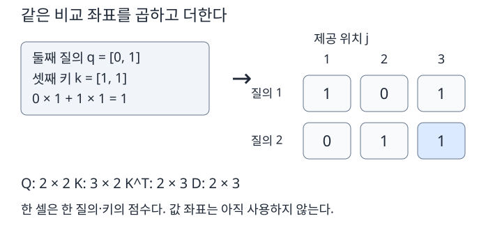{width=100% #s02-fig-dot}

### 유제 10.2.1 한 음수 좌표가 점수에 미치는 영향 {#s02-u-dot}

$Q=\begin{bmatrix}2&-1\\1&1\end{bmatrix}$, $K=\begin{bmatrix}1&2\\-1&0\\2&1\end{bmatrix}$다. 전치의 크기와 $QK^\top$의 크기를 쓰고 여섯 셀을 모두 계산하라. 첫 행·첫 열의 점수가 0인 이유를 좌표별 항으로 설명하라. 점수 0이라는 사실만으로 해당 값을 읽지 않는다고 결론 내릴 수 있는지도 잠정적으로 생각해 두자.

#### 이해 확인 — 두 합 축 {#s02-check-axes}

$D_{ij}=\sum_r q_{i,r}k_{j,r}$와 $O_{it}=\sum_j A_{ij}V_{jt}$는 무엇을 합하는가? $i,j,r,t$의 역할을 말로 적은 뒤 [해설](SOLUTIONS.md#solution-s02-check-axes)과 비교하자.

### 비교 좌표가 많아지면 점수의 크기도 달라진다 {#s02-scale-reading}

내적에는 $d_k$개의 곱이 들어간다. 각 곱이 양수와 음수를 섞어 가지면 모든 항이 같은 부호로 더해지는 것은 아니다. 그럼에도 항이 늘어날수록 합의 변동 폭이 커질 수 있다. 왜 분모에 $d_k$ 대신 $\sqrt{d_k}$를 쓰는지 알려면, 평균과 변동 폭을 구별해야 한다.

확률변수 $X$의 기댓값(expectation) $E[X]$은 분포에 따라 평균한 값이고, 분산(variance)은 $\operatorname{Var}(X)=E[(X-E[X])^2]$다. 표준편차(standard deviation)는 분산의 제곱근이다. $E[X]=0$이면 분산은 $E[X^2]$이다. 모든 실현값이 0이라는 뜻은 아니다. 예를 들어 $X$가 $+1,-1$을 같은 확률로 가지면 평균은 0, 분산은 1이다.

서로 독립인 두 변수의 곱은 $E[XY]=E[X]E[Y]$로 계산할 수 있다. 독립성이 없으면 이 분해를 함부로 사용할 수 없다. 또 합의 분산에는 각 항의 분산뿐 아니라 서로 함께 변하는 정도인 공분산(covariance)이 들어간다. $\operatorname{Cov}(X,Y)=E[(X-E[X])(Y-E[Y])]$이고

$$
\operatorname{Var}\!\left(\sum_r X_r\right)
=\sum_r\operatorname{Var}(X_r)+2\sum_{r<s}\operatorname{Cov}(X_r,X_s)
$$

이다. 이 식은 분산 정의에서 제곱을 펼치면 나온다. 각 교차항이 두 번 나타나는 것이 계수 2의 이유다. 공분산이 0인 것만으로 독립이라고 할 수는 없지만, 합의 분산을 더하는 데에는 교차 공분산이 0이면 충분하다.

### 정리 10.2.1 독립·평균 0·분산 1 모형에서 내적의 변동 폭 {#s02-th-variance}

$q_1,\ldots,q_d,k_1,\ldots,k_d$가 서로 독립인 실수 확률변수이고, 각 성분의 평균이 0, 분산이 1이라고 하자. $d\geq1$이고 $T=\sum_{r=1}^{d}q_rk_r$이면

$$
E[T]=0,\qquad \operatorname{Var}(T)=d,\qquad
\operatorname{Var}(T/\sqrt d)=1.
\tag{ 10.2.2 }\label{s02-eq-variance}
$$

**증명.** 한 항 $X_r=q_rk_r$를 먼저 보자. 독립성으로 $E[X_r]=E[q_r]E[k_r]=0$이다. $E[q_r^2]=E[k_r^2]=1$이므로 $E[X_r^2]=E[q_r^2]E[k_r^2]=1$이고 $\operatorname{Var}(X_r)=1$이다. 서로 다른 두 좌표 $r\ne s$에서는 네 성분의 독립성으로 $E[q_rk_rq_sk_s]=0$이다. 따라서 $\operatorname{Cov}(X_r,X_s)=0$이다. 기댓값의 선형성과 합의 분산 식에서 $E[T]=\sum_r0=0$, $\operatorname{Var}(T)=\sum_r1=d$를 얻는다. 마지막으로 $\operatorname{Var}(cT)=c^2\operatorname{Var}(T)$에 $c=1/\sqrt d$를 대입하면 $d/d=1$이다. $\square$

원래 내적의 표준편차는 $\sqrt d$다. 평균이 아니라 이 변동의 크기를 맞추려고 $\sqrt d$로 나눈다. $d$로 나누면 분산이 $1/d$가 되어 차원이 커질수록 이 모형의 점수가 0 주변으로 모인다. 어떤 고정 벡터의 모든 좌표가 같은 방향으로 더해지는 경우 내적이 $d$만큼 클 수 있다는 사실과, 독립 확률 모형에서 표준편차가 $\sqrt d$라는 사실은 충돌하지 않는다. 전자는 특정 입력, 후자는 분포의 성질이다.[^s02-variance]

정리의 전 성분 독립성은 설명하기 쉬운 충분조건이다. 더 약하게는 각 쌍 안의 독립성과, 곱 변수 $X_r$ 사이의 0 공분산이면 위 도출을 유지할 수 있다. 평균 0·분산 1만 쓰고 독립성이나 교차 공분산 조건을 생략해서는 안 된다. 학습된 $Q,K$는 같은 입력이나 앞 레이어를 공유할 수 있고, 실제 성분의 평균·분산·상관은 이 모형과 다를 수 있다. 이 정리는 모든 실제 Attention 점수의 분산이 반드시 $d_k$임을 보장하지 않는다.

### 예제 10.2.2 평균과 분산은 같아도 좌표 간 의존성이 다른 경우 {#s02-ex-variance}

$d=2$이고 네 성분이 각각 독립적으로 $+1,-1$을 같은 확률로 갖는 경우를 보자. 곱 $X_1,X_2$도 각각 $+1,-1$이고 서로 독립이다. 합 $T$는 $-2,0,2$를 확률 $1/4,1/2,1/4$로 갖는다. 평균은 0이고 분산은 $4/4+0+4/4=2$다. $T/\sqrt2$의 분산은 1이다. 이것은 유한한 16가지 성분 조합을 전부 세어 확인할 수 있다.

이번에는 독립적인 $U,V\in\{-1,1\}$를 하나씩 뽑고 $q=[U,U]$, $k=[V,V]$로 놓자. 각 성분의 평균 0·분산 1은 그대로지만 같은 벡터의 두 좌표가 완전히 같이 움직인다. $T=2UV$는 $-2,2$를 반씩 가지므로 분산이 4다. $\sqrt2$로 나누어도 분산은 2다. $X_1=X_2=UV$이므로 공분산이 1이고, 합의 분산에 $1+1+2\cdot1=4$가 들어갔다. 조건이 사라진 정리를 적용한 오류를 정확히 찾을 수 있다.

### 유제 10.2.2 분산이 1이 아닌 독립 성분 {#s02-u-variance}

전 성분 독립성·평균 0은 유지하되 $\operatorname{Var}(q_r)=4$, $\operatorname{Var}(k_r)=9$이고 $d_k=16$이라고 하자. 한 곱의 분산, 내적의 분산·표준편차, $\sqrt{d_k}$로 나눈 점수의 분산을 구하라. 분산 1을 얻으려면 어떤 분모가 필요한가? 원래 Transformer의 분모가 입력을 관측하여 이 분모로 자동 바뀐다고 생각해서는 안 된다.

### 정의 10.2.2 크기를 조정한 내적 점수 {#s02-def-scale}

**크기를 조정한 내적 점수** $S$를 다음과 같이 정의한다.

$$
S=\frac{QK^\top}{\sqrt{d_k}},\qquad
S_{ij}=\frac{\sum_{r=1}^{d_k}q_{i,r}k_{j,r}}{\sqrt{d_k}}.
\tag{ 10.2.3 }\label{s02-eq-scale}
$$

여기서 $d_k\geq1$은 질의와 키의 공통 좌표 수다. $Q$가 $m\times d_k$, $K$가 $n\times d_k$이면 $S$는 $m\times n$이다. 모든 셀에 같은 양의 분모를 사용하므로 행 안 점수의 대소 순서는 보존된다. 그러나 점수 차이는 $1/\sqrt{d_k}$배가 되고, 뒤의 Softmax 비율은 이 차이에 반응한다. $d_v$, $n$, $m$은 이 분모가 아니다.

이 연산을 scaling이라고 부른다. 질의나 키를 단위 길이로 바꾸는 벡터 정규화도, 점수 행의 합을 1로 만드는 정규화도 아니다. 차원에 따라 정한 상수로 점수의 크기를 조정하는 것이다. $d_k=1$일 때에는 점수가 그대로다. 모든 점수가 같을 때도 뒤의 비율은 같지만, 일반적으로 비율을 변화시킨다.

#### 이해 확인 — 나누는 수 {#s02-check-scale}

$Q$가 $3\times64$, $K$가 $5\times64$, $V$가 $5\times12$이면 점수의 분모는 무엇인가? 출력은 어떤 크기인가? [해설](SOLUTIONS.md#solution-s02-check-scale)을 보기 전에 네 수 3, 5, 64, 12의 역할을 적어 보자.

### 음수 점수도 집계 비율로 바꾸기 {#s02-softmax-reading}

점수는 음수·0·양수가 될 수 있다. 이를 단순히 행 합으로 나누면 문제가 생긴다. $[-1,1]$은 행 합이 0이라 나눌 수 없고, $[-1,2]$를 합 1로 나누면 음수 계수가 남는다. 앞 절에서 사용한 교육용 행합 규칙은 비음수 점수·양수 합이 전제였다. 내적 점수 전체에는 그 전제가 없다.

점수를 먼저 양수로 바꾸고 그 양수들의 합으로 나누면 모든 위치에 비음수 비율을 줄 수 있다. Softmax는 이 양수 변환에 지수함수 $e^x$를 쓴다. $e$는 약 2.71828이고, $e^0=1$, $e^1\approx2.71828$, $e^{-1}\approx0.367879$다. $x$가 음수여도 $e^x>0$이다. 지수함수는 덧셈을 곱셈으로 바꾸어 $e^{x+y}=e^xe^y$를 만족하고, 실수에서 엄격히 증가한다. 지수·로그 값은 계산기나 NumPy로 구해도 된다. 중요한 것은 어떤 점수 차이가 어떤 비율을 만드는지다.

### 정의 10.2.3 한 질의의 점수 행을 비율로 바꾸기 {#s02-def-softmax}

유한 점수 행 $s=(s_1,\ldots,s_n)\in\mathbb R^n$, $n\geq1$에 대해 **Softmax 가중치**를 다음과 같이 정의한다.

$$
a_j=\frac{e^{s_j}}{\sum_{\ell=1}^{n}e^{s_\ell}},\qquad j=1,\ldots,n.
\tag{ 10.2.4 }\label{s02-eq-softmax}
$$

$j$는 비율을 구할 제공 위치이고, $\ell$은 같은 질의가 읽는 모든 제공 위치를 세는 합 첨자다. 분모는 한 행에 공통이며 양수다. 따라서 $a_j>0$이고 $\sum_j a_j=1$이다. 여러 질의에는 $A_{ij}=e^{S_{ij}}/\sum_\ell e^{S_{i\ell}}$를 **각 행마다** 적용한다. 다른 질의 $i'$의 점수는 질의 $i$의 분모에 들어가지 않는다.

가중치가 확률분포와 같은 양수·합 1 형태라는 점은 유용하다. 그러나 값 집계에서는 그 비율대로 모든 값을 곱해 더한다. 위치를 확률적으로 하나 추첨하는 과정이 아니다. 또 $a_j$가 ‘이 위치의 정보가 참일 확률’이라는 해석은 정의에 없다. 실제 연산의 의미는 질의별 집계 비율이다.

### 정리 10.2.2 점수 차이와 비율, 공통 이동의 불변성 {#s02-th-ratio}

유한 점수 $s\in\mathbb R^n$의 Softmax를 $a$라 하자. 어떤 위치 $j,t$와 유한 실수 $c$에 대해서도

$$
\frac{a_j}{a_t}=e^{s_j-s_t},\qquad
\operatorname{softmax}(s+c\mathbf1)=\operatorname{softmax}(s)
\tag{ 10.2.5 }\label{s02-eq-ratio}
$$

이다. $\mathbf1$은 모든 성분이 1인 벡터다. 즉 두 위치의 가중치 비는 두 점수의 차이로 정해지고, 한 행의 모든 점수에 같은 상수를 더해도 비율은 같다.

**증명.** $Z=\sum_\ell e^{s_\ell}>0$라 놓으면 $a_j/a_t=(e^{s_j}/Z)/(e^{s_t}/Z)=e^{s_j-s_t}$다. 이동한 행의 $j$번째 비율은 $e^{s_j+c}/\sum_\ell e^{s_\ell+c}$다. 분자·분모에서 공통 인자 $e^c>0$를 나누면 원래 $a_j$가 된다. 모든 $j$에 성립하므로 두 행이 같다. $\square$

$s_j=s_t$이면 비율은 1이다. 차이가 $\ln2$이면 앞 위치가 두 배를 받는다. 차이가 1이면 약 2.718배, 차이가 2이면 약 7.389배다. scaling으로 점수 차이를 절반으로 만들면 이 비도 바뀐다. 점수 순서를 보존하는 연산이라고 Softmax가 불변인 것은 아니다. 공통 **덧셈**은 차이를 보존하지만 공통 **곱셈**은 차이를 바꾼다.

다른 위치가 추가되면 $j,t$ 사이의 비는 유지되어도 각각의 가중치는 작아질 수 있다. 분모에 새로운 양수가 더해지기 때문이다. 또한 제공 위치가 둘 이상이고 다른 유한 점수들을 고정한 채 한 점수만 올리면 그 위치의 계수는 커지지만 다른 위치들의 계수도 함께 줄어든다. 제공 위치가 하나이면 계수는 점수와 무관하게 항상 1이다. Softmax는 점수 하나를 다른 위치와 무관하게 개별 비율로 바꾸는 함수가 아니다.

### 예제 10.2.3 점수 0이 가중치 0이 아닌 이유 {#s02-ex-softmax}

한 행의 점수를 $[0,\ln2,\ln4]$로 정하자. 지수는 정확히 $[1,2,4]$이고 합은 7이므로 가중치는 $[1/7,2/7,4/7]$이다. 첫 점수 0도 약 14.29%를 받는다. 값이 $[7],[0],[0]$이면 출력은 $[1]$이다. ‘점수 0은 값을 안 읽는다’고 첫 위치를 삭제하면 이 기여가 사라진다.

같은 점수들을 원래 수의 행 합으로 나누면 $[0,1/3,2/3]$이 된다. $\ln4=2\ln2$이기 때문이다. 출력도 $[0]$으로 달라진다. 두 규칙은 모두 합 1을 만들 수 있으나 사용하는 함수와 실제 정보 전달이 다르다. 가중치가 합 1이라는 검사만으로 Softmax를 구현했다고 판단할 수 없다.

이번 행의 모든 점수에 $-\ln4$를 더하면 $[-\ln4,-\ln2,0]$이다. 지수는 $[1/4,1/2,1]$이고 합은 $7/4$이므로 같은 $[1/7,2/7,4/7]$을 얻는다. 점수의 절대 기준은 바뀌었지만 두 점수 사이의 차이는 그대로다.

### 유제 10.2.3 비율 요구로부터 점수 찾기 {#s02-u-softmax}

가중치를 $[1/6,1/3,1/2]$로 만들고 싶다. 점수 셋을 하나 제시하고 지수·행 합으로 확인하라. 모든 점수에 상수 $c$를 더한 것도 답인지 증명하라. 유한 점수로 $[0,1/2,1/2]$를 정확히 만들 수 있는지도 답하라.

#### 이해 확인 — 같은 비와 같은 가중치 {#s02-check-ratio}

두 점수 $[0,\ln2]$에 점수 0인 셋째 위치를 추가한다. 앞 두 위치의 비는 변하는가? 각 위치의 가중치도 그대로인가? [해설](SOLUTIONS.md#solution-s02-check-ratio)에서 두 질문을 구별하자.

### scaling이 선택의 집중과 변화 민감도에 주는 영향 {#s02-concentration}

왜 점수의 큰 변동 폭을 경계할까? 두 제공 위치의 점수 차이가 $\Delta=s_1-s_2$이면 첫 가중치는

$$
a_1=\frac{e^{s_1}}{e^{s_1}+e^{s_2}}
=\frac{1}{1+e^{-\Delta}},\qquad a_2=1-a_1
$$

이다. 차이가 커질수록 거의 모든 비율이 첫 위치로 모인다. 이 식을 미분할 때에는 $(1+e^{-\Delta})^{-1}$의 바깥 거듭제곱과 안쪽 지수를 차례로 미분한다.

$$
\frac{da_1}{d\Delta}
=-(1+e^{-\Delta})^{-2}(-e^{-\Delta})
=\frac{e^{-\Delta}}{(1+e^{-\Delta})^2}
=\frac{1}{1+e^{-\Delta}}\left(1-\frac{1}{1+e^{-\Delta}}\right)
=a_1(1-a_1).
$$

따라서 $\frac{da_1}{d\Delta}=a_1(1-a_1)$이다. 미분은 입력을 아주 조금 바꿨을 때 출력이 얼마나 변하는지를 나타낸다. 차이가 0이면 $a_1=1/2$여서 미분값은 $1/4$다. 차이가 매우 커서 $a_1$이 1에 가까우면 미분값은 0에 가까워진다. 거의 한 위치만 읽는 영역에서는 점수 차이의 작은 변화가 비율을 거의 바꾸지 않는다.

여러 위치에서는 같은 현상을 각 점수에 대한 미분으로 볼 수 있다. $Z=\sum_\ell e^{s_\ell}$에 대해 $\partial Z/\partial s_t=e^{s_t}$이고 몫의 미분으로

$$
\begin{aligned}
\frac{\partial a_j}{\partial s_t}
&=\frac{(\delta_{jt}e^{s_j})Z-e^{s_j}e^{s_t}}{Z^2}\\
&=\frac{e^{s_j}}{Z}\left(\delta_{jt}-\frac{e^{s_t}}{Z}\right)
=a_j(\delta_{jt}-a_t).
\end{aligned}
$$

를 얻는다. $\delta_{jt}$는 $j=t$이면 1, 아니면 0이다. 따라서 자신의 점수에 대한 미분은 $a_j(1-a_j)$, 다른 점수에 대한 미분은 $-a_ja_t$다. 한 계수가 1, 나머지가 0에 가까워지면 이 값들은 모두 작아진다. 비율을 통해 학습 신호가 전달되는 한 경로를 이해하는 데 필요한 계산이다. 이 미분값만으로 모델 전체의 학습 성공·실패를 판정할 수는 없다.

### 예제 10.2.4 같은 내적에 scale을 적용하기 전과 후 {#s02-ex-scale-effect}

$q=[1,1,1,1]$, $k_1=[1,1,1,1]$, $k_2=[0,0,0,0]$이면 $d_k=4$이고 내적은 $[4,0]$이다. 조정하지 않으면 가중치는

$$
\left[\frac{e^4}{e^4+1},\frac1{e^4+1}\right]
\approx[0.982014,0.017986]
$$

이다. $\sqrt4=2$로 나눈 $[2,0]$의 가중치는 $[0.880797,0.119203]$이다. 둘 다 첫 위치를 더 읽지만, 조정한 경우 둘째 위치가 보내는 비율은 약 1.8%에서 약 11.9%로 늘어난다. 값이 $[0],[10]$이면 출력은 각각 약 $[0.179862]$, $[1.192029]$다. scaling이 순위를 바꾸지 않아도 실제 전달 내용을 바꾼다.

조정된 점수 차이에 대한 미분은 조정 전 약 0.017663, 조정 후 약 0.104994다. 원래 내적 차이 $D_1-D_2$에 대한 미분까지 비교하려면 조정 후 값에 $1/2$를 곱하여 약 0.052497로 계산해야 한다. 입력 변수를 구별하지 않고 “미분이 여섯 배 커졌다”고 쓰면 부정확하다. 여기서는 조정 후에도 원 내적 차이에 대한 민감도가 더 크지만, 모든 입력에서 scaling이 미분을 키운다는 일반 정리는 아니다. 예를 들어 내적 차이가 0이면 조정 전 미분 $1/4$보다 조정 후 $1/8$이 작다.

이 입력의 모든 좌표는 직접 정한 상수다. 앞 확률 정리의 평균 0·독립 모형에서 나온 표본이라고 주장하지 않는다. 원 논문은 차원이 클 때 내적이 큰 크기를 가지며 Softmax의 작은 기울기 영역으로 갈 수 있음을 scaling의 동기로 설명한다. 본문은 그 동기를 확률 가정·실제 비율·미분 경로로 나누어 살펴본 것이다.[^s02-gradient]

### 유제 10.2.4 값은 그대로인데 출력이 달라지는 경우 {#s02-u-scale-effect}

$d_k=9$에서 내적 점수가 $[3,0]$이고 값이 $[2],[8]$이다. scale 전후의 점수·가중치·출력을 계산하라. 큰 점수의 위치는 그대로인데 출력이 달라지는 이유를 쓰라. $d_v$를 1에서 2로 늘려 같은 첫 좌표와 임의의 둘째 좌표를 보내면 scale의 분모도 바뀌는가?

### 같은 사례를 출력까지 끝내기 {#s02-full-reading}

[예제 10.2.1](#s02-ex-dot)의 $Q,K$에 앞 절의 값

$$
V=\begin{bmatrix}2&0\\0&4\\2&4\end{bmatrix}
$$

를 연결하자. $Q,K$의 폭은 2이고 $V$의 폭도 지금은 2지만, 두 폭이 같은 것은 이 예제의 선택일 뿐이다. 비교가 끝난 뒤 $d_v=3$인 값을 사용해도 같은 가중치로 집계할 수 있다.

### 정의 10.2.4 Scaled dot-product attention {#s02-def-operator}

**Scaled dot-product attention의 출력**을 다음과 같이 정의한다.

$$
\begin{aligned}
D&=QK^\top,& S&=D/\sqrt{d_k},\\
A_{ij}&=\frac{e^{S_{ij}}}{\sum_{\ell=1}^{n}e^{S_{i\ell}}},& O&=AV.
\end{aligned}
\tag{ 10.2.6 }\label{s02-eq-operator}
$$

입력은 $Q\in\mathbb R^{m\times d_k}$, $K\in\mathbb R^{n\times d_k}$, $V\in\mathbb R^{n\times d_v}$이며 $m,n,d_k,d_v$는 양의 정수다. 이 정의에서는 모든 점수가 유한하고 모든 제공 위치를 읽을 수 있다고 가정한다. $D,S,A$는 $m\times n$, $O$는 $m\times d_v$다. 같은 $j$의 키와 값은 같은 제공 위치에 대응해야 한다. 여기에는 Head 분할·위치 연산·dropout·차단 정책을 추가하지 않았다.

앞 절의 정규화된 비음수 가중 집계에 적용할 수 있는 계수가 실제로 만들어졌다. 이 정의의 실수 연산에서는 계수가 모두 양수이고 합이 1이므로 [정리 10.1.1](#th-convex)의 좌표별 범위가 출력 $O$에 성립한다. 그러나 뒤의 출력 변환·residual·비선형 연산까지 같은 범위를 보장하는 것은 아니다. 여러 층에서 값 벡터 자체가 바뀌는 경우도 현재 고정 $V$에 대한 범위와 구별해야 한다.

### 예제 10.2.5 두 질의의 모든 중간 행렬과 기여 {#s02-ex-full}

내적 $D=\begin{bmatrix}1&0&1\\0&1&1\end{bmatrix}$를 $\sqrt2$로 나누면

$$
S\approx\begin{bmatrix}0.707107&0&0.707107\\0&0.707107&0.707107\end{bmatrix}.
$$

$t=e^{1/\sqrt2}\approx2.028115$라 놓자. 지수 행은 $[t,1,t]$와 $[1,t,t]$이고, 각각의 분모는 $2t+1\approx5.056230$이다. 두 분모가 같은 것은 두 행이 같은 점수들을 다른 순서로 가졌기 때문이다. 일반적으로는 각 행에 다른 분모를 계산한다. 결과는

$$
A=\frac1{2t+1}\begin{bmatrix}t&1&t\\1&t&t\end{bmatrix}
\approx\begin{bmatrix}0.401112&0.197776&0.401112\\0.197776&0.401112&0.401112\end{bmatrix}.
$$

첫 질의의 세 기여를 각각 펼치면

$$
\begin{aligned}
a_{11}v_1&\approx[0.802224,0],\\
a_{12}v_2&\approx[0,0.791103],\\
a_{13}v_3&\approx[0.802224,1.604448].
\end{aligned}
$$

같은 좌표끼리 더한 첫 출력은 약 $[1.604448,2.395552]$다. 둘째 질의에서는 첫 값의 기여가 $[0.395552,0]$, 둘째 값의 기여가 $[0,1.604448]$, 셋째 값의 기여가 $[0.802224,1.604448]$이다. 따라서

$$
O=AV\approx\begin{bmatrix}1.604448&2.395552\\1.197776&3.208897\end{bmatrix}.
$$

첫 행은 첫 요청에 돌려줄 두 좌표이며, 둘째 행은 둘째 요청의 두 좌표다. 첫 요청이 첫째·셋째를 같은 비율로 읽어도 두 값의 둘째 좌표 기여는 다르다. 첫 값의 둘째 좌표가 0이기 때문이다. 둘째 요청의 두 번째 출력 좌표는 둘째와 셋째 값에서 각각 약 1.604448씩 들어왔다. 점수 셀, 가중치 셀, 값 좌표의 기여, 최종 출력 셀을 서로 바꾸어 읽지 말자.

표시한 여섯 자리 수를 더하면 마지막 자리에서 1 정도의 차이가 생길 수 있다. 실제 계산은 반올림 전의 $t/(2t+1)$을 유지하고 출력할 때 반올림했다. 중간 표의 반올림 수를 다시 넣어 얻은 결과와 기계의 더 정밀한 계산을 exact bytes 일치라고 주장할 수 없다.

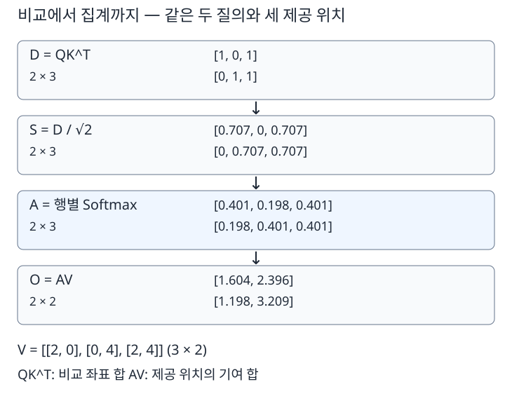{width=100% #s02-fig-flow}

scale을 생략한 행 $[1,0,1]$은 약 $[0.422319,0.155362,0.422319]$의 비율을 만든다. 첫 출력은 약 $[1.689275,2.310725]$로 바뀐다. 앞 절의 지정 비율 $[0.2,0.6,0.2]$와도 다르다. 값은 같고 비율을 생성하는 규칙이 달라진 것이다. 이 내적 사례가 앞 절의 언어 요청에 더 적합한 비율을 학습했다는 의미는 없다.

### 유제 10.2.5 비교 폭과 값 폭이 다른 전체 계산 {#s02-u-full}

$Q=\begin{bmatrix}1&0\\0&1\end{bmatrix}$, $K=\begin{bmatrix}\sqrt2\ln2&0\\0&\sqrt2\ln2\end{bmatrix}$, $V=\begin{bmatrix}3&0&6\\0&9&3\end{bmatrix}$다. $D,S,A,O$를 전부 구하고 크기를 쓰라. 지수가 $[2,1]$ 또는 $[1,2]$가 되도록 정한 교육용 수치다. 각 출력의 셋째 좌표를 기여 두 개로 나누어 설명하라.

### 최대값을 빼도 답은 같고 지수는 작아진다 {#s02-stability}

수학에서는 유한 점수의 지수를 계산할 수 있다. 컴퓨터의 부동소수점 수에는 표현 가능한 크기의 한계가 있다. 예를 들어 float64에서 `exp(1000)`은 표현 범위를 넘어서 무한대로 계산된다. $[1000,1001,999]$를 직접 지수화하면 무한대들을 더하고 무한대로 나누는 과정에서 정상적인 비율을 얻지 못한다. 원래 수학적 Softmax가 정의되지 않은 것이 아니라, 계산 방식이 수의 표현 범위를 넘은 것이다.[^s02-stable]

[정리 10.2.2](#s02-th-ratio)에 따라 각 행의 최대값 $M=\max_j s_j$를 뺄 수 있다. 이동 후 모든 점수는 0 이하이고 적어도 하나는 0이다. 따라서 지수는 모두 1 이하이며 적어도 하나는 정확한 수학에서 1이다. 지수의 합은 1 이상 $n$ 이하라서 모든 지수가 한꺼번에 0으로 사라지는 분모 문제도 피한다. 이는 지수를 안전한 범위로 옮기는 것이다. 다른 모든 연산의 오차가 없어졌다는 뜻은 아니다.

### 예제 10.2.6 큰 공통 기준과 작은 점수 차이 {#s02-ex-stable}

점수 $[1000,1001,999]$의 최대값 1001을 빼면 $[-1,0,-2]$이다. 지수는 약 $[0.367879,1,0.135335]$, 합은 약 1.503215이므로

$$
a\approx[0.244728,0.665241,0.090031]
$$

이다. 이 비율은 $[0,1,-1]$에 적용한 결과와 같다. 매우 큰 ‘절대 점수’가 아니라 1 또는 2의 점수 차이가 실제 비율을 결정했다. float64의 직접 계산이 NaN을 내는 것은 오류 진단 자료로 사용할 수 있지만 정상 구현이 NaN을 반환하도록 방치해서는 안 된다.

매우 작은 계수에는 다른 주의가 필요하다. $[0,-1000]$은 실수 계산에서 둘째 계수가 양수지만 float64의 `exp(-1000)`은 0으로 떨어질 수 있다. 최대값 이동은 큰 지수의 overflow를 막지만 작은 지수의 underflow를 모두 없애지는 않는다. 이 기계적 0은 접근을 금지한 정책의 0이 아니다. 금지 여부를 점수 크기와 계산 정밀도에 맡기면 구현 환경에 따라 정보가 조금 전달될 수 있다.

입력 $Q,K$가 유한해도 내적 연산 자체가 범위를 넘을 수 있다. 최대값 빼기는 이미 계산된 유한 점수에 적용하는 방법이므로 앞 행렬곱의 overflow까지 되돌릴 수 없다. 매우 큰 양수·음수 점수 사이의 차 계산도 표현 범위를 벗어날 수 있다. 이 절의 작은 실습은 float64 범위 안의 입력으로 계산하며, 소스는 유한하지 않은 점수와 출력을 거부한다. 임의의 큰 실수 입력을 모든 컴퓨터 정밀도에서 정확히 처리한다는 보장은 하지 않는다.

### 유제 10.2.6 큰 음수 점수의 안전한 계산 {#s02-u-stable}

점수가 $[-1000,-1001,-1002]$다. 직접 지수화하면 어떤 문제가 생길 수 있는가? 최대값을 빼고 정확한 지수 비율을 먼저 쓴 뒤 가중치를 여섯 자리로 구하라. 모든 점수를 1000만큼 올려도 답이 같은지 확인하라.

#### 이해 확인 — 차단인가 반올림인가? {#s02-check-zero}

점수 0의 위치, 매우 작은 양수 가중치가 기계에서 0이 된 위치, 정책으로 접근을 막은 위치를 같은 뜻으로 처리할 수 있는가? [해설](SOLUTIONS.md#solution-s02-check-zero)과 비교하자.

### 질의끼리 비율을 나누면 다른 연산이 된다 {#s02-axis-reading}

$S$의 행마다 다른 요청이 있다. 각 요청은 자기 출력 하나를 만들기 위해 제공 위치에 합 1의 비율을 분배한다. 전체 행렬을 한 번 정규화하면 모든 요청이 하나의 비율 예산을 공유하게 된다. 한 요청의 점수만 바꾸어도 다른 요청이 받는 전체 비율이 바뀐다. 이 절의 연산에는 그런 경쟁이 없다.

지수 행의 합을 $Z_i$라고 하자. 전체 정규화의 계수는 $B_{ij}=e^{S_{ij}}/\sum_h Z_h$이고, 따라서 $B_{ij}=[Z_i/\sum_h Z_h]A_{ij}$다. 한 행 안에서의 상대 비율은 같지만 행 합이 $Z_i/\sum_hZ_h$다. $m>1$이면 각 행 합은 1보다 작다. $BV$는 각 정상 출력 행에 서로 다른 축소율을 곱한 결과다. 단순히 소수점 오차가 생긴 것이 아니라 함수의 의미가 바뀌었다.

열별 정규화도 다르다. 제공 위치 하나가 여러 요청에 주는 비율을 나누는 꼴이어서 행별 합 1은 보장되지 않는다. 어떤 대칭 입력에서는 우연히 행 합도 1이 될 수 있으므로, 대칭 예제만으로 축 검사를 하면 오류를 놓친다. 비대칭 입력에서 한 요청을 바꾸어 다른 요청 행이 독립적으로 유지되는지 확인하는 것이 유용하다.

예를 들어 $S=\begin{bmatrix}0&\ln3\\0&0\end{bmatrix}$이면 지수는 $\begin{bmatrix}1&3\\1&1\end{bmatrix}$이고 올바른 $A=\begin{bmatrix}1/4&3/4\\1/2&1/2\end{bmatrix}$다. 전체 정규화는 $B=\begin{bmatrix}1/6&1/2\\1/6&1/6\end{bmatrix}$, 열별 정규화는 $C=\begin{bmatrix}1/2&3/4\\1/2&1/4\end{bmatrix}$다. $V=[[0],[8]]$이면 정상 출력 $[[6],[4]]$, 전체 정규화 출력 $[[4],[4/3]]$, 열별 출력 $[[6],[2]]$다. 첫 출력만 보면 열별 버그를 놓치지만 둘째 출력과 두 행 합 $5/4,3/4$가 오류를 드러낸다.

#### 이해 확인 — 어떤 요청이 바뀌는가? {#s02-check-independent}

위 비대칭 입력의 둘째 점수 행에만 큰 상수를 더한다. 올바른 행별 Softmax에서 첫 가중치 행은 변하는가? 전체 정규화에서는 어떤가? [해설](SOLUTIONS.md#solution-s02-check-independent)을 먼저 읽지 말고 분모를 비교하자.

### 수식을 NumPy의 네 연산으로 옮기기 {#s02-code-reading}

핵심은 `q @ k.T`, `dots / np.sqrt(q.shape[1])`, `softmax_rows(scores)`, `a @ v`다. 첫 행렬곱의 합 축은 비교 좌표, 마지막 행렬곱의 합 축은 제공 위치다. `q.shape[1]`은 비교 폭이고 `v.shape[1]`은 출력 좌표 수다. 2차원 입력에서 `axis=1`은 한 행의 제공 위치를 뜻한다. `keepdims=True`는 행별 최대값과 분모를 `(m,1)`로 유지해 각 행의 모든 열에 같은 수가 적용되도록 한다.

```{.python .numberLines source-root="." source="learning-source/scoring.py" source-start="5" source-end="15" source-revision="scoring-source-v0.1"}
```

위 함수는 값 벡터를 읽지 않는다. 점수 행마다 최대값을 빼고 지수를 계산하여 가중치만 반환한다. `np.exp`의 출력은 아직 합 1이 아니며, 다음 줄의 행 합 나눗셈까지 수행해야 한다. 입력 검사는 유한 실수 행렬이라는 이 함수의 정의역을 명시한다. 차단을 뜻하는 무한대는 다음 절의 별도 처리와 연결할 수 있으나 이 함수에 조용히 섞지 않는다.

```{.python .numberLines source-root="." source="learning-source/scoring.py" source-start="28" source-end="34" source-revision="scoring-source-v0.1"}
```

이 발췌는 같은 파일의 전체 함수 안에 있다. `q,k,v`를 float64의 2차원 배열로 변환한 뒤 비교 폭·제공 수·유한성을 검사한다. 입력 이름의 대문자 수학 표기와 소문자 코드 표기는 같은 역할을 가리킨다. 반환값에는 최종 출력뿐 아니라 중간 세 행렬도 남기므로 손계산과 단계별로 비교할 수 있다. 원소별 곱 `a * v`는 모든 제공 위치를 더하지 않으며, 어떤 우연한 크기에서는 오류 없이 잘못된 배열을 만들 수 있다.

저장소 루트에서 다음과 같이 실행한다. Python 3.12.2와 NumPy 2.2.6의 CPU 환경에서 검산한 실습이며 `uv.lock`에 의존성을 고정했다.

```bash
cd chapters/transformer/learning-source
uv sync --locked
uv run --locked python demo_scoring.py
uv run --locked python verify_scoring.py
```

출력 중 가중치와 최종 출력은 [예제 10.2.5](#s02-ex-full)의 여섯 자리 수와 같다. 작은 수치의 마지막 자리는 표시 정밀도와 연산 순서에 따라 비교해야 한다. 실습에서 질의 한 행을 바꿔 해당 가중치 행·출력 행만 변하는지, 값만 바꿔 가중치는 보존되는지 확인해 보자. 실제 모델의 원래 입력을 바꾸면 Q/K/V가 함께 바뀔 수 있다는 점은 별개다.

### 오류를 결과의 의미로 찾기 {#s02-errors}

잘못된 전치·폭 불일치는 곱셈에서 잡히지만, 잘못된 축·잘못된 scale·키/값 출처 뒤섞임은 배열 크기가 맞아도 지나갈 수 있다. 검사는 서로 다른 층위에서 필요하다. shape는 계산 가능한지, 행 합과 양수 조건은 요청별 비율인지, 독립 셀 계산은 내적이 맞는지, 알려진 지수 비는 Softmax가 맞는지, 출처 표지는 선택한 키와 전달 값이 대응하는지를 확인한다.

Softmax에 Q/K의 좌표를 바로 넣거나 $AV$ 대신 $AK$를 계산하면 역할이 바뀐다. $AK$도 크기가 맞을 수 있지만 비교용 키를 집계한 출력이다. 전달하도록 지정한 $V$의 내용은 사용되지 않았다. 또한 음수 점수를 0으로 잘라 행 합으로 나누는 방법은 여기서 정의한 연산과 다르다. 0 점수도 지수 1을 갖는다는 점을 기억하면 차이를 찾기 쉽다.

### 이 절을 마친 뒤 해볼 일

주어진 $Q,K,V$에서 모든 중간 행렬과 크기를 쓰고, 한 출력 좌표를 출처별 기여로 펼쳐 보자. scale의 분모와 Softmax의 축을 바꾸었을 때 어떤 성질·출력이 달라지는지 설명할 수 있어야 한다. 분산 도출의 가정을 지운 반례와 최대값 이동의 증명도 식을 따라 재구성해 보자. 계산·증명·진단이 막히는 위치는 아래 문제의 상세 해설에서 복습 경로를 찾을 수 있다.

이제 작은 점수와 정보 접근 금지를 구별할 수 있다. 유한 점수의 Softmax는 모든 위치에 양의 비율을 주므로, 아주 낮은 점수만으로 미래 위치나 빈 패딩 위치를 확실히 차단할 수 없다. 다음 절에서는 **어떤 위치를 읽어도 되는가**라는 별도의 규칙을 점수 정규화 전에 적용한다. 점수의 상대 크기와 정보 접근의 허용 여부는 서로 다른 문제다.

\clearpage

### 절 종료 연습문제

독립 연습은 아래 20문항이다. 지수·로그·제곱근은 계산기나 NumPy를 사용해도 된다. 수치 결과와 함께 합 축·차원·조건을 설명하라. 표시한 소수는 약값이며, 계산 중에는 가능한 한 반올림 전 값을 유지하라. 모든 유제·독립·심화의 상세 해설은 별도 해설서에 있다.

#### 셀 계산·전체 연산·차원

\Needspace{7\baselineskip}
### 연습문제 10.2.1 음수 키와 세 비교 좌표 {#s02-p01}

$q=[1,-2,3]$, 키는 $[2,1,0]$, $[0,-1,2]$다. 좌표별 곱, 내적 두 개와 조정 점수, 가중치를 계산하라. 값은 $[4],[10]$이다. 출력과 크기를 쓰고 점수 0인 첫 위치가 기여하는지 확인하라.

\Needspace{7\baselineskip}
### 연습문제 10.2.2 서로 다른 길이와 값 폭 {#s02-p02}

$Q=\begin{bmatrix}1\\-1\end{bmatrix}$, $K=\begin{bmatrix}0\\\ln2\\\ln4\end{bmatrix}$, $V=\begin{bmatrix}7&0\\0&7\\7&7\end{bmatrix}$다. $D,S,A,O$의 각 원소와 크기를 모두 계산하라. 둘째 요청이 첫 요청의 가중치 행을 단순히 음수로 바꾼 것인지 설명하라.

\Needspace{7\baselineskip}
### 연습문제 10.2.3 비교 가능한 입력 고르기 {#s02-p03}

(가) Q `(4,8)`, K `(6,8)`, V `(6,3)`, (나) Q `(4,8)`, K `(6,3)`, V `(6,8)`, (다) Q `(4,8)`, K `(6,8)`, V `(5,3)`이 있다. 가능한 입력에서는 분모와 $D,A,O$ 크기를, 불가능한 입력에서는 정확히 충돌하는 축을 쓰라. (나)를 값 폭의 자유로 정당화할 수 있는가?

\Needspace{7\baselineskip}
### 연습문제 10.2.4 두 scale을 비교하는 출력 {#s02-p04}

$d_k=4$인 내적 점수 $[2\ln3,0]$와 값 $[0],[12]$를 사용한다. 올바른 분모 $\sqrt{d_k}$와 잘못 사용한 분모 $d_k$에서 점수·비율·출력을 구하라. 순위가 같다는 사실만으로 오류를 놓칠 수 있는 이유를 설명하라.

#### 비율의 성질과 확률 가정

\Needspace{7\baselineskip}
### 연습문제 10.2.5 한 점수만 올린 경우 {#s02-p05}

점수 $[0,\ln2,\ln3]$에서 둘째 점수에만 $\ln2$를 더한다. 전후 가중치와 첫째/셋째 비를 구하라. 바꾸지 않은 두 위치의 비와 각 위치의 개별 계수가 어떻게 다른 반응을 보이는가?

\Needspace{7\baselineskip}
### 연습문제 10.2.6 전체 행에 같은 상수를 더하기 {#s02-p06}

$m\times n$ 점수 행렬의 각 행 $i$에 서로 다른 유한 상수 $c_i$를 더해도 $A$가 불변임을 증명하라. 반면 열마다 다른 상수 $b_j$를 더할 때 불변하지 않을 수 있음을 두 키의 작은 반례로 보이라. 같은 상수가 적용되는 대상이 왜 중요한가?

\Needspace{7\baselineskip}
### 연습문제 10.2.7 성분별 분산이 다른 경우 {#s02-p07}

모든 $q_r,k_r$가 독립이고 평균 0이다. $d_k=3$, q의 성분 분산은 $[1,4,9]$, k의 성분 분산은 $[9,1,4]$다. 내적의 평균·분산과 조정 점수의 분산을 도출하라. 평균 0만으로 곱의 기댓값을 분해할 수 있는지도 설명하라.

\Needspace{7\baselineskip}
### 연습문제 10.2.8 질의와 키가 같은 확률변수인 반례 {#s02-p08}

$U\in\{-1,1\}$이 두 값을 같은 확률로 갖고 $q=k=[U]$다. 각 성분의 평균·분산과 내적의 평균·분산을 계산하라. $d_k=1$이므로 내적 분산도 1이라는 주장이 왜 틀리는가? [예제 10.2.2](#s02-ex-variance)의 좌표 간 의존성과 이번 쌍 안의 의존성을 구별하라.

\Needspace{7\baselineskip}
### 연습문제 10.2.9 작은 미분이 뜻하는 범위 {#s02-p09}

두 위치에서 $a_1=1/(1+e^{-\Delta})$다. 미분을 직접 도출하고 $\Delta=0$과 $\Delta=\ln99$에서 값을 구하라. ‘Softmax 미분이 작으므로 모델 전체는 학습할 수 없다’라는 문장을, 이 계산이 뒷받침하는 범위로 고쳐 쓰라.

\Needspace{7\baselineskip}
### 연습문제 10.2.10 양수 비율에서 점수 복원 {#s02-p10}

양수·합 1인 $a_j$가 주어졌다. $s_j=\ln a_j+c$가 모든 유한 $c$에서 이 비율을 만드는지 증명하라. 역으로 같은 비율을 만드는 유한 점수들이 공통 상수 이동만큼만 다른지도 $a_j/a_t$로 보이라. 이는 지정 비율에서 점수 복원 문제이며 임의의 고정 Q/K 투영으로 그 점수를 학습할 수 있다는 보장은 아니다.

#### 수치·축·역할·구현 진단

\Needspace{7\baselineskip}
### 연습문제 10.2.11 최대값을 잘못 뺀 축 {#s02-p11}

$S=\begin{bmatrix}0&\ln3\\0&0\end{bmatrix}$에 `np.exp(S - S.max(axis=0, keepdims=True))`를 계산한 뒤 행별 합으로 나눈다. 결과를 올바른 $A$와 비교하라. 전체 행렬 최대값 하나를 빼고 행별로 나누는 경우도 틀리는가? 정확한 실수 연산과 overflow 예방 효과를 나누어 답하라.

\Needspace{7\baselineskip}
### 연습문제 10.2.12 전체 정규화의 축소율 {#s02-p12}

$s_1=[0,\ln3]$, $s_2=[0,0]$, 값은 $[2],[10]$이다. 행별 출력과 전체 정규화 출력을 구하고, 각 잘못된 출력이 정상 출력의 몇 배인지 보이라. 행 하나의 점수에 상수를 더했을 때 다른 출력도 변하는 경로를 분모로 설명하라.

\Needspace{7\baselineskip}
### 연습문제 10.2.13 안정화 코드 고치기 {#s02-p13}

한 함수는 `e = np.exp(S); return e / e.sum(axis=1)`을 사용한다. $S$가 `(2,3)`인 경우의 broadcasting 문제와 $S=[[1000,1001,999]]$의 지수 문제를 각각 진단하라. 제공된 실제 소스의 함수를 활용해 수정하고, 큰 점수 입력에서 가중치·행 합을 출력하여 확인하라.

\Needspace{7\baselineskip}
### 연습문제 10.2.14 키를 집계한 출력 {#s02-p14}

키는 $[0],[\ln3]$, 질의는 $[1]$, 값은 $[10,0],[0,2]$다. $A$와 정상 출력을 계산하라. `A @ K`는 무엇을 반환하며 크기는 무엇인가? Q/K/V 폭을 모두 1로 만든 뒤라면 shape 검사만으로 이 오류를 항상 잡을 수 있는가?

\Needspace{7\baselineskip}
### 연습문제 10.2.15 K와 V의 대응 순열 {#s02-p15}

질의 $[1]$, 키 $[0],[\ln3]$, 값 $[2],[10]$을 사용한다. 키만 뒤집은 출력과 키·값을 함께 뒤집은 출력을 계산하라. 후자가 보존되는 이유를 $A$ 열과 V 행의 대응으로 설명하라. 실제 문장을 바꾸어 Q/K/V를 다시 계산하는 경우에도 같은 보장을 그대로 적용할 수 있는가?

\Needspace{8\baselineskip}
### 연습문제 10.2.16 기여 배열을 함께 반환하기 {#s02-p16}

`with_contributions(q,k,v)`를 작성하여 $D,S,A,C,O$를 반환하라. $C_{ijt}=A_{ij}V_{jt}$이며 크기는 `(m,n,d_v)`다. [유제 10.2.5](#s02-u-full)의 입력에서 `C[1,0,2]`, `C[1,1,2]`, `O[1,2]`를 확인하라. 인덱스는 0부터 시작한다. 제공한 입력 검사를 재사용해도 되고 반복문 구현도 허용한다.

#### 새로운 요구와 모델 연결

\Needspace{8\baselineskip}
### 연습문제 10.2.17 어떤 변경이 가중치를 보존하는가? {#s02-p17}

Q/K/V가 독립적으로 주어진 유한 배열이고 $d_k$는 고정이다. (가) V만 변경, (나) 모든 키에 같은 벡터 $b$를 더함, (다) Q만 두 배로 함에서 A가 반드시 보존되는지 판단하고 증명 또는 반례를 제시하라. A가 보존되는 경우 O도 반드시 보존되는지 별도로 답하라.

\Needspace{8\baselineskip}
### 연습문제 10.2.18 유한 점수로 단일 위치를 선택할 수 있는가? {#s02-p18}

두 키의 점수가 $[M,0]$이고 값은 $[0],[10]$다. 모든 유한 $M$에서 출력이 정확히 0인지 판단하라. 둘째 계수를 $10^{-3}$ 이하로 만들기 위한 $M$ 조건을 구하라. ‘충분히 작은 계수’가 접근 금지의 안전한 대안인지 수학적 정의와 부동소수점 환경을 구별해 논하라.

\Needspace{8\baselineskip}
### 연습문제 10.2.19 센서 읽기 요구를 질의로 만들기 {#s02-p19}

세 센서의 키는 $[1,0],[0,1],[0,0]$, 값은 $[10],[20],[40]$이며 $d_k=2$다. 첫 요청은 첫째/셋째 가중치 비가 2, 둘째/셋째 비가 1이어야 한다. 둘째 요청은 두 비가 각각 1과 3이어야 한다. 두 질의를 구성하고 $D,S,A,O$와 크기를 구하라. 질의를 이처럼 직접 구성한 것이 센서 오차를 학습하여 최적 가중치를 얻었다는 뜻인지 설명하라.

\Needspace{8\baselineskip}
### 연습문제 10.2.20 중간 행렬 검증 실험 설계 {#s02-p20}

새 구현이 모든 입력에서 올바르다고 주장한다. (가) 잘못된 축, (나) $d_v$로 scale, (다) $AV$ 대신 $AK$를 각각 드러낼 입력과 기대 결과를 하나씩 제안하라. 세 결함을 하나의 입력으로 잡아도 된다. 검사의 근거를 손계산으로 제공하고, 유한한 테스트 통과가 모든 입력의 정확성 증명인지도 답하라.

\Needspace{13\baselineskip}

### 더 생각해 볼 심화문제

\Needspace{10\baselineskip}
### 심화문제 10.2.1 공분산 행렬로 일반화한 분산 {#s02-c01}

실수 랜덤 벡터 $q,k\in\mathbb R^d$는 서로 독립이고 평균 벡터가 0이다. 각 벡터 안 좌표들은 상관될 수 있다. 유한한 이차 적률을 가정하고 $C_q=E[qq^\top]$, $C_k=E[kk^\top]$라 놓자. (가) $E[q^\top k]=0$과 $\operatorname{Var}(q^\top k)=\sum_{r,s}(C_q)_{rs}(C_k)_{rs}=\operatorname{tr}(C_qC_k)$를 도출하라. (나) 두 행렬이 단위행렬일 때 앞 정리와 연결하라. (다) $q=[U,U]$, $k=[V,V]$인 독립 부호 변수 예를 이 식으로 검산하라. 행렬 trace는 대각 성분의 합이다.

\Needspace{10\baselineskip}
### 심화문제 10.2.2 점수 변화에서 출력 변화까지 {#s02-c02}

한 질의에서 값 벡터 $v_j$는 고정이고 $o(s)=\sum_j a_j(s)v_j$다. (가) 본문의 Softmax 미분을 사용하여 $\partial o/\partial s_t=a_t(v_t-o)$를 증명하라. (나) 두 스칼라 값 0,10과 점수 $[0,0]$에서 각 미분을 계산하라. (다) 원 내적 $D$에서 $s=D/\sqrt{d_k}$이면 미분이 어떻게 달라지는가? (라) 모두 같은 값이면 비율이 달라도 출력 미분은 왜 0인가?

\Needspace{10\baselineskip}
### 심화문제 10.2.3 낮은 차원 질의로 가능한 비율 {#s02-c03}

키를 $k_1=[1,0],k_2=[0,1],k_3=[0,0]$으로 고정하면 $d_k=2$다. (가) 임의의 양수·합 1 가중치 $a$를 만드는 질의를 $a_1/a_3,a_2/a_3$로 구성하라. (나) 키를 모두 스칼라 $[1],[2],[0]$으로 바꾸면 가능한 가중치가 만족해야 하는 등식을 $a_1/a_3,a_2/a_3$로 도출하라. (다) $[1/6,1/3,1/2]$가 두 키 구성에서 각각 가능한지 판단하라. Softmax가 모든 양수 비율을 점수로 표현할 수 있다는 사실과 고정 키·질의의 내적이 그 점수를 표현할 수 있다는 사실은 다르다.

\Needspace{12\baselineskip}

\clearpage

## 10.3 어떤 정보는 왜 읽지 못하게 해야 하는가? {#sec-visibility}

### 낮은 점수를 주는 것으로 충분할까? {#s03-start}

앞 절에서 한 요청은 여러 키와 비교하여 점수를 만들고, Softmax로 비율을 정한 뒤 값을 가져왔다. 점수가 낮은 위치도 유한한 점수라면 수학적으로 양의 비율을 받는다. “지금 별로 필요하지 않다”는 판단과 “지금 읽어서는 안 된다”는 규칙은 다르다. 다음 말을 예측해야 하는 모델이 정답을 미리 읽거나, 길이를 맞추기 위해 붙인 빈 칸을 실제 내용처럼 평균한다면 점수 계산 자체가 정확해도 우리가 의도한 과제를 수행하지 않는다.

“나는 오늘 책을 …”의 다음 토큰을 예측할 때 지금까지 입력된 부분은 단서지만, 아직 생성하지 않은 정답은 단서로 제공할 수 없다. 학습 자료 파일에는 완성된 문장이 들어 있으므로, 여러 위치의 계산을 한꺼번에 수행할 때 특히 이 차이를 지켜야 한다. 정답이 파일에 있다는 사실과 각 예측 계산이 정답을 읽을 수 있다는 사실은 별개다. 이 절의 질문은 **어떤 위치를 읽을 수 있는지 먼저 정하고, 그 범위 안에서만 비율을 정하는 방법**이다.[^s03-causal]

[정의 10.2.4](#s02-def-operator)의 $S=QK^\top/\sqrt{d_k}$, 행별 Softmax, $O=AV$를 출발점으로 삼는다. 점수 행의 열은 제공 위치이고, 출력 행은 요청 위치다. 지수는 양수이며 비율의 합은 1이라는 사실을 기억하면 된다. 집합 기호가 낯설면 $\{0,1\}$을 ‘위치 0과 위치 1을 담은 목록’으로 읽자. $j\in J_i$는 j가 그 목록 안에 있다는 뜻이다. 수학적 기초를 더 깊게 복습하려면 집합·관계와 행렬의 Chapter를 참고하자.

이번 수치는 저자가 만든 교육용 배열이다. 학습된 언어모델의 출력 확률이나 언어적 의미를 측정한 것이 아니다. 집계 출력 $o_i$는 뒤의 모델 계산에 넘길 벡터이며, 예측할 토큰 그 자체도 확률분포도 아니다.

### 먼저 읽을 수 있는 위치를 정하자 {#s03-relation}

정보를 받는 요청과 정보를 제공하는 키를 서로 다른 두 목록으로 놓는다. 요청 목록의 첫 원소가 원래 문장의 첫 위치일 필요는 없다. 저장을 위해 키를 재배열하거나 일부만 남기면 배열 열 번호도 원래 시퀀스 위치와 달라진다. 따라서 위치를 말할 때에는 **어느 배열의 몇 번째인가**, **원래 시퀀스의 어디인가**를 함께 확인해야 한다.

앞 절의 수학 행렬은 첫 행을 1로 세었다. 이 절에서는 코드와 함께 추적하기 위해 **배열 행 $i=0,\ldots,m-1$, 배열 열 $j=0,\ldots,n-1$**을 쓴다. 원래 시퀀스 위치도 BOS를 0으로 세되, 별도 함수 $p_Q(i)$와 $p_K(j)$로 기록한다. 첨자를 0부터 센다는 변경은 $QK^\top$나 $AV$의 연산을 바꾸지 않는다. ‘둘째 행’은 배열 행1을 뜻하지만, 그 행의 원래 위치는 $p_Q(1)$을 확인해야 알 수 있다.

### 정의 10.3.1 허용 접근 관계와 Mask {#s03-def-access}

질의 배열 행 i가 키 배열 열 j를 읽을 수 있는 **허용 접근 관계** $R$와 그 Boolean Mask $B$를 다음과 같이 정의한다.

$$
B_{ij}=\begin{cases}\mathrm{True},&(i,j)\in R,\\
\mathrm{False},&(i,j)\notin R,
\end{cases}
\qquad J_i=\{j\mid B_{ij}=\mathrm{True}\}.
\tag{ 10.3.1 }\label{s03-eq-access}
$$

$R$은 요청–제공 쌍들의 집합이며, $B\in\{\mathrm{False},\mathrm{True}\}^{m\times n}$는 그 관계를 표로 저장한 것이다. $J_i$는 질의 i가 읽을 수 있는 **배열 열 번호들의 집합**이다. 실제 출처 위치 집합은 $\{p_K(j)\mid j\in J_i\}$로 따로 구한다. $p_Q(i)$는 요청의 원래 위치, $p_K(j)$는 제공자의 원래 위치다. 그림과 손계산 표에서는 True를1, False를0으로 줄여 표시하지만 실행 함수에는 Boolean을 전달한다.

이 규약에서1은 허용이다. 어떤 구현은 True를 차단으로 사용한다. 이름이 같은 Mask라 해도 그대로 옮겨 넣으면 접근 정책이 뒤집힐 수 있다. 예를 들어 확인한 PyTorch 문서에서는 `scaled_dot_product_attention`의 Boolean `attn_mask`는 True를 참여 허용으로, `MultiheadAttention`의 Boolean `key_padding_mask`와 `attn_mask`는 True를 차단으로 사용한다. 변환에는 의미와 shape 둘 다의 확인이 필요하다.[^s03-api]

R은 읽기 **가능성**을 표현한다. 허용된 값들이 같아서 출력이 우연히 같거나 한 계수가 기계적으로 매우 작아도 접근 권한 자체가 사라진 것은 아니다. 반대로 Mask는 값의 내용을 판독하여 유해 여부를 판정하는 장치가 아니다. 여기서는 시퀀스 위치와 패딩 같은 주어진 정책을 연산에 적용한다.

### 예제 10.3.1 세 입력과 세 예측의 대응 {#s03-ex-prefix}

출력 토큰이 $y_1,y_2,y_3$라고 하자. 학습 시 입력 목록을 $[\mathrm{BOS},y_1,y_2]$, 예측 대상 목록을 $[y_1,y_2,y_3]$로 만든다. BOS는 시작을 표시하는 실제 입력 토큰이다. 패딩처럼 버리는 빈 칸이 아니다. 입력의 마지막 $y_2$도 질의 위치에 따라 정당한 과거이거나 읽어서는 안 되는 미래가 된다.

| 질의 배열 행 i | 입력 위치 $p_Q(i)$ / 입력 토큰 | 이 행이 예측할 대상 | 허용되는 입력의 원래 위치 |
|---|---|---|---|
| 0 | 0 / BOS | $y_1$ (대상 위치1) | $\{0\}$ |
| 1 | 1 / $y_1$ | $y_2$ (대상 위치2) | $\{0,1\}$ |
| 2 | 2 / $y_2$ | $y_3$ (대상 위치3) | $\{0,1,2\}$ |

첫 행은 BOS만 읽어야 한다. $y_1$은 다음 행의 입력에 실제로 들어 있지만 첫 행에서는 바로 그 토큰을 예측하고 있다. $y_1$의 키/값을 읽으면 정답의 정보가 예측 계산으로 들어온다. 둘째 행에서 $y_1$은 이미 주어진 입력이므로 읽어도 된다. 그러나 $y_2$는 그 행의 정답이므로 읽어서는 안 된다. 같은 열도 요청이 무엇을 예측하는지에 따라 권한이 달라진다.

표의 입력–대상 대응을 정확히 놓으면 **현재 입력 위치까지 포함하여 읽는 규칙**이 자연스럽게 나온다. 예측 대상은 현재 입력 위치보다 하나 뒤이므로 대각선을 허용해도 정답을 읽는 것이 아니다. 입력과 대상을 둘 다 $[y_1,y_2,y_3]$로 잘못 놓으면 대각선만으로도 정답이 들어온다. 삼각형 그림 하나가 입력–대상 대응 오류까지 해결하지는 않는다.

### 정의 10.3.2 원래 위치로 정한 Causal Mask {#s03-def-causal}

같은 시퀀스에서 입력 위치 p의 질의가 다음 위치 p+1을 예측할 때, **Causal Mask**의 허용 규칙을 다음과 같이 정의한다.

$$
B^{\mathrm{causal}}_{ij}=[p_K(j)\leq p_Q(i)].
\tag{ 10.3.2 }\label{s03-eq-causal}
$$

대괄호는 안의 명제가 참이면 True, 거짓이면 False라는 뜻이다. ‘causal’은 여기서 미래 토큰을 읽지 않는 방향의 접근 제약을 가리킨다. 인과 추론에서 개입 효과를 분석하는 의미와는 구별한다. 모든 키·질의가 같은 순서의 위치0,1,2에 놓일 때에는

$$
B^{\mathrm{causal}}=
\begin{bmatrix}1&0&0\\1&1&0\\1&1&1\end{bmatrix}
$$

이므로 아래 삼각형처럼 보인다. 모양은 **두 목록의 정렬이 같다는 조건의 결과**다. 일반적으로는 두 원래 위치를 비교해야 한다. m과 n이 달라도 이 비교는 정의되며, 한 행만 계산할 때에도 원래 위치를 알고 있으면 해당 과거를 모두 열 수 있다.

### 유제 10.3.1 네 번째 입력을 추가하면 {#s03-u-prefix}

입력 $[\mathrm{BOS},y_1,y_2,y_3]$에서 네 행이 각각 무엇을 예측하는지 쓰고, 각 행의 허용 원래 위치 집합과 $4\times4$ Boolean Mask를 구성하라. 질의 행2가 입력 $y_2$를 읽어도 되는 이유와 $y_3$를 읽으면 안 되는 이유를 대상 위치로 설명하라.

#### 이해 확인 — 대각선의 의미 {#s03-check-diagonal}

“정답을 보지 않으려면 항상 대각선을 차단해야 한다”는 설명은 위 입력–대상 대응에서 옳은가? 조건을 적은 뒤 [해설](SOLUTIONS.md#solution-s03-check-diagonal)과 비교하자.

### 차단은 분자뿐 아니라 분모를 바꾼다 {#s03-normalization}

앞 절 Softmax의 분모에는 모든 제공 위치의 지수가 들어갔다. 허용되지 않은 열을 제거한다면 분자에서 그 기여를 지우는 데 그쳐서는 안 된다. 읽을 수 있는 위치끼리 합이1이 되도록 **그 위치들만으로 분모를 다시 계산**해야 한다. 점수가 변하지 않아도 비교 상대 목록이 바뀌면 비율이 달라진다.

### 정의 10.3.3 허용 집합 위의 Softmax와 집계 {#s03-def-masked}

유효 질의 i의 허용 집합 $J_i$가 비어 있지 않고 모든 허용 점수 $s_{ij}$가 유한할 때, **Mask를 적용한 Softmax**와 출력은 다음과 같이 정의한다.

$$
A_{ij}=\begin{cases}
\displaystyle\frac{e^{s_{ij}}}{\sum_{\ell\in J_i}e^{s_{i\ell}}},&j\in J_i,\\
0,&j\notin J_i,
\end{cases}
\qquad o_i=\sum_{j\in J_i}A_{ij}v_j.
\tag{ 10.3.3 }\label{s03-eq-masked}
$$

\Needspace{6\baselineskip}

분모의 $\ell$은 허용된 배열 열만 움직인다. $s_{ij}=q_i\cdot k_j/\sqrt{d_k}$이고, 출력은 허용 값 벡터들의 정규화된 가중합이다. 따라서 차단 계수는 정확히0, 허용 계수는 실수 수학에서 양수이며 합은1이다. 출력은 [정리 10.1.1](#th-convex)의 볼록결합 범위 안에 놓이되 이번에는 허용된 값들만 그 범위를 만든다. 허용 집합이 하나면 그 계수는 점수와 무관하게1이다.

**도출.** $Z_i=\sum_{\ell\in J_i}e^{s_{i\ell}}>0$다. 허용된 분자의 합은 $Z_i$이므로 계수 합은 $Z_i/Z_i=1$이다. 허용 점수에 공통 상수 $c_i$를 더하면 분자·분모의 $e^{c_i}$가 약분된다. 허용 점수의 최대값 $M_i$를 빼고 계산해도 같은 비율이며, 적어도 한 지수는1이다. 최대값을 정할 때도 차단 열은 제외한다.

덧셈 Mask는 같은 규칙을 다른 형태로 나타낸다. 허용 위치에0, 차단 위치에 $-\infty$를 둔 $M_{ij}$를 **Softmax 전에** 더한다. $e^{-\infty}=0$이라는 확장 표기 아래 $\operatorname{softmax}(S+M)$은 위 식과 같다. 이 동등성에는 허용 집합이 비어 있지 않다는 조건, 허용 점수의 유한성, 정확한 차단 표기가 필요하다. $-\infty$는 매우 작은 실수의 이름이 아니다.[^s03-negative]

컴퓨터 구현에서는 무한대를 어디에 넣고 어떤 연산을 수행하는지도 중요하다. `0 * (-inf)`는0이 아니라 NaN이 될 수 있으므로 Boolean을 무한대와 곱하는 방식으로 Mask를 만들지 말자. `where`로0과 `-inf`를 선택하거나 허용 열을 선별한다. 뒤의 구현은 두 번째 방법을 쓴다. 기존 `scoring.py`의 `softmax_rows`는 유한 비차단 입력만 받으므로 임의의 무한대를 넣어 재사용하지 않는다.

### 예제 10.3.2 같은 점수·값에서 미래를 닫기 전과 후 {#s03-ex-full}

[예제 10.3.1](#s03-ex-prefix)의 입력에 비교 폭 $d_k=1$인 다음 교육 배열을 준다.

$$
Q=\begin{bmatrix}1\\1\\1\end{bmatrix},\qquad
K=\begin{bmatrix}0\\\ln2\\\ln3\end{bmatrix},\qquad
V=\begin{bmatrix}2&0\\0&6\\12&12\end{bmatrix}.
$$

Q의 세 행은 BOS,$y_1$,$y_2$의 요청, K/V의 세 행은 같은 원래 위치의 제공자다. $QK^\top$의 각 행은 $[0,\ln2,\ln3]$이고 $\sqrt{d_k}=1$이므로 S도 같다. 지수는 $[1,2,3]$다. 아무 제약이 없으면 각 행의 분모는6, 비율은 $[1/6,1/3,1/2]$다. 각 기여를 더하면

$$
o_i=\tfrac16[2,0]+\tfrac13[0,6]+\tfrac12[12,12]
=[1/3,0]+[0,2]+[6,6]=[19/3,8]
$$

로 세 요청의 출력이 모두 같다. 첫 예측은 $y_1$과 $y_2$의 값을, 둘째 예측은 $y_2$의 값을 읽어 미래 정보가 섞였다. 점수 계산이 틀린 것은 아니다. 아직 허용 관계를 적용하지 않은 것이다.

Causal Mask를 적용하면 질의 행0의 $J_0=\{0\}$다. 분모1, 비율 $[1,0,0]$, 출력 $[2,0]$이다. 행1에서는 $J_1=\{0,1\}$, 분모 $1+2=3$, 비율 $[1/3,2/3,0]$다. 출력은 $[2/3,0]+[0,4]=[2/3,4]$다. 행2는 세 입력을 모두 읽어도 되므로 이전 계산과 같다. 따라서

$$
A=\begin{bmatrix}1&0&0\\1/3&2/3&0\\1/6&1/3&1/2\end{bmatrix},
\qquad O=\begin{bmatrix}2&0\\2/3&4\\19/3&8\end{bmatrix}.
$$

Mask는 값을0으로 바꾸거나 키를0 벡터로 바꾼 것이 아니다. 같은 점수·같은 값에 읽기 관계를 적용했다. 첫 행은 정답의 정보를 받지 않고, 둘째 행은 이미 주어진 $y_1$의 정보를 계속 받는다. 미래를 없앤다고 모든 행을 BOS만 읽게 고치면 둘째·셋째 예측에 허용된 과거까지 잃는다.

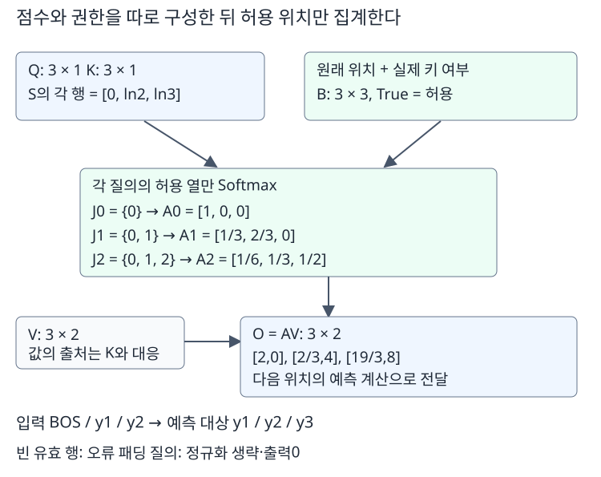{width=100% #s03-fig-flow}

도해에서 위치 정보는 B로, Q/K는 S로 들어간다. B는 S의 값을 학습하여 만들어지는 비율이 아니다. A가 정해진 뒤 별도 V 경로가 집계에 들어오고, O는 출력 위치에 맞는 다음 예측 계산으로 전달된다. 전체 Transformer의 residual·FFN·어휘 출력 연결은 후속 절에서 다룬다.

### 유제 10.3.2 분모를 직접 줄여 보기 {#s03-u-normalize}

한 질의의 점수는 $[\ln2,0,\ln5]$, 값은 $[3],[9],[30]$다. 모든 키를 허용할 때와 $J=\{0,1\}$만 허용할 때 지수·분모·가중치·출력을 계산하라. 차단 전 비율에 $[1,1,0]$을 곱하기만 한 출력도 구하고, 왜 요구된 연산과 다른지 설명하라.

#### 이해 확인 — 작은 점수와 차단 {#s03-check-small}

허용 점수0, 차단하고 싶은 점수−20, 값 $[0],[10^{12}]$를 생각하자. 둘째 값의 기여가 반드시 무시할 만한가? 정확한 접근 금지를 보장하는 방법을 적고 [해설](SOLUTIONS.md#solution-s03-check-small)과 비교하자.

### 길이를 맞춘 빈 칸은 내용이 아니다 {#s03-padding}

길이가 다른 문장들을 같은 크기의 배열로 처리하려면 빈 칸을 채울 수 있다. 이 **패딩(padding)** 위치는 실제 토큰 내용이 아니라 배열 길이를 맞추기 위한 자리다. 패딩 값 벡터가0이어도 Softmax 분모에 들어가면 실제 내용의 총 비율을 줄인다. 패딩을 제외할 이유는 값이 우연히 크기 때문만이 아니다.

**Key padding**은 패딩 키/값을 어느 유효 질의도 읽지 않게 열을 닫는다. **Query padding**은 출력이 필요한 실제 요청이 아닌 패딩 질의 행을 다루는 문제다. 패딩 열을 닫았다고 패딩 행의 출력까지0이 되지는 않는다. 그 행의 질의는 여전히 실제 키들과 비교할 수 있기 때문이다. 두 역할을 혼동하면 의미 없는 출력이 후속 계산이나 손실에 들어갈 수 있다.

### 정의 10.3.4 패딩과 결합한 허용 규칙 {#s03-def-padding}

실제 내용인 키에 $u_j=\mathrm{True}$, 패딩 키에 $u_j=\mathrm{False}$를 둔다. 유효 질의에서 **Causal/Key padding 결합 Mask**는 다음과 같이 정의한다.

$$
B_{ij}=[p_K(j)\leq p_Q(i)]\;\land\;u_j.
\tag{ 10.3.4 }\label{s03-eq-padding}
$$

$\land$는 두 조건이 모두 참일 때만 참이라는 뜻이다. 미래가 아니어야 하고 동시에 실제 키여야 한다. Key padding만 필요하면 위치 비교를 빼고 $B_{ij}=u_j$로 둔다. 이를 각 질의 행에 반복한다. 패딩 자리의 임시 위치 번호가 작든 크든 $u_j$가 False면 열이 닫힌다.

별도의 $h_i$는 유효 질의인지 나타낸다. 본문의 구현은 $h_i=\mathrm{False}$인 패딩 질의의 정규화를 생략하여 A의 해당 행과 O의 해당 행을0으로 둔다. 이 행의 합0은 확률분포가 아니다. 사용하지 않을 출력을 반환하기 위한 계약이다. 실제 후속 residual·편향·손실·다음 층에서도 패딩을 처리해야 하며, 이 함수의 출력0만으로 전체 모델의 패딩 처리 완료를 주장하지 않는다.

### 예제 10.3.3 패딩 값이0이어도 생기는 차이 {#s03-ex-padding}

한 유효 질의가 실제 키 둘과 패딩 키 하나를 만난다. 점수는 $[0,\ln3,\ln4]$, 값은 $[2],[10],[100]$으로 직접 정한다. 차단 전 지수는 $[1,3,4]$, 분모8, 비율 $[1/8,3/8,1/2]$다. 출력은 $2/8+30/8+50=54$다. 마지막100은 패딩 자리에 들어 있는 임의 수치이며 실제 토큰 내용이 아니다.

Key padding으로 마지막 열을 차단하면 지수의 정규화 대상은 $[1,3]$만 남는다. 분모4, 전체 배열의 비율 $[1/4,3/4,0]$, 출력 $2/4+30/4=8$이다. 패딩 값을100 대신0으로 바꾸어도 차단 전 출력은4이고 차단 후 출력은8이다. 값 경로의 패딩 기여는 사라졌지만 분모의 영향은 남았기 때문이다. 키를0 벡터로 만들어 점수0으로 바꾸어도 $e^0=1$이 분모에 들어가므로 차단이 아니다.

이제 둘째 질의를 패딩 행이라고 하고 같은 점수를 준다고 하자. 열 Mask만 반복하면 그 행도 출력8을 얻는다. `active=[True,False]`를 별도로 적용해야 둘째 A행과 출력이0이 된다. 첫 유효 질의의 비율과 출력은 그대로다. 모든 입력을 무조건0으로 바꾸는 대신, **제공 내용의 유효성과 요청 출력의 유효성**을 각각 처리한다.

### 유제 10.3.3 Causal과 패딩을 동시에 적용하기 {#s03-u-padding}

입력 배열은 $[\mathrm{BOS},y_1,\mathrm{PAD},\mathrm{PAD}]$다. 원래 위치 표지는 $[0,1,2,3]$, 실제 키 여부는 $[1,1,0,0]$이다. 유효 질의는 앞 두 행이다. 결합 Mask의 네 행을 쓰라. 모든 행의 점수가0이고 값은 $[4],[12],[80],[90]$일 때 위치 제한 없이 Key padding만 적용한 O, 결합 Mask를 적용한 O, 결합 Mask와 패딩 질의 생략을 함께 적용한 O를 비교하라. 마지막 두 행이 확률분포인지도 답하라.

#### 이해 확인 — 손실만 지우면 {#s03-check-loss}

패딩 질의에 대한 손실 항을 제외했다. 유효 질의가 패딩 키를 읽는 문제도 자동으로 해결되는가? 두 경로를 그려 보고 [해설](SOLUTIONS.md#solution-s03-check-loss)을 확인하자.

### 모든 열을 닫으면 무엇으로 나눌까? {#s03-empty}

허용 집합이 비어 있으면 위 정의의 분모는 빈 합0이다. 정규화할 대상 자체가 없으므로 합1인 비율을 만들 수 없다. 덧셈 Mask로 모든 점수를 $-\infty$로 만들면 지수는 모두0이며0/0이 된다. 안정화하려고 최대값 $-\infty$를 빼면 $-\infty-(-\infty)$도 NaN이 될 수 있다. 작은 $\epsilon$을 분모에 더해 모두0을 반환했다고 원래 Softmax가 정의된 것은 아니다.

이 절의 계약은 유효 질의가 모든 키를 잃으면 **오류를 보고한다**. 원래 허용해야 할 BOS를 잘못 닫았는지, 패딩 표지가 잘못되었는지, 너무 이른 질의를 구성했는지 확인한다. 금지된 키 하나를 임의로 다시 여는 것은 접근 정책 위반이다. 진짜로 정보가 없는 요청도 받아야 하는 다른 설계라면 별도0 출력·명시적 빈 정보 벡터·별도 상태 등을 계약으로 정하고 후속 계산까지 검토해야 한다. 패딩 질의의 생략 계약과 유효 질의의 입력 오류를 구별하자.

### 예제 10.3.4 왼쪽 패딩과 빈 행 {#s03-ex-empty}

배열이 $[\mathrm{PAD},\mathrm{BOS},y_1]$, 위치 표지가 $[-1,0,1]$, key_valid가 $[0,1,1]$이라고 하자. 질의도 같은 순서라면 결합 Mask는

$$
B=\begin{bmatrix}0&0&0\\0&1&0\\0&1&1\end{bmatrix}.
$$

행0은 패딩 질의다. `active=[False,True,True]`라면 정규화를 건너뛴다. 유효 BOS 행1은 열1만 읽고, $y_1$ 행2는 열1과2를 읽는다. 점수가 모두0, 값이 $[99],[2],[6]$이면 A는 $[[0,0,0],[0,1,0],[0,1/2,1/2]]$, O는 $[0,2,4]^\top$다. 순서가 달라도 규칙은 같다.

반면 같은 B에 `active=[True,True,True]`를 주면 행0을 실제 예측 요청으로 선언했으므로 오류다.0 반환을 얻으려고 active를 무작정 False로 바꾸면 유효한 예측까지 누락할 수 있다. 입력 토큰의 유효성으로 이 값을 정해야 한다. 패딩 표지를 보지 않고 모든 행 합이1인지 검사하는 테스트도 올바른 계약을 검사하지 못한다.

### 유제 10.3.4 비어 있는 실제 요청 {#s03-u-empty}

질의 원래 위치는 $[0,1]$, 키 원래 위치는 $[1,2]$이고 두 키는 실제 내용이다. 두 질의 모두 유효하다. Causal Mask를 쓰고 어떤 행에서 오류가 나는지 설명하라. ‘허용된 과거를 보존하면서 누출을 만들지 않는다’는 요구 아래, 키 목록을 바꾸어 해결하는 방법과0 출력 계약을 새로 정하는 방법의 차이를 설명하라.

### 키를 옮겼는데 삼각형을 그대로 쓰면 {#s03-reorder}

정보 누출을 찾을 때에는 첫째로 예측 대상, 둘째로 그 예측에 허용된 입력, 셋째로 Mask가 연 실제 열, 넷째로 그 열의 원래 위치와 내용을 대조한다. 위반 열을 발견하면 **토큰 → 키/값 → 점수/비율/집계 → 예측 계산**이라는 경로를 찾아야 한다. 출력의 숫자가 우연히 같다는 관찰만으로 잘못 연 경로를 무해하다고 판단하지 말자.

### 예제 10.3.5 정답의 열이 맨 앞으로 이동한 경우 {#s03-ex-reorder}

[예제 10.3.2](#s03-ex-full)의 키/값을 함께 재배열하여 원래 위치 순서를 $[2,0,1]$로 둔다. 질의 행은 원래 순서 $[0,1,2]$다. 새 K/V는 $[\ln3,0,\ln2]^\top$와 $[[12,12],[2,0],[0,6]]$다. 질의 행1의 입력은 $y_1$, 대상은 $y_2$다. **대상 $y_2$의 제공 열은 이제 배열 열0**이다.

단순히 `tril`로 새 배열의 아래 삼각형을 열면 행1은 열0과1을 허용한다. 첫 열의 원래 위치2가 요청 위치1보다 미래인데도 읽는다. 동시에 허용해야 할 원래 위치1의 열2는 닫는다. 이 오류는 누출과 과거 손실을 함께 만든다.

| 배열 열 j | 0 | 1 | 2 |
|---|---|---|---|
| 원래 위치 $p_K(j)$ | 2 | 0 | 1 |
| 입력 토큰 | $y_2$ | BOS | $y_1$ |
| 잘못된 행1 | 1 | 1 | 0 |
| 올바른 행1 | 0 | 1 | 1 |

잘못된 행1의 점수 지수는 허용 열에서 $[3,1]$, 분모4다. 비율 $[3/4,1/4,0]$, 출력은 $(3/4)[12,12]+(1/4)[2,0]=[9.5,9]$다. 경로는 $y_2\to(k_{j=0},v_{j=0})\to A_{1,0}=3/4\to o_1\to y_2$의 예측이다. 키는 비율 결정에, 값은 내용 전달에 참여한다.

원래 위치를 비교하여 전체 Mask를 다시 만들면

$$
B_{\mathrm{fixed}}=\begin{bmatrix}0&1&0\\0&1&1\\1&1&1\end{bmatrix}.
$$

행1의 분모는 $1+2=3$, 새 배열의 비율은 $[0,1/3,2/3]$, 출력은 $[2/3,4]$다. 미래 열0을 닫고 과거 열2를 열었다. **잘못된 Mask와 올바른 Mask를 AND하기만 하면** 행1은 열1만 남아 출력 $[2,0]$이 된다. 누출은 줄어도 $y_1$의 정보를 복구하지 못하므로 요구된 수정이 아니다.

전체 잘못된 출력과 수정 출력은 각각 다음과 같다.

$$
O_{\mathrm{wrong}}=\begin{bmatrix}12&12\\9.5&9\\19/3&8\end{bmatrix},\qquad
O_{\mathrm{fixed}}=\begin{bmatrix}2&0\\2/3&4\\19/3&8\end{bmatrix}.
$$

수정 출력은 원래 순서 때와 같다. K/V/위치 metadata를 함께 옮겼으므로 합의 내용이 보존된다. V만 따로 다른 순서로 두면 Mask가 키를 올바르게 닫아도 허용 키에 미래 값이 붙을 수 있다. 키의 출처 표지와 실제 값의 출처도 맞아야 한다.

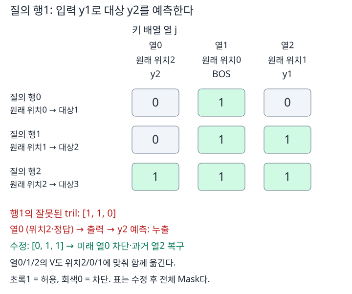{width=100% #s03-fig-grid}

### 유제 10.3.5 또 다른 배열 순서 {#s03-u-reorder}

질의 원래 위치 $[1,0]$, 키 원래 위치 $[1,2,0]$, 실제 키 여부 $[1,1,1]$이다. 입력 위치0은 BOS이고 위치1/2는 $y_1/y_2$다. 두 질의의 대상과 올바른 허용 집합·Mask를 구하라. 잘못된 `tril`의 두 행 $[[1,0,0],[1,1,0]]$에서 누출 열과 빠진 과거 열을 각각 찾아 수정하라.

#### 이해 확인 — 한 행만 계산하면 {#s03-check-single}

원래 위치5의 질의 하나와 위치 $[0,2,4,5]$의 키 넷이 있다. 배열 행0이라는 이유로 열0만 여는 것이 옳은가? [해설](SOLUTIONS.md#solution-s03-check-single)을 보기 전에 실제 위치로 답하자.

### 바뀌면 안 되는 출력과 바뀌어야 할 수 있는 출력 {#s03-invariance}

잘못된 경로를 닫았는지 검사하려면 금지된 미래 입력을 바꿔 본다. 그런데 이 실험에서 무엇을 고정했는지 정확히 말해야 한다. 미래 토큰의 변경이 이미 Q나 허용된 K/V 안에 반영되어 있다면 마지막 Mask만으로 되돌릴 수 없다. 먼저 한 Attention 연산의 보장을 분명히 하자.

### 정리 10.3.1 차단된 키·값 변경에 대한 한 행의 불변성 {#s03-th-local}

유효 질의 i에서 $J_i\ne\varnothing$이고 허용 점수·값이 유한하다고 하자. $q_i$, Mask, 모든 허용 $k_j,v_j$를 고정하고, 차단된 위치의 K/V만 바꾼다. 두 계산이 같은 구현 입력 계약을 충족하면 $o_i$는 변하지 않는다.

**증명.** 허용 열 $j\in J_i$에서 $s_{ij}=q_i\cdot k_j/\sqrt{d_k}$는 같다. 분모는 이 허용 점수들만 사용하므로 같고, 허용 A도 같다. 차단 A는 두 계산 모두0이다. 따라서 $o_i=\sum_{j\in J_i}A_{ij}v_j$의 모든 항이 같다. $\square$

키를 바꿀 때도 차단된 점수가 분모에 들어가지 않아야 한다는 것이 핵심이다. 값만0으로 만든다면 키 변화가 허용 계수까지 바꿀 수 있다. 이 정리는 **한 연산에서 직접 들어오는 경로**에 대한 것이다. ‘미래 토큰 변경에도 전체 모델 출력 불변’은 그 토큰이 질의나 허용 키/값으로 우회 전달되지 않는다는 추가 조건이 필요하다.

### 예제 10.3.6 미래 변경과 과거 전달을 따로 검사하기 {#s03-ex-change}

[예제 10.3.5](#s03-ex-reorder)에서 미래 열0의 키를 $\ln3$에서 $\ln30$으로, 값을 $[12,12]$에서 $[120,-12]$로 바꾸자. 잘못된 Mask의 행1 출력은

$$
\tfrac{30}{31}[120,-12]+\tfrac1{31}[2,0]
=[3602/31,-360/31]\approx[116.193548,-11.612903]
$$

으로 달라진다. 올바른 Mask에서는 행0/1이 이 열을 차단하므로 각각 $[2,0]$, $[2/3,4]$를 유지한다. 행2는 원래 위치2의 입력으로 $y_3$을 예측하며 그 토큰을 읽어도 된다. 행2 출력은 $[3602/33,-348/33]\approx[109.151515,-10.545455]$로 바뀐다. 미래 차단 검사는 **어느 예측에 대해 미래인가**를 지정해야 한다.

모든 출력을 상수0으로 반환하는 결함도 ‘미래 변경에 출력 불변’ 테스트만 통과할 수 있다. 그래서 허용된 과거의 변화도 함께 검사한다. 원래 위치1의 값 $[0,6]$을 $[0,9]$로 바꾸고 키는 그대로 두면 수정 Mask의 행1 출력은 $[2/3,6]$가 된다. 허용 과거가 실제로 전달되고 있음을 수치로 확인한다. 일반적으로 과거를 바꾸면 반드시 출력이 달라진다는 정리는 아니므로, 상쇄되지 않도록 테스트 값을 정한 것이다.

### 유제 10.3.6 두 변경의 전달 범위 {#s03-u-change}

[예제 10.3.2](#s03-ex-full)에서 K/Q/Mask를 고정하고 (가) 원래 위치2의 값에 $[6,-6]$을 더함, (나) 원래 위치0의 값에 $[6,-6]$을 더함을 각각 수행한다. 세 출력 행의 변화량을 구하라. 어느 예측에 대해 금지된 미래이고 어느 예측에는 허용된 입력인지 설명하라.

### 여러 층을 지나온 표현도 안전할까? {#s03-global}

첫 층에서 원래 위치1의 표현이 미래 위치2를 읽었다고 하자. 둘째 층의 질의0이 위치1을 읽도록 허용하는 상황이라면 미래 내용은 위치1을 거쳐 전달될 수 있다. 더 직접적으로, 질의 위치1이 자기 표현을0 아닌 경로로 전달하면 같은 문제가 남는다. 마지막 Attention의 미래 열을 닫는 것만으로 이미 섞인 정보를 제거하지 못한다.

다음의 최소 반례를 보자. 첫 계산에서 위치0의 표현을 $h_0=v_2$로 만들었고, 마지막 Attention에서는 위치0만 읽도록 $B=[1,0,0]$을 준다. 마지막 출력은 $h_0=v_2$다. 마지막 계수는 미래 열에서0인데도 미래 정보가 출력에 도달했다. 원래 위치 표지가0이라는 사실이 그 벡터의 내용이0까지의 입력에만 의존한다는 증명은 아니다.

### 정리 10.3.2 과거에만 의존하는 층을 쌓는 조건 {#s03-th-stack}

초기 위치 p의 표현이0부터 p까지의 입력에만 의존한다고 하자. 매 층에서 위치 p의 질의는 그 위치의 이전 표현으로 만들고, 키/값도 해당 제공 위치의 이전 표현으로 만든다. Attention은 원래 위치 r≤p인 실제 키만 읽는다. 나머지 연산은 위치별로 적용하며 미래를 섞는 별도 경로가 없다. 이 조건이 모든 층에서 유지되면 최종 위치 p의 표현도0부터 p까지의 입력에만 의존한다.

**증명.** 초기 층에서 가정이 성립한다. 어떤 층의 모든 위치 r에서 표현이0부터 r까지만 의존한다고 가정하자. 위치 p의 질의는0부터 p에만 의존한다. 허용 키/값은 r≤p의 표현에서 만들어지므로 각 의존 범위0부터 r도0부터 p에 포함된다. 점수·정규화·집계는 이 입력들만 사용한다. 위치별 후속 연산과 같은 위치의 residual도 이 범위를 넘지 않는다. 따라서 다음 층의 위치 p에서도 성립한다. 층 수에 대한 귀납으로 결론을 얻는다. $\square$

이 증명은 미래를 섞는 시퀀스 전체 평균·잘못된 첫 층·정답을 직접 넣은 질의·잘못 대응한 V·다른 제공 경로를 허용하지 않는다. 무작위 연산을 넣는 비교에서는 난수도 같은 값으로 고정해야 입력 변화의 영향만 비교할 수 있다. 구체적 Block 구성은 후속 절에서 확인한다. Mask 하나만 보고 전체 정보 누출이 없다고 결론 내릴 수 없지만, 각 층의 의존 조건을 지키면 보장을 연결할 수 있다.

#### 이해 확인 — 마지막 층의0 {#s03-check-global}

마지막 층 A의 미래 열이 모두0이면 전체 모델의 미래 정보 누출도 없다고 말할 수 있는가? 필요한 추가 조건 하나와 실패 경로 하나를 적고 [해설](SOLUTIONS.md#solution-s03-check-global)과 비교하자.

### 수식의 허용 목록을 NumPy로 옮기기 {#s03-code}

`masking.py`의 `causal_allowed`는 원래 위치 벡터를 `(m,1)`과 `(1,n)`으로 넓혀 비교한다. 결과의 shape는 `(m,n)`이다. 키 유효성 `(n,)`을 `(1,n)`으로 만들어 각 요청에 같은 패딩 열을 닫는다. True=허용이므로 두 조건을 `&`로 결합한다. 다른 시퀀스를 한 배열에 이어 붙인 경우는 이 함수의 계약 밖이다. 뒤의 연습에서 시퀀스 식별자 조건을 추가해 본다.

```{.python .numberLines source-root="." source="learning-source/masking.py" source-start="5" source-end="16" source-revision="masking-source-v0.1"}
```

핵심 정규화는 아래 부분이다. `flatnonzero`는 True인 열 번호들을 찾는다. 행 i에서 이 열만 뽑아 최대값·지수·분모를 계산한다. A를 먼저0으로 만들었으므로 차단 열에는 아무 값도 쓰지 않는다. 허용 점수에 큰 공통 상수를 더해도 그 행 최대값을 빼면 같은 비율이다. 수치 범위를 넘는 음수 차이는 `-inf`로 포화될 수 있지만 허용 최대의 지수1은 남아 분모가0이 되지 않는다. 매우 작은 허용 비율의 underflow는 수치 표현의 한계이며 정책적 차단의 근거와 구별한다.

```{.python .numberLines source-root="." source="learning-source/masking.py" source-start="30" source-end="42" source-revision="masking-source-v0.1"}
```

`active=False`를 만나면 정규화 자체를 생략하고 다음 행으로 간다. 유효 행에서 빈 목록이면0으로 숨기지 않고 오류를 낸다. 전체 함수는 부록에 있으며 Boolean의 의미·shape·finite 조건을 검사한다. 정수0/1 Mask는 여기서 거부한다. 손계산 표를 코드에 옮길 때 `dtype=bool`로 의미를 명시하자.

이 구현은 유한 Q/K/V와 유한 S를 요구한다. 차단된 V가 NaN이면 `A @ V`에서 `0 * NaN`이 NaN으로 전파될 수 있으므로 Mask로 비유한 입력을 정화한다고 가정하지 않는다. 매우 큰 유한 Q/K로 점수 overflow가 생겨도 오류다. 출력도 유한성을 검사한다. batch·Head·dropout·gradient·학습을 구현한 함수가 아니며 작은 연산의 축과 계약을 보여준다.

저장소 루트에서 아래처럼 실행한다. Python3.12와 고정 NumPy 환경은10.2의 uv lockfile을 공유한다.

```bash
cd chapters/transformer/learning-source
uv sync --locked
uv run --locked python demo_masking.py
uv run --locked python verify_masking.py
```

`demo_masking.py`는 위 차단 전후·패딩·재배열·미래 변경 수치를 출력한다. `verify_masking.py`는 NumPy 행렬곱과 별도 Decimal 스칼라 합을 비교하고, 원래 위치 재배열·패딩·미래 변경과 과거 전달·입력 오류를 검사한다. 기대 출력은 `EXPECTED_MASKING.txt`다. 테스트 통과는 검사한 사례의 증거이며 일반 불변성의 증명은 앞 정리에 있다.

### 이 절을 마친 뒤 해 볼 일 {#s03-close}

입력–대상 표를 쓰고 원래 위치 기준으로 허용 집합을 만든 뒤, 허용 지수만 분모에 넣어 실제 출력을 계산해 보자. 잘못된 Mask를 고칠 때에는 미래를 닫았는지와 필요한 과거를 남겼는지를 함께 검사한다. 출력이 같았다는 관찰과 경로가 없다는 주장은 구별하고, 마지막 연산 이전의 표현이 어떤 정보에 의존했는지도 확인한다.

이제 어떤 위치를 읽을 수 있는지는 명시할 수 있다. 그런데 요청과 제공 내용이 반드시 같은 입력 목록에서 와야 할까? 다음 절 ‘같은 입력과 다른 입력에서 정보를 가져오는 방식’에서는 Self/Cross Attention의 출처와 서로 다른 길이의 연결을 다룬다. 아래 독립 연습을 먼저 풀고, 막힌 수행에 해당하는 예제·정의로 돌아가자.

\clearpage

### 절 종료 연습문제

독립 연습은 아래20문항이다. ★는 핵심 수행을 함께 점검할 시작 묶음이며 전체 숙달 판정이 아니다. 계산기·NumPy 사용을 허용하되, 원래 위치/배열 번호·분모·누출 경로와 수정 이유를 계산과 함께 남기자. 모든 유제·독립·심화와 짧은 이해 확인의 답은 별도 해설서에 있다.

#### 접근 집합과 예측 대응

\Needspace{8\baselineskip}
### 연습문제 10.3.1 ★ 다섯 입력의 읽기 목록 {#s03-p01}

입력 $[\mathrm{BOS},a,b,c,d]$의 원래 위치는0–4다. 각 행이 다음 토큰을 예측한다. 대상 목록과 각 질의의 허용 원래 위치 집합, $5\times5$ Causal Mask를 쓰라. 마지막 행이 d를 읽는 이유를 설명하라. d 뒤의 토큰 이름은 e로 둔다.

\Needspace{8\baselineskip}
### 연습문제 10.3.2 ★ 대각선을 허용했는데 정답이 보인다 {#s03-p02}

입력과 대상 목록을 둘 다 $[y_1,y_2,y_3]$로 두고 아래 삼각형 Mask를 사용했다. 질의 행1의 정답이 어떤 경로로 들어오는지 찾으라. BOS를 이용해 입력–대상 대응을 고치고 허용된 이전 토큰을 유지하는 Mask를 제시하라. 단순히 대각선만 닫는 방법이 원래 잘못된 질의 내용까지 고치는지도 답하라.

\Needspace{8\baselineskip}
### 연습문제 10.3.3 두 요청과 일부만 남긴 키 {#s03-p03}

질의 원래 위치 $[4,1]$, 키 위치 $[3,0,5,1]$이고 모두 실제 키다. 질의별 대상 위치·허용 배열 열 집합·허용 원래 위치 집합·Mask를 쓰라. 행 수2와 열 수4가 달라도 적용되는 이유를 설명하라.

\Needspace{8\baselineskip}
### 연습문제 10.3.4 왼쪽 패딩과 재배열 {#s03-p04}

질의 위치 $[0,2]$, 키 위치 $[-1,2,0,1]$, key_valid $[0,1,1,1]$이다. 결합 Mask를 구성하라. $-1\leq0$인데도 열0을 닫는 이유를 설명하고, 패딩 표지 없이 위치 비교만 사용했을 때의 오류를 쓰라.

#### 정규화와 실제 출력

\Needspace{8\baselineskip}
### 연습문제 10.3.5 ★ 점수 순위와 접근 권한 {#s03-p05}

점수 $[0,\ln2,\ln7]$, 값 $[3],[9],[90]$, 허용 집합 $\{0,1\}$이다. 차단 전후 분모·A·O를 구하라. 가장 큰 점수의 열을 차단해도 되는 이유와, 낮은 점수 열이 허용되어야 할 수 있는 이유를 권한/적합성으로 설명하라.

\Needspace{8\baselineskip}
### 연습문제 10.3.6 값만0으로 만든 경우 {#s03-p06}

[연습문제 10.3.5](#s03-p05)에서 마지막 값만0으로 바꾸고 일반 Softmax를 사용했다. 출력과 허용 위치의 계수를 계산하고 정상 Mask 출력과 비교하라. 마지막 키의 점수를 $\ln7$에서 $\ln70$으로 바꾸었을 때 허용 계수도 변하는지 설명하라.

\Needspace{8\baselineskip}
### 연습문제 10.3.7 Softmax 뒤에 곱한 Mask {#s03-p07}

한 점수 행 $[0,\ln3,\ln4]$를 전체 정규화한 뒤 $[1,1,0]$을 곱했다. 계수 합과 값 $[2],[10],[100]$의 출력을 구하라. 이 행을 다시 합으로 나누면 정상 허용 Softmax와 같은지 유한 실수 수학에서 도출하라. 허용 질량이 기계적으로0으로 underflow한 경우에도 같은 절차가 안전한지 답하라.

\Needspace{8\baselineskip}
### 연습문제 10.3.8 유한 음수는 정확한 차단인가? {#s03-p08}

허용 점수0·값0, 차단하고 싶은 점수 $-C$·값 $10^6$이며 C는 유한하다. 둘째 비율과 출력 식을 쓰라. 출력이 $10^{-3}$ 이하가 되기 위한 C 조건을 구하고, 정확한 차단과 차이를 설명하라. 모든 키가 차단될 때 점수들을 모두 같은 유한 음수로 덮으면 어떤 비율이 나오는지도 답하라.

\Needspace{8\baselineskip}
### 연습문제 10.3.9 최대값을 어느 집합에서 구할까? {#s03-p09}

점수 $[0,1,10^6]$, 허용 집합 $\{0,1\}$이다. 전체 최대값을 뺀 뒤 허용 지수만 계산할 때 float64에서 생길 수 있는 문제를 설명하라. 허용 최대값을 빼서 비율을 구하고, 이 둘이 실수 수학에서는 왜 같지만 구현에서는 달라질 수 있는지 설명하라.

#### 누출 진단과 과거 복구

\Needspace{8\baselineskip}
### 연습문제 10.3.10 ★ 두 종류의 잘못된 열 {#s03-p10}

질의 위치 $[0,1,2]$, 키 위치 $[2,0,1]$, 모두 실제 키이고 잘못된 Mask는 아래 삼각형이다. 각 행의 (가) 잘못 연 미래 열, (나) 빠진 허용 과거 열을 따로 목록으로 쓰고 전체 Mask를 수정하라. 모든 행을 BOS만 읽게 고치면 어느 과거 정보가 사라지는지도 쓰라.

\Needspace{8\baselineskip}
### 연습문제 10.3.11 Mask는 옳고 값의 순서는 틀리다 {#s03-p11}

원래 위치1의 질의가 $y_2$를 예측한다. 키 위치 순서는 $[2,0,1]$, 올바른 Mask는 $[0,1,1]$이다. 키 점수는 $[\ln3,0,\ln2]$인데 V만 원래 순서 $[2],[0],[12]$로 남았다. 출력과 실제로 전달된 출처를 구하라. 정상 V는 원래 위치0/1/2에 각각 $2,0,12$다. 어떤 배열을 어떻게 함께 옮겨야 하는가?

\Needspace{8\baselineskip}
### 연습문제 10.3.12 ★ 불변 검사와 양성 대조 {#s03-p12}

[예제 10.3.5](#s03-ex-reorder)의 수정 Mask에서 원래 위치2의 K/V를 임의의 다른 유한 수로 바꾼다. Q와 다른 K/V는 고정한다. 어떤 출력 행이 반드시 유지되는지 근거를 쓰라. 이어 원래 위치1의 V를 $[0,9]$로 바꾸는 대조 계산을 수행하라. 미래 변경 불변만으로 상수0 구현을 배제할 수 있는가?

\Needspace{8\baselineskip}
### 연습문제 10.3.13 마지막 층 전에 누출된 경우 {#s03-p13}

첫 층이 미래 위치2의 값 t를 읽어 위치0 표현을 $h_0=t$로 만들었다. 마지막 층 질의0은 위치0만 허용한다. t=5와 t=9에서 마지막 출력을 구하고 경로를 그리라. 마지막 Mask 수정만으로 충분한지, 어떤 이전 조건을 고쳐야 하는지 설명하라.

#### 예외와 구현

\Needspace{8\baselineskip}
### 연습문제 10.3.14 ★ 패딩 행과 유효 빈 행 {#s03-p14}

점수 두 행은 모두 $[0,1]$, Mask는 $[[0,0],[1,0]]$, active는 $[0,1]$이다. A를 쓰라. active를 $[1,1]$로 바꾸면 무엇이 달라지는가? 분모에 $\epsilon$을 넣어 모두0으로 반환하는 수정이 원래 Softmax를 정의하는지도 설명하라.

\Needspace{8\baselineskip}
### 연습문제 10.3.15 Boolean 규약을 거꾸로 전달한 경우 {#s03-p15}

외부 API는 True=차단이며 `blocked=[[False,True,True]]`를 받는다. 본문 함수에 같은 배열을 allowed로 넘겼다. 어떤 열을 읽게 되는가? 올바른 변환과, key padding `(n,)`을 본문 `(m,n)` 계약에 맞추는 방법을 제시하라. 의미 변환과 shape 변환을 구별하라.

\Needspace{8\baselineskip}
### 연습문제 10.3.16 ★ NumPy로 실제 위치 비교하기 {#s03-p16}

`query_pos=[3,0]`, `key_pos=[2,0,4,1]`, `key_valid=[True,True,True,False]`다. broadcasting을 이용해 Boolean Mask를 만드는 식을 작성하고 각 중간 shape·최종 배열을 쓰라. `j <= i`라는 배열 번호 비교가 왜 틀리는지 사례의 한 셀로 보이라.

\Needspace{8\baselineskip}
### 연습문제 10.3.17 누출과 과거 손실을 함께 보고하기 {#s03-p17}

`diagnose_and_repair(query_pos,key_pos,key_valid,wrong)`를 구현하라. 잘못 연 열과 놓친 허용 열을 각각 `(질의 행, 키 열)` 쌍으로 반환하고 올바른 Mask도 반환한다. [연습문제 10.3.10](#s03-p10) 입력으로 출력 쌍을 확인하라. 단순 `wrong & correct`가 요구를 만족하는지 설명하라.

\Needspace{8\baselineskip}
### 연습문제 10.3.18 차단 열의 NaN {#s03-p18}

A가 $[1,0]$이고 V가 $[2],[\mathrm{NaN}]$일 때 NumPy의 `A @ V`가 왜2를 보장하지 않는지 설명하라. 본문 함수가 이 입력을 어떻게 처리하는지 쓰라. 차단된 V의 비유한 원소를 실제로 허용하려면 어떤 계산/입력 계약을 바꿔야 할지도 제안하라.

#### 새로운 접근 정책

\Needspace{8\baselineskip}
### 연습문제 10.3.19 바로 앞 두 입력만 읽는 정책 {#s03-p19}

원래 위치0–4의 입력과 질의가 같은 순서다. 각 유효 질의 p는 자기 위치와 바로 앞 위치만 읽는다. BOS는 위치0의 실제 입력이다. 관계식과 $5\times5$ Mask를 구성하라. 모든 점수가0이고 값이 $[2],[4],[8],[16],[32]$이면 O를 구하라. 이 정책이 미래를 막는지와 모든 허용 접두 정보를 보존하는지는 따로 답하라.

\Needspace{8\baselineskip}
### 연습문제 10.3.20 두 시퀀스를 하나의 배열에 넣기 {#s03-p20}

키와 질의의 `(시퀀스 식별자,원래 위치)`는 순서대로 $(A,0),(A,1),(B,0),(B,1)$이다. 실제 키만 있다. 각 예측은 같은 시퀀스의 현재까지 입력만 읽어야 한다. 위치 비교만 사용했을 때 생기는 다른 시퀀스 경로를 찾고, 두 조건을 결합한 $4\times4$ Mask를 구성하라. 모두 점수0이고 값 $[2],[6],[100],[200]$일 때 정상 출력을 구하라.

\Needspace{13\baselineskip}
### 더 생각해 볼 심화문제

\Needspace{10\baselineskip}
### 심화문제 10.3.1 Mask를 포함한 출력 미분 {#s03-c01}

고정된 비어 있지 않은 J와 유한 점수, 고정 V를 사용한다. (가) $t\in J$일 때 $\partial o/\partial s_t=A_t(v_t-o)$를 도출하라. (나) $t\notin J$이면 이 미분은 무엇인가? (다) 허용 위치가 하나일 때와 두 값이 같은 경우를 구별하라. (라) 실제 입력 변화로 Q/허용 K/V도 바뀌면 이 부분 미분만으로 누출 여부를 판정할 수 있는가?

\Needspace{10\baselineskip}
### 심화문제 10.3.2 두 층의 가능한 정보 경로 {#s03-c02}

위치0,1,2에서 두 층의 관계가 다음과 같이 주어진다.

$$
\begin{aligned}
R_1&=\{(0,0),(1,0),(1,1),(1,2),(2,2)\},\\
R_2&=\{(0,0),(1,0),(1,1),(2,0),(2,1),(2,2)\}.
\end{aligned}
$$ 각 쌍은 `(받는 위치,제공 위치)`다. 각 허용 계수는 양수이고 일반적인 서로 다른 V를 가정한다. 둘째 층 위치1에 첫 입력 위치2가 도달 가능한 경로를 쓰라. $C_{pr}=\bigvee_q (B^{(2)}_{pq}\land B^{(1)}_{qr})$로 가능한 두 단계 관계를 구성하고, 첫 층을 Causal로 수정한 뒤 과거 보존과 누출 차단을 설명하라. 이 관계만으로 실제 출력 변화가 항상0이 아니라고 증명할 수 있는지도 답하라.

\Needspace{10\baselineskip}
### 심화문제 10.3.3 전체 미래 차단 실험을 설계하기 {#s03-c03}

여러 층 모델의 다음 토큰 예측을 검사하려 한다. 검사할 예측 p+1, 허용 입력, 미래 변경 범위, 고정할 난수·위치·패딩, 측정할 중간값과 최종값, 과거 변화 대조, 입력–대상 오류·값 재배열·이전 층 우회 누출의 구별을 포함한 계획을 제시하라. 테스트 통과와 정리의 가정 확인, 인간의 교육적 평가가 각각 무엇을 알려 주는지도 구별하라. 설계는 하나로 정해지지 않으며 해설의 평가기준으로 자기 답을 검토한다.

\clearpage

\clearpage

## 10.4 같은 입력과 다른 입력에서 정보를 가져오는 방식 {#sec-sources}

### 무엇을 읽으며 누구의 표현을 바꾸는가? {#s04-start}

“민지는 책을 읽고 그것을 정리했다”에서 ‘그것’의 표현을 만들려면 같은 문장 안의 다른 위치를 참고해야 한다. 번역에서는 이미 생성한 번역문의 표현이 별도로 주어진 원문을 참고해야 한다. 두 상황 모두 ‘필요한 정보를 골라 가져온다’는 연산을 쓸 수 있다. 그러나 정보를 받는 위치들과 제공하는 위치들이 어디에서 왔는지는 다르다. 같은 길이의 문장 두 개도 서로 다른 출처일 수 있고, 원문과 번역문의 길이는 서로 달라도 된다.

앞 절들은 Q와 K로 점수를 계산하고 V를 집계하는 방법, 읽지 말아야 할 위치를 닫는 방법을 설명했다. 이번에는 그 앞과 뒤를 연결한다. **Q/K/V를 어느 표현에서 만들고, 집계 결과를 어느 표현의 갱신에 사용하는가?** 공식을 정확히 계산해도 이 배정을 뒤집으면 원문을 읽어 번역문을 보강하려던 요구와 다른 연산이 된다.

행렬곱은 ‘입력의 한 행과 투영 행렬의 한 열을 내적해 새 좌표 하나를 만든다’는 뜻으로 복습하자. $X\in\mathbb R^{n\times d_x}$의 n은 위치 수, $d_x$는 한 위치의 좌표 수다. $W\in\mathbb R^{d_x\times d_k}$는 위치별로 공통 적용하는 매개변수이며, $XW$는 $n\times d_k$다. 자세한 기초는 선형대수 Chapter의 행렬곱과 선형사상으로 돌아가면 된다. Attention의 점수와 행별 Softmax는 [정의 10.2.4](#s02-def-operator), 접근 제약은 [정의 10.3.1](#s03-def-access)를 참고하자.

이 절은 단일 Head, 배치 축 없는 2차원 배열, 편향 없는 선형 투영을 사용한다. 배열 행·열 첨자는0부터 센다. 모든 작은 벡터와 투영 행렬은 저자가 만든 교육용 수치다. 아래 자연어는 정보가 필요한 상황을 설명하며, 벡터의 첫 좌표가 ‘책’, 둘째 좌표가 ‘사람’이라고 확정하는 사전이 아니다. 학습된 표현의 의미나 번역 품질을 이 수치로 측정하지 않는다.

### 같은 집합에서도 세 역할은 다르다 {#s04-self}

문장의 각 위치는 필요한 정보를 요청하면서 다른 위치에 정보를 제공할 수도 있다. ‘그것’ 위치가 다른 명사를 참고하는 한편, 그 명사 위치 역시 주변 내용을 참고해 더 구체적인 표현을 얻는 식이다. 모든 위치를 동시에 계산하려면 현재의 표현 목록 X에서 세 역할을 각각 만들어 놓고, 요청 위치마다 제공자들을 비교하면 된다.[^s04-self]

\Needspace{14\baselineskip}

### 정의 10.4.1 Self-attention의 출처와 계산 {#s04-def-self}

**Self-attention**은 같은 표현 집합 X에서 질의·키·값을 각각 만들고, 그 집합의 위치들에 대한 집계 출력을 구하는 연산이다.

$$
Q=XW_Q,\qquad K=XW_K,\qquad V=XW_V,
$$
$$
S=\frac{QK^\top}{\sqrt{d_k}},\qquad
A=\operatorname{Softmax}_{\rm row}(S;B),\qquad O=AV.
\tag{ 10.4.1 }\label{s04-eq-self}
$$

여기서 X는 $n\times d_x$, $W_Q,W_K$는 각각 $d_x\times d_k$, $W_V$는 $d_x\times d_v$다. Q/K는 $n\times d_k$, V는 $n\times d_v$, S/A/B는 $n\times n$, O는 $n\times d_v$다. B는 True=허용인 접근 관계다. 유효 행의 허용 집합은 비어 있지 않아야 하며, Softmax는 [정의 10.3.3](#s03-def-masked)처럼 허용 열만으로 정규화한다. 제한이 없으면 모든 열을 허용한다.

‘같다’는 말은 **투영 전 표현 집합의 출처가 같다**는 뜻이다. $W_Q=W_K=W_V$라는 조건이 아니다. 입력 폭 $d_x$는 투영 전의 좌표 수이고, 비교 폭 $d_k$와 값 폭 $d_v$는 투영 후의 좌표 수다. 두 투영 행렬의 shape가 같아도 원소가 다르면 Q/K의 수치는 다르다. $d_v\ne d_k$이면 V는 Q와 shape부터 다를 수 있다. 또한 Self라는 이름이 자기 위치만 읽으라는 뜻은 아니다. 같은 집합 안의 다른 위치를 읽어 표현에 문맥을 반영하는 것이 핵심이다.

### 예제 10.4.1 세 위치에서 세 역할 만들기 {#s04-ex-project}

세 위치의 표현과 투영을 다음처럼 놓자. $L_2=\ln2$, $L_3=\ln3$로 줄여 쓴다.

$$
X=\begin{bmatrix}1&0\\0&1\\1&1\end{bmatrix},\quad
W_Q=\begin{bmatrix}1&0\\0&1\end{bmatrix},\quad
W_K=\sqrt2\begin{bmatrix}L_2&0\\0&L_3\end{bmatrix},\quad
W_V=\begin{bmatrix}2&0\\0&3\end{bmatrix}.
$$

X의 shape는 $3\times2$이고 세 W의 shape는 모두 $2\times2$다. 앞의3은 입력 위치 수라서 W의 shape에는 들어가지 않는다. 예를 들어 $x_2=[1,1]$의 첫 키 좌표는 $1\cdot\sqrt2L_2+1\cdot0=\sqrt2L_2$다. 각 행에 같은 W를 적용하면

$$
Q=\begin{bmatrix}1&0\\0&1\\1&1\end{bmatrix},\quad
K=\begin{bmatrix}\sqrt2L_2&0\\0&\sqrt2L_3\\\sqrt2L_2&\sqrt2L_3\end{bmatrix},\quad
V=\begin{bmatrix}2&0\\0&3\\2&3\end{bmatrix}.
$$

첫 위치만 보아도 $q_0=[1,0]$, $k_0\approx[0.980258,0]$, $v_0=[2,0]$다. 같은 $x_0$에서 시작했지만 같지 않다. Q는 무엇과 비교할지, K는 비교에 어떤 특징을 내놓을지, V는 어떤 내용을 집계할지의 서로 다른 좌표계다. 여기서 $W_Q=I$는 계산을 읽기 쉽게 택한 예시이며, 실제 모델에서 질의 투영이 항상 항등이라는 주장이 아니다.

### 유제 10.4.1 투영 폭을 바꾸면 {#s04-u-project}

위 X에서 $W_V=[2,3]^\top$만 사용하고 나머지는 유지하라. Q/K/V의 shape와 V의 실제 값을 구하라. S/A가 바뀌는지, 출력의 shape는 무엇인지 설명하라.

#### 이해 확인 — 같은 입력이라는 말 {#s04-check-equal}

“Self-attention에서는 Q=K=V다”라는 설명을 위 첫 위치로 반박하라. 세 수치가 우연히 같다면 Self임을 확정할 수 있는가? [해설](SOLUTIONS.md#solution-s04-check-equal)에서 출처와 수치를 비교하자.

### 예제 10.4.2 점수부터 세 출력까지 {#s04-ex-self}

먼저 모든 위치를 허용한다. 비교 폭은2이므로 $\sqrt{d_k}=\sqrt2$로 나눈다. 내적 $q_0k_2^\top=\sqrt2L_2$, $q_2k_2^\top=\sqrt2(L_2+L_3)$다. 따라서

$$
QK^\top=\sqrt2\begin{bmatrix}L_2&0&L_2\\0&L_3&L_3\\L_2&L_3&L_2+L_3\end{bmatrix},
$$
$$
S=\begin{bmatrix}\ln2&0&\ln2\\0&\ln3&\ln3\\\ln2&\ln3&\ln6\end{bmatrix}.
$$

$W_K$의 $\sqrt2$와 scaling의 $\sqrt2$가 이 예제에서는 상쇄된다. 일반 식에서 scaling을 생략해도 된다는 뜻은 아니다. 지수는 첫 행 $[2,1,2]$, 둘째 행 $[1,3,3]$, 셋째 행 $[2,3,6]$이다. 분모는 행마다5,7,11로 다르므로

$$
A=\begin{bmatrix}2/5&1/5&2/5\\1/7&3/7&3/7\\2/11&3/11&6/11\end{bmatrix}.
$$

가중합은 V의 좌표별로 수행한다. 첫 행에서는 $\frac25[2,0]+\frac15[0,3]+\frac25[2,3]=[8/5,9/5]$다. 나머지도 같은 방식으로 계산하면

$$
O=AV=\begin{bmatrix}8/5&9/5\\8/7&18/7\\16/11&27/11\end{bmatrix}
\approx\begin{bmatrix}1.600000&1.800000\\1.142857&2.571429\\1.454545&2.454545\end{bmatrix}.
\tag{ 10.4.2 }\label{s04-eq-self-result}
$$

세 출력은 서로 다르며 대각선만 남은 계산도 아니다. 위치0의 원래 표현 $[1,0]$에는 없던 둘째 좌표의 정보가 위치1과2의 값을 통해 들어왔다. 각 출력 행은 해당 요청 위치에 돌려줄 문맥 정보다. 새로운 위치를 만든 것이 아니라 기존 세 위치 각각에 필요한 집계 벡터를 만든 것이다.

### 유제 10.4.2 한 행을 끝까지 검산하기 {#s04-u-self}

위치1의 $q_1$에서 시작해 세 내적, scaled 점수, 지수, 분모, A행, O행을 직접 구하라. $v_0,v_1,v_2$의 기여를 각각 두 좌표 벡터로 적고, 자기 위치가 아닌 어느 위치가 둘째 좌표에 기여했는지 말하라.

\Needspace{11\baselineskip}

### 예제 10.4.3 다른 위치의 값이 얼마나 들어왔는가? {#s04-ex-contribution}

위치0 출력의 기여를 분해하면 다음과 같다.

| 제공 위치 j | 비율 $A_{0j}$ | 값 $v_j$ | 출력에 더하는 $A_{0j}v_j$ |
|---|---|---|---|
| 0 | $2/5$ | $[2,0]$ | $[4/5,0]$ |
| 1 | $1/5$ | $[0,3]$ | $[0,3/5]$ |
| 2 | $2/5$ | $[2,3]$ | $[4/5,6/5]$ |

다른 위치1과2의 기여만 더해도 $[4/5,9/5]$다. 자기 위치의 값만 가져오면 $[2,0]$이므로 실제 결과 $[8/5,9/5]$와 다르다. 이 분해는 ‘위치2가 출력의 둘째 좌표에 $6/5$를 직접 더했다’는 정확한 계산이다. ‘위치2의 단어가 예측을 정확히 그만큼 설명한다’는 결론은 아니다. 입력을 바꾸면 Q/K에 따른 비율도 달라질 수 있고 후속 연산도 있기 때문이다.

원래 X와 같은 폭의 O를 받아 쓰는 간단한 예로 $X^{\rm new}=X+O$를 구성하면

$$
X^{\rm new}=\begin{bmatrix}13/5&9/5\\8/7&25/7\\27/11&38/11\end{bmatrix}.
$$

특히 $x_0^{\rm new}=[13/5,9/5]$에는 위치1·2의 기여가 들어간다. 이 덧셈은 갱신의 한 예다. Self-attention의 집계 정의 자체는 O까지이고, 전체 Transformer Block에서는 출력 투영·residual stream·정규화 등의 배치가 추가된다. 그 상세는 [10.7절](#sec-block)에서 다룬다. 여기서는 ‘같은 집합에서 읽은 결과를 그 집합의 위치들에 돌려준다’는 연결을 확인하면 된다.

### 유제 10.4.3 값을 바꾸는 실험과 입력을 바꾸는 실험 {#s04-u-value}

Q/K와 B를 고정하고 투영 후 $v_2$에만 $[5,-5]$를 더하면 $o_0$와 $o_1$은 각각 얼마나 변하는가? 이어서 X의 행2 자체를 바꿀 때 이 답을 그대로 적용할 수 없는 이유를 설명하라.

### 예제 10.4.4 Self-attention에도 다른 접근 정책이 있다 {#s04-ex-causal}

문장 전체가 주어진 이해 과제라면 앞뒤 위치를 모두 읽는 Bidirectional Self-attention을 사용할 수 있다. 다음 토큰을 예측하는 경우에는 [정의 10.3.2](#s03-def-causal)의 Causal Self-attention처럼 현재 입력 위치까지 허용한다. 두 경우 모두 Q/K/V의 출처는 X다. 바뀌는 것은 B다.[^s04-policy]

같은 수치를 유지하고 $B_{ij}=[j\leq i]$를 적용하자. 위치0은 열0만 허용한다. 위치1은 점수 $[0,\ln3]$인 두 열만 허용하고, 위치2는 세 열 모두 허용한다. 따라서

$$
A^{\rm causal}=\begin{bmatrix}1&0&0\\1/4&3/4&0\\2/11&3/11&6/11\end{bmatrix},\qquad
O^{\rm causal}=\begin{bmatrix}2&0\\1/2&9/4\\16/11&27/11\end{bmatrix}.
$$

위치0은 미래 위치1·2를 읽지 않고, 위치1은 과거 위치0의 값에 $1/4$를 준다. Causal에서도 다른 위치의 정보를 반영한다. 미래를 읽는지 여부와 Self인지 여부는 다른 질문이다. 여기서 Causal이라는 보장은 한 연산의 접근 관계에 대한 것이다. 입력 표현이 이미 미래를 담았다면 이 Mask만으로 전체 모델의 누출이 사라지지 않는다는10.3의 경계도 유지한다.

### 유제 10.4.4 패딩은 어느 축을 닫는가? {#s04-u-mask}

세 위치 중 마지막 위치2가 패딩이라고 하자. 위 Self 수치에서 질의0·1만 유효하다. Causal 조건 없이 key padding으로 열2를 닫은 A와 두 유효 출력을 계산하라. 패딩 질의의 active=False/출력0 계약을 적용하면 전체 O는 무엇인가? Causal 조건까지 추가하면 어느 유효 행이 달라지는가?

#### 이해 확인 — Mask가 있으면 {#s04-check-mask}

별도의 Z를 읽는 모듈에서 Z의 패딩 열을 닫았다. Mask를 사용했으므로 Self-attention이 된 것인가? [해설](SOLUTIONS.md#solution-s04-check-mask)과 비교하자.

### 다른 집합을 읽어야 할 때 {#s04-cross}

번역문의 현재 표현만으로는 원문에 어떤 내용이 있는지 알 수 없다. 원문 전체를 하나의 고정 벡터로 압축해 전달하면 요청마다 다른 위치를 골라 읽는 통로가 드러나지 않는다. 원문을 위치별 표현 목록 Z로 남겨 두고, 번역문의 각 위치 H가 자기 요청으로 Z의 키를 비교하도록 하면 된다. 요청과 제공자를 구별한 Attention의 같은 수식이 두 집합 사이의 조건 전달 인터페이스가 된다.

\Needspace{14\baselineskip}

### 정의 10.4.2 Cross-attention의 출처와 계산 {#s04-def-cross}

**Cross-attention**은 정보를 받는 표현 집합 H에서 질의를 만들고, 별도의 조건 표현 집합 Z에서 키와 값을 만들어 H의 요청 위치들에 대한 집계 출력을 구하는 연산이다.

$$
Q=HW_Q,\qquad K=ZW_K,\qquad V=ZW_V,
$$
$$
O=\operatorname{Softmax}_{\rm row}\!\left(\frac{QK^\top}{\sqrt{d_k}};B\right)V.
\tag{ 10.4.3 }\label{s04-eq-cross}
$$

H는 $m\times d_h$, Z는 $n\times d_z$다. m은 요청 위치 수, n은 조건 제공 위치 수이며 같을 필요가 없다. $d_h,d_z$는 투영 전 입력 폭으로 서로 달라도 된다. $W_Q$는 $d_h\times d_k$, $W_K$는 $d_z\times d_k$, $W_V$는 $d_z\times d_v$다. $d_k$는 Q/K의 공통 비교 폭, $d_v$는 V/O의 좌표 폭이다. B는 $m\times n$의 허용 관계다.

이 식의 방향은 H가 Z를 읽는 방향이다. Z가 H를 읽게 하려면 질의 제공자를 Z로 바꾼 별도 연산이 필요하다. 이름을 바꾸는 것만으로 읽기 방향이 바뀌지 않는다. H와 Z가 같은 길이거나 우연히 같은 수치를 가져도 서로 다른 표현 출처라는 배정은 유지된다. 반대로 이름만 H/Z로 다르게 썼지만 실제로 같은 X를 세 역할에 배정했다면 그것은 위 Self의 구조다.

### 정리 10.4.1 집계 출력은 요청 위치에 대응한다 {#s04-th-shape}

위 정의의 차원 조건과 유효한 접근 관계가 주어지면, H가 Z를 읽는 집계 출력의 shape는 $m\times d_v$다. 요청 위치마다 출력 하나가 생기며, 제공 위치 수 n은 출력 행 수가 되지 않는다.

**증명.** 각 투영을 곱하면 Q는 $m\times d_k$, K는 $n\times d_k$, V는 $n\times d_v$다. 따라서 $QK^\top$의 셀 $(i,j)$는 요청 i와 제공자 j의 비교이며 점수표는 $m\times n$이다. 행별 Softmax는 shape를 유지하므로 A도 $m\times n$이다. $O=AV$의 셀은 $O_{ir}=\sum_{j=0}^{n-1}A_{ij}V_{jr}$다. 합으로 사라지는 축은 제공 위치 j이고, 남는 축은 요청 i와 값 좌표 r이다. 따라서 $O\in\mathbb R^{m\times d_v}$다. Self에서는 $m=n$인 같은 계산을 적용한다. $\square$

이 증명은 집계가 H의 입력 폭을 자동 복원하지 않는다는 사실도 보여 준다. $d_v\ne d_h$라면 O를 H에 바로 더할 수 없다. 길이가 n인 조건 목록을 읽었다고 n개의 원문 표현을 새로 반환하는 것도 아니다. 길이와 폭은 서로 다른 역할을 한다.

### 예제 10.4.5 두 요청이 세 조건 위치를 읽기 {#s04-ex-cross}

다음 입력을 사용한다. Z의 수치는 앞의 X와 같지만, 별도로 주어진 원문의 표현 집합이라고 배정한다.

$$
H=\begin{bmatrix}1&0&1\\0&1&1\end{bmatrix}\in\mathbb R^{2\times3},\qquad
Z=\begin{bmatrix}1&0\\0&1\\1&1\end{bmatrix}\in\mathbb R^{3\times2}.
$$

비교 폭과 값 폭을 각각 $d_k=2,d_v=2$로 정하고 투영을 놓는다. 위 Self의 $W_Q$와 구별해 이번 질의 투영의 수치를 직접 적는다.

$$
W_Q=\begin{bmatrix}1&0\\0&1\\0&0\end{bmatrix}\ (3\times2),\quad
W_K=\sqrt2\begin{bmatrix}\ln2&0\\0&\ln3\end{bmatrix}\ (2\times2),\quad
W_V=\begin{bmatrix}2&0\\0&3\end{bmatrix}\ (2\times2).
$$

H의 첫 행에서 첫 질의 좌표는 $1\cdot1+0\cdot0+1\cdot0=1$, 둘째는0이다. 둘째 행은 $[0,1]$을 만든다. 이 예제의 $W_Q$는 H의 셋째 좌표를 비교에 사용하지 않는다. 서로 다른 입력 폭을 공통 비교 폭으로 옮긴다는 뜻을 보여주려는 선택이며, 버린 좌표가 모든 과제에서 불필요하다는 주장은 아니다.

$$
Q=\begin{bmatrix}1&0\\0&1\end{bmatrix},\quad
K=\begin{bmatrix}\sqrt2\ln2&0\\0&\sqrt2\ln3\\\sqrt2\ln2&\sqrt2\ln3\end{bmatrix},\quad
V=\begin{bmatrix}2&0\\0&3\\2&3\end{bmatrix}.
$$

Q는 $2\times2$, K/V는 $3\times2$다. 원문 세 위치를 전부 허용하면 계산은

$$
S=\frac{QK^\top}{\sqrt2}
=\begin{bmatrix}\ln2&0&\ln2\\0&\ln3&\ln3\end{bmatrix},\quad
A=\begin{bmatrix}2/5&1/5&2/5\\1/7&3/7&3/7\end{bmatrix},
$$
$$
O=AV=\begin{bmatrix}8/5&9/5\\8/7&18/7\end{bmatrix}\in\mathbb R^{2\times2}.
$$

첫 요청은 원문 값들을 $2:1:2$로, 둘째 요청은 $1:3:3$으로 섞었다. 첫 요청의 둘째 좌표는 $\frac15\cdot3+\frac25\cdot3=9/5$다. 서로 다른 요청이 같은 원문을 다른 비율로 읽어 각자의 집계 정보를 얻는다. 첫 출력 행은 $h_0$를 보강할 자료이지 $z_0$의 새 표현이 아니다. 원문 위치 j와 요청 위치 i가 같은 번호를 가진다고 해서 서로 짝지어 갱신하는 계산도 아니다.

### 유제 10.4.5 같은 폭이어야 하는 것은 무엇인가? {#s04-u-cross}

H가 $2\times3$, Z가 $3\times4$이고 $d_k=2,d_v=5$인 Cross 인터페이스를 구성하라. 세 W와 Q/K/V/S/A/O의 shape를 모두 적어라. $W_K\in\mathbb R^{3\times2}$라는 제안이 왜 틀렸는지, O를 H에 더하려면 어떤 추가 사상이 필요한지 설명하라.

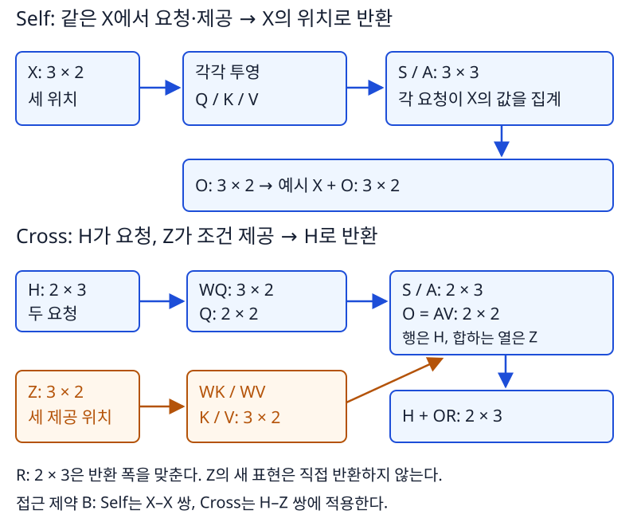{width=99% #s04-fig-flow}

\Needspace{14\baselineskip}

### 정의 10.4.3 집계와 받는 표현의 갱신 연결 {#s04-def-return}

집계 출력을 받는 집합의 폭으로 옮기는 **출력 사상** R과, 이 절에서 사용할 예시 갱신을 다음처럼 정의한다.

$$
R\in\mathbb R^{d_v\times d_h},\qquad U=OR,\qquad H^{\rm new}=H+U.
\tag{ 10.4.4 }\label{s04-eq-return}
$$

U와 $H^{\rm new}$는 $m\times d_h$다. Self에는 $H=X,d_h=d_x$를 대입한다. 이는 집계 결과가 받는 위치의 다음 표현으로 연결되는 것을 보여주는 예시이며, 정규화나 FFN까지 포함한 전체 Block 정의가 아니다. $d_v=d_h$인 경우에도 R이 항상 항등일 필요는 없다. 입력 배열을 코드에서 제자리 수정해야 한다는 의미도 아니다. 새 배열을 반환해 후속 계산에 넘겨도 표현 갱신이다.

### 예제 10.4.6 폭2의 정보를 폭3의 H로 돌려주기 {#s04-ex-return}

위 Cross에서 $H+O$는 shape가 달라 정의되지 않는다. 다음 사상을 추가한다.

$$
R=\begin{bmatrix}1&0&1\\0&1&-1\end{bmatrix},\qquad
OR=\begin{bmatrix}8/5&9/5&-1/5\\8/7&18/7&-10/7\end{bmatrix}.
$$

O의 한 행 $[a,b]$가 $[a,b,a-b]$로 바뀐 것이다. H에 더하면

$$
H^{\rm new}=\begin{bmatrix}13/5&9/5&4/5\\8/7&25/7&-3/7\end{bmatrix}.
$$

이 반환은 두 요청 위치의 표현을 보강한다. Z는 키와 값을 제공했지만 이 한 번의 식에는 $Z^{\rm new}$를 계산하는 대입이 없다. Z가 영원히 고정된다는 뜻은 아니다. 다른 Encoder 층이나 별도 모듈에서 갱신될 수 있고, 학습에서는 이 연산을 통한 gradient가 Z를 생성한 매개변수에 전달될 수도 있다. 지금 구별하는 것은 **이번 순방향 연산의 직접 반환 대상**이다.

### 유제 10.4.6 읽는 방향을 바꾸면 {#s04-u-return}

Z가 H를 읽도록 위 인터페이스의 역할을 뒤집으려 한다. 원래 H/Z의 길이와 폭을 유지하면서 새로운 Q/K/V 투영의 shape를 정하라. 비교 폭2·값 폭2로 두고 S/A/O의 shape와 직접 갱신되는 쪽을 적어라. 기존 $W_Q$를 그대로 재사용할 수 있는지도 확인하라.

#### 이해 확인 — 원문은 바뀌지 않는가? {#s04-check-update}

한 번의 Cross-attention이 Z의 새 표현을 직접 반환하지 않았다는 관찰로 “Z는 학습 중에도, 다른 층에서도 바뀌지 않는다”라고 결론 낼 수 있는가? [해설](SOLUTIONS.md#solution-s04-check-update)을 보자.

### 같은 숫자라도 데이터 흐름을 다시 읽자 {#s04-compare}

### 예제 10.4.7 같은 집계 수치, 다른 출처와 반환 대상 {#s04-ex-same}

Self의 요청0·1만 골라 계산하면 Q/K/V/S/A/O의 수치는 위 Cross와 정확히 같다. Self에서는 두 Q도 X에서 만들었고 K/V도 X에서 만들었다. 출력 두 행은 X의 위치0·1로 돌아간다. 전체 Self 계산에서는 위치2의 요청도 포함하므로 출력이 세 행이다. Cross의 Q는 별도 H에서 왔고 K/V는 Z에서 왔다. 출력 두 행은 H의 두 위치로 돌아간다. Z의 세 위치를 갱신하는 출력이 아니다.

| 확인 항목 | 전체 Self 예제 | Cross 예제 |
|---|---|---|
| Q의 투영 전 출처 | X: $3\times2$ | H: $2\times3$ |
| K/V의 투영 전 출처 | 같은 X | 별도 Z: $3\times2$ |
| Q/K/V의 shape | $3\times2$ / $3\times2$ / $3\times2$ | $2\times2$ / $3\times2$ / $3\times2$ |
| 요청 수 / 제공 위치 수 | 3 / 3 | 2 / 3 |
| S/A/B의 shape | $3\times3$ | $2\times3$ |
| O의 행 수 / 좌표 폭 | 3 / 2 | 2 / 2 |
| 예시 반환 위치 / 폭 | X의 세 위치 / 2 | H의 두 위치 / 3, R 사용 |
| 조건 정보 공급 | X의 허용 위치 | Z의 허용 위치 |
| 접근 제약의 자리 | X 요청–X 제공 쌍 | H 요청–Z 제공 쌍 |

전체 도해의 화살표와 이 표를 함께 읽자. O의 좌표 폭은 값 폭을 따르고, 출력 사상을 거친 U의 폭은 받는 표현 폭을 따른다. ‘V와 최종 모델 표현의 폭이 항상 같다’고 뭉뚱그리면 이 둘을 혼동한다. 같은 수치의 Q/K/V만 보아서는 원래 출처를 복원할 수 없으므로, 구현에서도 어느 배열을 전달했는지 확인해야 한다.

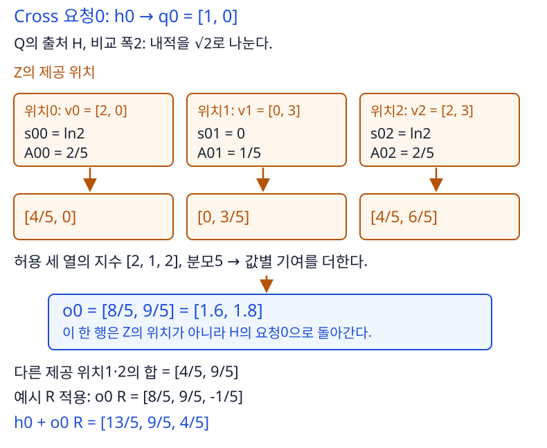{width=98% #s04-fig-detail}

### 정리 10.4.2 고정된 비율에서 값 변경의 직접 기여 {#s04-th-value}

Q/K/B를 고정하고 투영 후 한 제공 값 $v_t$만 $v_t+\delta$로 바꾸면, 모든 요청 i에 대해

$$
\Delta o_i=A_{it}\delta.
\tag{ 10.4.5 }\label{s04-eq-change}
$$

**증명.** A는 Q/K/B만으로 계산되므로 변하지 않는다. $o_i=\sum_jA_{ij}v_j$에서 변경 전후를 빼면 t 이외의 항은 모두 상쇄되어 $A_{it}\delta$만 남는다. t가 차단되어 $A_{it}=0$이면 직접 변화는0이다. $\square$

이 성질은 Self와 Cross 모두에 적용된다. 그러나 **입력 표현** X나 Z의 행을 바꾸는 실험은 일반적으로 다르다. Z를 바꾸면 K와 V가 함께 변할 수 있어 비율도 다시 계산해야 한다. Self에서 X를 바꾸면 그 위치의 Q까지 변할 수 있다. ‘값의 기여를 분해한 표’와 ‘입력 토큰을 바꾼 전체 효과’는 같은 양이 아니다.

Cross에서도 접근 제약이 필요하다. 원문 패딩은 Z의 열을 닫고, 특정 요청에 아직 제공할 수 없는 자료가 있다면 해당 H–Z 쌍을 닫는다. 번역 원문이 처음부터 모두 주어진 상황에서는 번역 위치 i와 원문 위치 j에 기계적으로 $j\leq i$를 적용할 이유가 없다. 반면 시간에 따라 도착하는 조건 자료라면 요청 시점까지 도착한 제공자만 허용하는 별도 관계를 만들 수 있다. Causal이라는 요구는 실제 시간·위치 대응으로 정하고, 모듈 이름만으로 Mask를 생략하거나 삼각형을 강제하지 않는다.

### 유제 10.4.7 원문 마지막 위치를 닫으면 {#s04-u-provider}

Cross 예제의 두 요청 모두 Z의 열2를 닫아라. 허용 분모·A·O를 구하고, 열2의 K/V만 유한한 다른 값으로 바꾸었을 때 O가 유지되는 조건을 적어라. 그 열을 다시 열면 같은 불변을 보장할 수 있는가?

#### 이해 확인 — 길이가 같으면 {#s04-check-length}

H와 Z가 모두 $3\times2$이고 Q/K/V의 수치도 같게 나왔다. 이 정보만으로 Self인지 Cross인지 결정할 수 있는가? [해설](SOLUTIONS.md#solution-s04-check-length)에서 필요한 정보를 확인하자.

### 구현에서 입력 출처를 잃지 않기 {#s04-code}

함수의 인수 이름이 올바른 데이터 흐름을 보장하지는 않는다. 아래 함수에서 질의 투영은 h에, 키/값 투영은 z에 적용한다. Self는 같은 x를 두 인수에 배정하는 구조다. 원래10.3의 `masked_attention`을 수정 없이 호출하므로 True=허용·유효 빈행 오류·비활성 행의 계수/출력0·유한 수치 계약을 그대로 따른다. 하나의 Head만 다루며 batch·dropout·자동미분은 구현하지 않는다.

```{.python .numberLines source-root="." source="learning-source/sources.py" source-start="24" source-end="36" source-revision="sources-source-v0.1"}
```

`sources.py`의 `project`는 입력 폭과 W의 첫 축이 맞는지 검사한다. Q/K 비교 폭과 K/V 행 수는 기존 집계 함수가 검사한다. `allowed`는 점수와 정확히 같은 shape여야 한다. 행렬곱과 Softmax를 통과했다고 출처까지 올바르다는 뜻은 아니다. 예를 들어 $d_h=d_z$이면 K/V에 h를 잘못 넣어도 shape 검사는 통과한다. 요구가 H가 Z를 읽는 것이라면 코드의 실제 피연산자와 중간 Q/K/V를 대조해야 한다.

Learning Source 디렉터리에서 다음을 실행하자. 고정 NumPy CPU 환경의 설정과 lockfile은10.2·10.3과 같다.

```bash
uv sync --locked
uv run --locked python demo_sources.py
uv run --locked python verify_sources.py
```

실제 소스 경로는 `chapters/transformer/learning-source/`다. 대표 출력의 O는 다음과 같으며, 전체 Q/K/V/S/A도 demo가 출력한다.

```text
Self O = [[1.600000, 1.800000],
          [1.142857, 2.571429],
          [1.454545, 2.454545]]
Cross O = [[1.600000, 1.800000],
           [1.142857, 2.571429]]
Z의 행2 변경 후 Cross O = [[2.857143, 2.142857],
                           [2.000000, 2.571429]]
```

마지막 실험은 $z_2=[1,1]$을 $[2,1]$로 바꾼 것이다. K의 첫 좌표와 V의 첫 좌표가 함께 바뀐다. 첫 요청의 지수 비율은 $[2,1,4]/7$이 되고 출력은 $[20/7,15/7]$이다. 둘째 요청의 비율은 $[1,3,3]/7$ 그대로지만 값이 달라져 첫 출력 좌표가2가 된다. 따라서 ‘Z를 바꾸면 모든 A행이 반드시 변한다’도 틀리다. 어떤 경로가 변하는지 실제 투영으로 확인해야 한다.

#### 이해 확인 — 실행 성공과 인터페이스 {#s04-check-code}

H와 Z의 폭이 같아서 `project(h, wk)`가 실행됐다. 이 사실이 H가 Z를 읽는 요구를 만족한다는 증거인가? [해설](SOLUTIONS.md#solution-s04-check-code)을 보자.

### 원문과 번역문을 연결한 뒤 남는 질문

원래 Transformer의 Encoder 쪽 Self-attention은 원문 표현 집합 안의 정보를 섞고, Decoder의 Causal Self-attention은 이미 주어진 출력 쪽 입력들을 읽는다. Decoder가 Encoder 출력을 참고하는 Attention은 Decoder 쪽 표현을 Q로, Encoder 출력을 K/V로 사용한다. 이번 절의 H/Z가 바로 이 읽기 방향을 단순화한 인터페이스다. Encoder 전체·Decoder 전체와 각 하위 연산의 배치는 [10.7절](#sec-block)·[10.8절](#sec-architectures)에서 이어간다.[^s04-cross]

이번 절에서 구별한 것은 **출처, 접근 관계, 반환 대상**이다. 어느 집합에서 읽을지를 정해도 하나의 Q/K 비교와 하나의 가중합만으로 여러 관계를 충분히 표현할 수 있는지는 남는다. 다음 [10.5절](#sec-heads)에서는 여러 Head가 서로 다른 투영과 비율로 읽고 그 결과를 어떻게 결합하는지 살핀다.

\clearpage

### 절 종료 연습문제 {#s04-practice}

먼저 식의 각 행이 어느 위치에 속하는지 적고 계산하자. ★ 문제는 출처·실제 계산·인터페이스 구성의 핵심 확인이다. 수치가 맞더라도 제공자와 반환 대상을 말할 수 없다면 관련 예제로 돌아가자. 유제7개·독립22개·심화3개와 이해 확인의 답은 [별도 해설서](SOLUTIONS.md#solution-sec-sources)에 있다.

### 출처와 실제 계산

### 연습문제 10.4.1 ★ 세 역할의 실제 출처 {#s04-p01}

모듈 A는 $Q=XW_Q,K=XW_K,V=XW_V$, 모듈 B는 $Q=HW_Q,K=ZW_K,V=ZW_V$다. X/H/Z는 별도로 주어진 표현 집합이다. 각 모듈의 이름, 요청 집합, 제공 집합, 집계 출력의 직접 반환 대상과 접근 관계의 행/열 의미를 적어라. B에서 Z에 A를 곱해 Z를 갱신했다는 설명의 오류를 찾아라.

### 연습문제 10.4.2 입력과 매개변수의 축 {#s04-p02}

Self에서 X가 $5\times4$, 비교 폭3, 값 폭2다. 세 W와 Q/K/V/S/A/O의 shape를 모두 적어라. ‘입력이 다섯 위치이므로 $W_Q$는 $5\times3$’이라는 답을 고쳐라. 출력 사상으로 원래 폭을 복원하려면 R은 어떤 shape인가?

### 연습문제 10.4.3 ★ 세 위치의 전체 Self 계산 {#s04-p03}

$X=[[1],[2],[0]]$, $W_Q=[1]$, $W_K=[\ln2]$, $W_V=[3]$으로 놓고 모두 허용하라. Q/K/V/S/A/O를 정확한 지수 비율로 구하고, 요청0에 자기 위치 이외의 기여가 있음을 수치로 보여라. 이 예제의 비교 폭은1이다.

### 연습문제 10.4.4 ★ 같은 집합의 표현 갱신 {#s04-p04}

[예제 10.4.2](#s04-ex-self)의 위치2를 선택하라. 세 제공 위치의 기여를 따로 구해 $o_2$를 만들고, $x_2+o_2$를 계산하라. 이 반환에 다른 위치들의 정보가 어떻게 들어갔는지 설명하라. O 자체와 예시 갱신을 구별하라.

### 연습문제 10.4.5 투영이 같은 특별한 경우 {#s04-p05}

Self에서 $d_x=d_k=d_v$이고 $W_Q=W_K=W_V$이면 Q/K/V는 어떤 관계인가? 이 특별한 경우가 Self의 필수 조건이 아닌 이유를 반례로 설명하라. Q=K이면 A가 반드시 대칭이라는 주장도 X=$[[1],[2]]$, 세 W=$[1]$에서 검토하라.

### 연습문제 10.4.6 허용 위치만의 문맥화 {#s04-p06}

[예제 10.4.2](#s04-ex-self)에 Causal Mask를 적용해 위치1의 A/O를 구하라. 이어서 자기 위치1만 허용했을 때와 비교하라. 두 연산이 모두 Self인 이유와, 다른 위치를 반영한다는 교육적 목적에서 달라지는 점을 적어라.

### 두 집합의 인터페이스

### 연습문제 10.4.7 ★ 길이와 폭이 모두 다른 설계 {#s04-p07}

H가 $4\times6$, Z가 $7\times5$다. H가 모든 실제 Z 위치를 읽어 조건화되어야 한다. $d_k=3,d_v=2$로 Q/K/V의 출처와 세 투영, 점수·가중치·집계 출력의 shape를 구성하라. H와 같은 폭의 반환을 위한 R도 정하라. 요청 수가7이라는 제안을 반박하라.

### 연습문제 10.4.8 ★ 새로운 수치의 Cross 계산 {#s04-p08}

$H=[[1],[2]]$, $Z=[[0],[1],[2]]$, $W_Q=[1],W_K=[\ln2],W_V=[4]$다. 전부 허용하고 Q/K/V/S/A/O를 구하라. 출력의 개수와 각 출력에 정보를 제공한 위치를 설명하라. 한 번의 연산에서 Z의 새 표현이 직접 반환되는가?

### 연습문제 10.4.9 폭이 맞아도 출처가 틀릴 수 있다 {#s04-p09}

H와 Z 모두 $2\times2$다. ‘H가 Z를 읽는다’는 요구에 구현자가 `q=h@wq; k=h@wk; v=z@wv`를 작성했다. 행렬곱이 성공해도 왜 요구를 만족하지 못하는가? 수정 코드와, H/Z가 우연히 같은 수치일 때 단 한 번의 출력 비교가 오류를 놓치는 이유를 설명하라.

### 연습문제 10.4.10 두 방향으로 조건을 교환하기 {#s04-p10}

H가 $2\times3$, Z가 $3\times2$다. H가 Z를 읽는 연산과 Z가 H를 읽는 연산을 둘 다 구성하라. 각각 비교 폭2·값 폭4를 사용하되 별도 매개변수를 허용한다. 두 S/A/O와 출력 사상의 shape, 갱신 대상을 적어라. 첫 연산의 $A^\top$를 그대로 둘째 연산의 가중치로 써도 되는지 행합으로 설명하라.

### 연습문제 10.4.11 숫자만으로 이름을 붙일 수 있는가? {#s04-p11}

한 로그에 Q=$[[1,0]]$, K=$[[1,0],[0,1]]$, V=$[[2],[8]]$만 저장되어 있다. Self에서 선택한 한 요청의 기록일 수도, 별도 H가 Z를 읽은 기록일 수도 있는가? 두 가능한 출처 구성을 제시하고 분류에 필요한 추가 기록을 적어라.

### 기여와 접근 제한

### 연습문제 10.4.12 직접 값 경로와 전체 입력 효과 {#s04-p12}

Cross 대표 예제에서 Q/K/B를 고정하고 $v_1$에 $[7,-7]$을 더하라. 두 O행의 변화량과 R을 거친 U의 변화량을 구하라. 실제 $z_1$ 변경에도 이 값을 항상 적용할 수 있는가? 조건을 설명하라.

### 연습문제 10.4.13 Cross의 패딩 열 {#s04-p13}

[예제 10.4.5](#s04-ex-cross)에서 Z의 마지막 위치는 패딩이고, H의 둘째 요청은 비활성 패딩 질의다. 허용 B, active, A/O를 구하라. 패딩 질의의 출력은 확률분포의 평균인가? 유효 질의의 모든 키를 닫으면 무엇을 해야 하는가?

### 연습문제 10.4.14 두 시계로 정하는 접근 관계 {#s04-p14}

H 요청 시각은 $[4,5]$, Z 자료 도착 시각은 $[1,4,6]$이다. 도착한 자료만 읽도록 B를 구성하라. 지수 점수가 모든 셀에서 $[2,1,2]$이고 값은 $[2,8,20]^\top$일 때 A/O를 구하라. 이 Cross에 단순 $2\times3$ `tril`을 적용하면 어떤 허용 자료를 놓치는가?

### 연습문제 10.4.15 원문 열을 무조건 삼각형으로 닫는 오류 {#s04-p15}

완성된 원문 세 위치가 처음부터 주어지고 번역 쪽 요청은 두 위치다. `B[i,j]=(j<=i)`를 반드시 써야 한다는 주장을 평가하라. 실제 입력/예측 대상/조건 도착에 따라 언제 제한이 필요한지 말하고, 원문이 전부 유효한 경우 B를 제안하라. 미래 번역 토큰의 접근 문제는 어느 집합의 어떤 경로에서 따로 다루는가?

### 연습문제 10.4.16 제공자 순서를 바꾸기 {#s04-p16}

Cross 대표 예제에서 Z의 행을 순서 $[2,0,1]$로 옮기고, 열2 차단 B도 대응되게 옮겨라. 새 K/V/A와 O를 구하라. V만 옮기면 왜 일반적으로 틀린가? 원래 모든 열 허용 A의 첫 행으로 V만 옮긴 출력도 계산하라.

### 구현·진단·새 상황

### 연습문제 10.4.17 ★ NumPy 실행과 실제 결과 대조 {#s04-p17}

Learning Source를 사용해 대표 Self/Cross의 Q/K/V/S/A/O를 출력하라. 단순 출력 shape 확인에 더해 Self의 첫 두 행과 Cross의 수치 일치, 전체 Self의 세 행 존재, $X+O$와 $H+OR$의 값, 입력 x/h가 호출 전후 보존됨을 검사하라. 어느 검사가 출처 배정을 대신할 수 없는지 설명하라.

### 연습문제 10.4.18 제공자만 바꾸는 실험 {#s04-p18}

대표 Cross에서 H와 매개변수는 유지하고 $z_2=[2,1]$로 바꾸라. 변화 전후 Q/K/V/S/A/O를 대조해 어느 행의 A가 유지되는지 계산하라. 이어 열2를 차단하고 같은 변경을 반복하여 O의 불변을 검사하라. 유한성 계약과 다른 경로가 없다는 조건을 명시하라.

### 연습문제 10.4.19 갱신 방향을 거꾸로 쓰는 코드 {#s04-p19}

H가 $2\times3$, Z가 $3\times2$인 대표 Cross에서 `z_new = z + a @ h`를 반환하려 한다. 차원 오류를 찾고 H를 갱신하는 올바른 수식을 제시하라. 길이와 폭까지 맞아 그 코드가 실행되는 다른 사례에서도 왜 목적이 맞지 않는가? 학습 중 gradient 전달과 이 직접 반환 오류를 구별하라.

### 연습문제 10.4.20 문서·질문·응답 슬롯 {#s04-p20}

문서 표현 D는 $6\times4$, 질문 표현 T는 $3\times5$, 답을 구성할 빈 슬롯 표현 U는 $2\times3$이다. 먼저 질문 각 위치가 문서를 읽어 $3\times5$의 새 질문 표현을 받고, 그다음 두 슬롯이 새 질문 표현을 읽어 $2\times3$을 받게 설계하라. 각 단계 $d_k=2,d_v=4$로 세 투영·A·O·R의 shape와 출처를 적어라. 문서 전체의 새 표현이 자동 반환되는가?

### 연습문제 10.4.21 같은 자연어, 다른 표현 출처 {#s04-p21}

같은 문장을 서로 다른 Encoder 두 개에 통과시킨 표현 H와 Z가 있다. H가 Q를 제공하고 Z가 K/V를 제공하면 Self인가 Cross인가? 반대로 한 문장과 다른 문장의 토큰을 하나의 X로 이어 붙여 세 역할을 X에서 만들면 무엇인가? 같은 문장 여부보다 실제 모듈의 출처 경계를 적고, 서로 다른 문서끼리 읽지 않아야 한다면 필요한 접근 관계를 제안하라.

### 연습문제 10.4.22 빈 조건 집합을 처리하는 설계 {#s04-p22}

실제 요청 H는 두 개지만 검색된 조건 Z의 길이가0이다. 본문의 함수는 왜 거부하는가? 유효한 별도 설계 두 가지를 제안하고, 각 설계의 반환/학습 계약 또는 대체 정보 출처를 설명하라. 아무 허용 키도 없는 행을 확률분포라고 부르는 답은 제외한다.

### 선택적 심화

### 심화문제 10.4.1 순열에 따른 Self와 Cross의 대응 {#s04-c01}

P가 제공 위치를 옮기는 순열 행렬일 때 Cross에서 $Z'=PZ$, $B'=BP^\top$로 두면 $O'=O$임을 증명하라. Self에서는 $X'=PX$, $B'=PBP^\top$일 때 $O'=PO$임을 증명하라. W는 공유하고 위치별 추가 신호가 있다면 그것도 대응해 옮긴다는 조건을 사용하라. 단순히 입력 행만 옮기고 고정 Causal Mask를 재사용할 때 같은 증명이 성립하는가?

### 심화문제 10.4.2 조건 변화가 출력에 들어오는 두 경로 {#s04-c02}

Cross에서 H와 W를 고정하고 Z를 $Z+\epsilon E$로 바꾸라. 허용 집합은 고정·비공집합, 입력은 유한하다고 하자. $\dot K=EW_K$, $\dot V=EW_V$에서 시작해 $\dot S,\dot A,\dot O$를 도출하고, $\dot O$를 비율 변화 경로와 값 변화 경로로 나누어라. 입력 변경을 [정리 10.4.2](#s04-th-value)만으로 설명하면 어떤 항을 빠뜨리는가?

### 심화문제 10.4.3 출처 오류를 잡는 검증 설계 {#s04-c03}

H/Z의 길이와 폭이 같아도 잘못된 `k=h@wk` 또는 `v=h@wv`를 검출하는 작은 실험을 구성하라. 한 입력에서 H=Z라서 출력을 비교하는 시험의 약점을 보완하고, K 경로·V 경로를 따로 진단할 중간값과 양성 대조를 제시하라. 단순히 무작위 시험을 많이 실행했다는 답을 넘어서 예상 변화와 유지되어야 할 값을 설명하라.

\clearpage

\clearpage

## 10.5 여러 Head를 독립적으로 계산하고 결합하기 {#sec-heads}

### 같은 입력을 여러 방식으로 읽을 수 있을까? {#s05-start}

한 문장의 표현을 만들 때 어느 위치의 정보를 가져올지는 한 가지 기준으로만 결정되지 않을 수 있다. 앞 절에서는 Q와 K를 비교해 요청마다 하나의 비율 행을 만들었다. 그 행의 계수는 V의 모든 좌표를 집계할 때 공통으로 쓰였다. 예를 들어 어떤 요청의 비율이 $[0.8,0.2]$이면 첫 값 좌표도, 둘째 값 좌표도 두 위치를 그 비율로 읽는다. 값을 여러 좌표로 늘린다고 좌표마다 별도의 Attention 비율이 생기지는 않는다.

서로 다른 비교 기준으로 읽은 결과를 함께 사용하려면 어떻게 할까? 입력에서 Q/K/V를 만드는 투영을 여러 벌 두고, 각 투영으로 Attention을 따로 계산할 수 있다. **Head**는 이렇게 따로 투영하고 집계하는 부분 연산이다. 여러 Head의 출력 좌표를 모은 뒤 다시 선형 변환하면, 한 위치가 여러 읽기 결과를 반영한 하나의 표현을 받는다. 이 절의 질문은 **“독립 계산에서 무엇이 달라지며, 따로 얻은 결과를 어떻게 결합하는가?”**다.[^s05-original]

‘독립’은 매개변수와 중간 계산을 따로 둔다는 뜻이다. 입력이 통계적으로 독립이거나, Head끼리 관련 없는 정보를 학습한다는 뜻은 아니다. 두 Head가 서로 다른 점수와 출력을 만들 수 있지만 반드시 ‘문법 담당’과 ‘의미 담당’으로 나뉘지는 않는다. 기능 분화에 관한 연구 관찰은 모델·학습·자료의 조건을 가진 결과이며 모든 Head의 성질을 보장하는 정리가 아니다.[^s05-roles] 여러 Head를 둔다고 모든 과제에서 Single-head보다 나은 결과를 보장하지도 않는다. 이 절에서는 성능 비교보다 어떤 함수가 계산되는지 먼저 이해하자.

진입에 필요한 것은 앞 절의 투영, scaled 점수, 허용 열 Softmax, 값의 가중합이다. [정의 10.2.4](#s02-def-operator)·[정의 10.3.3](#s03-def-masked)·[정의 10.4.2](#s04-def-cross)로 부분 복습할 수 있다. 행렬곱 한 셀은 한 행과 한 열의 내적이고, 같은 행의 벡터들을 옆으로 잇는 일은 행 수를 바꾸지 않는다. 선형대수의 행렬곱·블록 행렬이 더 필요한 경우 해당 Chapter로 돌아가자. 여기서는 계산에 필요한 블록 곱도 직접 도출한다.

배치 축 없는 실수 배열, 편향 없는 선형 투영, dropout 없는 Attention을 사용한다. 위치 첨자는0부터, Head 번호 r은1부터 센다. 모든 작은 행렬은 저자가 계산을 설명하려고 정한 수치이며 학습된 벡터나 논문 실험값이 아니다. 특정 좌표에 언어적 의미를 부여하지 않는다.

### Head 하나의 계산은 앞 절과 같다 {#s05-head}

먼저 출처와 폭을 정하자. 요청 표현은 $H\in\mathbb R^{m\times d_H}$, 제공 표현은 $Z\in\mathbb R^{n\times d_Z}$다. Self-attention이면 H와 Z에 같은 X를 배정하고, Cross-attention이면 별도 표현 집합을 배정한다. Head 수 h는 양의 정수이며 m 또는 n과 무관하다. 문장이3개 위치라고 Head가3개여야 할 이유는 없다.

\Needspace{15\baselineskip}

### 정의 10.5.1 Head별 투영과 집계 {#s05-def-head}

**r번째 Attention Head의 출력** $O_r$는 H와 Z에 Head별 투영을 적용해 얻은 Q/K/V로 계산한 Attention 집계다.

$$
Q_r=HW_{Q,r},\quad K_r=ZW_{K,r},\quad V_r=ZW_{V,r},
$$
$$
D_r=Q_rK_r^\top,\quad S_r=D_r/\sqrt{d_{k,r}},\quad
A_r=\operatorname{Softmax}_{\rm row}(S_r;B_r),\quad O_r=A_rV_r.
\tag{ 10.5.1 }\label{s05-eq-head}
$$

여기서 $r=1,\ldots,h$, 비교 폭 $d_{k,r}$와 값 폭 $d_{v,r}$는 양의 정수다. 투영 행렬의 shape는 각각 $d_H\times d_{k,r}$, $d_Z\times d_{k,r}$, $d_Z\times d_{v,r}$이다. $B_r\in\{\mathrm{False},\mathrm{True}\}^{m\times n}$은 True=허용인 관계이며 유효 요청의 허용 집합 $J_{r,i}=\{j:B_{r,ij}=\mathrm{True}\}$는 비어 있지 않아야 한다. 허용 위치의 계수는

$$
A_{r,ij}=\frac{\exp(S_{r,ij})}{\sum_{\ell\in J_{r,i}}\exp(S_{r,i\ell})}
\quad(j\in J_{r,i}),\qquad A_{r,ij}=0\quad(j\notin J_{r,i}).
$$

r은 Head, i는 요청 위치, j는 제공 위치다. Head마다 동일한 여섯 단계를 반복하지만 W의 원소가 다르므로 Q/K/V, 점수, 비율, 출력이 달라질 수 있다. 각 Head 안에서는 Q와 K의 비교 폭이 같아야 한다. 다른 Head끼리는 그 폭이나 값 폭이 달라도 이 수학적 계산은 정의된다. 행별 최대값을 빼고 지수화하는 수치 안정화는 앞 절과 같다.

| 단계 | shape | 합하거나 유지하는 축 |
|---|---|---|
| $Q_r$ / $K_r$ | $m\times d_{k,r}$ / $n\times d_{k,r}$ | 요청/제공 위치를 유지 |
| $V_r$ | $n\times d_{v,r}$ | 제공 위치를 유지 |
| $D_r,S_r,A_r,B_r$ | $m\times n$ | 비교 좌표를 합하고 요청–제공 쌍을 남김 |
| $O_r=A_rV_r$ | $m\times d_{v,r}$ | 제공 위치를 합하고 요청/값 좌표를 남김 |

$O_{r,i,t}=\sum_jA_{r,ij}V_{r,j,t}$에서 같은 Head의 모든 값 좌표 t는 같은 A행을 사용한다. 여러 Head의 차이는 이 규칙을 여러 투영 공간에서 따로 적용한다는 데 있다. 입력 X의 앞부분은 Head1만, 뒷부분은 Head2만 읽어야 한다는 정의가 아니다. 각 W는 입력의 모든 좌표를 사용할 수 있다.

\Needspace{14\baselineskip}

### 예제 10.5.1 입력 폭을 반드시 h로 나누어야 할까? {#s05-ex-width}

H는 $4\times5$, Z는 $7\times3$, Head는2개라고 하자. Head1은 $d_{k,1}=2,d_{v,1}=1$, Head2는 $d_{k,2}=3,d_{v,2}=2$를 선택한다. 그러면

$$
\begin{array}{c|ccc|ccc}
 &W_Q&W_K&W_V&Q&K&V\\\hline
1&5\times2&3\times2&3\times1&4\times2&7\times2&7\times1\\
2&5\times3&3\times3&3\times2&4\times3&7\times3&7\times2
\end{array}
$$

두 A는 모두 $4\times7$이지만 O는 각각 $4\times1$, $4\times2$다. 입력 폭5가 Head 수2로 나누어떨어지지 않아도 이 곱들은 모두 정의된다. 공통된 것은 요청 행 수4와 제공 위치 수7이다.

#### 보충 계산 — 비교 폭2와3에서 실제로 나누기

위 shape의 첫 요청과 일곱 제공 위치를 그대로 사용하자. 아래는 투영을 마친 한 요청의 교육용 수치다. Head1은 $q_1=[1,1]^\top$, $k_{1,0}=[\sqrt2\ln2,0]^\top$, $k_{1,1}=[0,\sqrt2\ln2]^\top$이며 나머지 키는0이다. 값은 $V_1=[1,4,0,0,0,0,0]^\top$다. 실제 좌표 내적은 첫 두 열에서 각각 $1(\sqrt2\ln2)+1(0)$과 $1(0)+1(\sqrt2\ln2)$다. 비교 폭2의 $1/\sqrt2$를 적용하면

$$
S_1=[\ln2,\ln2,0,0,0,0,0],\qquad
A_1=[2/9,2/9,1/9,1/9,1/9,1/9,1/9].
$$

지수 합은 $2+2+5=9$이고 $o_1=(2/9)1+(2/9)4=10/9$다. **값 폭1이 아니라 비교 폭2로 scaling**했다. $\sqrt2$로 나누지 않으면 첫 두 지수는 $2^{\sqrt2}$가 되어 비율과 출력도 달라진다.

Head2는 비교 폭3/값 폭2다. $q_2=[1,0,1]^\top$, 첫 키는 $[\sqrt3\ln3,0,0]^\top$, 나머지는0으로 두자. 첫 내적은 $1(\sqrt3\ln3)+0(0)+1(0)$이며 $1/\sqrt3$를 적용한 점수는 $[\ln3,0,0,0,0,0,0]$이다. 비율은 $[1/3,1/9,1/9,1/9,1/9,1/9,1/9]$이다. 첫 두 값 행이 $[2,-1]$, $[0,3]$이고 나머지는0이면

$$
o_2=\tfrac13[2,-1]+\tfrac19[0,3]=[2/3,0].
$$

따라서 같은 요청의 두 출력은 폭1과2이고, 이어 붙인 행은 $[10/9,2/3,0]$이다. 두 비교 폭과 두 값 폭은 각각 다른 역할을 한다. 이 수치는 예를 들어 첫 두 Z행을 서로 다른 단위벡터, 나머지를0으로 두고 각 투영의 해당 행을 위 K/V로 택해 만들 수 있다. 앞의 두 Head 전체 대표 계산을 교체하는 값은 아니다.

반면 원 Transformer의 구성은 모든 Head의 폭을 같게 두고 $d_k=d_v=d_{\rm model}/h$로 택했다.[^s05-width] 이런 균등 구성에서는 $d_{\rm model}$이 h로 나누어떨어져야 한다. 이는 **그 차원 선택과 배열 구현의 조건**이며 일반적인 Multi-head 수학의 조건은 아니다. 여기서 서로 다른 폭을 허용한 식은 원 논문의 균등 폭 표기를 대수적으로 일반화한 것이다. 특정 고수준 API가 이 일반형을 모두 지원한다고 가정하지 말자.

### 유제 10.5.1 다른 폭의 두 Head {#s05-u-width}

H가 $3\times7$, Z가 $5\times4$이고 Head1은 비교 폭2/값 폭3, Head2는 비교 폭1/값 폭2다. 각 W·Q/K/V·S/A/O의 shape를 쓰고 두 출력에서 공통인 축을 찾아라. 최종 폭6으로 보내려면 이어 붙인 배열과 $W_O$의 shape는 무엇인가?

#### 이해 확인 — Head 수는 어느 축인가? {#s05-check-axis}

입력 X가 $11\times6$이고 h=3이다. 요청 수는3인가11인가? ‘각 Head는 입력의 두 좌표만 읽는다’는 결론이 일반 정의에서 나오는가? [해설](SOLUTIONS.md#solution-s05-check-axis)을 보자.

### 두 Head를 입력에서 끝까지 계산하기 {#s05-numbers}

이제 한 개의 완결된 예제를 단계별로 전개한다. 세 위치를 가진 같은 X에서 두 Head를 만들므로 **Multi-head Self-attention**이다. 두 Head 모두 세 위치를 전부 허용한다. 따라서 $B_1=B_2=\mathbf1_{3\times3}$이며, 아직 Causal/패딩 제한은 없다. 비교 폭과 값 폭은 두 Head 모두1이다. Head 수2, 입력 위치 수3, 입력 폭2는 서로 다른 양이다.

\Needspace{17\baselineskip}

\Needspace{25\baselineskip}

### 예제 10.5.2 서로 다른 투영 두 벌 {#s05-ex-project}

$L_2=\ln2$, $L_3=\ln3$로 줄여 쓰고 다음처럼 정하자.

$$
X=\begin{bmatrix}1&0\\0&1\\1&-1\end{bmatrix},\qquad
\begin{array}{c|ccc}
 r&W_{Q,r}&W_{K,r}&W_{V,r}\\\hline
1&[1,0]^\top&[L_2,0]^\top&[2,1]^\top\\
2&[0,1]^\top&[0,L_3]^\top&[-1,3]^\top
\end{array}
$$

X는 $3\times2$, 여섯 W는 각각 $2\times1$이다. 첫 Head의 질의는 첫 입력 좌표를 택하지만 값은 두 입력 좌표를 $2x_0+x_1$로 섞는다. 둘째 Head의 질의는 둘째 입력 좌표를 택하고 값은 $-x_0+3x_1$로 만든다. 입력을 두 조각으로 잘라 같은 계산을 복사한 것이 아니다.

$$
\begin{gathered}
Q_1=\begin{bmatrix}1\\0\\1\end{bmatrix},\quad
K_1=\begin{bmatrix}L_2\\0\\L_2\end{bmatrix},\quad
V_1=\begin{bmatrix}2\\1\\1\end{bmatrix},
\\[6pt]
Q_2=\begin{bmatrix}0\\1\\-1\end{bmatrix},\quad
K_2=\begin{bmatrix}0\\L_3\\-L_3\end{bmatrix},\quad
V_2=\begin{bmatrix}-1\\3\\-4\end{bmatrix}.
\end{gathered}
$$

예를 들어 위치2는 $x_2=[1,-1]$이므로 $v_{1,2}=2\cdot1+1\cdot(-1)=1$, $v_{2,2}=(-1)\cdot1+3\cdot(-1)=-4$다. 같은 위치에서 만든 값도 달라졌다. 여기서 Head1의 출력이 양수이고 Head2에 음수가 있다고 각 Head를 긍정/부정 의미 담당이라고 해석할 근거는 없다.

### 예제 10.5.3 Head1의 점수·비율·출력 {#s05-ex-first}

비교 폭1이므로 scaling의 분모는 $\sqrt1=1$이다. 따라서 원 내적 D와 scaled 점수 S가 같지만, 일반 식의 나눗셈을 생략한 것은 아니다.

$$
D_1=S_1=\begin{bmatrix}L_2&0&L_2\\0&0&0\\L_2&0&L_2\end{bmatrix},\qquad
A_1=\begin{bmatrix}2/5&1/5&2/5\\1/3&1/3&1/3\\2/5&1/5&2/5\end{bmatrix}.
$$

첫 행의 지수는 $[2,1,2]$, 분모5다. 둘째 요청은 질의0이라 점수가 모두0이며 지수는 모두1, 분모3이다. 점수0은 접근 금지가 아니므로 세 위치를 균등하게 읽는다. 세 행의 가중합은

$$
O_1=A_1V_1=
\begin{bmatrix}(2\cdot2+1\cdot1+2\cdot1)/5\\(2+1+1)/3\\(2\cdot2+1\cdot1+2\cdot1)/5\end{bmatrix}
=\begin{bmatrix}7/5\\4/3\\7/5\end{bmatrix}.
$$

D/S/A는 $3\times3$, O는 $3\times1$이다. 한 Head는 요청 세 개 각각에 값 좌표 하나를 돌려준다. Head가1개라서 출력도1행이라는 뜻이 아니다.

### 유제 10.5.2 제공 위치의 기여로 검산하기 {#s05-u-first}

Head1의 요청0에서 세 제공 위치의 기여를 따로 적어 $7/5$를 복원하라. 요청1도 계산하라. 두 요청이 같은 세 값을 사용하면서 서로 다른 출력을 만드는 이유는 무엇인가?

\Needspace{19\baselineskip}

### 예제 10.5.4 Head2는 다른 비율을 만든다 {#s05-ex-second}

둘째 Head 역시 비교 폭1이다. $q_{2,2}=-1$은 K의 부호를 뒤집어 비교한다. 모든 점수를 곱해 보면

$$
D_2=S_2=\begin{bmatrix}0&0&0\\0&L_3&-L_3\\0&-L_3&L_3\end{bmatrix}.
$$

요청0의 지수는 $[1,1,1]$이고, 요청1은 $[1,3,1/3]$, 요청2는 $[1,1/3,3]$이다. 뒤의 두 행은 분자·분모에3을 곱해 정수 비율로 쓰면 읽기 쉽다.

$$
A_2=\begin{bmatrix}1/3&1/3&1/3\\3/13&9/13&1/13\\3/13&1/13&9/13\end{bmatrix}.
$$

요청1이 위치1을 읽는 계수는 $9/13$이며 Head1의 $1/3$과 다르다. 요청2가 위치2를 읽는 계수도 $9/13$이고 Head1의 $2/5$와 다르다. 각 행을 $V_2=[-1,3,-4]^\top$와 곱하면

$$
O_2=\begin{bmatrix}(-1+3-4)/3\\(-3+27-4)/13\\(-3+3-36)/13\end{bmatrix}
=\begin{bmatrix}-2/3\\20/13\\-36/13\end{bmatrix}.
\tag{ 10.5.2 }\label{s05-eq-head-results}
$$

두 Head는 같은 위치 집합을 읽어도 **무엇을 비교하는지, 어느 비율로 읽는지, 무엇을 전달하는지**가 모두 다를 수 있음을 보였다. 각 O는 아직 부분 연산의 출력이다. 다음 단계에서 두 출력을 모델이 사용할 폭으로 결합해야 한다.

### 유제 10.5.3 음수 점수도 허용된 위치다 {#s05-u-second}

Head2의 요청1에서 위치2의 점수·지수·비율·기여를 구하라. 이 위치를 차단했을 때의 새 분모와 출력도 구하라. 음수 점수와 차단의 차이를 설명하라.

![그림 10.5.1 Head2의 요청1 확대. $q=1$, 세 키와 비교한 점수를 허용 열에서 정규화하고, 값 $[-1,3,-4]$를 집계해 $20/13$을 만든다.](figures/heads-detail.svg){width=98% #s05-fig-head}

#### 이해 확인 — 서로 다른 투영의 의미 {#s05-check-role}

이 예제에서 Head2가 실제로 다른 비율을 만들었다. 이것만으로 Head2가 ‘문법 관계’를 학습했다고 말할 수 있는가? 두 Head가 언제나 서로 다른 출력을 만들어야 하는가? [해설](SOLUTIONS.md#solution-s05-check-role)에서 계산과 해석을 구별하자.

### 여러 출력에서 하나의 표현으로 {#s05-combine}

같은 요청 위치 i에서 얻은 두 수를 그냥 더하면 어느 수가 어느 Head에서 왔는지 좌표 구별이 사라진다. 먼저 각 Head의 좌표를 보존하며 나란히 놓고, 그다음 학습할 수 있는 변환으로 원하는 조합을 만드는 순서를 사용한다.

\Needspace{12\baselineskip}

### 정의 10.5.2 출력 좌표의 이어 붙이기 {#s05-def-concat}

**Concat**은 각 요청 행에서 Head별 출력 좌표를 명시된 순서로 나란히 이어 붙이는 연산이다.

$$
C=\operatorname{Concat}(O_1,\ldots,O_h)
=[\,O_1\mid O_2\mid\cdots\mid O_h\,]
\in\mathbb R^{m\times D},\qquad D=\sum_{r=1}^h d_{v,r}.
\tag{ 10.5.3 }\label{s05-eq-concat}
$$

C의 한 행은 같은 요청의 Head1 좌표, Head2 좌표, … 순서다. 요청 행 수 m은 그대로이고 좌표 폭만 D가 된다. Head별 폭이 같다면 $D=hd_v$다. 이것은 합이나 평균이 아니다. 행 방향으로 이어 붙이면 요청 수가 늘어나고, `stack`은 새로운 Head 축을 추가하므로 이 정의의 2차원 C와 다르다.

### 정의 10.5.3 출력 변환까지 포함한 Multi-head Attention {#s05-def-multi}

**Multi-head Attention의 최종 출력** Y는 독립 Head 출력들을 Concat하고 출력 투영 $W_O$를 적용한 결과다.

$$
Y=CW_O\in\mathbb R^{m\times d_{\rm out}},\qquad
W_O\in\mathbb R^{D\times d_{\rm out}}.
\tag{ 10.5.4 }\label{s05-eq-output}
$$

$d_{\rm out}$은 후속 처리가 요구하는 좌표 폭이다. Self에서 입력 폭으로 돌려주려면 흔히 $d_{\rm out}=d_H=d_{\rm model}$로 택하지만, 식 자체가 이 같음을 강제하지는 않는다. Cross에서는 출력의 행 수는 여전히 H의 요청 수다. $d_{v,r}$는 Head 하나의 집계 폭이고 $d_{\rm out}$은 결합 후 표현 폭이므로 서로 혼동하지 말자.

### 예제 10.5.5 Concat과 $W_O$를 실제로 곱하기 {#s05-ex-output}

대표 계산에서 $O_1,O_2$는 각각 $3\times1$이다. Head1 다음 Head2 순서로 붙이면

$$
C=\begin{bmatrix}7/5&-2/3\\4/3&20/13\\7/5&-36/13\end{bmatrix},\qquad
W_O=\begin{bmatrix}1&2\\-1&1\end{bmatrix}.
$$

C는 $3\times2$, $W_O$는 $2\times2$다. 첫 요청 행을 곱하면 첫 출력 좌표는 $7/5-(-2/3)=31/15$, 둘째는 $2(7/5)+(-2/3)=32/15$다. 따라서

$$
Y=\begin{bmatrix}31/15&32/15\\-8/39&164/39\\271/65&2/65\end{bmatrix}
\approx\begin{bmatrix}2.066667&2.133333\\-0.205128&4.205128\\4.169231&0.030769\end{bmatrix}.
\tag{ 10.5.5 }\label{s05-eq-final-values}
$$

요청1은 $4/3-20/13=(52-60)/39=-8/39$, $8/3+20/13=(104+60)/39=164/39$다. 요청2의 둘째 좌표는 $14/5-36/13=(182-180)/65=2/65$다. 이 작은 값은 서로 다른 Head의 기여가 상쇄된 결과다. 어떤 Head도 정보를 주지 않았다는 뜻이 아니다.

최종 첫 좌표는 두 Head를 차로, 둘째 좌표는 Head1의 두 배와 Head2의 합으로 섞었다. $W_O$의 각 **열**은 최종 출력 좌표 하나의 조합법이고 각 **행**은 C의 입력 좌표 하나가 여러 출력 좌표에 기여하는 방식을 나타낸다. 출력은 Head별 목록이 아니라 세 요청에 대한 하나의 $3\times2$ 표현 Y다. $W_O$가 입력 위치를 섞지는 않는다. 위치 간 집계는 각 A에서 수행했고, $W_O$는 같은 요청 행의 좌표들을 섞는다.

### 유제 10.5.4 순서와 폭을 유지하는 출력 변환 {#s05-u-output}

위 C에 $\widetilde W_O=[[2,0,1],[1,-1,0]]$을 적용하라. 새 shape와 첫 요청의 세 출력 좌표를 구하라. Head별 값 폭1에서 최종 폭3으로 바꾸는 것이 왜 가능한가?

#### 이해 확인 — 이어 붙인 뒤 남는 것 {#s05-check-concat}

첫 요청의 두 Head 출력 $7/5$와 $-2/3$를 Concat하면 무엇인가? 두 수의 합과는 어떻게 다른가? Y에서 Head 출력을 언제나 복원할 수 있는지도 생각하고 [해설](SOLUTIONS.md#solution-s05-check-concat)을 보자.

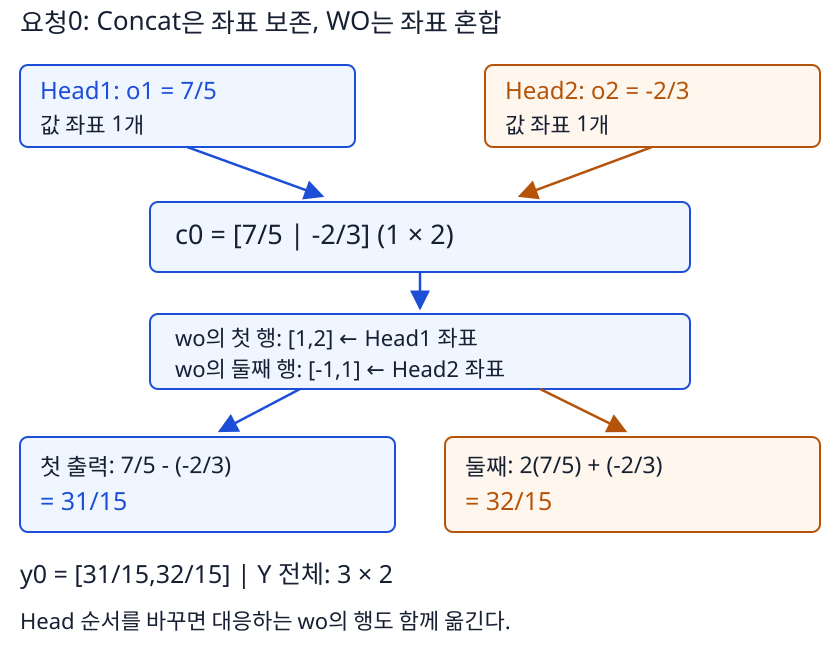{width=98% #s05-fig-combine}

\Needspace{15\baselineskip}

### 정리 10.5.1 Concat 뒤의 선형 변환은 Head별 변환의 합이다 {#s05-th-block}

$W_O$를 Head별 값 폭에 맞추어 행 블록 $R_r\in\mathbb R^{d_{v,r}\times d_{\rm out}}$로 나누면

$$
W_O=\begin{bmatrix}R_1\\\vdots\\R_h\end{bmatrix},\qquad
Y=\sum_{r=1}^h O_rR_r.
\tag{ 10.5.6 }\label{s05-eq-block}
$$

**증명.** 요청 i와 최종 좌표 t를 고정하자. 행렬곱은 C의 D개 좌표에 걸친 합이다. 이 좌표를 Head별 연속 구간으로 묶으면 $Y_{it}=\sum_r\sum_{u=1}^{d_{v,r}}O_{r,iu}(R_r)_{ut}$가 된다. 안쪽 합은 $(O_rR_r)_{it}$이므로 성립한다. 각 블록의 경계는 Concat 순서·폭과 같아야 한다. $\square$

이 정리는 ‘원래 Head 출력들을 더하면 된다’는 뜻이 아니다. 먼저 각 $R_r$로 출력 좌표계에 옮긴 항들을 더한다. 대표 예제는 $R_1=[1,2]$, $R_2=[-1,1]$이어서 두 Head에 서로 다른 변환을 적용한다. 값 폭이 다른 Head의 원출력은 덧셈 자체가 정의되지 않을 수도 있다.

같은 값 폭 v인 Head들을 평균한 뒤 T를 적용하는 $\bar O T$는 $R_r=T/h$를 모든 r에 사용한 특별한 경우다. 일반 $W_O$에는 이런 제약이 없다. 예를 들어 두 출력 $[a,b]=[1,0]$과 $[0,1]$은 평균이 모두1/2이지만 대표 $W_O$의 결과는 각각 $[1,2]$, $[-1,1]$이다. 평균만 남기면 이 두 경우를 같은 것으로 만들므로 원래 변환을 복구할 수 없다. 모든 가능한 Head 출력에 대한 동등성과 특정 한 입력에서의 우연한 동등성도 구별해야 한다.

### 예제 10.5.6 값 폭이 달라도 결합할 수 있다 {#s05-ex-block}

한 요청에서 $O_1=[1,2]$, $O_2=[3]$이고 $R_1=[[1,0],[0,2]]$, $R_2=[[-1,1]]$라고 하자. 두 Head의 값 폭은2와1로 다르다. 각 변환을 거치면 $O_1R_1=[1,4]$, $O_2R_2=[-3,3]$이므로 합은 $[-2,7]$이다. 직접 $[1,2,3][[1,0],[0,2],[-1,1]]$를 곱해도 같다. $O_1+O_2$를 NumPy broadcasting으로 억지로 계산하는 것은 이 수학적 결합이 아니다. 여기서는 각 Head를 공통 출력 폭2로 옮긴 뒤에 합했다.

### 유제 10.5.5 Head별 변환의 기여 {#s05-u-block}

위 예제의 두 R은 유지하고 $O_1=[-1,2]$, $O_2=[4]$로 바꾸라. Head별 변환과 합을 계산하고, Concat/$W_O$ 경로와 대조하라. 둘째 Head 출력을0으로 만들 때의 변화량도 적어라.

### Head 번호는 임의지만 좌표 대응은 임의가 아니다 {#s05-order}

Head1과 Head2라는 이름은 바꾸어도 된다. 그러나 저장된 $W_O$의 첫 행이 어느 Head 좌표를 받도록 정해졌는지는 계산의 일부다. 이름만 바꾸는 일과 C의 열 순서를 실제로 바꾸는 일은 다르다.

\Needspace{18\baselineskip}

### 예제 10.5.7 Head만 바꾸면 생기는 오류 {#s05-ex-swap}

대표 예제의 요청0에서 Concat을 $[-2/3,7/5]$로 뒤집고 $W_O$를 그대로 쓰면

$$
[-2/3,7/5]\begin{bmatrix}1&2\\-1&1\end{bmatrix}
=[-31/15,1/15].
$$

원래의 $[31/15,32/15]$와 다르다. 입력 좌표의 자리는 바뀌었는데 그 자리에 대응하는 변환을 바꾸지 않았기 때문이다. $W_O$의 두 행도 바꾸면

$$
[-2/3,7/5]\begin{bmatrix}-1&1\\1&2\end{bmatrix}
=[31/15,32/15]
$$

로 돌아온다. Head 순서를 바꾸면서 Q/K/V 투영과 해당 Mask도 한 묶음으로 옮겨야 ‘같은 Head의 출력’을 옮긴 계산이 된다.

\Needspace{18\baselineskip}

### 정리 10.5.2 Head 순열과 출력 투영의 대응 {#s05-th-permute}

이미 계산된 Head 출력의 좌표들을 순열 행렬 P로 옮겨 $C'=CP$로 만들자. 순열 행렬은 각 행·열에1이 하나씩 있는 $D\times D$ 행렬이며 $PP^\top=I$를 만족한다. 출력 투영도 $W'_O=P^\top W_O$로 바꾸면

$$
C'W'_O=CP P^\top W_O=CW_O=Y.
\tag{ 10.5.7 }\label{s05-eq-permute}
$$

**증명.** P는 좌표를 재배치하고 $P^\top$는 그 재배치를 되돌린다. 중간 두 행렬의 곱이 I이므로 위 등식이 성립한다. Head의 값 폭이 다르면 Head 하나의 좌표 구간 전체를 옮기는 D차원 순열을 사용한다. h차원 순열을 그대로 D차원 C에 곱해서는 안 된다. $\square$

조건은 출력 좌표 묶음과 $W_O$의 대응 입력 축을 **같이** 옮긴다는 것이다. 이 책은 행 벡터에 오른쪽에서 $W_O$를 곱하므로 대응 입력 축은 $W_O$의 행이다. 반대 저장 규약을 쓰는 구현에서는 그에 맞는 축을 찾아야 한다. 단순히 $W_O$의 열을 바꾸면 최종 출력 좌표를 바꾸는 다른 연산이 된다.

$W_O$를 고정하고 C만 바꾼 차이는 $C(P-I)W_O$다. 특정 C에서 이 값이0이면 우연히 보존될 수 있다. 모든 가능한 C에 대해 보존하려면 $(P-I)W_O=0$이어야 한다. 필요성은 C의 한 행에 각 표준기저 벡터를 차례로 넣으면 알 수 있고, 충분성은 곱이0인 것에서 즉시 나온다. 교환되는 입력 행들의 변환이 같다면 이 특별한 조건이 가능하지만 일반 $W_O$에는 강제되지 않는다.

### 유제 10.5.6 값 폭이 다른 순서 바꾸기 {#s05-u-order}

어느 요청에서 $O_1=[1,2]$, $O_2=[3]$이고 $W_O=[10,100,1000]^\top$다. 원래 출력, Head2를 먼저 붙이고 $W_O$를 유지한 출력, 대응 행을 함께 옮긴 출력을 구하라. 새 $W_O$의 행 순서를 쓰고 왜 Head 번호 두 개만으로 행을 골라서는 안 되는지 설명하라.

#### 이해 확인 — 우연히 같은 답 {#s05-check-permute}

한 입력에서 두 Head의 출력이 같아서 순서를 바꿔도 Y가 같았다. 이 결과가 그 $W_O$를 모든 입력에서 그대로 써도 된다는 증거인가? [해설](SOLUTIONS.md#solution-s05-check-permute)을 보자.

### 출처·접근 정책·Head는 서로 다른 선택이다 {#s05-mask}

Self/Cross는 Q와 K/V의 **출처**를, Mask는 요청–제공 쌍의 **접근 허용**을, Multi-head는 투영과 집계를 **몇 벌 계산하고 결합하는지**를 정한다. 따라서 Multi-head는 Self/Cross와 대립하는 세 번째 출처 유형이 아니다. 같은 X에서 여러 Head를 만들면 Multi-head Self-attention이고, H가 요청하고 Z가 제공하는 구조에 여러 Head를 두면 Multi-head Cross-attention이다.[^s05-source]

### 예제 10.5.8 Cross로 바꾸거나 접근을 닫기 {#s05-ex-cross-mask}

대표 X를 Z로 쓰고 요청 표현을 $H=[[1,0,1],[0,1,1]]$로 바꾸자. 두 질의 투영에만0행을 하나씩 덧붙여 $W_{Q,1}=[1,0,0]^\top$, $W_{Q,2}=[0,1,0]^\top$로 둔다. 키/값 투영은 그대로다. 각 Head의 Q는 원래 첫 두 행이고 K/V는 원래 세 행이므로 A는 $2\times3$, O는 $2\times1$이다. 모든 열 허용이면 C는 대표 계산의 첫 두 행이다. 요청 폭3으로 반환하려고

$$
W_O^{\rm cross}=\begin{bmatrix}1&2&0\\-1&1&1\end{bmatrix}
$$

를 적용하면 $Y=[[31/15,32/15,-2/3],[-8/39,164/39,20/13]]$이다. 최종 shape는 $2\times3$이며 H의 두 위치에 전달된다. Z의 세 위치에 대한 새 표현이 직접 반환되는 것은 아니다. 수치 일부가 대표 Self와 같아도 출처와 반환 위치는 달라졌다.

다시 대표 Self로 돌아와 두 Head 모두에 $B_{r,ij}=[j\le i]$를 적용하자. 요청0은 각 Head에서 열0만 읽으므로 $o_{1,0}=2$, $o_{2,0}=-1$, $y_0=[3,3]$이다. 요청1은 Head1에서 점수 $[0,0]$·비율 $[1/2,1/2]$, Head2에서 점수 $[0,L_3]$·비율 $[1/4,3/4]$를 사용한다. 따라서

$$
O_1^{\rm causal}=\begin{bmatrix}2\\3/2\\7/5\end{bmatrix},\quad
O_2^{\rm causal}=\begin{bmatrix}-1\\2\\-36/13\end{bmatrix},\quad
Y^{\rm causal}=\begin{bmatrix}3&3\\-1/2&5\\271/65&2/65\end{bmatrix}.
$$

요청0에서 Head1만 Causal로 닫고 Head2는 전부 열어 두면 결과는 $[2,-2/3]W_O=[8/3,10/3]$이다. 미래 위치의 값이 Head2를 통해 결합으로 들어올 수 있다. Head가 여러 개라고 잘못된 Mask가 자동으로 해결되지 않는다. 과제의 접근 제한을 각 Head에 정확히 적용해야 한다.

Head마다 다른 접근 관계를 설계할 수도 있다. 예를 들어 허용된 과거 중 가까운 위치만 읽는 Head와 전체 과거를 읽는 Head를 둘 수 있다. 모두가 지켜야 하는 미래 차단·패딩 제약은 어느 Head에서도 빠뜨려서는 안 된다. 어떤 제공 위치 t를 요청 i의 모든 Head에서 닫으면, H를 고정하고 그 제공 위치의 유한한 K/V만 바꾸는 한 모든 $o_{r,i}$와 $y_i$는 불변이다. 이는 허용 항만 분모와 집계에 참여하기 때문이다. Self에서 요청 i 자체의 표현을 바꾸거나 이미 미래 정보를 포함한 H를 쓰는 경우까지 이 국소 보장을 확대할 수 없다. $W_O$의 우연한 상쇄도 접근 정책의 대체가 아니다.

### 유제 10.5.7 한 Head에서만 닫힌 패딩 {#s05-u-mask}

대표 Self의 요청1에서 열2가 패딩이다. Head1만 이 열을 닫고 Head2는 열어 놓았을 때와, 두 Head 모두 닫았을 때의 O 두 개와 Y를 구하라. 앞의 경우 패딩 V의 변화를 차단한다고 말할 수 있는가?

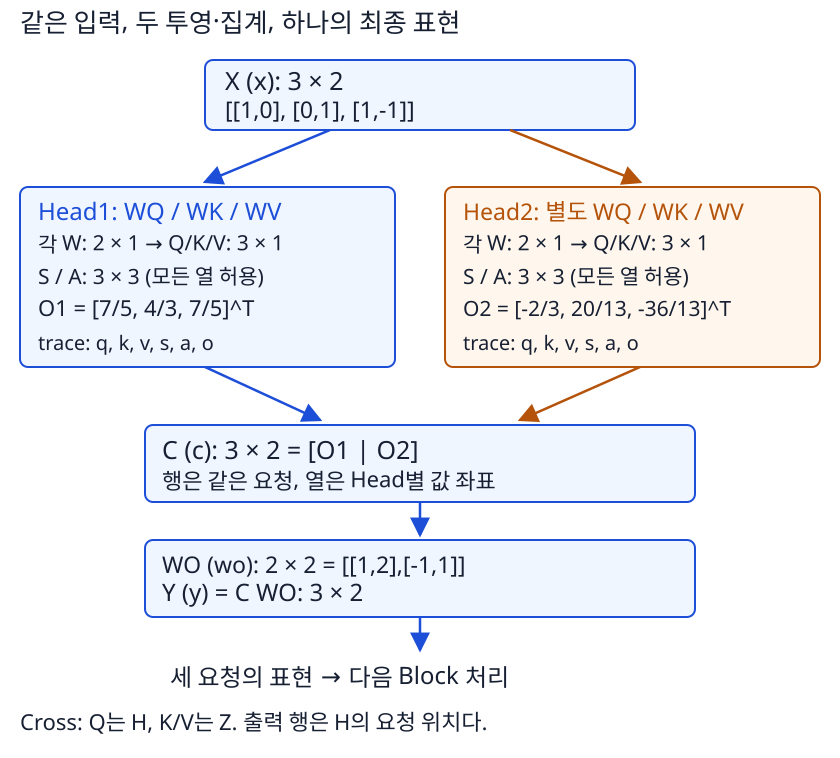{width=100% #s05-fig-flow}

### 코드에서는 어떤 축을 확인해야 할까? {#s05-code}

아래 핵심 함수는 각 Head에 별도 `(wq,wk,wv)`와 Mask를 전달하고 중간 Q/K/V/S/A/O를 반환한다. Head별 폭이 달라도 작동하도록 배열 하나에 억지로 쌓지 않고 목록을 사용한다. 수학적으로 병렬인 계산을 읽기 쉬운 Python 반복문으로 실행한 것이며 여러 장치에 나누는 실행 정책을 뜻하지 않는다.

```{.python .numberLines source-root="." source="learning-source/heads.py" source-start="18" source-end="32" source-revision="heads-source-v0.1"}
```

`masked_attention`은 [정의 10.3.3](#s03-def-masked)의 실제 구현으로 비교 폭 검사, scaling, Head별 허용 열 Softmax와 AV를 수행한다. `project`는 입력 폭과 투영 첫 축을 검사한다. Concat의 `axis=1`은 `(요청, 값 좌표)`의 값 좌표 축이다. 배치가 추가되어 `(batch, head, query, value)`를 사용한다면 Head 축과 값 축을 원하는 순서로 정렬한 뒤 합쳐야 한다. `reshape` 한 줄은 의미상 축의 이동을 대신하지 않는다.

같은 폭의 여러 W를 큰 행렬 $[W_{Q,1}|\cdots|W_{Q,h}]$에 모아 H와 한 번에 곱할 수는 있다. 이 경우에도 각 열 블록의 매개변수는 다르다. 곱의 실행을 묶는 것과 모든 Head가 같은 $W_Q$를 공유하는 것은 다르다. Q/K/V를 한 번만 계산한 뒤 복사하는 구현은 일반적인 독립 투영을 구현하지 않는다. 공유한 투영에서도 별도 Mask나 값이 다른 경우 출력이 달라질 수 있으므로, ‘출력이 다름’만으로 올바른 독립 투영을 증명하지도 못한다.

| 흔한 오류 | 실제 확인과 수정 |
|---|---|
| Head별 W 대신 하나를 복사 | Head별 매개변수 블록과 실제 Q/K/V를 대조 |
| Head 수를 요청 길이로 사용 | h와 m/n을 별도 기록, 각 O의 행은 m |
| 같은 Head의 Q/K 폭 불일치 | 내적 전에 두 마지막 폭을 검사 |
| 값 폭을 최종 폭이라고 단정 | $d_{v,r}$·D·$d_{\rm out}$을 각각 기록 |
| 행 방향 Concat 또는 잘못된 flatten | 같은 요청 행의 Head 좌표가 이웃하는지 확인 |
| $W_O$의 입력 폭 오류 | 첫 축이 $\sum_r d_{v,r}$인지 검사 |
| Head 순서와 $W_O$ 불일치 | 해당 좌표 구간과 대응 행을 함께 이동 |
| 평균을 원래 연산으로 대체 | 블록 변환이 모두 $T/h$인 조건인지 확인 |
| Mask를 한 Head에만 적용 | 각 A의 차단 셀0·허용 분모를 따로 검사 |

Learning Source에서는 다음을 실행한다. CPU 고정 환경은 앞 절의 `pyproject.toml`과 `uv.lock`을 그대로 사용한다. 첫 명령은 아직 환경이 없을 때 필요하며 인터넷 없이 설치하려면 의존성이 이미 캐시에 있어야 한다.

```bash
uv sync --locked
uv run --locked python demo_heads.py
uv run --locked python verify_heads.py
```

실제 디렉터리는 `chapters/transformer/learning-source/`다. demo는 모든 중간값·shape와 Concat, 최종 Y, 잘못/올바르게 바꾼 순서, Causal Y를 출력한다. 검증 코드는 NumPy 행렬곱·지수·Softmax를 사용하지 않는 별도의 Decimal 스칼라 계산으로 투영부터 Y까지 대조한다. 검증이 통과했다는 사실은 학습된 Head의 의미나 모든 입력에서의 부동소수점 정확도를 보장하지 않는다.

#### 이해 확인 — 실행되는 잘못된 코드 {#s05-check-code}

두 O가 모두 $3\times1$일 때 `np.concatenate(outputs, axis=0)`도 실행된다. 왜 요구된 Concat이 아닌가? $W_O$를 그 배열에 맞게 바꾸어 실행하면 원래 Multi-head가 되는가? [해설](SOLUTIONS.md#solution-s05-check-code)을 보자.

### 다음 처리에 넘기는 것은 무엇인가?

이 절의 반환은 $Y=CW_O$까지다. Transformer에서는 이 결과를 Attention 하위 연산의 출력으로 사용하고 residual 경로·정규화·FFN 등과 연결한다. 입력과 더할 설계라면 출력 폭을 받는 표현 폭과 맞추어야 한다. $W_O$ 자체를 FFN이라고 부르거나, Y를 이미 전체 Block의 최종 출력이라고 부르면 뒤의 처리를 빠뜨린다. 상세 배치는 [10.7절](#sec-block)에서 다룬다.

각 Head는 입력의 투영과 내용 비교를 바꿨지만, 지금까지 위치를 나타내는 별도 신호는 더하지 않았다. 전부 허용하는 Self-attention에서 모든 위치를 같은 방식으로 옮기면 출력도 대응해 옮겨진다는 앞 절의 성질은 여러 Head와 $W_O$ 뒤에도 이어진다. Head가 늘어난 사실만으로 절대 위치·거리의 정보가 생기지는 않는다. 다음 [10.6절](#sec-position)에서는 내용이 같아도 위치와 순서에 따라 비교가 달라지도록 만드는 방법을 배운다.

\clearpage

### 절 종료 연습문제 {#s05-practice}

각 문제에서 요청/제공/Head/좌표 축을 먼저 적고 계산하자. ★는 전체 연산과 주요 오류를 점검하는 핵심 문제다. 유제7·독립22·심화3과 짧은 이해 확인5의 답은 [별도 해설서](SOLUTIONS.md#solution-sec-heads)에 있다. 독립 문제의 수치와 설계는 대표 예제의 답을 그대로 복사해서는 해결되지 않도록 바꾸었다.

### 실제 계산과 차원

### 연습문제 10.5.1 ★ 두 Head의 새로운 전체 계산 {#s05-p01}

$X=[[1],[0]]$에 두 Self Head를 둔다. Head1은 $W_Q=[1],W_K=[\ln2],W_V=[3]$, Head2는 $W_Q=[-1],W_K=[\ln2],W_V=[6]$이다. 모두 허용하고 $W_O=[[2,-1],[1,1]]$로 둔다. 각 Q/K/V/D/S/A/O와 C/Y, 모든 shape를 계산하라. 두 A가 실제로 다른지 확인하라.

### 연습문제 10.5.2 ★ 세 Head의 서로 다른 폭 {#s05-p02}

H는 $2\times5$, Z는 $4\times7$이다. 세 Head의 $(d_k,d_v)$는 $(1,2),(3,1),(2,4)$이고 최종 폭은5다. 각 W·Q/K/V·D/S/A/O와 C/$W_O$/Y의 shape를 모두 적어라. 입력 폭5를3으로 나눌 수 없어서 불가능하다는 주장을 평가하라.

### 연습문제 10.5.3 Scaling 폭 바꾸기 {#s05-p03}

대표 예제의 각 Head에서 $Q'_r=[Q_r,0]$, $K'_r=[\sqrt2K_r,0]$, V/B는 그대로로 둔다. 새 비교 폭에서 D/S/A/O/Y가 어떻게 되는지 계산하라. K에 $\sqrt2$를 곱하지 않으면 Head1 요청0의 비율은 무엇인가?

### 연습문제 10.5.4 ★ 실제 Concat과 출력 변환 {#s05-p04}

두 요청에서 $O_1=[[1,2],[3,4]]$, $O_2=[[5],[6]]$이고 $W_O=[[1,0],[0,1],[2,-1]]$이다. C/Y를 계산하고 각 최종 좌표가 어느 Head 좌표들을 사용하는지 적어라. O의 단순 합이 정의되는가?

### 연습문제 10.5.5 같은 평균, 다른 최종 출력 {#s05-p05}

대표 $W_O$에서 Head 출력 행이 $[a,b]=[1,0]$ 또는 $[0,1]$인 두 경우를 비교하라. 평균과 Y를 계산하고 평균만 받은 어떤 결정적 함수가 두 Y를 모두 복구할 수 있는지 증명하라.

### 연습문제 10.5.6 Head의 수와 출력의 폭 {#s05-p06}

X는 $9\times10$이다. 네 Head의 비교 폭은 모두3, 값 폭은 모두2, 최종 폭은10이다. Q/K/V/A/O/C/$W_O$/Y를 쓰고 ‘각 Head의 입력은 $9\times(10/4)$’라는 설명을 고쳐라. 균등 분할 구현만 허용하는 별도 API에서는 무엇을 확인해야 하는가?

### 순서·조건·반례

### 연습문제 10.5.7 ★ Head만 교환한 결과 {#s05-p07}

대표 예제에서 세 요청 모두의 Concat 순서를2→1로 바꾸고 $W_O$는 유지하라. 새 Y를 계산한 뒤 대응 행도 바꾼 결과와 비교하라. 출력 행·열 중 어느 축이 Head 순서 변경으로 이동했는가?

### 연습문제 10.5.8 블록 폭이 다른 순열 {#s05-p08}

세 Head의 출력 한 행은 $[1,2]$, $[3]$, $[4,5]$다. 원래 $W_O=[1,10,100,1000,10000]^\top$이다. 순서3→1→2의 C와 대응 $W'_O$를 쓰고 두 최종 출력이 같은지 계산하라.

### 연습문제 10.5.9 순서만 바꾸어도 항상 보존되는 조건 {#s05-p09}

두 Head의 값 폭이1이고 $W_O$의 두 행은 $R_1,R_2$다. 모든 가능한 $[a,b]$에서 Head 교환 후에도 $W_O$를 그대로 쓸 수 있는 필요충분조건을 도출하라. 한 입력에서 a=b인 경우와 구별하라.

### 연습문제 10.5.10 독립 Head인데 같은 출력 {#s05-p10}

서로 다른 A를 만드는 두 Head에서 V의 모든 행이 같은 벡터 c라고 하자. 모든 유효 요청에 두 O가 같음을 증명하라. 투영 매개변수까지 같아야 한다는 결론이 나오는가? 비활성 질의0 계약도 따로 설명하라.

### 연습문제 10.5.11 하나로 묶은 투영과 공유 투영 {#s05-p11}

H가 $m\times d$이고 Head1/2의 질의 투영이 각각 $W_1,W_2$다. $H[W_1|W_2]=[HW_1|HW_2]$를 한 셀로 증명하라. 한 번의 행렬곱으로 구현했다는 사실이 Head들이 매개변수를 공유한다는 뜻인지 설명하라. 같은 $HW$를 복사하는 경우와 구별하라.

### 출처와 접근 경로

### 연습문제 10.5.12 Multi-head Cross 인터페이스 {#s05-p12}

문서 Z는 $6\times4$, 질문 H는 $3\times5$다. 두 Head의 비교 폭은2, 값 폭은 각각1과3이다. 질문 세 위치에 폭5의 표현을 반환하도록 투영·A/O/C/$W_O$/Y와 출처를 설계하라. 이것을 ‘Multi-head이므로 Self/Cross가 아니다’라고 부르는 설명을 고쳐라.

### 연습문제 10.5.13 두 Head의 Causal 계산 {#s05-p13}

대표 예제에서 두 Head 모두 현재 위치까지 허용하라. 요청0·1의 각 A/O와 최종 Y를 직접 계산하라. Head2만 전부 허용하면 요청0의 Y는 무엇인가? 어떤 금지 경로가 열리는가?

### 연습문제 10.5.14 Head별 허용 집합 {#s05-p14}

한 요청이 세 제공 위치를 읽는다. 두 Head의 scaled 점수는 모두 $[0,\ln2,\ln4]$, V는 모두 $[1,5,9]^\top$다. Head1은 위치0/1, Head2는 위치0/2만 허용한다. $W_O=[1,-1]^\top$일 때 각 A/O와 Y를 구하라. 위치2의 값만10으로 바꾸면 어느 Head와 최종 출력이 얼마나 변하는가?

### 연습문제 10.5.15 ★ 패딩을 모든 Head에서 닫기 {#s05-p15}

독립1의 X에서 제공 위치1만 패딩으로 지정하되 두 요청은 유효하다고 하자. 두 Head의 B/A/O와 Y를 구하라. 이어 둘째 요청을 비활성으로 바꾸면 무엇을 반환하는가? 유효 행의 모든 제공 위치를 닫으면 어떻게 해야 하는가?

### 연습문제 10.5.16 제공자 변경의 불변 조건 {#s05-p16}

Cross에서 H를 고정하고 Z의 행 t만 바꾼다. 요청 i가 모든 Head에서 t를 차단한 경우 $y_i$의 불변을 증명하라. 하나의 Head라도 t를 허용하면 반드시 변화하는가? 반례와 변화할 수 있는 예를 각각 제시하라.

### 구현·설계·검증

### 연습문제 10.5.17 ★ 잘못 결합한 코드 수정 {#s05-p17}

`outputs=[o1,o2]`이고 각 배열은 $(m,v)$다. 다음 코드의 잘못을 고치고 필요한 $W_O$ shape를 적어라. `mean`이 차원상 가능해도 일반 연산과 같지 않은 이유를 말하라.

```python
joined = np.concatenate(outputs, axis=0)
result = joined @ wo
average = np.mean(outputs, axis=0)
```

### 연습문제 10.5.18 실행되지만 순서가 틀린 reshape {#s05-p18}

$O_1=[[1],[2]]$, $O_2=[[3],[4]]$이다. `np.stack([o1,o2],axis=0)`의 shape와 원소 순서를 적어라. 그대로 `reshape(2,2)`한 배열과 올바른 C를 비교하라. `transpose`를 사용한 수정과 `concatenate`를 사용한 수정을 제시하라.

### 연습문제 10.5.19 Q/K와 $W_O$의 오류 진단 {#s05-p19}

한 로그에 $Q_1:3\times2,K_1:5\times3,V_1:5\times4$, $O_2:3\times2$, $W_O:4\times7$이 적혔다. 첫 오류와 그 오류만 고친 뒤 남는 오류를 찾아라. $K_1:5\times2$로 고칠 때 C와 올바른 $W_O$/Y를 제시하라. 이 로그만으로 Self/Cross의 실제 출처를 확정할 수 있는가?

### 연습문제 10.5.20 Learning Source로 오류를 드러내기 {#s05-p20}

대표 예제의 모든 중간값과 Y를 실행 출력과 대조하라. Head2에 Head1의 투영을 잘못 복사한 변형, Head 순서만 바꾼 변형, 한 Head만 Causal로 닫은 변형을 만들어 각 오류를 검출할 검사를 제시하라. shape만 검사해서는 왜 부족한가?

### 연습문제 10.5.21 ★ 새 인터페이스 설계와 검증 {#s05-p21}

요청 R은 $2\times7$, 제공 M은 $5\times4$다. 두 Head는 $(d_k,d_v)=(3,2),(1,3)$이고 최종 폭은7이다. 제공 위치4는 패딩이며 요청 시각 $[2,4]$, 나머지 제공 시각 $[0,1,3,4]$다. 도착한 실제 자료만 읽도록 출처·투영·각 B·A/O/C/$W_O$/Y를 설계하라. 무작위 가중치를 쓴 구현에서 shape 외에 어떤 접근/순서/출력 변환 검사를 할지 제시하라.

### 연습문제 10.5.22 여러 Head만으로 순서가 생기는가? {#s05-p22}

위치 신호 없이 전부 허용한 Self에서 X의 행을 P로 옮기면 각 Q/K/V/A/O/C/Y가 어떻게 되는지 도출하라. Head 수를 늘리면 이 성질이 사라지는가? 고정된 Causal Mask를 재사용하는 경우의 조건 차이와 다음 절에서 다룰 질문을 적어라.

### 선택적 심화

### 심화문제 10.5.1 평균으로 대체할 수 있는 정확한 조건 {#s05-c01}

모든 Head의 값 폭이 v이고 출력 폭이 d라고 하자. 임의의 독립적인 $O_1,\ldots,O_h$에 대해 $\sum_rO_rR_r=(\sum_rO_r/h)T$일 필요충분조건을 증명하라. 실제 모델이 만들어 낼 수 있는 출력 집합을 제한하면 이 조건의 필요성을 그대로 주장할 수 있는가?

### 심화문제 10.5.2 서로 다른 폭의 Head 순열 구현 {#s05-c02}

값 폭 $[2,1,3]$인 세 Head의 순서를 $[2,0,1]$로 옮기는0기반 Python 함수를 작성하라. 투영·Mask·$W_O$의 해당 행들을 함께 옮겨라. 원래/변경 Y의 동등성을 검사하고, `wo[order]`만으로 처리한 코드가 왜 틀리는지 설명하라.

### 심화문제 10.5.3 출력 변환의 보존 한계 {#s05-c03}

$D=3,d_{\rm out}=2$이고 $W_O=[[1,0],[0,1],[1,1]]$이다. 서로 다른 C행 두 개가 같은 Y를 만드는 예를 구하라. 영공간으로 이유를 설명하고, Concat이 좌표를 보존한다는 말이 최종 Y에서 모든 Head 출력을 복원할 수 있다는 뜻인지 평가하라. 학습된 의미 복원과도 구별하라.

\clearpage

\clearpage

## 10.6 위치와 순서를 Attention에 반영하기 {#sec-position}

### 내용이 같아도 순서가 다르면 무엇이 달라져야 할까? {#s06-start}

‘민수가 영희를 도왔다’와 ‘영희가 민수를 도왔다’는 등장하는 이름과 동사가 같지만 도움을 준 사람이 다르다. 실제 언어에서는 조사와 주변 표현도 단서다. 지금 생각할 질문은 그런 단서와 별개로 **각 내용이 시퀀스의 어느 위치에 놓였는가**를 계산에 어떻게 알릴지다. 앞 절의 여러 Head는 같은 입력을 서로 다른 투영으로 읽었다. 그러나 위치를 표시하는 정보가 없는 입력을 모든 위치에서 같은 방식으로 처리하면, Head를 늘리는 것만으로 ‘첫 위치’, ‘한 칸 뒤’라는 표지가 생기지는 않는다.

이 절에서는 위치 정보를 세 지점에 넣는다. 입력 표현에 벡터를 더할 수 있고, Q/K로 만든 점수에 상대 위치의 편향을 더할 수도 있으며, 이미 투영한 Q/K를 위치에 따라 회전할 수도 있다. 세 방식의 이름을 외우는 것보다 먼저 확인할 것은 위치를 넣기 전후에 **어떤 배열과 어떤 점수 항이 바뀌는가**다. 최종 가중합까지 계산하면 위치 정보가 내용의 집계에 미치는 영향을 볼 수 있다.

진입에 필요한 것은 [10.2절](#sec-scoring)의 내적·비교 폭 scaling·행별 Softmax와 [10.3절](#sec-visibility)의 허용 관계다. 행렬곱은 한 셀의 좌표 내적을 모은 것으로 복습한다. 삼각함수와 회전은 이 절에서 필요한 만큼 설명한다. 더 넓은 기초는 MATH-CALC의 삼각함수, MATH-LINALG의 선형변환과 직교행렬로 연결된다.

### 위치 표지가 없는 계산의 조건 {#s06-permutation}

먼저 전부 허용하는 Self-attention 하나를 보자. X의 모든 행에서 같은 $W_Q,W_K,W_V$를 사용하고, 별도의 위치 벡터·편향·회전·위치에 따른 접근 제한은 없다고 가정한다. dropout도 사용하지 않는다. X의 행을 바꾸는 순열행렬 P는 $P^\top P=I$이며 각 원래 행을 정확히 한 번 옮긴다.

### 정리 10.6.1 위치 신호 없는 Self-attention의 순열 등변성 {#s06-th-equiv}

위 조건에서 $F(X)=\operatorname{softmax}_{\rm row}(QK^\top/\sqrt{d_k})V$라 두면

$$
F(PX)=PF(X). \tag{ 10.6.1 }\label{s06-eq-equiv}
$$

입력 행의 이동에 출력 행이 대응해 이동하는 성질을 순열 등변성(permutation equivariance)이라 한다. 출력 배열 자체가 언제나 동일하다는 ‘불변’과 구별한다.

**증명.** $Q'=PXW_Q=PQ$, $K'=PK$, $V'=PV$다. 따라서 $S'=PSP^\top$이다. 한 행의 열 순열은 지수들의 순서만 바꾸고 합은 유지하므로 Softmax도 같은 열 순열을 따른다. 요청 행의 순열 역시 행별 계산을 옮길 뿐이다. 따라서 $A'=PAP^\top$이며

$$
O'=A'V'=PAP^\top PV=PO.
$$

각 Head에 같은 증명을 적용하면 $O_r'=PO_r$이고, 행을 맞춘 Concat은 $C'=PC$, 공유 출력 투영 뒤 $Y'=PCW_O=PY$다. Head가 여러 개인 경우에도 성립한다. $\square$

\Needspace{12\baselineskip}

### 예제 10.6.1 두 입력 행을 실제로 교환하기 {#s06-ex-permutation}

$L=\ln2$, $X=[[1,0],[2,0]]$, $W_Q=I_2$, $W_K=\sqrt2 L I_2$, $W_V=[2,0]^\top$로 둔다. 그러면 $Q=X$, $K=\sqrt2 LX$, $V=[2,4]^\top$이며 비교 폭은2다.

$$
S=L\begin{bmatrix}1&2\\2&4\end{bmatrix},\quad
A=\begin{bmatrix}1/3&2/3\\1/5&4/5\end{bmatrix},\quad
O=\begin{bmatrix}10/3\\18/5\end{bmatrix}.
$$

첫 행의 지수는2와4, 둘째는4와16이다. 두 X행을 교환하면 Q/K/V행도 교환된다. 새 S는 $L[[4,2],[2,1]]$, 새 A는 $[[4/5,1/5],[2/3,1/3]]$이며 새 V는 $[4,2]^\top$이다. 집계하면 $O'=[18/5,10/3]^\top=PO$다. 내용1에 붙어 있던 출력10/3은 그 내용이 이동한 둘째 행으로 따라갔다. 계산에 첫 행이라는 별도 표지는 없었다.

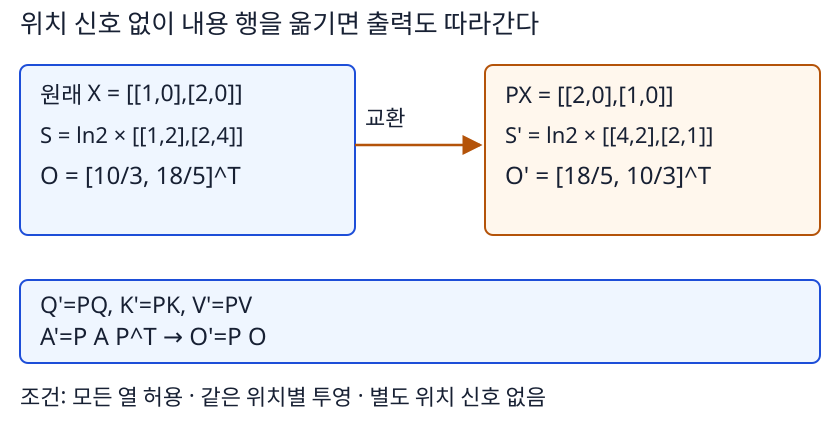{width=100% #s06-fig-permutation}

동일한 X행 두 개는 같은 Q를 가지며 같은 키 집합을 읽으므로 같은 A행과 O행을 만든다. 서로 다른 내용을 가진 행이라면 출력이 달라질 수 있지만, 그 차이를 위치 자체가 제공했다고 말할 수는 없다. 위 예제에서 마지막에 출력 합을 취하면 순열에도 합이 같다. 반면 특정 배열의 첫 출력만 뽑는 후속 연산은 위치를 구별하는 선택을 새로 도입한다.

Causal Mask를 배열 위치에 고정한 채 X만 임의로 교환하면 허용 관계는 일반적으로 $PBP^\top$로 이동하지 않는다. 앞의 증명 조건이 깨지며 결과는 단순한 PO일 필요가 없다. 그렇다고 Causal Mask가 정확한 모든 거리와 방향을 벡터로 부호화하는 것은 아니다. 이미 위치를 포함한 입력, 위치별로 다른 매개변수, 전역 선택 연산, 여러 층의 다른 정보 경로도 따로 확인해야 한다. 모델 전체가 실제로 학습한 순서 정보는 이 단일 연산의 대수적 성질만으로 판정할 수 없다.

### 유제 10.6.1 두 종류의 순열 주장 {#s06-u-equiv}

전부 허용한 위 예제에서 $O'=O$라는 주장과 $O'=PO$라는 주장을 비교하라. 두 X행을 교환한 채 배열 기준 Causal Mask를 고정하면 요청0의 원래/새 출력은 무엇인가? 정리의 어떤 가정이 달라졌는가?

#### 이해 확인 — 입력에 이미 순서가 있다면 {#s06-check-input}

외부 모듈이 순서를 반영해 만든 표현 H를 Self-attention에 넣었다. Attention에 별도 위치 벡터를 더하지 않았으므로 모델이 순서를 절대로 사용할 수 없다는 결론이 나오는가? [해설](SOLUTIONS.md#solution-s06-check-input)을 보자.

### Absolute Position은 표현을 먼저 바꾼다 {#s06-absolute}

내용을 나타내는 표현 $x_p$에 위치 p를 나타내는 같은 폭의 벡터 $e_p$를 더하자. 이 방법은 위치를 요청–제공 쌍마다 새로 계산하기 전에 각 위치의 표현에 넣는다. 원 Transformer는 Encoder와 Decoder의 입력 표현에 위치 부호화를 더했다.[^s06-absolute]

### 정의 10.6.1 절대 위치 벡터의 가산 {#s06-def-absolute}

내용 벡터와 위치 벡터가 $x_p,e_p\in\mathbb R^d$일 때 위치를 반영한 표현은

$$
\widetilde x_p=x_p+e_p. \tag{ 10.6.2 }\label{s06-eq-add}
$$

p는 실제 시퀀스 위치이고 d는 가산할 표현의 폭이다. 위치가 배열에서 재배열되었다면 그 행에 대응하는 원래 p로 $e_p$를 골라야 한다. $e_p$는 학습한 표에서 가져오거나 고정 함수로 계산할 수 있다. 같은 폭이라는 조건은 벡터 덧셈을 정의하기 위한 것이지 e와 x의 의미가 같다는 뜻은 아니다.

행 배열에서는 $\widetilde X=X+E$ 뒤 $Q=\widetilde XW_Q$, $K=\widetilde XW_K$, $V=\widetilde XW_V$를 계산한다. 가산된 표현을 세 투영에 모두 쓰면 **Q/K뿐 아니라 V도** 바뀔 수 있다. e가 특정 투영의 영공간에 있거나 그 투영에 가산 전 표현을 따로 공급한 설계라면 해당 배열은 바뀌지 않을 수도 있다. 따라서 ‘Absolute는 점수에 벡터를 직접 더한다’는 설명은 이 경로의 연산 순서를 잘못 옮긴 것이다.

한 쌍의 점수에서 무엇이 생겼는지 전개해 보자. 수학적 도출에서는 $x_i,e_i$를 열벡터로 쓰고, 실제 행배열 투영과 맞추어 $q_i=W_Q^\top(x_i+e_i)$, $k_j=W_K^\top(x_j+e_j)$라 둔다. $M=W_QW_K^\top$는 $d\times d$다. 그러면

$$
\begin{aligned}
q_i^\top k_j
&=(x_i+e_i)^\top M(x_j+e_j)\\
&=\underbrace{x_i^\top Mx_j}_{\text{내용–내용}}
 +\underbrace{x_i^\top Me_j}_{\text{내용–위치}}\\
&\quad+\underbrace{e_i^\top Mx_j}_{\text{위치–내용}}
 +\underbrace{e_i^\top Me_j}_{\text{위치–위치}}.
\end{aligned} \tag{ 10.6.3 }\label{s06-eq-expand}
$$

이 전체를 $\sqrt{d_k}$로 나눈 것이 scaled 점수다. 첫 항만 내용 비교이고 나머지 세 항이 위치에 따른 변화를 만들 수 있다. 일반 M은 항을 혼합하므로 위치–위치 항 하나만으로 결과를 설명할 수 없다. Cross에서도 서로 다른 출처 벡터와 투영을 사용해 같은 순서로 전개하되 두 입력 폭이 다르면 M은 그 두 폭에 맞춘 직사각형이다.

\Needspace{15\baselineskip}

### 예제 10.6.2 같은 비교 내용에서 가산의 효과 {#s06-ex-absolute}

이제 세 방법에서 재사용할 인공 입력을 정하자. 세 위치 $p=[0,1,2]$에

$$
X=\begin{bmatrix}1&0&2\\1&0&5\\1&0&8\end{bmatrix},\quad
W_Q=\begin{bmatrix}1&0\\0&1\\0&0\end{bmatrix},\quad
W_K=\sqrt2 L W_Q,\quad W_V=\begin{bmatrix}0\\0\\1\end{bmatrix}.
$$

세 번째 내용 좌표는 값만 제공한다. 따라서 위치를 넣기 전 Q의 모든 행은 $[1,0]$, K의 모든 행은 $\sqrt2 L[1,0]$, $V=[2,5,8]^\top$다. 모든 점수는 L, 모든 비율은1/3이며 모든 출력은5다. **전체 X행이 같은 것은 아니지만 Q/K 비교에 사용한 내용은 같다.** 이 구별 덕분에 같은 비교 내용에서 비율 변화가 서로 다른 값을 어떻게 읽는지 볼 수 있다.

교육용 절대 위치 표는 $e_0=[0,0,0]$, $e_1=[0,1,0]$, $e_2=[1,0,0]$이다. 특정 모델의 학습 결과나 원 논문의 Sinusoidal 수치가 아니다. 가산 뒤

$$
\widetilde X=\begin{bmatrix}1&0&2\\1&1&5\\2&0&8\end{bmatrix},\quad
Q=\begin{bmatrix}1&0\\1&1\\2&0\end{bmatrix},\quad K=\sqrt2 LQ.
$$

V는 이 표의 셋째 좌표가0이라 우연히 유지된다. 예를 들어 $e_1$의 셋째 좌표를1로 바꾸면 V의 둘째 행은6이 된다. Q/K가 쓰지 않는 좌표라도 집계 값에는 영향을 줄 수 있다.

$$
S=L\begin{bmatrix}1&1&2\\1&2&2\\2&2&4\end{bmatrix},\quad
A=\begin{bmatrix}1/4&1/4&1/2\\1/5&2/5&2/5\\1/6&1/6&2/3\end{bmatrix},\quad
O=\begin{bmatrix}23/4\\28/5\\13/2\end{bmatrix}.
$$

첫 행은 지수 $[2,2,4]$·합8에서 $o_0=(2+5+16)/4=23/4$를 만든다. 요청1–키2의 내적은 $2L$다. [식 (10.6.3)](#s06-eq-expand)의 네 scaled 항은 차례로 $L,L,0,0$이다. 요청1–키1은 $L,0,0,L$이므로 같은 $2L$도 다른 항의 합으로 만들어졌다. 위치 정보가 가산되었다는 선언 대신 어떤 항이 점수를 바꾸었는지 확인할 수 있다.

### 유제 10.6.2 값도 바뀌는 경우 {#s06-u-absolute}

이 예제에서 $e_1=[0,1,1]$로 바꾸고 나머지는 유지하라. Q/K/S/A가 유지되는 이유를 투영으로 설명하고 새 V/O를 구하라. 요청2–키2의 네 scaled 항을 원래 표에서 각각 계산하라.

### sin과 cos로 위치 표를 만들기 {#s06-sinusoidal}

고정 함수로 e를 만들면 위치마다 독립적인 학습 벡터를 저장하지 않아도 된다. Sinusoidal Encoding은 사인과 코사인을 사용한다. 단위원에서 양의 각도 a를 가로축의 양의 방향으로부터 반시계로 잴 때 점의 좌표는 $(\cos a,\sin a)$다. 가로 좌표인 cos는0도에서1,90도에서0,180도에서-1이 되고, 세로 좌표인 sin은 차례로0,1,0이 된다. 한 바퀴 뒤 원래 값으로 돌아온다. 음의 각도는 시계 방향이다.

공식의 각도 단위는 라디안(rad)이다. 180도는 $\pi$ rad,90도는 $\pi/2$ rad이고 한 바퀴는 $2\pi$ rad다. NumPy의 sin/cos에90을 넣으면90도가 아니라90 rad를 계산하므로 단위를 먼저 확인한다.

### 정의 10.6.2 여러 주파수의 Sinusoidal 위치 부호화 {#s06-def-sinusoidal}

이 절의 짝수 폭 d와0기반 좌표에서, 위치 p의 좌표 쌍 r에 대해

$$
e_{p,2r}=\sin(p\omega_r),\qquad
 e_{p,2r+1}=\cos(p\omega_r),\qquad
\omega_r=10000^{-2r/d},\quad 0\le r<d/2.
\tag{ 10.6.4 }\label{s06-eq-sinusoidal}
$$

p는 위치, r은 좌표 쌍 번호, $\omega_r$는 한 위치 이동마다 증가하는 각도(rad/위치)다. 각 쌍은 같은 주파수의 sin/cos로 이루어진다. 밑10000은 원 Transformer의 특정 선택이며 모든 Absolute Encoding의 정의가 아니다. 다른 주파수나 학습 가능한 표도 절대 위치를 나타내는 방법이다.

### 예제 10.6.3 위치가 바뀌면 어느 좌표가 움직이는가? {#s06-ex-sin}

폭4이면 $\omega_0=1$, $\omega_1=0.01$이다. 다음 표는 라디안으로 계산한 값을 소수 여섯 자리로 반올림했다.

| p | $\sin p$ | $\cos p$ | $\sin(0.01p)$ | $\cos(0.01p)$ |
|---|---:|---:|---:|---:|
| 0 | 0.000000 | 1.000000 | 0.000000 | 1.000000 |
| 1 | 0.841471 | 0.540302 | 0.010000 | 0.999950 |
| 2 | 0.909297 | -0.416147 | 0.019999 | 0.999800 |
| 3 | 0.141120 | -0.989992 | 0.029996 | 0.999550 |

첫 쌍은 위치0→3에서 빨리 변하고 둘째는 천천히 변한다. 여러 주파수는 서로 다른 변화 규모의 좌표를 함께 제공한다. 한 주파수의 주기적 값만 보아 멀리 떨어진 위치의 관계를 단순한 거리라고 해석할 수는 없다. 여러 주파수를 쓴다고 모든 가능한 위치가 수치적으로 완벽하게 구별되거나 학습하지 않은 길이에서 좋은 성능이 보장되는 것도 아니다.

같은 내용 $x=[1,0,-1,2]$를 위치0와1에 놓으면 가산 표현은 각각

$$
\begin{aligned}
\widetilde x_0&=[1,1,-1,3],\\
\widetilde x_1&\approx[1.841471,0.540302,-0.990000,2.999950]
\end{aligned}
$$

이다. 비교 투영 전에 이미 다른 벡터가 되었다. 학습 가능한 Absolute Position Embedding은 위치별 e 자체를 매개변수로 학습한다. 고정 Sinusoidal은 함수와 주파수를 정해 계산한다. 학습 표의 범위를 벗어난 위치에는 별도의 처리 규약이 필요하며 두 방식이 같은 위치 성질을 자동으로 공유하지는 않는다.

\Needspace{12\baselineskip}

### 정리 10.6.2 Sinusoidal 벡터의 내적과 변위 {#s06-th-sin-inner}

위 정의의 두 위치 벡터에는

$$
e_p^\top e_t=\sum_{r=0}^{d/2-1}\cos((p-t)\omega_r)
\tag{ 10.6.5 }\label{s06-eq-sin-inner}
$$

가 성립한다. **증명.** 쌍 r의 내적은 $\sin(p\omega_r)\sin(t\omega_r)+\cos(p\omega_r)\cos(t\omega_r)=\cos((p-t)\omega_r)$다. 좌표 쌍을 모두 합하면 된다. $\square$

이 관계는 절대 위치 함수가 상대 변위와 아무 관계도 없다는 주장을 반박한다. 또 $[\sin((p+u)\omega),\cos((p+u)\omega)]^\top$는 덧셈정리에 따라 $[[\cos(u\omega),\sin(u\omega)],[-\sin(u\omega),\cos(u\omega)]]$와 원래 쌍의 곱으로 나타난다. 이 쌍의 좌표 순서는 단위원의 $(\cos,\sin)$과 반대임을 주의하자.

그러나 $\cos$는 주기 함수이므로 내적이 거리 증가에 따라 항상 감소하지는 않는다. 폭2에서 변위3의 $\cos3\approx-0.989992$보다 변위4의 $\cos4\approx-0.653644$가 더 크다. 가산 후의 Attention 점수에는 M과 두 혼합 항도 있으므로, 위치 벡터 자체의 내적 성질을 전체 점수의 동시 이동 불변으로 옮길 수 없다. 학습한 임의의 절대 위치 표에는 이 항등식조차 일반적으로 성립하지 않는다.

### 유제 10.6.3 상대 변위와 실제 Attention 점수 {#s06-u-sin}

폭2 Sinusoidal의 $e_0^\top e_1$과 $e_2^\top e_3$을 계산하라. $x=[1,0]^\top$, $W_Q=W_K=I_2$일 때 가산한 두 쌍 (0,1)과 (2,3)의 **scaled 점수**도 같은가? 중간식을 써서 비교하라.

#### 이해 확인 — 절대 위치의 오해 {#s06-check-absolute}

‘Absolute는 V를 바꾸지 않는다’, ‘Sinusoidal은 상대 변위를 나타낼 수 없다’, ‘위치 벡터의 내적은 거리와 함께 반드시 감소한다’라는 세 문장에 각각 어떤 조건 또는 반례가 필요한가? [해설](SOLUTIONS.md#solution-s06-check-absolute)을 보자.

### Relative Position Bias는 점수를 직접 바꾼다 {#s06-relative}

입력에 위치를 섞는 대신 ‘이 키는 이 요청보다 한 칸 앞이다’라는 쌍의 관계로 점수를 보정할 수 있다. 내용 점수가 같아도 가까운 과거와 미래에 서로 다른 추가 점수를 줄 수 있다. 여기서는 상대 위치에 대응하는 **스칼라 편향**을 다룬다. 방향을 보존하려고 거리의 절댓값만 사용하지 않는다.

### 정의 10.6.3 상대 위치에 따른 스칼라 점수 편향 {#s06-def-bias}

요청 i의 실제 위치가 $p_Q(i)$, 키 j의 실제 위치가 $p_K(j)$이고, 상대 위치 함수 b가 주어지면

$$
\delta_{ij}=p_Q(i)-p_K(j),\qquad
S_{ij}=\frac{q_i^\top k_j}{\sqrt{d_k}}+b(\delta_{ij}).
\tag{ 10.6.6 }\label{s06-eq-bias}
$$

이 절에서 $\delta>0$은 키가 요청보다 앞선 위치, $\delta<0$은 뒤의 위치,0은 같은 위치다. Q/K는 가산이나 회전 없이 내용에서 만든 벡터로 고정한다. b는 **scaling 뒤, Mask를 반영한 Softmax 전에** 더한다. 이 규약에서 $b/\sqrt{d_k}$를 더하는 다른 식과 혼동하지 않는다. 다른 문헌/구현이 $p_K-p_Q$를 쓰면 표의 부호를 함께 바꾸어야 한다.

$A_{ij}=\exp(S_{ij})/\sum_{t\in J_i}\exp(S_{it})$는 허용 집합 $J_i$ 안에서만 정의하고 차단 셀은0으로 둔다. 집계는 여전히 $o_i=\sum_jA_{ij}v_j$다. 이 scalar 방식은 V에 위치 벡터를 직접 더하지 않지만 A를 통해 어떤 값을 얼마나 읽는지 바꾼다. 같은 행에 더한 상수 편향은 Softmax에서 소거되고, 열마다 다른 편향은 비율을 바꿀 수 있다.

\Needspace{14\baselineskip}

### 예제 10.6.4 편향 전후의 점수·비율·집계 {#s06-ex-bias}

[예제 10.6.2](#s06-ex-absolute)의 가산 전 Q/K/V와 위치 $[0,1,2]$를 쓴다. 다음은 교육용 편향 표이며 특정 학습 모델의 매개변수가 아니다.

| $\delta=p_Q-p_K$ | -2 | -1 | 0 | 1 | 2 |
|---|---:|---:|---:|---:|---:|
| $b(\delta)$ | $-\ln2$ | $\ln2$ | 0 | $\ln3$ | $-\ln3$ |

요청0의 상대 위치는 $[0,-1,-2]$다. 원래 점수 $[L,L,L]$에 $[0,L,-L]$을 더하면 $[L,2L,0]$이 된다. 지수 $[2,4,1]$·합7로부터 $a_0=[2/7,4/7,1/7]$, $o_0=(4+20+8)/7=32/7$이다. 원래 균등 비율·출력5와 달라졌다. 음의 편향을 받은 키2도 허용되어 비율1/7로 기여한다.

요청1에서는 $\delta=[1,0,-1]$이므로 점수 $[L+\ln3,L,2L]$·지수 $[6,2,4]$·비율 $[1/2,1/6,1/3]$이며 출력은 $1+5/6+8/3=9/2$다. 요청2에서는 $\delta=[2,1,0]$, 지수 $[2/3,6,2]$·합26/3으로 비율 $[1/13,9/13,3/13]$, 출력 $71/13$을 얻는다. 따라서

$$
S=\begin{bmatrix}L&2L&0\\L+\ln3&L&2L\\L-\ln3&L+\ln3&L\end{bmatrix},\quad
A=\begin{bmatrix}2/7&4/7&1/7\\1/2&1/6&1/3\\1/13&9/13&3/13\end{bmatrix},\quad
O=\begin{bmatrix}32/7\\9/2\\71/13\end{bmatrix}.
$$

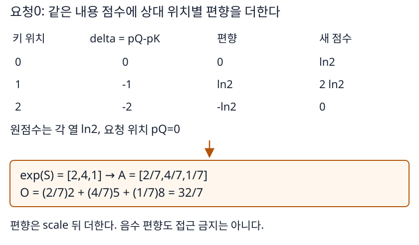{width=100% #s06-fig-bias}

요청0–키1과 요청1–키2는 둘 다 $\delta=-1$이므로 같은 편향 L을 받는다. 반면 방향을 뒤집은 요청1–키0은 $\delta=1$이므로 $\ln3$을 받는다. 같은 거리1이라고 같은 방향이 아니다. 같은 $\delta$에 같은 b를 더해도 원래 내용 내적이 다르면 최종 점수는 같을 필요가 없다. 같은 행에서 정규화할 경쟁 키 집합이 달라지면 같은 한 셀의 점수가 같은 비율을 보장하지도 않는다.

### 유제 10.6.4 편향의 부호와 Mask {#s06-u-bias}

요청 위치1, 키 위치 $[0,2]$에서 내용 scaled 점수는 모두0, 값은 $[2,8]^\top$이다. 위 표로 비율/출력을 구하라. $p_K-p_Q$를 계산하면서 표를 그대로 쓴 오류의 출력도 구하라. 올바른 계산에 Causal Mask를 적용하면 무엇이 남는가?

#### 이해 확인 — 같은 거리의 의미 {#s06-check-bias}

두 쌍이 같은 상대 위치라면 최종 점수와 Attention 비율도 항상 같은가? 어떤 양을 추가로 고정해야 하는가? [해설](SOLUTIONS.md#solution-s06-check-bias)을 보자.

스칼라 편향은 상대 위치 표현 전체의 유일한 공식이 아니다. Shaw 외의 제안은 상대 위치 벡터를 키에 더해 $q_i^\top(k_j+a^K_{ij})/\sqrt{d_k}$를 만들고, 집계에 $v_j+a^V_{ij}$를 넣는 구조도 포함한다. 추가 점수 $q_i^\top a^K_{ij}/\sqrt{d_k}$는 질의 내용에 의존한다. 원문은 상대 위치 $j-i$를 범위 안으로 잘라 사용한다.[^s06-shaw] T5 논문은 상대 위치 구간별 학습 스칼라를 logit에 더하는 방식을 설명한다.[^s06-t5] 이 절의 작은 signed 표는 T5의 전체 구간 배정과 모델을 재현한 것이 아니라 스칼라 방식의 작동 지점을 학습하기 위한 규약이다.

학습 표를 정확한 거리별로 두거나 여러 거리를 같은 구간으로 묶을 수 있다. 같은 구간이면 그 편향만으로 두 거리를 구별하지 못한다. 표현력은 표/함수·방향·Head별 매개변수와 다른 연산에 달려 있다. 어떤 선택도 모든 과제에서 자동으로 우월하다고 결론 내릴 수 없다.

### RoPE를 이해하기 위한 회전 {#s06-rotation}

회전은 벡터를 새 방향으로 옮기되 길이를 보존한다. 두 벡터를 같은 각도로 돌리면 둘 사이의 각도가 유지되지만, 다른 각도로 돌리면 내적은 달라질 수 있다. RoPE는 위치를 그런 **방향의 차이**에 넣는다. 먼저 2차원에서 부호와 곱의 순서를 고정하자.

### 정의 10.6.4 2차원 반시계 회전과 위치 회전 {#s06-def-rotation}

열벡터 $z=[z_0,z_1]^\top$의 반시계 각도 a 회전은

$$
R(a)=\begin{bmatrix}\cos a&-\sin a\\\sin a&\cos a\end{bmatrix},\qquad
R(a)z=\begin{bmatrix}z_0\cos a-z_1\sin a\\z_0\sin a+z_1\cos a\end{bmatrix}.
\tag{ 10.6.7 }\label{s06-eq-rotation}
$$

a의 단위는 rad다. 한 위치 증가당 회전각을 $\theta$로 정하면 위치 p의 각도는 $p\theta$다. RoPE(Rotary Position Embedding)는 이미 투영한 질의와 키에

$$
q_i'=R(p_Q(i)\theta)q_i,\qquad
k_j'=R(p_K(j)\theta)k_j
\tag{ 10.6.8 }\label{s06-eq-rope}
$$

를 적용한다.[^s06-rope] 여기서는 V를 회전하지 않는다. 벡터 폭은 회전 전후 모두2다. 코드의 각 행에 열벡터의 좌표를 저장하므로 행벡터에 행렬을 오른쪽 곱으로 쓸 때는 $z_{\rm row}R(a)^\top$여야 한다.

\Needspace{11\baselineskip}

### 예제 10.6.5 90도·180도의 좌표와 방향 {#s06-ex-rotation}

$z=[2,1]^\top$에서 $R(0)=I$, $R(\pi/2)=[[0,-1],[1,0]]$, $R(\pi)=[[-1,0],[0,-1]]$다. 따라서 회전 결과는 $[2,1]^\top$, $[-1,2]^\top$, $[-2,-1]^\top$다.90도에서 첫 좌표는 $0(2)-1(1)=-1$, 둘째는 $1(2)+0(1)=2$다. 세 결과의 길이 제곱은 모두5다. 위치 $[0,1,2]$와 $\theta=\pi/2$가 위 세 각도를 만든다. 이 주파수는 손계산을 위한 선택이며 원 논문의 실제 주파수 전부를90도로 돌린다는 뜻이 아니다.

### 정리 10.6.3 상대각과 직교성 {#s06-th-rotation}

모든 실수 $\alpha,\beta$에서

$$
R(\alpha)^\top R(\beta)=R(\beta-\alpha),\qquad
R(\alpha)^\top R(\alpha)=I.
\tag{ 10.6.9 }\label{s06-eq-relative-rotation}
$$

**증명.** $c_a=\cos\alpha,s_a=\sin\alpha,c_b=\cos\beta,s_b=\sin\beta$라 쓰면 곱은

$$
\begin{bmatrix}c_a&s_a\\-s_a&c_a\end{bmatrix}
\begin{bmatrix}c_b&-s_b\\s_b&c_b\end{bmatrix}
=\begin{bmatrix}c_ac_b+s_as_b&-c_as_b+s_ac_b\\
-s_ac_b+c_as_b&s_as_b+c_ac_b\end{bmatrix}.
$$

대각 항은 $\cos(\beta-\alpha)$, 오른쪽 위는 $-\sin(\beta-\alpha)$, 왼쪽 아래는 $\sin(\beta-\alpha)$다. 이 네 항은 $R(\beta-\alpha)$이며 $\beta=\alpha$일 때 I다. 따라서 $\|R(\alpha)z\|^2=z^\top Iz=\|z\|^2$다. 두 벡터에 같은 각도를 적용하면 내적도 보존된다. $\square$

### 유제 10.6.5 길이가 같으면 내적도 같은가? {#s06-u-rotation}

$q=[1,0]^\top$, $k=[0,1]^\top$에 q는0도, k는90도 회전을 적용하라. 회전 전후의 길이와 내적을 구하라. 두 벡터를 모두90도 돌린 경우와 비교하라.

### 위치 회전이 점수에서 상대 위치가 되는 과정 {#s06-relative-rope}

RoPE를 적용한 점수의 분자는 두 회전 결과의 내적이다. [정리 10.6.3](#s06-th-rotation)을 이용하면

$$
\begin{aligned}
(q_i')^\top k_j'
&=(R(p_Q(i)\theta)q_i)^\top R(p_K(j)\theta)k_j\\
&=q_i^\top R(p_Q(i)\theta)^\top R(p_K(j)\theta)k_j\\
&=q_i^\top R((p_K(j)-p_Q(i))\theta)k_j.
\end{aligned} \tag{ 10.6.10 }\label{s06-eq-rope-score}
$$

순서는 q의 회전이 전치되어 왼쪽에, k의 회전이 오른쪽에 놓인다. Relative Bias에서 정의한 $\delta=p_Q-p_K$와 연결하면 상대각은 $-\delta\theta$다. 부호를 같게 보이려고 중간에 $R(\delta\theta)$로 바꾸면 다른 점수를 만든다.

$\phi=(p_K-p_Q)\theta$, $q=[a,b]^\top$, $k=[c,d]^\top$로 직접 좌표를 전개하면

$$
q^\top R(\phi)k=(ac+bd)\cos\phi+(bc-ad)\sin\phi.
\tag{ 10.6.11 }\label{s06-eq-rope-coordinates}
$$

첫 항의 계수는 회전 전 내적, 둘째는 두 좌표 사이의 방향에 의존하는 교차항이다. q와 k가 같으면 둘째 계수는0이지만 일반 내용에서는 그렇지 않다. 위치 차이와 내용이 함께 실제 점수를 만든다. 길이를 보존한 사실만으로 서로 다른 위치의 내적이 유지된다고 말할 수 없는 이유다.

![그림 10.6.3 $q=k=[1,0]^\top$의 기하학적 비교. 요청 각도0에서 키를0/90/180도로 회전하면 분자는1/0/-1이다. 상대각은 키 각도에서 요청 각도를 뺀 값이다.](figures/position-rotation.svg){width=100% #s06-fig-rotation}

\Needspace{14\baselineskip}

### 예제 10.6.6 같은 내용, 다른 위치의 S/A/O {#s06-ex-rope}

[예제 10.6.2](#s06-ex-absolute)의 **가산 전** Q/K/V를 사용한다. $a=\sqrt2 L$, 모든 원래 질의는 $[1,0]^\top$, 키는 $[a,0]^\top$다. 위치 $[0,1,2]$와 $\theta=\pi/2$의 회전 행렬은 앞 예제의 $I,R(\pi/2),R(\pi)$다. 회전 후 행 배열은

$$
Q'=\begin{bmatrix}1&0\\0&1\\-1&0\end{bmatrix},\quad
K'=\begin{bmatrix}a&0\\0&a\\-a&0\end{bmatrix}.
$$

요청0의 내적은 $[a,0,-a]$이므로 비교 폭2로 나누면 $[L,0,-L]$다. 요청1은 $[0,L,0]$, 요청2는 $[-L,0,L]$이다. 따라서

$$
S=L\begin{bmatrix}1&0&-1\\0&1&0\\-1&0&1\end{bmatrix},\quad
A=\begin{bmatrix}4/7&2/7&1/7\\1/4&1/2&1/4\\1/7&2/7&4/7\end{bmatrix},\quad
O=\begin{bmatrix}26/7\\5\\44/7\end{bmatrix}.
$$

첫 행의 지수는 $[2,1,1/2]$·합7/2다. 값 집계는 $(4/7)2+(2/7)5+(1/7)8=26/7$이며 다른 행도 같은 V를 사용한다. 회전 전에는 세 행 모두 점수L·균등 비율·출력5였다. 이번에는 V를 그대로 두었는데도 Q/K의 상대 회전으로 읽는 비율과 출력이 달라졌다.

**위치만 바꾸는 비교.** 같은 하나의 q를 위치0 대신1에 놓고 키 위치0/1/2는 고정하면 점수 행은 $[0,L,0]$, 비율은 $[1/4,1/2,1/4]$, 출력은5가 된다. 내용 q/k와 V·주파수·허용 집합은 그대로이며 바뀐 것은 요청 위치뿐이다. 모든 위치를 함께10만큼 옮기는 실험과 구별한다. 그때는 상대 위치가 유지된다.

### 유제 10.6.6 내용 교차항이 있는 회전 점수 {#s06-u-rope}

$q=[1,0]^\top$, 키 내용 $k_0=[0,\sqrt2\ln2]^\top$, $k_1=[\sqrt2\ln2,0]^\top$, 값 $[3,9]^\top$다. 요청 위치0, 키 위치 $[1,0]$, $\theta=\pi/2$에서 회전 전후 scaled 점수·비율·출력을 구하라. 상대각 부호를 반대로 쓴 결과와도 비교하라.

#### 이해 확인 — 회전과 내적 {#s06-check-rotation}

직교행렬이 길이를 보존하므로 RoPE의 모든 점수가 회전 전과 같다는 주장은 어디에서 틀리는가? 같은 회전과 서로 다른 회전을 식으로 구별하라. [해설](SOLUTIONS.md#solution-s06-check-rotation)을 보자.

### 여러 좌표 쌍은 서로 다른 속도로 회전한다 {#s06-multiple}

실제 Q/K는 대개2차원보다 크다. 짝수 비교 폭 $d_k=2m$의 좌표를 $(0,1),(2,3),\ldots,(2m-2,2m-1)$로 묶고 쌍 r마다 $\theta_r$를 정하자. 위치 p의 전체 변환은

$$
\mathcal R(p)=\operatorname{diag}\big(R(p\theta_0),\ldots,R(p\theta_{m-1})\big),\qquad
q_i'=\mathcal R(p_Q(i))q_i.
\tag{ 10.6.12 }\label{s06-eq-block}
$$

각 블록은2×2, 전체는 $d_k\times d_k$이므로 폭은 유지된다. 여러 쌍의 점수 분자는 $\sum_rq_{i,r}^\top R((p_K-p_Q)\theta_r)k_{j,r}$다. 모든 좌표를 합친 뒤 **전체 비교 폭 $d_k$**의 제곱근으로 나눈다. 쌍마다 $\sqrt2$로 나누고 합하는 다른 계산을 하지 않는다.

원 RoPE의 일반형은 $\theta_r=10000^{-2r/d_k}$의 여러 주파수를 사용한다. 아래 손계산은 서로 다른 주파수의 블록 작동을 보기 위해 간단한 각도를 택한다. Sinusoidal 위치 벡터를 가산하는 것과, 기존 q/k 좌표 쌍을 sin/cos로 혼합하는 것은 작동 지점이 다르다.

\Needspace{12\baselineskip}

### 예제 10.6.7 4차원에서 두 주파수 {#s06-ex-four}

$q=[1,0,0,2]^\top$의 요청 위치는1, $k=[0,1,1,0]^\top$의 키 위치는2다. 주파수는 $[\pi/2,\pi/4]$다. 요청의 블록 각도는90도/45도, 키는180도/90도이다.

$$
q'=[0,1,-\sqrt2,\sqrt2]^\top,\qquad
k'=[0,-1,0,1]^\top.
$$

첫 요청 쌍 $[1,0]$는 $[0,1]$, 둘째 $[0,2]$는 $[-\sqrt2,\sqrt2]$가 된다. 키도 쌍별로 계산했다. 회전 전 내적은0, 회전 후 내적은 $-1+\sqrt2$이며 scaled 점수는 $(-1+\sqrt2)/2\approx0.207107$이다. 상대 위치 차1로 따로 계산하면 첫 쌍 $[1,0]^\top R(\pi/2)[0,1]=-1$, 둘째 $[0,2]^\top R(\pi/4)[1,0]=\sqrt2$여서 같은 합이 나온다. q의 길이 제곱은5, k는2로 유지된다.

키가 한 개만 허용되면 그 점수가 변해도 Softmax 계수는1이고 값 하나가 그대로 출력된다. 점수 변화와 비율/출력 변화를 무조건 동일시하지 않기 위해, 실제 비율 변화는 둘 이상의 경쟁 키가 있는 앞 예제에서 확인했다.

배열 구현에는 두 규약이 있다. 인접 쌍을 사용하는 Interleaved는 $(0,1),(2,3)$을 묶는다. Split-half는 폭4에서 $(0,2),(1,3)$을 묶는다. 둘은 같은 원시 배열에 적용하면 일반적으로 다른 변환이다. 인접 좌표 $[a,b,c,d]$를 $[a,c,b,d]$로 옮기는 순열 T와 주파수 대응을 함께 적용하면 동일한 수학적 쌍 회전을 다른 배열 순서로 저장할 수 있다. 기존 투영의 출력 좌표와 Q/K의 배치를 일관되게 바꾸어야 한다. ‘rotate_half’라는 함수 이름만으로 배치를 추측하지 말자.

홀수 폭의 모든 좌표를 아무 처리 없이2개씩 묶을 수는 없다. 이 절의 Learning Source는 전체 회전 폭이 짝수일 때만 허용한다. 짝수 부분만 회전하고 남은 좌표를 그대로 두는 별도 구현도 가능하지만, 회전 구간·주파수 수·전체 scaling 폭을 명시해야 한다. 홀수 폭 자체를 모든 가능한 RoPE 설계의 금지 조건이라고 확대하지 않는다.

### 유제 10.6.7 배치와 두 주파수 {#s06-u-pairs}

배열 $[1,2,3,4]$에 위치1, 주파수 $[\pi/2,0]$를 적용하라. Interleaved와 Split-half 각각의 결과를 계산하라. 둘째 규약에 입력을 재배치하고 결과를 다시 원래 배치로 돌리면 첫 규약과 맞는지 확인하라.

### 무엇을 함께 옮겨야 같은 점수가 유지되는가? {#s06-shift}

### 정리 10.6.4 고정된 내용에서 RoPE의 동시 위치 이동 {#s06-th-shift}

각 쌍의 Q/K 내용·주파수·좌표 배치를 고정하면, 모든 요청과 키 위치를 동일한 정수 c만큼 이동해도 RoPE 점수는 같다. 또한 V와 허용 관계를 고정하면 A/O도 같다.

**증명.** 각 쌍의 상대각은 $((p_K+c)-(p_Q+c))\theta_r=(p_K-p_Q)\theta_r$이다. [식 (10.6.10)](#s06-eq-rope-score)를 블록별로 합한 점수는 같고 scaling 폭도 유지된다. 허용 집합이 같으면 같은 점수 행의 Softmax가 같으며 V가 같으면 AV도 같다. $\square$

키가 도착한 시각을 비교하는 Causal 관계 $p_K\le p_Q$는 두 위치를 함께 c만큼 옮기면 유지된다. 반면 고정된 절대 시각 cutoff나 다른 접근 규칙은 허용 집합이 유지되는지 따로 검사해야 한다. q/k가 다른 입력·다른 층에서 새로 만들어졌거나 주파수를 길이에 따라 바꾸면 ‘고정 내용·주파수’ 가정이 깨진다. 정리는 전체 모델을 임의로 이동해도 출력이 항상 같다는 보장이 아니다. 부동소수점에서 큰 각도의 삼각함수 계산은 근사 오차도 만들 수 있다.

스칼라 Relative Bias도 고정된 내용·b에서 $\delta$가 유지되므로 같은 조건으로 S/A/O를 보존한다. Absolute 가산은 일반적으로 $e_{p+c}$가 달라지고 내용–위치 혼합 항도 바뀐다. Sinusoidal e 자체의 내적이 상대 변위만 쓴다는 앞 정리만으로 가산 후 전체 점수의 불변을 보장하지 못한다.

### 예제 10.6.8 거리 증가와 점수 감소는 같은 법칙이 아니다 {#s06-ex-limit}

2차원에서 $q=k=[1,0]^\top$, 요청 위치0, $\theta=\pi/2$면 분자는 위치 차0/1/2/3/4에서 $[1,0,-1,0,1]$이다. 거리2→3에서 증가하고4에서1로 돌아온다. 원 주파수 목록의 첫 쌍도 $\theta_0=1$이므로 그 쌍만 내용이0이 아니게 하면 변위3→4에서 $\cos3<\cos4$가 된다. 여러 쌍을 쓰는 일반 구조에서도 모든 내용에 대한 단조 감소를 보장할 수 없다는 반례다.

원 논문은 특정 주파수의 장거리 감쇠를 별도로 분석한다.[^s06-decay] 그 분석과 관찰을 임의의 q/k에 대한 각 점수의 단조 감소로 바꾸어 읽지 말자. 또한 긴 위치의 각도를 계산할 수 있다는 대수적 사실만으로, 학습하지 않은 무제한 Context Length의 성능이 보장되지 않는다. 학습 길이·자료·모델·주파수와 평가 조건이 필요한 별도 연구 질문이다.

### 세 경로를 같은 관점으로 읽기 {#s06-compare}

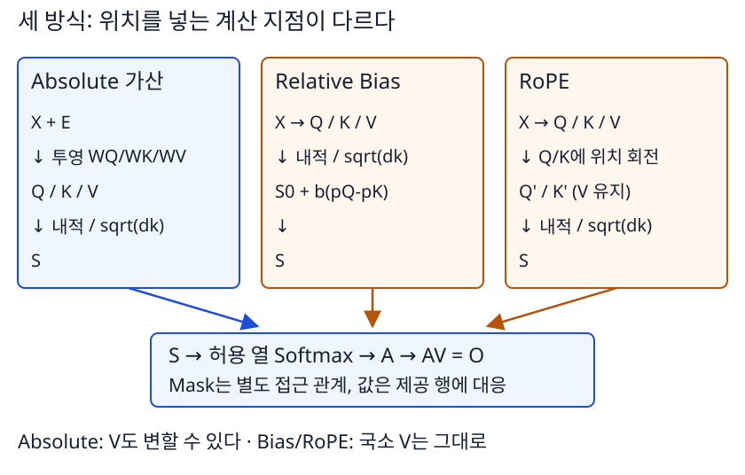{width=100% #s06-fig-paths}

### 예제 10.6.9 한 요청의 직접 비교 {#s06-ex-comparison}

[예제 10.6.2](#s06-ex-absolute)의 원래 X·투영·위치0/1/2에서 요청0만 비교하자. 네 행 모두 같은 기본 내용을 출발점으로 삼는다. Absolute만 E를 가산하고, Bias만 signed 편향 표를, RoPE만90도/위치의 회전을 도입한다. 이 예제의 E는 값 투영에 사용되는 세 번째 좌표가0이라 네 경로의 V는 모두 $[2,5,8]^\top$이다.

| 방식 | 요청0의 S | 요청0의 A | $o_0$ |
|---|---|---|---:|
| 위치 없음 | $[L,L,L]$ | $[1/3,1/3,1/3]$ | 5 |
| Absolute 가산 | $[L,L,2L]$ | $[1/4,1/4,1/2]$ | $23/4$ |
| Relative Bias | $[L,2L,0]$ | $[2/7,4/7,1/7]$ | $32/7$ |
| RoPE | $[L,0,-L]$ | $[4/7,2/7,1/7]$ | $26/7$ |

서로 다른 위치 규칙이므로 중간 Q/K까지 동일하게 강제하지 않는다. 수치의 크기로 기술의 우열을 평가할 수도 없다. 주어진 규칙이 어느 점수를 어떻게 바꿨는지 비교하는 표다.

\Needspace{16\baselineskip}

| 관찰 항목 | Absolute 가산 | Relative Bias | RoPE |
|---|---|---|---|
| 계산 지점 | 표현→투영 전에 가산 | scaled 점수→Softmax 전에 가산 | 투영 Q/K→내적 전에 회전 |
| 직접 영향 | 해당 표현의 Q/K/V·후속 경로 | S; A를 통해 집계 | Q/K; A를 통해 집계 |
| 위치 규약 | 위치별 $e_p$ | $\delta=p_Q-p_K$ | 상대각 $(p_K-p_Q)\theta_r$ |
| 필요한 구성 | 학습 표 또는 고정 함수 | 상대 위치 표/구간/함수 | 쌍 배치·회전 주파수 |
| 동시 이동 | 일반 보장 없음 | 고정 내용·b에서 S 유지 | 고정 내용·주파수에서 S 유지 |

이 표의 ‘직접 영향’은 해당 방법 하나가 국소 계산에서 바꾸는 배열이다. 여러 층 뒤의 표현이나 다른 방법을 조합한 전체 모델은 그 조건을 다시 살펴야 한다. 예를 들어 e가 투영의 영공간에 있으면 가산해도 점수가 바뀌지 않고, 같은 행의 상수 편향은 A를 유지하며, RoPE에서도 특정 q/k·위치 차에서 내적이 우연히 같을 수 있다. 방법이 적용되었다는 사실과 특정 출력이 반드시 달라진다는 주장은 별개다.

### Position과 Mask를 함께 사용하는 방법 {#s06-code}

위치는 비교에 들어갈 수 있는 정보이고 Mask는 어떤 제공 위치를 읽을 수 있는지 정하는 접근 정책이다. RoPE의 요청0에서 키2의 점수가 음수여도 비율1/7은0이 아니다. Causal로 요청0의 키1/2를 닫아야 첫 값2만 반환한다. 요청1에서는 허용 점수 $[0,L]$의 비율이 $[1/3,2/3,0]$여서 출력은4다. 요청2는 모두 허용되므로44/7이다. 위치를 넣었다고 미래 차단이 자동으로 적용되지 않는다.

Causal Mask만 있는 내용 점수L의 요청1은 두 허용 키를 $[1/2,1/2,0]$로 읽어 출력7/2를 만든다. 같은 접근 집합이라도 RoPE와 결합하면4가 된다. Mask가 과거 접근 순서를 제공하는 것과 상대각·상대 거리 표현을 제공하는 것이 다른 기능임을 실제 값으로 볼 수 있다.

각 Head에서 별도 Q/K에 RoPE를 적용하거나 Head별 b표를 사용할 수 있다. Head마다 내용 투영·비교 폭·주파수/편향과 Mask를 명시한 뒤 [10.5절](#sec-heads)의 집계·Concat·출력 투영을 그대로 이어 간다. 하나의 Head에 위치가 있고 다른 Head가 없을 수도 있지만 접근 금지는 필요한 모든 Head에 적용해야 한다.

### 유제 10.6.8 재배열 뒤 원래 위치를 유지하기 {#s06-u-mask}

RoPE 대표 예제에서 키 배열을 원래 위치 $[2,0,1]$ 순서로 재배열하라. Q행 순서는 유지하고 K/V/키 위치를 함께 옮긴다. 요청1의 Causal 허용 관계·회전 키·점수·비율·출력을 구하라. 키 위치를 잘못 $[0,1,2]$로 새로 붙이면 어떤 오류가 생기는가?

실습의 `rope`는 인접 쌍을 사용한다. 아래는 완전한 함수의 실제 발췌다. 앞 절의 `matrix`는 유한 행렬, `positions`는 실제 정수 위치와 행 대응, `frequencies`는 쌍 수/주파수를 검사한다.

```{.python .numberLines source-root="." source="learning-source/position.py" source-start="86" source-end="111" source-revision="position-source-v0.1"}
```

`p[:,None] * theta[None,:]`의 shape는 `(행 수, 좌표 쌍 수)`다. 요청 위치와 키 위치는 길이가 달라도 각각 자기 행에 맞추어 회전한다. Q의 위치 목록을 K에 무조건 재사용하지 않는다. x의 짝/홀수 열은 원래 좌표를 참조하며 두 결과를 새 out에 저장한다. 첫 좌표를 제자리로 덮어쓴 다음 둘째를 계산하면 원래 짝 좌표를 잃어 잘못된 회전이 된다.

스칼라 편향 구현은 기존 `masked_attention`에서 내용 점수와 입력 검사를 재사용한 뒤 편향을 더하고 `masked_softmax`로 다시 정규화한다. 읽기 쉬운 교육용 구성이라 원래 A/O도 한 번 계산하지만 최종 출력에는 **편향 뒤** A/O를 사용한다. 큰 모델의 최적화 구현은 점수/정규화를 분리할 수 있다. 학습·자동미분·batch·dropout·전체 Block은 이 실습의 범위 밖이다.

| 잘못되기 쉬운 지점 | 확인할 조건 |
|---|---|
| Absolute 가산의 축 | x/e의 행과 좌표 폭이 정확히 같음 |
| Bias의 부호 | $p_Q[:,None]-p_K[None,:]$, 표도 같은 부호 |
| Bias의 시점 | scaling 뒤, 허용 Softmax 전 |
| 회전의 방향 | 열벡터 $Rz$ 또는 행배열 $zR^\top$ |
| Q/K 위치 | 각자의 실제 위치 목록·원래 행 대응 |
| 좌표 쌍 | Interleaved/Split-half와 주파수 배치를 함께 확인 |
| 회전의 폭 | 짝수 회전 구간; scale은 전체 비교 폭 |
| 접근 정책 | Position과 별도의 allowed; 유효 빈행은 오류 |

실제 실행 디렉터리는 `chapters/transformer/learning-source/`다. 앞 절의 uv 환경/lockfile을 그대로 쓴다. 설치가 필요한 첫 실행에는 캐시 또는 인터넷이 필요하다.

```bash
uv sync --locked
uv run --locked python demo_position.py
uv run --locked python verify_position.py
```

demo는 가산 전 배열·Sinusoidal 표·세 경로의 S/A/O·RoPE+Causal을 출력한다. 검증은 별도 스칼라 삼각 계산·고정90도 정답·Decimal 정규화와 대조하며 수학적 증명을 대신하지 않는다. 큰 각도와 큰 값에는 부동소수점 오차/표현 한계가 있다. 교육용 위치 범위는 절댓값 $2^{31}-1$ 이하의 정수이며 모든 가능한 모델의 위치 범위로 선언하지 않는다.

#### 이해 확인 — 배열 인덱스와 위치 {#s06-check-index}

키를 원래 위치 $[7,3,5]$ 순서로 저장했다. `np.arange(3)`로 회전한 뒤 값만 같은 순서에 맞추면 원래 위치를 보존하는가? 어디에서 두 종류의 인덱스를 혼동했는가? [해설](SOLUTIONS.md#solution-s06-check-index)을 보자.

#### 이해 확인 — 어디까지 보장하는가? {#s06-check-shift}

q/k·주파수를 고정해 모든 위치를 함께 이동했다. 점수 보존으로부터 다른 Mask·다른 V·다른 입력을 가진 전체 모델의 출력 보존까지 따라오는가? [해설](SOLUTIONS.md#solution-s06-check-shift)을 보자.

### 다음에는 이 출력을 어디에 연결할까?

세 방식은 비교에 위치를 넣는 지점이 달랐다. 새로운 입력을 만나면 표현 가산 여부, scaled 점수의 추가항, Q/K 회전 여부를 확인하고, 각 항의 위치와 부호를 실제 점수로 도출하자. 이후 허용 집합과 V를 확인해야 최종 집계까지 설명할 수 있다.

이 절에서 만든 O나 여러 Head를 결합한 Y는 아직 Transformer Block 전체의 결과가 아니다. 다음 [10.7절](#sec-block)에서는 Attention 출력이 residual 표현·정규화·FFN과 어떻게 연결되는지 살펴본다. 회전한 키를 나중에 재사용할 때도 원래 위치가 중요하지만, KV Cache의 계산·갱신은 [10.9절](#sec-cache)에 남긴다.

\clearpage

### 절 종료 연습문제 {#s06-practice}

먼저 고정한 내용·위치·주파수/편향·허용 집합·값을 적자. ★는 세 방식의 계산과 주요 조건을 점검하는 핵심 문제다. 유제8·독립24·심화3과 짧은 확인6의 상세 풀이는 [별도 해설](SOLUTIONS.md#solution-sec-position)에 있다. 수치는 계산기를 사용하되 식과 부호를 설명해야 한다.

### 내용과 위치 가산

### 연습문제 10.6.1 ★ 새로운 순열 계산 {#s06-p01}

$X=[[1,0],[0,1]]$, $W_Q=I_2$, $W_K=\sqrt2\ln2 I_2$, $W_V=\operatorname{diag}(2,3)$다. 전부 허용하고 위치 신호는 없다. Q/K/V/S/A/O를 계산하고 두 X행을 교환한 결과를 비교하라. 출력의 합과 첫 출력 각각의 변화를 설명하라.

### 연습문제 10.6.2 순열 증명의 가정 {#s06-p02}

‘같은 공유 FFN을 모든 행에 적용’, ‘고정 Causal Mask’, ‘각 행마다 다른 $W_Q$’, ‘위치 정보를 가진 H를 함께 행순열’, ‘출력 모든 행의 합’, ‘배열 첫 행 선택’을 검토하라. 위치 신호 없는 정리의 계산 경로에 무엇을 추가하면 등변성 또는 출력 해석이 달라지는가? 다른 경로의 존재와 H행의 대수적 순열을 구별하라.

### 연습문제 10.6.3 Sinusoidal 좌표 계산 {#s06-p03}

폭6에서 주파수 세 개를 쓰고 위치2의 e를 계산하라. $x=[1,0,1,0,1,0]$에 가산한 표현을 적어라. 좌표 쌍 번호를1기반으로 잘못 공식에 넣으면 첫 주파수는 어떻게 달라지는가?

### 연습문제 10.6.4 ★ 네 점수 항의 실제 전개 {#s06-p04}

열벡터 $x_i=[1,2]^\top,x_j=[2,-1]^\top$, $e_i=[0,1]^\top,e_j=[1,0]^\top$, $W_Q=I_2,W_K=\operatorname{diag}(2,1)$이다. 네 내적 항과 scaled 점수, 가산 후 Q/K의 직접 내적을 대조하라. 위치–위치 항만으로 점수 변화를 설명할 수 있는가?

### 연습문제 10.6.5 가산 뒤 Q/K/V의 전달 {#s06-p05}

$x=[1,2,3]$, $e=[0,1,2]$, $W_Q=[1,0,0]^\top,W_K=[0,1,0]^\top,W_V=[[1,0],[0,1],[1,1]]$이다. 가산 전후 Q/K/V를 구하라. 어떤 투영에서 위치 정보가 사라졌고 어떤 배열에서 남았는가?

### 연습문제 10.6.6 절대 표의 동시 이동 반례 {#s06-p06}

스칼라 $x=1$, $e_p=p$, $W_Q=W_K=1$이다. 위치 쌍(0,1)과(1,2)의 점수를 비교하라. 상대 위치가 같아도 점수가 다른 이유를 네 항으로 설명하라. 임의 학습 Absolute 표에 Sinusoidal 내적 항등식을 적용할 수 있는가?

### 상대 위치와 정규화

### 연습문제 10.6.7 ★ 두 요청과 세 키의 Bias {#s06-p07}

$q_0=q_1=[1,0]^\top$, $k_0=[\sqrt2\ln2,0]^\top,k_1=[0,0]^\top,k_2=[-\sqrt2\ln2,0]^\top$, 값 $[1,4,10]^\top$이다. 요청 위치 $[1,3]$, 키 위치 $[0,2,3]$, $b(\delta)=\delta\ln2$로 둔다. 편향 전후 S/A/O를 계산하라.

### 연습문제 10.6.8 방향을 지운 편향 {#s06-p08}

요청 위치2, 키 위치 $[1,3]$에서 내용 점수는0, 값은 $[2,8]^\top$이다. $b(1)=\ln4,b(-1)=0$일 때와 부호를 지우고 두 키에 모두 $b(|\delta|)=\ln4$를 쓸 때의 A/O를 비교하라.

### 연습문제 10.6.9 같은 행의 상수 편향 {#s06-p09}

유효 요청의 허용 집합이 비어 있지 않다. 모든 허용 열에 상수 c를 더해도 A가 같음을 증명하라. 차단 열을 열지 않는다는 조건을 밝히고, 서로 다른 상수를 두 열에 더하면 달라지는 수치 예를 들라.

### 연습문제 10.6.10 두 Relative 방식의 차이 {#s06-p10}

$d_k=2$, $q=[2,0]^\top$, 키 $k=[1,1]^\top$, 상대 위치 키 벡터 $a^K=[0,3]^\top$다. Shaw 형태의 추가 점수를 구하고 q를 $[0,2]^\top$로 바꾼 결과와 비교하라. 위치만으로 정한 스칼라 b 하나가 이 두 추가 점수를 모두 나타낼 수 있는가? 값 경로의 선택도 설명하라.

### 회전과 상대 위치

### 연습문제 10.6.11 회전의 직접 좌표 {#s06-p11}

$z=[3,-2]^\top$를0/90/180/-90도로 각각 돌리고 길이 제곱을 확인하라. 행배열 `z @ R`를 쓴90도 결과를 계산하고 요구된 `R @ z`와 비교하라.

### 연습문제 10.6.12 ★ 새 RoPE 전체 계산 {#s06-p12}

$q=[1,1]^\top$, 키 내용 두 개는 모두 $[\sqrt2\ln2,0]^\top$, 값은 $[1,7]^\top$이다. 요청 위치1, 키 위치 $[0,2]$, $\theta=\pi/2$다. 회전 행렬·Q/K·scaled 점수·비율·출력을 구하고 회전 전과 비교하라.

### 연습문제 10.6.13 상대각 부호 오류 {#s06-p13}

$q=[1,0]^\top,k=[0,1]^\top$, 요청 위치0·키 위치1·$\theta=\pi/2$다. $q^\top R((p_K-p_Q)\theta)k$와 부호를 반대로 한 값을 구하라. q=k인 일부 예제만 시험하면 이 오류를 놓칠 수 있는 이유를 설명하라.

### 연습문제 10.6.14 ★ 같은 이동과 한쪽 이동 {#s06-p14}

RoPE 대표 예제의 모든 위치를7만큼 이동하라. 회전 Q/K 자체와 S/A/O 중 무엇이 같은가? 요청0 위치만1로 옮기고 키 위치를 고정한 경우의 S/A/O도 계산하라. 보존 조건을 서술하라.

### 연습문제 10.6.15 4차원 상대식 {#s06-p15}

[예제 10.6.7](#s06-ex-four)의 q/k·위치에서 주파수를 $[\pi/2,\pi/2]$로 바꿔라. 회전 후 벡터·내적·scaled 점수를 계산하고 두 블록의 상대각으로 대조하라. 왜 분모가2인가?

### 연습문제 10.6.16 거리 단조 감소의 반례 {#s06-p16}

$d_k=4$의 원 주파수 $[1,0.01]$에서 $q=k=[1,0,0,0]^\top$로 둔다. 요청 위치0, 키 위치3/4의 scaled 점수를 계산하라. 이 반례로 무엇을 부정할 수 있고 원 논문의 특정 감쇠 분석 전체에 관해서는 무엇을 추가로 검토해야 하는가?

### Mask·배열·구현

### 연습문제 10.6.17 ★ Position과 접근 금지 {#s06-p17}

RoPE 대표 예제에 Causal을 적용해 A/O 전행을 구하라. 요청0에서 키2의 점수를 단지-100으로 바꾸고 모두 허용하면 엄밀히 차단한 것과 같은가? 부동소수점 underflow와 접근 규약을 구별하라.

### 연습문제 10.6.18 제자리 회전의 오류 {#s06-p18}

다음 코드의 위치 각도는90도, 원래 x는 $[1,2]$다. 계산 결과를 추적하고 수정하라. sin/cos의 단위와 원래 두 좌표 보존을 함께 설명하라.

```python
c, s = np.cos(np.pi/2), np.sin(np.pi/2)
x[0] = c*x[0] - s*x[1]
x[1] = s*x[0] + c*x[1]
```

### 연습문제 10.6.19 편향 적용 축의 오류 {#s06-p19}

요청 위치 $[2,5]$, 키 위치 $[0,3,4]$다. 올바른 delta행렬을 쓰고 `qp[None,:]-kp[:,None]`의 shape/원소를 비교하라. Q는 $2\times4$, K는 $3\times4$일 때 어떤 축이 요청/제공인가? 결과를 전치만 하면 부호까지 해결되는가?

### 연습문제 10.6.20 ★ 실제 위치의 재배열 복구 {#s06-p20}

[유제 10.6.8](#s06-u-mask)의 재배열을 Learning Source로 구현하라. 원래/재배열 결과에서 어떤 배열이 순열되고 어떤 출력이 유지되는지 확인하라. 올바른 위치로 Causal Mask를 만들고, 새 배열 인덱스로 RoPE만 적용한 오류의 요청1 출력도 구하라.

### 연습문제 10.6.21 좌표 쌍과 홀수 폭 {#s06-p21}

폭6의 Interleaved/Split-half 쌍을 나열하라. 폭5에서 앞4좌표만 회전하고 마지막 좌표는 그대로 두는 설계를 명시하고 내적·scaling을 적어라. 제공된 `rope` 함수에 폭5를 넣으면 어떤 처리가 맞는가?

### 새 상황의 판단

### 연습문제 10.6.22 세 방법의 로그 진단 {#s06-p22}

로그 A는 $\widetilde X=X+E$ 뒤 Q/K/V를 만든다. 로그 B는 Q/K를 유지하고 $QK^\top/\sqrt{d_k}+T$를 정규화한다. 로그 C는 위치별 직교행렬로 Q/K를 바꾸고 V는 유지한다. 세 방법을 식별하고 각 로그에서 확인해야 할 위치 대응·차원·부호·Mask·추가 매개변수를 적어라. B의 T가 임의 행렬이면 반드시 Relative Bias인가?

### 연습문제 10.6.23 출력 불변의 세 반례 {#s06-p23}

위치가 계산에 도입되었지만 출력이 원래와 같을 수 있는 상황을 세 방식 각각에 제시하라. 한 허용 키, 상수 V, 투영 영공간·상수 편향·내용/각도의 특수 조건 중 필요한 것을 사용하되 어떤 배열이 실제로 바뀌었는지 구별하라.

### 연습문제 10.6.24 ★ 새로운 위치에서 세 경로 비교 {#s06-p24}

Cross 요청 H와 제공 Z의 모든 행은 $[1,0]$이다. 요청 위치1, 두 키 위치 $[0,2]$, $W_Q=I_2$, $W_K=\sqrt2\ln2 I_2$다. 값은 별도 입력 $V=[2,8]^\top$로 고정하며 키와 대응한다. Absolute는 $e_p=[0,p]$를 H/Z에만 가산, Bias는 $b(\delta)=\delta\ln2$, RoPE는 $\theta=\pi/2$다. 각 S/A/O를 계산하라. 모든 위치를1만큼 옮길 때 어떤 점수가 유지되는지 도출하고, Absolute의 V를 여기서 고정한 이유를 설명하라.

### 선택적 심화

### 심화문제 10.6.1 블록 회전과 보존 조건의 증명 {#s06-c01}

짝수 폭의 서로 다른 주파수 블록에서 $\mathcal R(p)^\top\mathcal R(t)=\mathcal R(t-p)$와 직교성·길이 보존을 증명하라. 고정 V/Mask에서 동시 이동이 A/O를 유지함을 도출하라. Q와 K에 서로 다른 주파수 목록을 적용하면 상대 위치만의 함수가 되는지 2차원 반례로 판단하라.

### 심화문제 10.6.2 Split-half를 같은 수학으로 구현하기 {#s06-c02}

인접 쌍 구현을 재사용해 Split-half 회전을 구현하라. 폭 $2m$에서 필요한 좌표 순열과 역순열을 명시하고, 같은 q/k를 재배치한 경우 두 구현의 점수가 같음을 검사하라. 같은 원시 배열을 재배치 없이 돌렸을 때 달라지는 반례와 홀수 폭 거부를 제공하라.

### 심화문제 10.6.3 가산과 회전의 이동 성질 비교 {#s06-c03}

짝수 폭 Sinusoidal e의 동시 이동에서도 $e_p^\top e_t$가 유지됨을 증명하라. $W_Q=W_K=I$에서 가산 후 점수가 유지되기 위한 네 항의 합 조건을 쓰고 같은 내용 $x=[1,0]$의 (0,1)/(2,3) 반례를 분석하라. 고정 내용 RoPE에서는 왜 혼합 가산 항을 따로 검사할 필요가 없는지 설명하라.

\clearpage

\clearpage

## 10.7 Attention 출력을 Transformer 블록으로 연결하기 {#sec-block}

### 가져온 정보가 곧 다음 층의 표현일까? {#s07-start}

어떤 단어의 표현이 주변 문장에서 필요한 정보를 가져왔다고 하자. 그 단어가 원래 가진 표현도 있고, Attention이 방금 모은 표현도 있다. 어느 것을 다음 층으로 보내야 할까? 새 집계만 전달하면 원래 표현을 직접 이어 가는 경로가 사라진다. 둘을 더하더라도 그 합의 좌표 규모를 어떻게 다룰지, 모은 특징을 어떻게 새 조합으로 바꿀지라는 질문이 남는다. **Attention을 계산했다는 사실과 하나의 Transformer 블록(Transformer block)을 완성했다는 사실은 다르다.**

앞 절들에서 우리는 집계 내용과 비교 점수, 접근 허용, Q/K/V 출처, 여러 Head의 결합, 위치의 효과를 배웠다. 이번에는 이 결과를 기존 표현에 연결하고, 한 위치의 좌표들을 신경망 정규화(normalization)와 피드포워드(feed-forward) 변환으로 처리한다. 같은 재료라도 함수가 어떤 표현을 입력으로 받는지에 따라 다른 Block이 된다. 끝에서는 동일한 두 위치 입력과 동일한 매개변수로 Post-LN과 Pre-LN을 처음부터 다시 계산한다.

[10.5절](#sec-heads)의 Concat과 출력 투영, [10.3절](#sec-visibility)의 Mask를 기억하면 된다. 행벡터 $xW$는 출력 좌표마다 x의 좌표를 가중 합한 것이다. 평균은 합을 좌표 수로 나누며 분산은 평균에서 벗어난 차이의 제곱을 평균한다. 필요한 계산은 바로 아래에서 펼친다. 더 넓은 선형변환은 MATH-LINALG, 신경망의 일반적인 Residual·Normalization은 DL의 관련 기초로 돌아가 복습할 수 있다. 여기서는 Block의 입력과 반환을 직접 계산하는 데 필요한 부분에 집중한다.

### Residual은 무엇을 이어 주는가? {#s07-residual}

새 연산의 출력으로 기존 표현을 완전히 교체하는 대신, 기존 표현에 새 출력을 더해 보자. 이때 새 출력은 기존 표현과 같은 좌표 공간으로 반환되어야 한다. Attention의 한 Head가 반환한 좁은 벡터와 모델의 표현은 아직 같은 폭이 아닐 수 있다. [10.5절](#sec-heads)에서 여러 Head를 이어 붙이고 $W_O$로 변환한 이유가 여기서 이어진다.

### 정의 10.7.1 같은 표현 공간에서의 Residual 갱신 {#s07-def-residual}

Residual Connection의 기본 갱신을 다음과 같이 정의한다.

$$
y=x+F(x), \qquad x\in\mathbb R^d, \quad F(x)\in\mathbb R^d.
\tag{ 10.7.1 }\label{s07-eq-residual}
$$

x는 갱신 전 표현, F는 하위 연산, F(x)는 그 연산이 반환한 벡터다. 덧셈은 대응 좌표별로 한다. F(x)를 ‘변화량’이라고 부르면 더하는 역할을 이해하는 데 도움이 되지만, 실제로 학습된 출력이 반드시 작거나 항상 도움이 되는 수정이라는 보장은 없다. 행렬 $X\in\mathbb R^{n\times d}$에서는 F(X)도 $n\times d$이고, 요청 행 i의 출력은 같은 행 $X_i$에 더한다. 다른 요청의 행으로 임의로 이동시켜 더하지 않는다.

**Residual Stream**은 이런 갱신 사이를 이어 가는 신경망 표현의 경로를 가리킨다. 별도 저장 장치나 추가 Attention 연산을 뜻하지 않는다. 한 지점에서는 X, 다음 지점에서는 X에 하위 연산 출력을 더한 표현이 이 경로를 따라간다. 어느 지점에 LayerNorm을 넣는지는 곧 살펴볼 설계 차이다.

### 예제 10.7.1 벡터와 요청 행을 실제로 더하기 {#s07-ex-residual}

기존 표현 $x=[1, -2, 3]$에 Attention 하위 연산이 $m=[0.5, 1, -1]$을 반환했다고 하자. 그 연산에 제공한 입력이 x였다면, 새 합은

$$
r=x+m=[1+0.5, -2+1, 3-1]=[1.5, -1, 2]
$$

다. 이후 LayerNorm을 적용하는 설계라면 그 함수의 입력은 x나 m이 아니라 r이다. 합만 다음으로 넘기는 설계라면 r 자체가 다음 경로의 표현이다. **연산에 준 입력, 반환된 보강 정보, Residual 합, 다음 함수의 입력**을 따로 이름 붙이면 순서를 놓치지 않는다.

두 요청을 함께 쓰면

$$
X=\begin{bmatrix}1&-2&3\\0&4&-1\end{bmatrix}, \quad
M=\begin{bmatrix}0.5&1&-1\\2&-0.5&3\end{bmatrix}, \quad
X+M=\begin{bmatrix}1.5&-1&2\\2&3.5&2\end{bmatrix}.
$$

첫 M행은 첫 요청의 결과다. 같은 shape라는 이유만으로 M행을 거꾸로 더하면 다른 갱신이 된다. 아래쪽 요청이 읽은 정보를 위쪽 요청에 배정하는 오류다.

### 예제 10.7.2 Head 출력과 최종 MHA 출력의 폭 {#s07-ex-width}

모델 폭3, 두 Head의 값 폭이 각각1이면 $O_1, O_2$는 $n\times1$, Concat C는 $n\times2$다. $X:n\times3$에 C를 직접 더할 수 없다. $W_O:2\times3$가 다음처럼 주어지면

$$
W_O=\begin{bmatrix}1&0&1\\0&1&-1\end{bmatrix}, \qquad
[2, -1]W_O=[2, -1, 3]
$$

이고 최종 MHA 출력 M은 $n\times3$이 된다. 요청 표현 $[1, 0, 2]$에는 $[2, -1, 3]$을 더해 $[3, -1, 5]$를 만들 수 있다. $O_1$만 더하거나 C를 더한 결과와는 다르다. 두 Head의 Concat 폭이 우연히 d와 같더라도, 정의한 MHA에 $W_O$가 포함된다면 그 변환을 생략해도 된다는 뜻은 아니다.

NumPy는 $(n, 1)$ 배열을 $(n, 3)$ 배열에 방송하여 실행할 수 있다. 그러나 이는 Head의 스칼라를 세 좌표에 반복해서 더한 새 연산이다. **오류 없이 실행되었다는 사실이 수학적 인터페이스가 맞다는 증거는 아니다.** 이 절의 Residual 함수는 두 shape의 exact 일치를 요구한다.

### 유제 10.7.1 반환 폭과 대응 행 {#s07-u-residual}

$X=[[1, 2, 0], [3, -1, 2]]$, $C=[[2, 1], [-1, 3]]$과 위 $W_O$를 사용하라. M과 X+M을 전행 계산하라. C의 둘째 행을 첫 X행에 더하는 것과 첫 Head만 방송하여 더하는 것은 각각 어떤 정보를 잘못 연결하는가?

#### 이해 확인 — 직접 경로의 의미 {#s07-check-residual}

Residual Connection이 있으면 x의 모든 정보를 최종 y에서 항상 복원할 수 있는가? F의 한 가지 반례를 생각하라. 기울기 문제도 모든 조건에서 해결된다고 결론 낼 수 있는가? [해설](SOLUTIONS.md#solution-s07-check-residual)에서 조건을 확인하자.

### 한 위치의 특징 좌표를 LayerNorm으로 다루기 {#s07-ln}

Residual 합에는 기존 표현과 새 변환의 크기가 함께 들어간다. 다음 하위 연산에 이 좌표를 그대로 줄 수도 있지만, 한 위치의 평균과 좌표 차이의 규모를 기준으로 바꾼 표현을 줄 수도 있다. Layer Normalization(LayerNorm, LN)은 **한 위치 안의 특징 좌표**에서 통계를 계산한다. 이 절의 X가 $n\times d$라면 n개 위치를 모아 평균하지 않고 각 행의 d개 좌표를 각각 처리한다. Ba·Kiros·Hinton은 동일 사례의 은닉 좌표에서 통계를 구하고 학습 가능한 gain과 bias를 적용하는 방법을 제시했다.[^s07-ln]

### 정의 10.7.2 마지막 특징 축의 LayerNorm {#s07-def-ln}

한 위치의 행벡터 $x=[x_1, \ldots, x_d]$에 대한 LayerNorm을 다음과 같이 정의한다. d는 양의 정수이고 모든 입력·매개변수는 유한 실수이며 $\epsilon>0$이다.

$$
\mu=\frac1d\sum_{t=1}^d x_t, \qquad
\sigma^2=\frac1d\sum_{t=1}^d(x_t-\mu)^2,
\tag{ 10.7.2 }\label{s07-eq-stat}
$$

$$
\operatorname{LN}(x)_t
=\gamma_t\frac{x_t-\mu}{\sqrt{\sigma^2+\epsilon}}+\beta_t.
\tag{ 10.7.3 }\label{s07-eq-ln}
$$

d는 특징 좌표 수, $\mu$는 그 위치의 좌표 평균, $\sigma^2$는 그 위치의 좌표 분산이다. 분모는 d이며 불편분산 추정의 d-1을 사용하지 않는다. $\epsilon$은 분모의 수치 안정화를 위한 양수다. $\gamma, \beta\in\mathbb R^d$는 정규화된 좌표에 곱하고 더하는 학습 가능한 Scale·Shift 매개변수다. 두 LN을 사용하면 각자 별도 매개변수를 가질 수 있다.

행렬에서 통계는 $\mu_i, \sigma_i^2$이고 좌표는 $\operatorname{LN}(X)_{it}$다. 같은 $\gamma_t, \beta_t$를 모든 위치에서 공유한다. Batch가 더해져 $(b, n, d)$여도 여기서는 마지막 d축만 계산한다. 다른 사례나 다른 위치는 해당 행의 통계에 들어가지 않는다. 통계 축은 구현에서 반드시 명시해야 한다.

### 예제 10.7.3 평균을 빼고 규모로 나누기 {#s07-ex-ln}

$x=[1, 3, 5]$는 평균0도 아니고 분산0도 아니다. $\mu=(1+3+5)/3=3$, 중심화 좌표는 $[-2, 0, 2]$이고

$$
\sigma^2=\frac{(-2)^2+0^2+2^2}{3}=\frac83.
$$

$\gamma=[1, 1, 1]$, $\beta=[0, 0, 0]$, $\epsilon=1/3$을 고르면 분모는 $\sqrt3$이다. 따라서

$$
\operatorname{LN}(x)=[-2/\sqrt3, 0, 2/\sqrt3]
\approx[-1.154701, 0, 1.154701].
$$

평균3이 사라지고, 평균으로부터의 차이가 동일한 분모로 나뉘었다. 이 단계만으로 무엇이 중요한 특징인지 선택한 것은 아니다. 실제 모델의 ε는 설계에 따라 다르며 이 큰 값은 손계산에서 효과를 드러내기 위한 선택이다. ε를0으로 둔 형식 계산에서는 분산이1이지만, 위 출력의 분산은 $8/9$다. 안정화 항을 넣는 효과가 실제 수치에도 남는다.

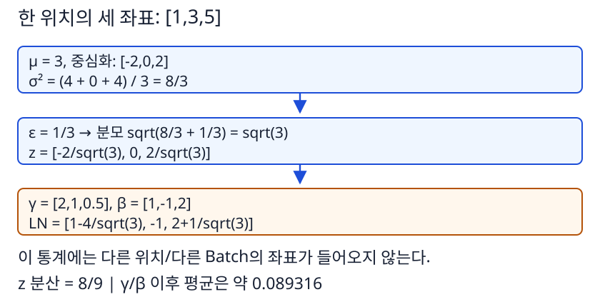{width=100% #s07-fig-ln}

### 정리 10.7.1 정규화 좌표의 통계와 출력 통계의 차이 {#s07-th-stats}

$z_t=(x_t-\mu)/\sqrt{\sigma^2+\epsilon}$라 두면 z의 좌표 평균과 분산은

$$
\overline z=0, \qquad
\operatorname{var}(z)=\frac{\sigma^2}{\sigma^2+\epsilon}.
\tag{ 10.7.4 }\label{s07-eq-zstats}
$$

**증명.** 중심화 좌표의 합은 $\sum_t x_t-d\mu=0$이다. 공통 분모로 나눠도 합은0이다. 따라서 z의 분산은 $d^{-1}\sum_t z_t^2$이고, 분모 $\sigma^2+\epsilon$을 밖으로 빼면 위 식이 된다. $\square$

$\sigma^2>0$, $\epsilon>0$이면 이 분산은1보다 작다. 최종 출력은 $\gamma_tz_t+\beta_t$이므로 좌표별 γ/β가 다르면 평균은 $d^{-1}\sum_t(\gamma_tz_t+\beta_t)$이고0일 필요가 없다. 모든 γ가 같은 g이고 모든 β가 같은 b인 특수 경우에는 평균 b, 분산 $g^2\sigma^2/(\sigma^2+\epsilon)$다. 따라서 ‘LayerNorm 출력은 항상 평균0·분산1’은 일반 LayerNorm에 대한 올바른 설명이 아니다.

\Needspace{12\baselineskip}

### 예제 10.7.4 같은 통계에서 Scale·Shift만 바꾸기 {#s07-ex-affine}

앞의 z를 두고 $\gamma=[2, 1, 0.5]$, $\beta=[1, -1, 2]$로 바꾸자. 중심화/분모는 그대로지만 출력은

$$
[1-4/\sqrt3, \ -1, \ 2+1/\sqrt3]
\approx[-1.309401, -1, 2.577350]
$$

이다. 평균은 $2/3-1/\sqrt3\approx0.089316$이다. 같은 z라도 좌표별 Scale·Shift가 달라지면 최종 좌표의 관계가 달라진다. γ/β는 각 입력에서 재계산하는 평균·분산과 달리 매개변수다.

### 예제 10.7.5 분산0과 폭1 {#s07-ex-constant}

$x=[4, 4, 4]$면 $\mu=4$, $\sigma^2=0$, 중심화 좌표는 모두0이다. ε가 없으면0/0으로 정의되지 않는다. ε가 양수이면 모든 z는0이고 어떤 유한 γ에도 $\operatorname{LN}(x)=\beta$다. 예를 들어 위 β면 $[1, -1, 2]$를 반환한다. 입력이 모두0이어야만 이 경계가 생기는 것은 아니다. 폭1이면 모든 입력이 자기 평균과 같아 항상 이 경계에 들어간다.

ε는 작은 분산에서도0 분모를 피하지만 비유한 입력을 고치지는 않는다. NaN이나 Infinity를 포함한 행, float64에서 중심화 제곱이 overflow하는 매우 큰 수에는 별도 거부/처리가 필요하다. 계산 범위를 벗어난 결과를 의미 있는 정규화 벡터라고 취급하지 않는다.

### 정리 10.7.2 LayerNorm은 일반적으로 역변환할 수 없다 {#s07-th-shift}

모든 좌표에 같은 c를 더해도, 고정된 γ/β/ε에 대해 $\operatorname{LN}(x+c\mathbf1)=\operatorname{LN}(x)$다.

**증명.** 새 평균은 $\mu+c$라서 중심화 좌표는 $(x_t+c)-(\mu+c)=x_t-\mu$다. 분산과 분모도 같다. 같은 Scale·Shift 뒤 출력도 같다. $\square$

$x=[1, 3, 5]$와 $[8, 10, 12]$는 서로 다르지만 같은 출력이다. 따라서 출력만으로 입력 평균을 복원할 수 없다. ε가 있어도 이 이동 불변은 정확한 실수 항등식이다. 입력을 a배 하는 경우에는 ε가 함께 a²배로 바뀌지 않는 한 같은 규모 불변을 일반적으로 주장할 수 없다. 수치 시험의 근사 일치와 위 항등식을 구별하자.

### 유제 10.7.2 통계·Scale·Shift를 직접 구하기 {#s07-u-ln}

$x=[2, 4, 6]$, ε=1/3에서 μ·분산·z를 구하라. γ=[1, 2, 1], β=[0, 1, -1]일 때 LN 출력과 평균을 계산하라. 입력을 [9, 11, 13]으로 옮기면 어느 값이 달라지고 어느 값이 같은가?

### 예제 10.7.6 shape가 같아도 축이 다르면 다른 함수다 {#s07-ex-axis}

$X=[[1, 3], [10, 14]]$와 ε=1/4, γ=1, β=0을 보자. 올바른 행별 통계는 평균 [2, 12], 분산 [1, 4]다. 출력은

$$
\begin{bmatrix}-2/\sqrt5&2/\sqrt5\\-4/\sqrt{17}&4/\sqrt{17}\end{bmatrix}
\approx\begin{bmatrix}-0.894427&0.894427\\-0.970143&0.970143\end{bmatrix}.
$$

반대로 각 특징 열에서 위치들을 섞으면 평균 [5.5, 8.5], 분산 [20.25, 30.25]이고 출력은

$$
\begin{bmatrix}-4.5/\sqrt{20.5}&-5.5/\sqrt{30.5}\\
4.5/\sqrt{20.5}&5.5/\sqrt{30.5}\end{bmatrix}.
$$

두 결과 모두 $2\times2$지만 첫 행의 두 번째 좌표 부호조차 다르다. 또한 둘째 위치를 바꾸면 잘못된 연산은 첫 위치의 출력까지 바꾼다. Causal Attention을 써도 이런 전역 통계를 추가하면 미래 정보 경로가 생길 수 있다.

#### 이해 확인 — ε와 γ/β {#s07-check-ln}

분산이 양수이고 ε가 양수일 때 z의 분산은 정확히1인가? γ/β 뒤 평균0을 보장할 수 있는가? 모든 좌표가 같은 입력을 서로 다르게 구별할 수 있는가? [해설](SOLUTIONS.md#solution-s07-check-ln).

### 수집한 특징을 새 조합으로 바꾸는 FFN {#s07-ffn}

Attention은 다른 위치에서 값을 모아 온다. 그 집계 뒤에는 한 위치의 특징 좌표들을 함께 읽어 새 특징을 만들 일이 남는다. 예를 들어 두 좌표의 합이 양수일 때만 한 중간 특징을 켜고, 두 좌표의 차이가 특정 수준을 넘으면 다른 특징을 켤 수 있다. 이렇게 만든 특징을 다시 모델 폭으로 반환하는 것이 Position-wise Feed-forward Network(FFN)의 역할이다. 인공 좌표에 언어적 의미를 붙이는 대신 실제 선형 조합과 활성화의 효과로 살펴보자.

### 정의 10.7.3 두 선형 변환 사이에 활성화를 둔 FFN {#s07-def-ffn}

행벡터 x에 대해 FFN을 다음과 같이 정의한다.

$$
\operatorname{FFN}(x)=\phi(xW_1+b_1)W_2+b_2.
\tag{ 10.7.5 }\label{s07-eq-ffn}
$$

$x\in\mathbb R^d$, $W_1\in\mathbb R^{d\times d_{\rm ff}}$, $b_1\in\mathbb R^{d_{\rm ff}}$, $W_2\in\mathbb R^{d_{\rm ff}\times d}$, $b_2\in\mathbb R^d$다. $d_{\rm ff}$는 중간 특징 폭이다. φ는 중간 좌표마다 적용하는 활성화다. 기본 예제는 $\operatorname{ReLU}(z_t)=\max(0, z_t)$다. 먼저 $z=xW_1+b_1$, 이어 h=ReLU(z), 마지막으로 $f=hW_2+b_2$를 계산한다. 반환 폭 d가 Residual 덧셈을 가능하게 한다.

원 Transformer의 FFN도 두 변환 사이에 ReLU를 넣고 위치마다 같은 함수를 적용한다.[^s07-ffn] 중간 폭은 모델 폭과 다를 수 있다. 큰 중간 폭은 더 많은 중간 특징을 만들지만 그 자체로 특정 성능을 보장하지 않는다. 활성화를 빼면 $xW_1W_2+b_1W_2+b_2$라는 하나의 affine 변환으로 합쳐진다. ReLU는 입력에 따라 어떤 중간 좌표가 살아남는지를 바꾸어 이 단일 변환과 다른 함수를 만든다.

### 예제 10.7.7 두 위치에서 같은 매개변수, 다른 활성화 {#s07-ex-ffn}

$d=3, d_{\rm ff}=4$와 다음 매개변수를 고르자. 이는 뒤의 완전한 Block에서도 그대로 사용한다.

$$
W_1=\begin{bmatrix}1&0&-1&1\\0&1&1&-1\\1&-1&0&0\end{bmatrix}, \quad
b_1=[0, 0.5, 0, -0.5],
$$
$$
W_2=\begin{bmatrix}0.5&0&-0.5\\0&0.5&0.5\\0.5&-0.5&0\\-0.5&0&0.5\end{bmatrix}, \quad
b_2=[0.1, -0.2, 0.3].
$$

첫 변환은 좌표 [a, b, c]를 $[a+c, b-c+0.5, -a+b, a-b-0.5]$로 만든다. 예를 들어 $x_0=[1, -1, 2]$면 $z_0=[3, -2.5, -2, 1.5]$, $h_0=[3, 0, 0, 1.5]$다. 둘째 변환 뒤

$$
f_0=[0.5(3)-0.5(1.5)+0.1, \ -0.2, \ -0.5(3)+0.5(1.5)+0.3]
=[0.85, -0.2, -0.45].
$$

다른 위치 $x_1=[-1, 2, 0]$는 $z_1=[-1, 2.5, 3, -3.5]$, $h_1=[0, 2.5, 3, 0]$를 만든다. 반환은 $f_1=[1.6, -0.45, 1.55]$다. 첫 행의 h와 둘째 행의 h는 달라도 W들은 같다. 첫 위치 계산에 둘째 위치의 원좌표를 더해 넣지 않았다.

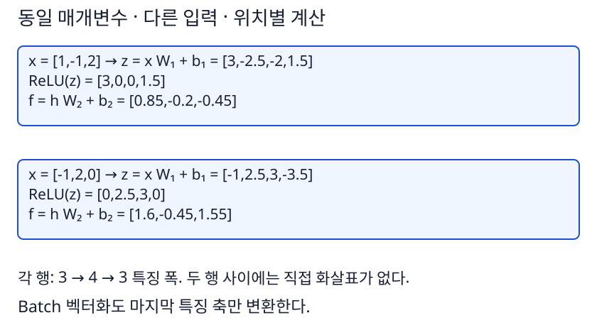{width=100% #s07-fig-ffn}

행렬 X에는 $XW_1$로 여러 행을 한 번에 계산한다. $b_1$은 모든 행에 더하되 각 행의 ReLU를 따로 적용한다. Batch 축까지 함께 벡터화할 수 있어도 이 수학적 성질은 같다. 계산을 동시에 한다는 사실과 위치 값을 섞는다는 사실을 혼동하지 말자. 다만 FFN의 입력이 이미 Attention으로 다른 위치 정보를 포함한다면 그 정보를 변환할 수 있다. ‘직접 읽지 않는다’는 말은 정보가 전혀 없다는 뜻이 아니다.

다른 Transformer에서는 활성화를 바꾸거나 Gated FFN처럼 중간 경로를 더 만들 수 있다. 그 경우 새 함수를 실제로 정의해야 한다. 이 절의 구현·수치·문제는 위 ReLU 두 변환을 사용하며 다른 변형의 결과까지 대신하지 않는다.

### 유제 10.7.3 활성화 전후를 분리하기 {#s07-u-ffn}

위 FFN에 $x=[0, 1, -1]$을 넣어 z, h, f를 구하라. ReLU를 마지막 출력에만 적용한 $\operatorname{ReLU}(zW_2+b_2)$와 같은가? 다른 위치의 입력을 바꾸어도 이 f가 유지되는 조건을 설명하라.

#### 이해 확인 — Position-wise {#s07-check-ffn}

FFN이 특징 좌표를 섞는 것과 위치를 섞는 것은 어떻게 다른가? 입력에 이미 다른 위치 정보가 있다면 FFN 출력에 그 정보가 포함될 수 있는가? [해설](SOLUTIONS.md#solution-s07-check-ffn).

### 원 Transformer의 순서: 합한 뒤 정규화하기 {#s07-post}

이제 재료를 하나로 연결하자. Vaswani 외의 원 Transformer는 Attention과 FFN 각각을 Residual Connection으로 감싸고, 그 **합 뒤에** LayerNorm을 적용했다.[^s07-post] 이 순서를 Post-LN이라 부른다. ‘Post’라는 이름보다 함수 안의 합을 먼저 보는 것이 정확하다.

\needspace{10\baselineskip}

### 정의 10.7.4 이 절의 Post-LN Block {#s07-def-post}

동일 시퀀스의 행렬 X에 대해 다음 두 갱신을 하나의 Post-LN Block으로 정의한다.

$$
U=\operatorname{LN}_1(X+\operatorname{MHA}(X)), \qquad
Y=\operatorname{LN}_2(U+\operatorname{FFN}(U)).
\tag{ 10.7.6 }\label{s07-eq-post}
$$

MHA는 각 Head의 투영·집계·Concat·출력 투영을 포함하며 $n\times d$를 반환한다. LN₁/LN₂는 각 행의 특징 축에 적용한다. U는 첫 Residual 합을 **정규화한 뒤의 표현**, Y는 둘째 합을 **정규화한 뒤의 반환**이다. MHA와 FFN의 입력은 각각 X와 U다. 입력 X를 직접 이어 가는 경로와 Attention 반환은 첫 합에서 만나고, U를 이어 가는 경로와 FFN 반환은 둘째 합에서 만난다.

원 논문 §5.4는 하위 연산 출력에 Dropout을 적용한 뒤 합산하고 정규화한다고 명시한다. 그러면 첫 식은 $\operatorname{LN}_1(X+\operatorname{Dropout}(\operatorname{MHA}(X)))$다. 손계산에서는 Dropout을 생략한다. 원 논문의 모든 학습 연산을 그대로 구현했다고 주장하지 않으며, 확률적인 학습과 확정적인 이 예제 계산을 구별한다.

### 먼저 정규화해 하위 연산에 주기 {#s07-pre}

다른 배치에서는 기존 Residual 표현을 그대로 합산 경로에 두고, 하위 연산에 주는 가지에서 먼저 정규화한다. 이 순서가 Pre-LN이다. LayerNorm을 밖에서 안으로 옮기면 하위 함수가 읽는 수치도 달라진다. 같은 MHA 반환을 고정한 채 마지막 정규화 위치만 바꾸는 비교로는 이 차이를 볼 수 없다.

### 정의 10.7.5 이 절의 Pre-LN Block {#s07-def-pre}

이 절에서는 Pre-LN의 Block 반환을 다음처럼 정의한다.

$$
U=X+\operatorname{MHA}(\operatorname{LN}_1(X)), \qquad
Y=U+\operatorname{FFN}(\operatorname{LN}_2(U)).
\tag{ 10.7.7 }\label{s07-eq-pre}
$$

U는 첫 합 자체이며 Post-LN의 U와 계산 의미가 다르다. MHA는 LN₁(X)를 Q/K/V의 출처로 읽는다. 첫 Residual은 여전히 X에 MHA 반환을 더한다. FFN은 LN₂(U)를 읽고 그 반환은 정규화 전 U에 더한다. Y는 둘째 Residual 합 자체다. **이 기준식에는 Block 뒤의 별도 최종 LN이 없다.** 여러 Block을 쌓은 모델이 마지막 예측 앞에 최종 LN을 따로 두는 것은 별도 모델 구성이다. Xiong 외의 논문에는 그런 최종 LN도 있으므로 Block의 반환과 모델의 마지막 정규화 결과를 구별해야 한다.[^s07-pre]

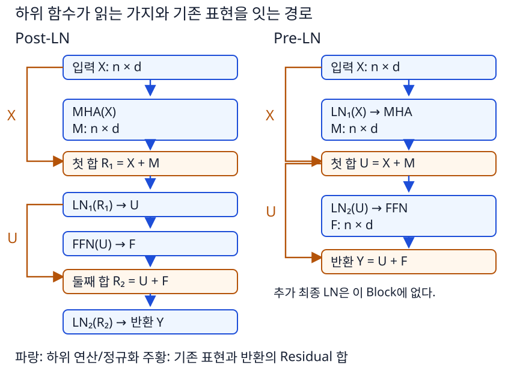{width=100% #s07-fig-paths}

| 관찰할 지점 | Post-LN | Pre-LN |
|---|---|---|
| MHA 입력 | X | LN₁(X) |
| 첫 합 | X+MHA(X) | X+MHA(LN₁(X)) |
| U의 의미 | 첫 합의 LN₁ 출력 | 첫 합 자체 |
| FFN 입력 | U | LN₂(U) |
| 둘째 합 | U+FFN(U) | U+FFN(LN₂(U)) |
| Y의 의미 | 둘째 합의 LN₂ 출력 | 둘째 합 자체 |

### 유제 10.7.4 같은 기호를 다른 입력으로 바꾸지 않기 {#s07-u-order}

‘Post-LN’ 코드가 `m = MHA(LN1(X)); u = LN1(X+m); y = LN2(u+FFN(u))`라면 정의와 일치하는가? 가장 먼저 다른 함수 입력을 찾고 고쳐라. Pre-LN에서 `y = u+FFN(u)`라 쓴 경우도 기준식에 맞게 고쳐라.

#### 이해 확인 — 반환 위치 {#s07-check-order}

Pre-LN의 반환 Y가 일반적으로 평균0이어야 하는가? 모델의 마지막에 LN이 하나 더 있다는 사실이 모든 Block의 반환을 LN 이후라고 바꾸는가? [해설](SOLUTIONS.md#solution-s07-check-order).

### 예제 10.7.8 두 위치에서 Post-LN을 끝까지 계산하기 {#s07-ex-post-full}

앞의 FFN과 $W_O$를 그대로 사용한다. 입력은 $n=2, d=3$이고 두 Head의 비교/값 폭은 각각1이다. 모든 위치를 허용하며 Attention 투영에는 Bias가 없다. 두 LN은 각각 γ=[1, 1, 1], β=[0, 0, 0], ε=0.01이다. **같은 초기 값으로 고른 별도 LN 매개변수이며 학습 후에도 같다는 가정은 아니다.** ε는 손계산에서 효과가 보이도록 고른 값이다. 아래 소수는6자리로 표시하되 다음 단계는 반올림 전 값으로 계산한다.

$$
X=\begin{bmatrix}1&0&2\\0&2&1\end{bmatrix}, \quad L=\ln2,
$$
$$
\begin{aligned}
&W_{Q1}=[1, 0, 0]^\top, \quad W_{K1}=[L, 0, 0]^\top, \quad W_{V1}=[0, 0, 1]^\top, \\
&W_{Q2}=[0, 1, 0]^\top, \quad W_{K2}=[0, L, 0]^\top, \quad W_{V2}=[1, 0, 0]^\top.
\end{aligned}
$$

MHA의 입력은 X다. Head1은 첫 특징으로 비교하고 셋째 특징을 모은다. Head2는 둘째 특징으로 비교하고 첫째 특징을 모은다. 이 선택은 작은 계산을 위한 인공 매개변수다. 실제 학습된 Head가 이런 역할을 갖는다는 측정값은 아니다.

**Head1의 투영과 집계.** $Q_1=[1, 0]^\top$, $K_1=[L, 0]^\top$, $V_1=[2, 1]^\top$다. 비교 폭1이라 scaling 분모는1이고

$$
S_1=\begin{bmatrix}L&0\\0&0\end{bmatrix}, \quad
A_1=\begin{bmatrix}2/3&1/3\\1/2&1/2\end{bmatrix}, \quad
O_1=\begin{bmatrix}5/3\\3/2\end{bmatrix}.
$$

첫 요청은 $2(2/3)+1(1/3)=5/3$을 반환한다. 둘째 요청도 첫 제공 위치의 값을 절반 읽었다. 비대각 기여가 존재한다.

**Head2의 투영과 집계.** $Q_2=[0, 2]^\top$, $K_2=[0, 2L]^\top$, $V_2=[1, 0]^\top$이며

$$
S_2=\begin{bmatrix}0&0\\0&4L\end{bmatrix}, \quad
A_2=\begin{bmatrix}1/2&1/2\\1/17&16/17\end{bmatrix}, \quad
O_2=\begin{bmatrix}1/2\\1/17\end{bmatrix}.
$$

$e^{4L}=16$이므로 둘째 요청은 제공 위치1에 큰 비율을 주지만 그 V는0이다. 큰 Attention 계수와 큰 출력 좌표는 같은 말이 아니다. MHA의 마지막은

$$
C=\begin{bmatrix}5/3&1/2\\3/2&1/17\end{bmatrix}, \qquad
M=CW_O=\begin{bmatrix}5/3&1/2&7/6\\3/2&1/17&49/34\end{bmatrix}.
$$

C는 $2\times2$, M은 $2\times3$다. Head의 폭1 결과가 아니라 이 M을 X에 더한다.

**첫 Residual 합과 LN₁.** 대응하는 행끼리 더하면

$$
R_1=X+M=\begin{bmatrix}8/3&1/2&19/6\\3/2&35/17&83/34\end{bmatrix}
\approx\begin{bmatrix}2.666667&0.5&3.166667\\1.5&2.058824&2.441176\end{bmatrix}.
$$

첫 행의 평균은 $(8/3+1/2+19/6)/3=19/9$다. 중심화 좌표는 $[5/9, -29/18, 19/18]$이고

$$
\sigma_0^2=\frac{(5/9)^2+(-29/18)^2+(19/18)^2}{3}
=\frac{217}{162}\approx1.339506.
$$

이를 $\sqrt{217/162+0.01}\approx1.161682$로 나누면 첫 U행을 얻는다. 둘째 행의 평균은2, 중심화 좌표는 $[-1/2, 1/17, 15/34]$, 분산은 $259/1734\approx0.149366$이다. 두 위치의 통계를 합치지 않는다.

$$
U=\operatorname{LN}_1(R_1)
\approx\begin{bmatrix}0.478234&-1.386877&0.908644\\-1.252485&0.147351&1.105134\end{bmatrix}.
$$

이것이 첫 갱신 이후 이어 가는 표현이며 FFN의 입력이다. 첫 U행에 M이나 R₁을 다시 FFN 입력으로 넣으면 다른 순서가 된다.

**FFN의 첫 선형 변환과 활성화.** 앞의 [a, b, c] 좌표식에 각 U행을 넣으면

$$
Z=UW_1+b_1\approx
\begin{bmatrix}
1.386877&-1.795521&-1.865111&1.365111\\
-0.147351&-0.457783&1.399837&-1.899837
\end{bmatrix},
$$
$$
H=\operatorname{ReLU}(Z)\approx
\begin{bmatrix}1.386877&0&0&1.365111\\0&0&1.399837&0\end{bmatrix}.
$$

두 위치에서 켜진 중간 특징이 다르다. 첫 위치는 첫째/넷째, 둘째 위치는 셋째가 살아남는다. 음수 값을 그대로 둘째 변환에 전달하면 ReLU FFN을 계산한 것이 아니다.

**둘째 선형 변환과 Residual.** $F=HW_2+b_2$이며 첫 행은

$$
f_0=[0.5(1.386877)-0.5(1.365111)+0.1, \ -0.2, \
-0.5(1.386877)+0.5(1.365111)+0.3]
$$

에 대응한다. 표시값으로 읽으면 첫 두 큰 항이 일부 상쇄되지만 Bias는 남는다. 반올림 전 값으로 계산한 전행 결과와 합은

$$
F\approx\begin{bmatrix}0.110883&-0.2&0.289117\\0.799918&-0.899918&0.3\end{bmatrix},
$$
$$
R_2=U+F\approx\begin{bmatrix}0.589117&-1.586877&1.197761\\-0.452567&-0.752567&1.405134\end{bmatrix}.
$$

마지막 LN의 입력은 R₂다. 우연히 이 예제의 W₂ 각 행 합이0이고 b₂ 합이0.2라서 F 각 행의 평균은1/15이다. U 평균은0이므로 R₂의 두 행 평균도1/15이다. 모든 FFN에서 그런 것은 아니다.

**LN₂와 완성된 반환.** R₂의 행별 분산은 약1.428845, 0.910748이다. 첫 행에서는

$$
y_0=\frac{[0.589117, \ -1.586877, \ 1.197761]-\frac1{15}[1, 1, 1]}
{\sqrt{1.428845+0.01}}
$$

에 해당하는 계산을 한다. 정확한 중간값을 사용한 최종 반환은

$$
Y_{\rm post}\approx
\begin{bmatrix}0.435550&-1.378506&0.942956\\-0.541119&-0.853763&1.394882\end{bmatrix}.
\tag{ 10.7.8 }\label{s07-eq-post-result}
$$

Attention은 첫 번째 반환 M만 만들었다. 여기까지 연결한 뒤에야 Block은 다음 Block이 받을 두 위치의 폭3 표현을 반환했다. 이 Y는 단어 확률이나 선택한 토큰이 아니다. 다음 표현 변환의 입력이다.

### 유제 10.7.5 한 위치의 계산을 빈칸 없이 잇기 {#s07-u-post}

대표 Post-LN의 둘째 요청에서 V₁의 두 기여, V₂의 두 기여, M, R₁의 중심화 좌표와 분모를 계산하라. 이어 U행을 사용해 Z·H·F·R₂·Y행을 연결하라. 마지막 LN 입력에 F만 넣는 오류가 어느 원래 경로를 빠뜨리는지 설명하라.

\Needspace{8\baselineskip}

### 예제 10.7.9 동일한 입력과 매개변수로 Pre-LN 다시 계산하기 {#s07-ex-pre-full}

X와 모든 매개변수·허용 관계·ε를 유지한다. 먼저 LN₁(X)를 계산한다. 두 X행 모두 평균1, 분산2/3이며

$$
\rho=\frac1{\sqrt{2/3+0.01}}=\sqrt{300/203}\approx1.215661,
\quad T=\operatorname{LN}_1(X)=\begin{bmatrix}0&-\rho&\rho\\-\rho&\rho&0\end{bmatrix}.
$$

여기서부터 Post-LN과 다르다. MHA가 읽는 출처는 X가 아니라 T다. 첫 Head의 Q/K/V뿐 아니라 둘째 Head의 세 투영도 모두 다시 만든다.

**새 Head1.** $Q_1=[0, -\rho]^\top$, $K_1=[0, -\rho L]^\top$, $V_1=[\rho, 0]^\top$. $a=\rho^2L=(300/203)L\approx1.024355$라 두면

$$
S_1=\begin{bmatrix}0&0\\0&a\end{bmatrix}, \quad
A_1\approx\begin{bmatrix}0.5&0.5\\0.264180&0.735820\end{bmatrix}, \quad
O_1\approx\begin{bmatrix}0.607831\\0.321153\end{bmatrix}.
$$

둘째 행 첫 비율은 $1/(1+e^a)$다. 원래 Post-LN의1/2를 복사할 수 없다. Q뿐 아니라 K/V가 읽는 표현도 바뀌었다.

**새 Head2.** $Q_2=[-\rho, \rho]^\top$, $K_2=[-\rho L, \rho L]^\top$, $V_2=[0, -\rho]^\top$다.

$$
S_2=\begin{bmatrix}a&-a\\-a&a\end{bmatrix}, \quad
A_2\approx\begin{bmatrix}0.885817&0.114183\\0.114183&0.885817\end{bmatrix}, \quad
O_2\approx\begin{bmatrix}-0.138808\\-1.076854\end{bmatrix}.
$$

예를 들어 첫 요청의 위치1 비율은 $e^{-a}/(e^a+e^{-a})=1/(1+e^{2a})$다. V₂의 음수 좌표를 가중 합하므로 출력도 음수다. 음수 결과는 차단을 뜻하지 않는다.

**Concat·출력 투영·첫 합.** 위 O를 같은 요청 행에 이어 붙여 앞과 같은 $W_O$를 곱한다.

$$
C\approx\begin{bmatrix}0.607831&-0.138808\\0.321153&-1.076854\end{bmatrix}, \quad
M\approx\begin{bmatrix}0.607831&-0.138808&0.746638\\0.321153&-1.076854&1.398007\end{bmatrix}.
$$

그런데 합산 경로에는 정규화 전 X가 남아 있다. T+M이 아니라

$$
U=X+M\approx\begin{bmatrix}1.607831&-0.138808&2.746638\\0.321153&0.923146&2.398007\end{bmatrix}
$$

이다. Pre-LN의 U는 이 합 자체다. Post-LN의 U와 이름만 같을 뿐 입력 경로와 정규화 위치가 다르다.

**LN₂(U)와 FFN.** U의 행별 평균은 약1.405220, 1.214102이고 분산은1.408158, 0.761215다. 각 행에서 그 평균을 빼고 $\sqrt{\sigma_i^2+0.01}$로 나눠 FFN 입력 B를 얻는다.

$$
B=\operatorname{LN}_2(U)\approx
\begin{bmatrix}0.170137&-1.296561&1.126423\\-1.016808&-0.331314&1.348122\end{bmatrix}.
$$

B는 Post-LN의 U와 다르다. 같은 FFN 매개변수에 이 새 B를 넣는다.

$$
Z=BW_1+b_1\approx
\begin{bmatrix}1.296561&-1.922984&-1.466698&0.966698\\
0.331314&-1.179436&0.685494&-1.185494\end{bmatrix},
$$
$$
H\approx\begin{bmatrix}1.296561&0&0&0.966698\\0.331314&0&0.685494&0\end{bmatrix}, \quad
F\approx\begin{bmatrix}0.264931&-0.2&0.135069\\0.608404&-0.542747&0.134343\end{bmatrix}.
$$

Post-LN 둘째 위치의 첫 중간 좌표는 음수였지만 여기서는0.331314로 양수다. 배치가 바뀌면서 활성화가 통과시키는 특징도 달라졌다. 첫 위치에서는 $f_{00}=0.5(1.296561)-0.5(0.966698)+0.1\approx0.264931$이다. 둘째에서는 $f_{10}=0.5(0.331314)+0.5(0.685494)+0.1\approx0.608404$다.

**둘째 합과 반환.** FFN에 준 B와 합산 경로의 U를 다시 구별하자. 반환은 B+F가 아니라 U+F다.

$$
Y_{\rm pre}=U+F\approx
\begin{bmatrix}1.872762&-0.338808&2.881707\\0.929557&0.380399&2.532350\end{bmatrix}.
\tag{ 10.7.9 }\label{s07-eq-pre-result}
$$

여기서 끝이다. 뒤에 LN을 덧붙이면 이 절의 Pre-LN 기준식과 다른 반환을 만들게 된다. 이 Y를 다음 Block에 전달할 때 다음 Block은 자기 배치에 따라 다시 함수를 적용한다.

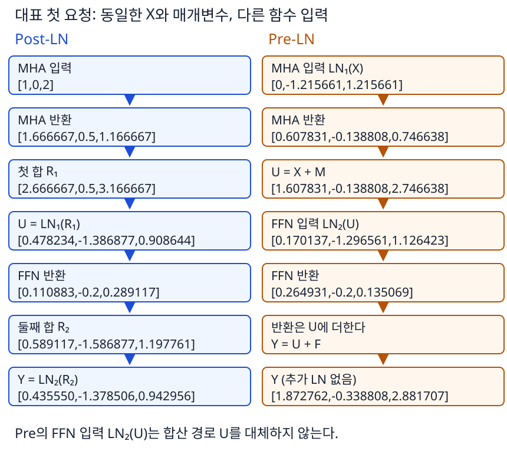{width=100% #s07-fig-trace}

### 유제 10.7.6 정규화 가지와 합산 가지 {#s07-u-pre}

대표 Pre-LN의 첫 요청에서 LN₁ 입력/출력, MHA 출력, 첫 합 U, LN₂ 출력 B, FFN 출력, 최종 반환을 자기 표로 적어라. 잘못된 반환 B+F의 실제 숫자도 구하고, 이 값이 U+F와 다른 이유를 설명하라.

### 두 완전 계산이 무엇을 보여 주는가? {#s07-compare}

처음 달라지는 지점은 **첫 MHA에 제공한 표현**이다. Post-LN은 X를 읽고 Pre-LN은 LN₁(X)를 읽는다. 따라서 Q/K/V·점수·집계·MHA 반환이 달라졌다. 첫 합도 달라지고, 이후 FFN은 각각 첫 합 뒤의 LN₁ 출력과 첫 합의 LN₂ 출력을 받았다. 둘째 합은 각자 U에 자기 FFN 반환을 더했다. 마지막에는 Post-LN만 그 합을 LN₂에 통과시켰다.

\Needspace{10\baselineskip}

| 첫 요청의 지점 | Post-LN | Pre-LN |
|---|---|---|
| MHA 입력 | [1, 0, 2] | [0, -1.215661, 1.215661] |
| MHA 반환 | [1.666667, 0.5, 1.166667] | [0.607831, -0.138808, 0.746638] |
| FFN 입력 | [0.478234, -1.386877, 0.908644] | [0.170137, -1.296561, 1.126423] |
| FFN 반환 | [0.110883, -0.2, 0.289117] | [0.264931, -0.2, 0.135069] |
| Block 반환 | [0.435550, -1.378506, 0.942956] | [1.872762, -0.338808, 2.881707] |

Post-LN의 첫 합은 X를 직접 연결하지만 그 다음에는 합의 LN 출력이 흐른다. Pre-LN의 첫 합은 정규화 전 X를 직접 잇고, 둘째 합도 정규화 전 U를 잇는다. ‘직접 이어 간다’는 연산 경로의 설명이지, 모든 원래 정보를 독립적으로 복원할 수 있다는 보장은 아니다. 더해지는 가지가 원래 표현을 상쇄할 수도 있다.

최종 숫자가 다르다고 한 설계가 더 좋은 모델이라고 결론 낼 수 없다. Xiong 외는 특정 초기화와 단순화한 분석에서 LayerNorm 배치에 따른 기울기를 연구하고, 지정 과제·학습률 조건에서 Pre-LN의 Warm-up 생략을 실험했다.[^s07-research] 그 결과는 초기화와 학습 조건에 관한 연구이지 이 작은 인공 예제의 출력 벡터 크기로 성능을 판정하는 규칙이 아니다. 모든 모델에서 Pre-LN이 더 정확하다거나 항상 안정적이라는 결론으로 확대하지 않는다.

#### 이해 확인 — 첫 차이와 성능 {#s07-check-compare}

Post-LN의 MHA 반환을 그대로 복사해 Pre-LN의 나머지만 계산하면 동일 매개변수 비교가 되는가? 두 반환 중 좌표 크기가 큰 쪽의 성능이 우수하다고 볼 수 있는가? [해설](SOLUTIONS.md#solution-s07-check-compare).

### Mask만으로 Block 전체의 정보 경로를 판정할 수 있을까? {#s07-access}

Causal Attention은 허용한 키만 직접 읽는다. 그 밖의 Residual·행별 LN·Position-wise FFN은 각 위치에서 계산하므로 이 연산들만으로 새로운 위치 사이 연결이 생기지는 않는다. 하지만 입력 행 자체가 이미 미래 정보를 포함한다면 Residual 경로로 그 정보가 이어질 수 있다. [10.3절](#sec-visibility)에서 다룬 입력 생성 경로의 조건이 Block에서도 그대로 중요하다.

### 정리 10.7.3 위치별 하위 연산 아래 다층 Causal 의존성 {#s07-th-causal}

초기 표현 $X_i^{(0)}$가 원래 위치 i 이하의 입력에만 의존한다고 하자. 모든 Block에서 요청 i의 MHA가 i 이하의 키만 읽고, LN/FFN/Residual은 위치별이며 매개변수는 고정되어 있다. 전역 혼합 연산이 없으면 Pre/Post 어느 배치에서도 $X_i^{(\ell)}$는 i 이하의 초기 입력에만 의존한다.

**증명.** 초기 층에서는 가정이 성립한다. 층 ℓ의 모든 j≤i 표현이 j 이하, 따라서 i 이하에만 의존한다고 가정하자. 요청 i의 Q와 허용 K/V는 그 범위 표현들의 함수다. 집계도 그 범위를 벗어나지 않는다. 행별 LN과 Position-wise FFN은 이미 얻은 행의 함수이고 Residual은 같은 i행 두 표현을 더한다. 따라서 다음 i행 역시 i 이하에만 의존한다. 수학적 귀납법으로 모든 층에서 성립한다. $\square$

이는 고정 매개변수의 forward 정보 의존성 주장이다. 학습으로 매개변수가 어떤 자료를 반영했는지에 대한 개인정보 주장이나 모든 서비스 입력 경로의 검증을 대신하지 않는다. 잘못된 시퀀스 축 LN, 전역 pooling, 미래를 먼저 읽은 입력 생성, 다른 Cross 출처가 있다면 따로 검사한다.

### 예제 10.7.10 이미 입력에 들어온 미래와 비활성 패딩 {#s07-ex-leak}

미래 신호 s를 미리 넣은 $X_0=[s, 0, 1]$을 생각하자. Pre-LN에서 MHA/FFN 반환을0으로 두면 Y₀=X₀다. Causal Mask가 완벽해도 미래 s는 그대로 남는다. Post-LN도 일반적으로 그 의존성을 없애지 않는다. γ=1, β=0, ε>0에서 s=0일 때 첫 LN의 첫 좌표는 음수, s=2일 때 양수다. 정규화는 정보 접근 정책의 대체가 아니다.

패딩 요청의 Attention 계수를0으로 두는 계약도 Block 출력을 자동0으로 만들지 않는다. 패딩 표현 p가0이 아니면 Residual p가 남는다. p=0이어도 LN의 β 또는 FFN Bias가 비영 출력을 만들 수 있다. 예를 들어 Pre-LN에서 MHA=0, LN₂의 β=0, FFN의 $W_1=W_2=0$, $b_2=[1, 0, -1]$이면 p=0인 행의 반환은 $[1, 0, -1]$다. 최종 패딩 행을0으로 유지하려면 필요한 지점의 명시적 게이팅을 설계하고, 다음 Attention에서는 그 행을 키로 읽지 않게 해야 한다.

### 유제 10.7.7 비활성 요청을 끝까지 따라가기 {#s07-u-padding}

위 p=0 예제를 Post-LN에 적용하라. 두 LN은 γ=1, β=0, ε=0.01이고 MHA=0, FFN 반환은 [1, 0, -1]이다. 두 합과 최종 출력을 계산하라. 마지막 결과를0으로 만들려면 어디에 어떤 연산을 추가하는지, 다음 Block의 키 허용 조건은 무엇인지 설명하라.

#### 이해 확인 — Causal의 전제 {#s07-check-access}

올바른 Causal Mask와 행별 LN만 확인하면 미래 입력 의존성 부재가 증명되는가? 귀납법의 초기 가정과 위치별 조건을 자신의 말로 설명하라. [해설](SOLUTIONS.md#solution-s07-check-access).

### 수식의 순서를 코드에서 그대로 읽기 {#s07-code}

Learning Source는 작은 NumPy CPU 구현이다. 기존 Multi-head Attention을 재사용하면서 LN·FFN·Residual·Block을 직접 구현한다. 고수준 Transformer API로 전체 연산을 숨기지 않는다. 핵심 분기는 다음과 같다. `attention_input`, `first_sum`, `u`, `ffn_input`, `second_sum`을 나눈 덕분에 같은 변수 이름으로 정규화 전후를 덮어쓰는 오류를 줄일 수 있다.

```{.python .numberLines source-root="." source="learning-source/block.py" source-start="81" source-end="104" source-revision="block-source-v0.1"}
```

`mode=="pre"`에서 LN₁ 결과를 MHA에 주고, 합은 원래 x에 한다. Post-LN에서는 첫 합 뒤 LN₁을 적용해 u와 FFN 입력을 함께 만든다. Pre-LN은 u를 합으로 두고 LN₂(u)를 FFN 입력으로 따로 만든다. 마지막 조건 분기는 Post-LN에서만 둘째 합을 정규화한다. [장 끝 부록 H](#s07-appendix)의 전체 함수와 함께 읽자.

**구현 계약.** LN/FFN은 $(\ldots, d)$ 배열의 마지막 특징 축을 처리하고 배치·위치를 포함한 앞 축들을 유지한다. Block/MHA는 단일 시퀀스 $(n, d)$만 지원한다. Batch Block은 외부에서 사례별로 호출해야 하며 현재 함수에3차원 배열을 직접 넣으면 거부한다. LN의 γ/β는 폭d 벡터, ε는 양의 유한 스칼라이고 분산은 ddof=0이다. FFN은 ReLU이며 두 Bias를 포함한다. MHA는 Bias/Dropout 없이 기존 Head별 투영과 $W_O$를 사용한다. MHA 최종 반환 shape는 X와 같아야 한다.

Mask는 Head마다 하나의 $(n, n)$ Boolean 배열이며 True가 허용이다. 생략하면 전부 허용한다. `active`는 요청별 Boolean이다. 비활성 요청의 MHA 출력만0으로 하고 후속 Block은 계속 계산한다. 유효 요청의 모든 키 차단은 오류다. 위치 표현은 입력 또는 앞 절의 적절한 경로에서 이미 구성해야 하며 이 함수가 별도 위치를 자동 추가하지 않는다. Cross-attention·학습·역전파·Gated FFN·별도 최종 LN은 이 인터페이스에 포함하지 않는다.

입력은 유한 실수이고 모든 중간 결과가 float64 범위에 들어와야 한다. 복소수·NaN·Infinity·잘못된 shape·overflow는 거부한다. 입력/매개변수 배열을 제자리 변경하지 않는다. 반환 trace는 통계와 각 중간 배열을 제공한다. 독립 reference는 Decimal70 스칼라 계산으로 원 매개변수부터 다시 계산한다. 이것은 다른 라이브러리 설정의 일치나 학습 성능을 확인하는 시험이 아니다.

실습 폴더에서 `uv run --locked python demo_block.py`를 실행하면 대표 두 순서의 모든 배열을 출력한다. `solution_block.py`는 아래 독립 문제의 새 입력, `verify_block.py`는 수치·축·shape·Mask·순서·경계의 변형을 재현한다. 코드 결과만 보지 말고, 먼저 첫 요청의 계산을 종이에 적은 뒤 어디서 차이가 생겼는지 비교해 보자.

### 이제 Block을 어디에 놓을 것인가? {#s07-next}

우리는 Attention의 최종 반환을 기존 표현과 연결하고, 정규화와 특징 변환을 거쳐 다음 층이 받을 표현까지 계산했다. 위치 간 집계와 위치 안의 좌표 변환은 다른 역할이며, 정규화가 어느 표현을 받는지에 따라 같은 매개변수도 다른 계산을 만든다. 다음 질문은 과제에 필요한 정보에 맞추어 이런 Block을 어디에 배치할지다. 전체 입력을 읽어야 하는 분류, 과거만 읽는 이어쓰기, 별도 원문에서 정보를 가져오는 생성은 같은 접근 요구를 갖지 않는다. 다음 절에서는 Encoder와 Decoder의 구조 선택으로 이 계산을 연결한다.

\clearpage

### 절 종료 연습문제

★는 핵심 계산과 정보 흐름을 스스로 확인할 문제다. 소수 계산에서는 중간값을 충분한 정밀도로 유지하고 최종값만6자리로 표시하라. 구조를 묻는 문제에서는 출력 숫자와 함께 각 함수의 입력/반환을 설명하라. [모든 상세 해설](SOLUTIONS.md#s07-independent-solutions)에는 중간 계산·오류 원인·복습 안내가 있다.

### 연습문제 10.7.1 ★ 새로운 Post-LN Block의 전체 계산 {#s07-p01}

$X=[[2, 1, 0], [0, 1, 2]]$, 단일 Head $W_Q=[1, 0, 0]^\top$, $W_K=[\ln2, 0, 0]^\top$, $W_V=[[1, 0], [0, 1], [0, 1]]$, $W_O=[[0.5, 0, -0.5], [0, 0.5, 0.5]]$다. 모든 키를 허용하고 Bias/Dropout은 없다. FFN은 $W_1=[[1, -1], [0, 1], [1, 0]]$, $b_1=[-0.5, 0.25]$, $W_2=W_O$, $b_2=[0, 0.1, -0.1]$이다. 두 LN은 γ=1, β=0, ε=0.04다. Q/K/V/S/A/O, 출력 투영, 두 합, LN 통계와 반환, FFN의 Z/H/F, 최종 Y를 모두 계산하라. 첫 위치에서 ReLU의 모든 중간 좌표가 꺼져도 FFN 반환이0이라고 할 수 있는가?

### 연습문제 10.7.2 ★ 새 매개변수의 실제 Pre/Post 비교 {#s07-p02}

$X=[[1, 3], [2, 0]]$다. 단일 Head $W_Q=[1, 0]^\top$, $W_K=[0, \ln2]^\top$, $W_V=I_2$, $W_O=0.5I_2$이며 전부 허용한다. FFN은 $W_1=[[1, -1], [1, 1]]$, $b_1=[-0.5, 0.25]$, $W_2=[[1, 0], [0, -1]]$, $b_2=[0.2, -0.1]$다. 두 LN 각각 γ=[1, 2], β=[0.5, 0], ε=0.25다. 두 배치의 MHA 입력/반환·첫 합·FFN 입력/Z/H/F·둘째 합·최종 반환과 LN 통계를 계산하라. 최초 차이와 최종 반환 위치를 설명하라. γ/β가 있는 LN을 다시 평균0으로 가정하지 마라.

### 연습문제 10.7.3 ★ Residual shape와 실제 덧셈 {#s07-p03}

X가 $3\times4$, 두 O가 각각 $3\times2, 3\times1$이다. C와 $W_O$의 필요 shape를 정하고 첫 행 C=[2, -1, 3]에 $W_O=[[1, 0, 1, 0], [0, 1, 0, 1], [1, -1, 0, 2]]$를 적용하라. 첫 X행 [1, 2, 0, -1]과 더하라. $X+O_2$가 NumPy에서 실행되어도 왜 정의와 다른가?

### 연습문제 10.7.4 ★ LayerNorm의 모든 항 {#s07-p04}

x=[2, 5, 8], ε=3, γ=[1, 2, 0.5], β=[1, 0, -1]이다. 평균·분산·z·LN 출력을 정확한 식으로 구하라. 최종 평균을 계산하고0이라는 주장을 검토하라.

### 연습문제 10.7.5 안정화 항의 실제 효과 {#s07-p05}

x=[1, 3]에서 γ=1, β=0이다. ε=0.25와 ε=3의 두 출력·분산을 비교하라. 분모를 $\sqrt{\sigma^2}+\epsilon$으로 바꾼 코드가 같은 연산인가? ε=0.25일 때 숫자로 반박하라.

### 연습문제 10.7.6 분산0과 폭1 {#s07-p06}

x=[7, 7, 7], γ=[2, -1, 0], β=[1, 2, -3], ε=0.01의 출력을 구하라. 폭1의 x=[9], γ=[4], β=[-2]도 계산하라. ε=0이면 어떤 문제가 있는가? 서로 다른 상수 입력을 구별할 수 있는가?

### 연습문제 10.7.7 ★ 같은 shape의 축 오류 {#s07-p07}

X=[[1, 3], [10, 14]]에서 `mean(axis=0)`과 `var(axis=0)`를 쓴 결과의 두 행을 ε=0.25, γ=1, β=0으로 계산하라. 올바른 `axis=-1, keepdims=True` 결과와 비교하고 두 번째 위치만 바꾸면 첫 위치의 출력이 영향을 받는 이유를 설명하라.

### 연습문제 10.7.8 FFN의 순서 오류 {#s07-p08}

x=[1, -2], $W_1=[[1, -1], [1, 1]]$, b₁=0, $W_2=[[1, 2], [-1, 1]]$, $b_2=[-1, 1]$이다. 올바른 FFN, 활성화를 생략한 FFN, 마지막에만 ReLU를 쓴 FFN을 모두 계산하라. 같은 선형 변환을 사용해도 다른 함수를 만든 지점을 찾아라.

### 연습문제 10.7.9 Position-wise와 배치 벡터화 {#s07-p09}

$W_1=I_2$, b₁=0, $W_2=[[1, -1], [0, 2]]$, b₂=0과 X=[[1, -1], [-2, 3]]을 사용하라. 행별 FFN 출력과 행렬 구현의 결과를 비교하라. X의 둘째 행을 바꾸면 첫 출력이 변하는가? `(b, n, 2)`로 Batch를 추가하면 유지할 축은 무엇인가?

### 연습문제 10.7.10 ★ 이름과 수식이 다른 구현 {#s07-p10}

코드 A는 `u = X + MHA(LN1(X)); y = LN2(u + FFN(u))`, 코드 B는 `u = LN1(X + MHA(X)); y = u + FFN(LN2(u))`다. 각각 순수한 Post-LN 또는 Pre-LN인가? 각 코드에서 구성요소의 실제 입력을 표로 쓰고 두 기준식에 맞는 수정을 제시하라.

### 연습문제 10.7.11 LayerNorm을 더하는 쪽으로 이동하기 {#s07-p11}

Pre-LN의 첫 식 대신 `u = LN1(X) + MHA(X)`라고 했다. 이는 같은가? 반례로 MHA=0, X=[1, 3], γ=1, β=0, ε=0.25를 사용하라. 최종 Block 반환까지 일반적으로 같을 필요가 없는 이유를 설명하라.

### 연습문제 10.7.12 활성화가 없는 FFN의 합성 {#s07-p12}

φ가 항등함수일 때 두 affine 변환을 하나로 합쳐라. b₁을 빠뜨리지 마라. ReLU를 사용하면 일반적으로 같은 합성이 불가능함을 폭1의 $W_1=W_2=1$, b=0으로 증명하라.

### 연습문제 10.7.13 이동 불변과 복원 불가 {#s07-p13}

임의 고정 γ/β와 ε>0에서 LN(x+c1)=LN(x)를 증명하고, 입력 평균이 복원 불가능한 이유를 설명하라. LN(ax)=LN(x)를 모든 a>0에서 주장할 수 있는가? x=[-1, 1], a=2, ε=1로 반례를 계산하라.

### 연습문제 10.7.14 ★ 비활성 패딩의 후속 계산 {#s07-p14}

Pre-LN에서 패딩 입력 p=[2, -1], MHA 반환0, LN₂ γ=1/β=0/ε=0.25다. FFN은 W₁=W₂=I₂, b₁=0, b₂=[0.5, -0.5]다. B/H/F/Y를 계산하라. 최종 게이팅과 다음 MHA의 키 패딩 정책을 설명하라.

### 연습문제 10.7.15 ★ 두 층의 정보 의존성 {#s07-p15}

네 위치 0–3에서 각 MHA가 현재와 과거만 읽는다. LN·FFN·Residual은 위치별이다. 초기 i행은 i 이하의 토큰에만 의존한다. 두 번째 Block의 위치1이 의존할 수 있는 초기 위치 집합을 설명하고 일반 층 귀납법을 적어라. 둘째 Block에 시퀀스 전체 평균을 빼는 연산을 넣으면 무엇이 달라지는가?

### 연습문제 10.7.16 Causal Mask 이전의 누출 {#s07-p16}

미래 토큰 신호 s를 입력 생성에서 X₀=[s, 0, 1]에 넣었다. MHA/FFN은0이다. Pre-LN과 Post-LN에서 미래 의존성이 자동으로 사라진다는 주장을 반박하라. Post-LN 두 LN은 γ=1, β=0, ε>0이다. 필요한 입력 생성 수정도 제시하라.

### 연습문제 10.7.17 Attention 접근 조건 변경 {#s07-p17}

대표 입력의 MHA를 Causal로 바꿔 각 Head에 [[True, False], [True, True]]를 적용하라. Post/Pre의 첫 요청 MHA 반환과 첫 합을 다시 계산하라. 미래 행만 바꾸었을 때 첫 요청의 이후 FFN/Y가 유지되는 이유와 전제를 설명하라.

### 연습문제 10.7.18 ★ 새로운 Block 인터페이스 설계 {#s07-p18}

모델 폭5, 위치수n, 두 Head의 값 폭2/3, FFN 중간 폭7을 갖는 Pre-LN을 설계하라. $W_O, W_1, b_1, W_2, b_2$, LN 매개변수·축·ε, Mask와 반환 shape를 적어라. 요청별 패딩·비유한 입력·Batch 지원 여부·입력 비변경을 계약에 포함하라. 모든 Head의 비교 폭이 동일해야 하는가? 대안의 허용 조건도 설명하라.

### 연습문제 10.7.19 수치가 맞아 보이는 구현 오류 {#s07-p19}

X가 $n\times d$일 때 `mu=X.mean(axis=-1)`를 만든 뒤 `X-mu`라고 했다. keepdims를 생략하면 어떤 방송 문제가 생기는가? n=d인 사례에서도 잘못된 값을 만들 수 있음을 X=[[1, 3], [10, 14]]로 보이라. 고쳐 쓰고 Batch 축까지 설명하라.

### 연습문제 10.7.20 지원 범위와 거부 조건 {#s07-p20}

ε=0, 복소수, NaN 패딩, $X:(2, 3)$/$M:(2, 1)$, 유효 요청의 빈 허용 키 집합, $X:(2, 4, 3)$을 이 절 Block에 직접 전달하는 경우를 각각 판정하라. 수학적 정의 불가·교육 구현의 지원 제외·명시 계약 위반을 구별하라. 차단 열의 NaN을 그대로 두어도 괜찮은가?

### 연습문제 10.7.21 같은 매개변수의 비교를 계획하기 {#s07-p21}

다른 라이브러리의 Transformer Block과 수치 비교하려 한다. LN ε/γ/β·행렬 저장 규약·투영/Bias·scaling·활성화·Dropout·Mask 의미/shape·Pre/Post·최종 LN을 맞추는 검토표를 작성하라. 차이가 났을 때 가장 먼저 다른 중간값을 찾는 절차를 설명하라. 서로 다른 설정의 결과가 다르다는 이유로 라이브러리 오류라고 판단할 수 있는가?

\Needspace{8\baselineskip}

### 연습문제 10.7.22 독립 구현과 수식 대조 {#s07-p22}

두 위치의 새로운 유한 입력을 직접 골라 `post_ln`과 `pre_ln`의 trace를 출력하라. 주요 배열 shape와 LN 통계, Z/H/F, 두 합을 자기 수식으로 대조하라. 이어 Pre-LN의 FFN 입력에서 LN₂를 삭제한 오류를 넣고 최초 차이와 최종 영향을 확인하라. 변화가 우연히 상쇄되면 다른 입력/매개변수로 양성 대조를 만들고 그 이유를 설명하라.

### 선택적 심화

### 심화문제 10.7.1 직접 Residual 경로와 기울기 {#s07-c01}

열벡터 규약으로 $y=x+F(x)$의 Jacobian을 유도하라. $y=\operatorname{LN}(x+F(x))$의 Jacobian도 연쇄법칙으로 쓰라. Pre-LN 한 하위 갱신 $x+F(\operatorname{LN}(x))$과 비교하라. ReLU의 비미분 경계는 제외한다. I항이 있다는 것만으로 기울기 소실/폭발이 불가능하다고 결론 낼 수 없는 반례를 제시하라.

### 심화문제 10.7.2 순열과 Block의 정보 경로 {#s07-c02}

전부 허용·위치 신호 없음·모든 위치에 공유 매개변수·Dropout 없음이라는 조건에서 Pre/Post Block의 $B(PX)=PB(X)$를 증명하라. Causal Mask를 배열에 고정한 채 X만 순열하면 어떤 가정이 깨지는가? 이 성질이 언어 의미를 보존한다는 뜻은 아닌 이유를 설명하라.

### 심화문제 10.7.3 연구 문제 — 배치와 학습 안정성의 근거 {#s07-c03}

Xiong 외 (2020)의 본문 §3.3·정리1·§4를 읽고 단순화한 이론의 가정, 초기화 시 분석 대상, 실험 과제·학습률/Warm-up 조건, 논문에서 관찰한 결과와 자신의 추가 추측을 나누어 기록하라. 작은 forward 계산이나 한 설정의 실험으로 모든 모델의 성능 우위를 주장할 수 없는 이유를 설명하라. 실제 학습 실험을 계획한다면 두 구조 밖의 조건을 어떻게 통제할지 제안하라. 학습 실행은 이 문제의 필수 조건이 아니다.

\clearpage

\clearpage

## 10.8 Encoder와 Decoder의 정보 요구 및 구조 선택 {#sec-architectures}

### 같은 Block으로 서로 다른 일을 할 수 있을까? {#s08-start}

영화평 전체를 읽고 감정을 분류하는 모델을 생각해 보자. 마지막 문장에 앞의 칭찬을 뒤집는 반전이 있다면 첫 문장의 표현도 그 반전을 참고할 수 있어야 한다. 이번에는 아직 끝나지 않은 문장을 이어 쓰는 모델을 생각해 보자. 모델이 다음 단어를 맞히기 전에 그 정답을 읽으면, 우리가 원하는 생성 능력을 연습한 것이 아니다. 마지막으로 완성된 영어 문장을 보고 한국어 번역을 만드는 모델을 생각해 보자. 영어 문장은 모두 제공됐지만 한국어 번역의 뒤쪽은 아직 생성하지 않았다. **입력 문장의 뒤쪽과 출력 문장의 미래는 서로 다른 정보다.**

세 과제에서 필요한 기본 연산은 앞 절의 Transformer Block이다. 달라지는 것은 그 Block을 어디에 놓고, 어느 표현 집합을 읽게 하며, 어느 정보 경로를 막는가다. 먼저 세 상황의 정보 요구를 정리한 뒤 Encoder-only, Decoder-only, Encoder–Decoder 구성을 도출하자. 이름을 선택하는 데서 멈추지 않고 입력·Mask·Q/K/V·반환 표현·예측 위치를 끝까지 연결한다.

[10.3절](#sec-visibility)의 접근 관계, [10.4절](#sec-sources)의 요청/제공 출처, [10.7절](#sec-block)의 Residual·LayerNorm·FFN을 기억하면 된다. 행렬곱 한 셀은 요청 좌표와 제공 좌표의 곱을 더하고, Softmax는 **허용된 열끼리** 지수를 정규화한다. 관련 행렬 기초는 MATH-LINALG에서 복습할 수 있다. 위치 표현은 [10.6절](#sec-position)을 재사용한다. 아래 작은 배열은 손계산을 위해 직접 고른 교육용 값이며 학습된 언어모델의 관찰값이 아니다.

### 예측 시점에 이미 있는 정보부터 정하기 {#s08-contract}

영화평 분류에서 입력 전체는 이미 존재한다. 각 입력 위치가 다른 유효 위치의 앞뒤 문맥을 읽어 표현을 갱신해도 된다. 이 위치별 표현을 만드는 Block 묶음에 과제용 Readout을 연결하면 **Encoder-only** 구성을 얻는다. 여기서 Encoder는 완성된 입력을 조건화된 위치별 표현으로 바꾸는 역할을 한다. 그 표현을 분류 결과로 바꾸는 마지막 함수까지 Encoder의 한 행과 같다고 보지는 않는다.

이어쓰기에서는 이미 제공된 Token Prefix를 읽는다. 현재 입력 토큰까지는 알지만 지금 예측할 다음 토큰과 그 이후 정답은 사용할 수 없다. 자기 시퀀스를 읽는 Block에 Causal 접근을 넣고 각 위치의 반환을 다음 토큰 점수로 연결하면 **Decoder-only** 구성을 얻는다. 별도 Encoder가 없어도 이미 주어진 정보에 조건화할 수 있다.

번역에서는 두 출처가 필요하다. 완성된 원문의 표현과 이미 제공된 번역 Prefix다. 원문에는 Bidirectional Encoding을, 번역 Prefix에는 Causal Decoding을 적용한다. Decoder 안에서 별도 Encoder 출력을 읽는 Cross-attention 인터페이스를 더하면 **Encoder–Decoder** 구성을 얻는다. 원 논문의 Transformer는 이 두 스택과 Decoder의 세 하위 연산을 제안했다.[^s08-original]

### 정의 10.8.1 요청과 제공 집합의 접근 관계 {#s08-def-access}

Attention의 접근 관계를 요청 위치 i가 제공 위치 j를 읽을 수 있는지를 나타내는 Boolean 행렬 B로 정의한다.

$$
B_{ij}=\begin{cases}
1&\text{요청 }i\text{가 제공 위치 }j\text{를 읽을 수 있음},\\
0&\text{읽을 수 없음}.
\end{cases}
\qquad B\in\{0,1\}^{m\times n}.
\tag{ 10.8.1 }\label{s08-eq-access}
$$

m은 요청 수, n은 제공 위치 수다. NumPy 예제에서는 **True=읽기 허용, False=읽기 금지**다. 다른 API의 Boolean 의미가 같다고 추측하지 말고 그 계약을 확인해야 한다. 행 i는 Query를 만드는 표현에, 열 j는 같은 제공 위치의 Key와 Value 쌍에 대응한다. Self에서는 두 집합이 같고 Cross에서는 다를 수 있다.

입력 시퀀스의 배열 행 번호와 원래 위치는 구별한다. 재배열했다면 배열의 열0이 원래 위치2일 수 있다. 또한 Decoder 입력 행 i가 Token $y_i$를 담는다고 해서 같은 행의 예측 Target도 $y_i$인 것은 아니다. 이후 예제에서는 배열0부터 세고 $D_0=\mathrm{BOS},D_1=y_1,D_2=y_2$로 두어 행 i가 $y_{i+1}$을 예측한다. Encoder의 원문 위치 번호 j에는 이 출력 Token 시간표가 적용되지 않는다.

### 정의 10.8.2 세 정보 요구에 맞춘 대표 접근 정책 {#s08-def-three}

유효 키 표시 $v_j\in\{0,1\}$와 추가 허용 관계 $R_{ij}\in\{0,1\}$가 있을 때 완성 입력의 Bidirectional 접근을

$$
B^{\mathrm{enc}}_{ij}=v_jR_{ij}
\tag{ 10.8.2 }\label{s08-eq-enc}
$$

로 정의한다. 원래 Decoder 입력 위치 $p_i,p_j$에 대한 Causal 접근은

$$
B^{\mathrm{self}}_{ij}=v_j\mathbf1[p_j\le p_i]R_{ij}.
\tag{ 10.8.3 }\label{s08-eq-causal}
$$

완성 원문을 읽는 Cross 접근은 $B^{\mathrm{cross}}_{ij}=v^{\mathrm{enc}}_jR^{\mathrm{cross}}_{ij}$다. 이 Cross의 행은 Decoder 요청, 열은 Encoder 출력 위치다. 완성 원문 전체가 제공되고 별도 제한이 없다면 모든 유효 원문 열을 허용한다. **원문 번호 j와 번역 번호 i를 비교하는 $j\le i$를 자동으로 넣지 않는다.**

Bidirectional은 앞뒤 정보를 읽는다는 의미이지 패딩이나 권한 밖 세그먼트까지 모두 허용한다는 의미가 아니다. 예를 들어 완성 입력 네 배열 행 중 마지막이 패딩이면 활성 앞 세 행의 허용표는 $[1,1,1,0]$이고 마지막 요청은 비활성으로 처리할 수 있다. 서로 다른 문서 사이 읽기를 금지했다면 R에 그 경계를 표시한다.

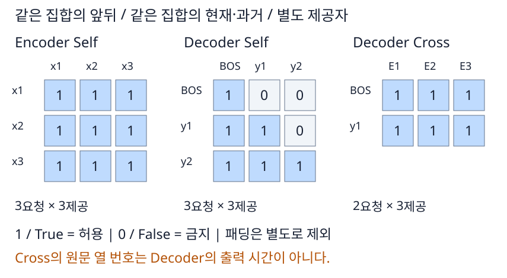{width=100% #s08-fig-masks}

#### 이해 확인 — 이름과 허용표 {#s08-check-mask}

모델을 Encoder라고 부르면 네 배열 열을 모두 허용해도 되는가? 세 유효 원문 열을 가진 Cross가2행이라면 셋째 원문 열을 막아야 하는가? [해설](SOLUTIONS.md#solution-s08-check-mask)에서 실제 정보 요구로 판단하자.

### Encoder-only: 전체 입력을 서로의 문맥으로 만들기 {#s08-encoder}

입력 Token은 정수 식별자이고 Token Embedding은 그 식별자를 벡터로 바꾼 결과다. 위치 정보를 더한 Encoder 입력 Z는 또 다른 객체다. Block의 Attention 반환과 Residual 합, 정규화·FFN을 거친 최종 E도 구별해야 한다. 같은 행 번호를 유지한다는 이유로 이 모든 배열을 하나의 ‘원문 벡터’라고 부르면 어느 단계가 실제로 문맥을 섞었는지 놓친다.

### 정의 10.8.3 위치별 조건 표현을 반환하는 Encoder {#s08-def-encoder}

이 절의 Encoder를 위치 정보를 반영한 입력 Z에 Bidirectional Self-attention Block을 적용하여 같은 입력 위치에 대응하는 출력 E를 만드는 함수로 정의한다.

$$
Z_i=\operatorname{Embed}(x_i)+P_i,\qquad
E=\operatorname{Encoder}(Z;B^{\mathrm{enc}}),\quad
Z,E\in\mathbb R^{n\times d_E}.
\tag{ 10.8.4 }\label{s08-eq-encoder}
$$

$x_i$는 입력 Token, $P_i$는 여기서 선택한 가산 위치 표현이다. Encoder 내부 한 층의 Q/K/V는 그 층에 들어가는 **같은 표현 집합**에서 만들어진다. 첫 층에서는 Z, 다음 층에서는 직전 Block 출력이다. 출력 행 $E_i$는 입력 위치 i에 대응하지만, 허용된 다른 입력 위치의 정보도 담을 수 있다. 위치 가산 방식과 Post/Pre 배치는 설계에 따라 달라지며 위 정의가 모든 Encoder의 위치 구현을 고정하지 않는다.

### 예제 10.8.1 세 위치의 전체 접근과 실제 집계 {#s08-ex-encoder}

완성 입력의 내용 표현과 위치 표현을 다음처럼 고르자.

$$
C=\begin{bmatrix}1&0&1\\0&1&1\\1&1&0\end{bmatrix},\quad
P=\begin{bmatrix}0&0&1\\0&1&0\\1&0&0\end{bmatrix},\quad
Z=C+P=\begin{bmatrix}1&0&2\\0&2&1\\2&1&0\end{bmatrix}.
$$

세 위치 모두 유효하고 별도 제한이 없어 $B^{\mathrm{enc}}=\mathbf1_{3\times3}$이다. 한 Head의 비교 폭1, 값 폭3으로 두고 $L=\ln2$와

$$
W_Q=[1,0,0]^\mathsf T,\quad W_K=[L,0,0]^\mathsf T,\quad W_V=I_3
$$

를 사용한다. **각 요청 i의 Q도, 각 제공 j의 K/V도 Z에서 나온다.** 투영 결과는 $Q=[1,0,2]^\mathsf T$, $K=[L,0,2L]^\mathsf T$, $V=Z$다. 따라서

$$
S=\begin{bmatrix}L&0&2L\\0&0&0\\2L&0&4L\end{bmatrix},\quad
A=\begin{bmatrix}2/7&1/7&4/7\\1/3&1/3&1/3\\4/21&1/21&16/21\end{bmatrix},
$$
$$
O=AV=\begin{bmatrix}10/7&6/7&5/7\\1&1&1\\12/7&6/7&3/7\end{bmatrix}.
$$

첫 요청의 집계는 $(2/7)[1,0,2]+(1/7)[0,2,1]+(4/7)[2,1,0]$다. 현재 첫 위치 뒤에 있는 두 위치가 실제로 기여했다. 첫 좌표는 $2/7+0+8/7=10/7$, 둘째는 $0+2/7+4/7=6/7$, 셋째는 $4/7+1/7+0=5/7$다. 처음의 Z행을 복사한 결과가 아니다.

### 예제 10.8.2 Attention에서 Encoder 반환 E까지 {#s08-ex-encoder-block}

[10.7절](#sec-block)의 **Post-LN**을 사용한다. 단일 Head이므로 Concat=O이고 $W_O=\tfrac12I_3$, FFN은 $\operatorname{ReLU}(u)\tfrac14I_3$다. 모든 LN은 γ=1, β=0, ε=0.1이며 Dropout은 생략한다. ε와 작은 폭은 손계산용 선택이다. 각 합 뒤 LN이라는 순서는 원 Transformer의 배치를 따른다.[^s08-original]

$$
M=\tfrac12O,\quad R_1=Z+M,
\quad U=\operatorname{LN}_1(R_1),
\quad F=\tfrac14\operatorname{ReLU}(U),
\quad E=\operatorname{LN}_2(U+F).
$$

실제 첫 합은

$$
R_1=\begin{bmatrix}12/7&3/7&33/14\\1/2&5/2&3/2\\20/7&10/7&3/14\end{bmatrix}.
$$

세 행 평균은 모두3/2이고 분산은 각각9/14, 2/3, 7/6이다. 첫 행의 중심화는 $[3/14,-15/14,12/14]$, 분모는 $\sqrt{9/14+0.1}$다. 같은 방법으로 전행을 정규화하고 음수 좌표를 ReLU에서0으로 만든다.

$$
U\approx\begin{bmatrix}0.248623&-1.243113&0.994490\\-1.142080&1.142080&0\\1.205853&-0.063466&-1.142387\end{bmatrix},
$$
$$
F\approx\begin{bmatrix}0.062156&0&0.248623\\0&0.285520&0\\0.301463&0&0\end{bmatrix},
$$
$$
U+F\approx\begin{bmatrix}0.310778&-1.243113&1.243113\\-1.142080&1.427601&0\\1.507316&-0.063466&-1.142387\end{bmatrix}.
$$

둘째 LN의 평균은 약 [0.103593, 0.095173, 0.100488], 분산은 [1.051683, 1.105072, 1.183595]다. 최종 제공 표현은

$$
E\approx\begin{bmatrix}0.193060&-1.254892&1.061831\\-1.127073&1.213771&-0.086698\\1.241730&-0.144713&-1.097017\end{bmatrix}.
\tag{ 10.8.5 }\label{s08-eq-E}
$$

E와 Z는 같은3×3이지만 수치와 계산 출처가 다르다. E의 세 행은 원문 세 위치에 대응하는 **Block 반환**이며 아직 분류 정답도 번역 토큰도 아니다. 아래 통합 사례에서는 이 E를 Decoder의 조건 제공자로 사용한다. 소수는 표시 때만 반올림하며 다음 계산에는 반올림 전 결과를 쓴다.

### 유제 10.8.1 셋째 위치를 제외하면 무엇이 바뀌는가? {#s08-u-encoder}

앞 Attention의 Q/K/V를 유지하되 셋째 제공 위치를 패딩으로 지정한다. 첫 요청의 새 A와 O를 구하라. 비활성 셋째 Query를 별도로 표시했을 때, 그 Attention 반환0이 왜 전체 Post-LN Block의 최종0을 보장하지 않는지도 설명하라. 이것은 Mask 계산 연습이며 실제 패딩 입력을 만들 때에는 초기 위치별 입력 계약도 함께 지켜야 한다.

### 예제 10.8.3 표현을 하나의 분류 결과로 연결하기 {#s08-ex-readout}

완성 입력을 두 범주로 분류하려면 E에서 분류용 표현 r을 고르고 점수 함수에 넣어야 한다. 특별한 분류용 Token 위치를 입력에 추가하여 그 반환을 읽을 수도 있고, 유효 행들의 평균·최대 풀링(pooling)을 쓸 수도 있으며, 별도 학습된 Readout을 둘 수도 있다. BERT는 [CLS]의 최종 표현을 분류용 집계 표현으로 사용하지만 이것이 모든 Encoder-only의 정의는 아니다.[^s08-bert]

앞 E의 유효 행 평균을 고르면 $r\approx[0.102572,-0.061944,-0.040628]$이다. 예시 두 범주 점수 행렬을

$$
W_c=\begin{bmatrix}1&-1\\0&1\\1&0\end{bmatrix},\qquad
b_c=[0.1,-0.1]
$$

로 두면 $rW_c+b_c\approx[0.161944,-0.264517]$이다. 큰 점수를 고르는 규칙에서는 첫 범주가 선택된다. 이 계산은 임의 매개변수의 인터페이스 예시이며 언어 분류의 실제 정확도를 말하지 않는다. 패딩이 있다면 평균의 분모도 유효 행 수여야 한다. 특수 Token 없이 평균을 썼다는 이유로 Encoder-only가 아닌 것은 아니다.

#### 이해 확인 — 구조와 학습 목표 {#s08-check-objective}

Bidirectional Encoder를 선택하면 학습 목표도 반드시 Masked Language Modeling(MLM)인가? 예를 들어 입력 `[나는, MASK, 좋아한다]`, 별도 감독 Target=`사과를`로 두면 모델이 그 정답을 입력에서 직접 읽는가? [해설](SOLUTIONS.md#solution-s08-check-objective)로 확인하자.

Bidirectional 구조는 정보 접근과 Block 배치다. MLM은 어떤 입력을 변형하고 어떤 정답을 맞히게 하는지에 관한 학습 목표다. 여기서는 위 MASK 예시처럼 정답을 입력에서 제거한 계약을 쓴다. 실제 BERT의 MLM에는 MASK 이외의 변형도 있으며 그 전체 학습 규칙을 이 작은 예시와 동일시하지 않는다.[^s08-bert] 또한 분류를 하려면 Readout과 감독을 설계해야 한다. 구조 이름만으로 학습 대상·손실·정답 공급 방식이 모두 결정되지 않는다.

### Decoder-only: 현재 입력과 현재 정답을 구별하기 {#s08-decoder}

출력을 차례대로 생성할 때도 입력으로 제공된 토큰은 읽을 수 있다. 문제는 그 행이 **무엇을 예측하는가**다. 행에 정답 자체를 입력한 뒤 대각선만 허용하면 정답 복사 경로가 열린다. 입력 이동과 Causal Mask는 서로 보완하는 조건이다.

### 정의 10.8.4 다음 토큰 예측의 입력과 Target {#s08-def-shift}

길이 T의 출력 정답 $[y_1,\ldots,y_T]$에 대해 이 절의 학습 입력과 감독 Target을

$$
D_{\mathrm{token}}=[\mathrm{BOS},y_1,\ldots,y_{T-1}],\qquad
T_{\mathrm{token}}=[y_1,y_2,\ldots,y_T]
\tag{ 10.8.6 }\label{s08-eq-shift}
$$

로 정의한다. 배열 행 i=0,…,T-1의 표현은 $y_{i+1}$을 예측한다. 그 행의 입력 Token은 i=0에서 BOS, i>0에서 $y_i$다. Target는 감독 데이터이며 Q/K/V 입력이 아니다. 이 계약은 반복 Token 값이 우연히 같더라도 **시퀀스에서 어느 위치가 출처인가**로 해석한다.

길이3에서는 다음과 같다.

| 배열 행/입력 위치 | 입력 Token | 허용 입력 Token | 예측 Target |
|---|---|---|---|
| 0 | BOS | BOS | $y_1$ |
| 1 | $y_1$ | BOS, $y_1$ | $y_2$ |
| 2 | $y_2$ | BOS, $y_1$, $y_2$ | $y_3$ |

대각선 $B_{ii}=1$은 현재 **입력**을 읽는다. 현재 Target를 읽는다는 뜻이 아니다. 행1이 $y_1$을 읽고 $y_2$를 예측하므로 정답 $y_2$가 있는 입력 행2는 차단해야 한다. $y_3$는 이 입력 배열 자체에 없다.

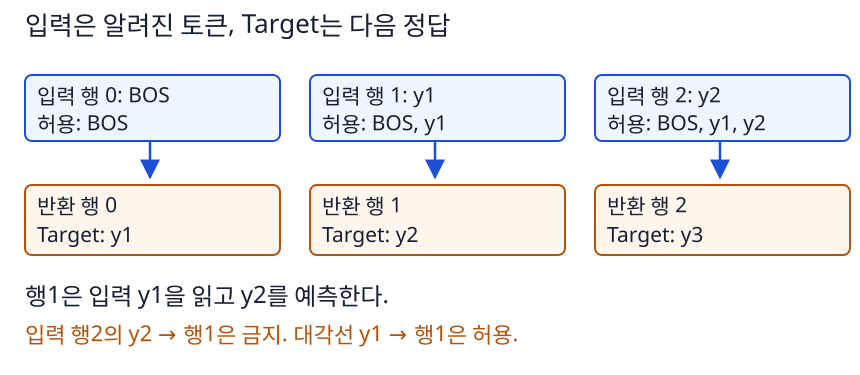{width=100% #s08-fig-shift}

### 예제 10.8.4 같은 세 벡터에서 Causal 계산하기 {#s08-ex-decoder}

Encoder 예제의 Z와 동일한 숫자를 이번에는 `[BOS,y1,y2]`의 **위치 정보가 반영된 Decoder 입력 D**로 사용하자. 배열의 역할이 달라졌으므로 출처를 D라 부른다. 같은 투영에서 Q/K/V와 S는 앞과 같지만 허용표가

$$
B^{\mathrm{self}}=\begin{bmatrix}1&0&0\\1&1&0\\1&1&1\end{bmatrix}
$$

이 된다. 각 행의 지수 분모가 바뀌므로

$$
A=\begin{bmatrix}1&0&0\\1/2&1/2&0\\4/21&1/21&16/21\end{bmatrix},\qquad
O=\begin{bmatrix}1&0&2\\1/2&1&3/2\\12/7&6/7&3/7\end{bmatrix}.
$$

행1은 $\tfrac12[1,0,2]+\tfrac12[0,2,1]=[1/2,1,3/2]$다. 미래 입력 행2의 값 [2,1,0]은 계수0으로 빠졌다. 같은 Post-LN과 $W_O=\tfrac12I_3$, $F=\tfrac14\operatorname{ReLU}$를 연결하면 첫 합은

$$
R_1=\begin{bmatrix}1.5&0&3\\0.25&2.5&1.75\\20/7&10/7&3/14\end{bmatrix}.
$$

첫 두 행의 평균은1.5, 분산은1.5와0.875다. LN₁ 뒤 첫 행은 약 [0,-1.185854,1.185854], 둘째 행은 약 [-1.265924,1.012739,0.253185]다. 각 양수 좌표의1/4을 더하고 LN₂를 적용한 최종 반환은

$$
Y^{\mathrm{only}}\approx\begin{bmatrix}-0.086960&-1.130478&1.217437\\-1.256842&1.063482&0.193360\\1.241730&-0.144713&-1.097017\end{bmatrix}.
$$

최종 행2는 $y_3$의 점수 함수로 보낸다. 행0은 $y_1$, 행1은 $y_2$에 대한 학습 출력을 만들지만 생성 시 현재까지 제공된 Prefix의 마지막 행이 다음 Token을 예측한다. 전체 어휘 분포와 손실의 도출은 여기서 확장하지 않는다.

### 유제 10.8.2 이동과 대각선의 역할 {#s08-u-shift}

출력 정답 `[가, 나, 다, EOS]`의 학습 입력을 쓰고 각 행의 허용 입력 집합과 예측 Target를 연결하라. 입력을 정답과 동일하게 넣은 구현은 삼각 Mask가 있어도 어느 경로에서 누출되는가?

### 예제 10.8.5 금지 경로를 막고 허용 경로를 남기기 {#s08-ex-invariance}

앞 Decoder의 미래 입력 행2를 [7,-3,5]로 바꾸자. 행0/1의 Q는 자기 행에서 나오므로 같고, 두 요청이 허용하는 K/V도 행0/1이라 같다. 금지 열의 점수가 바뀌어도 그 열은 분모에 들어가지 않는다. 따라서 행0/1의 A·O와 같은 행의 Residual·LN·FFN·최종 Y도 그대로다.

반대로 허용 과거 입력 행0을 [-2,1,4]로 바꾸면 행1의 Q=0은 유지되지만 허용 V가 바뀐다. 행1 A는 여전히 [1/2,1/2,0], O는 [-1,1.5,2.5]로 바뀐다. 입력 행1은 그대로여도 새 집계가 달라지는 **양성 대조**다. 모든 출력이 항상0인 잘못된 함수도 미래 변경에는 불변이므로 이 반응까지 확인해야 한다.

학습에서는 Teacher Forcing으로 이미 있는 정답의 앞부분을 각 입력 행에 제공하고 여러 행을 병렬로 계산한다. 행1이 행2 입력을 보지 못하는 관계는 그대로다. 생성에서는 미래 Token이 아직 없어, 현재 마지막 행으로 다음 Token을 고른 뒤 그 Token을 입력에 추가한다. **학습 계산의 병렬성과 생성 중 정보의 가용성은 다른 이야기다.** 원 Transformer의 Mask와 한 위치 이동도 이 목적을 함께 수행한다.[^s08-original]

### 유제 10.8.3 불변 시험을 보완하기 {#s08-u-causal}

앞 예제에서 미래 변경 뒤 행1이 그대로인데 허용 과거 변경 뒤에도 항상 그대로인 함수가 있다. 그것만으로 Causal 구현 성공이라고 할 수 있는가? 실제 행1의 과거 변경 전후 O를 계산하고, 기대 양성 대조를 만족하지 못하는 한 결함을 제시하라.

#### 이해 확인 — 병렬 학습 {#s08-check-parallel}

Teacher Forcing으로 `[BOS,y1,y2]`를 한 번에 주면 행0이 $y_2$를 사용할 수 있는가? 동일한 입력 Token 값이 반복됐다는 이유로 이동 계약을 무시해도 되는가? [해설](SOLUTIONS.md#solution-s08-check-parallel)을 보자.

### 조건을 Prefix에 넣는 Decoder-only {#s08-prefix}

‘조건부 생성’이라는 말은 별도 Encoder의 존재를 뜻하지 않는다. 예를 들어 `[번역 지시, 원문1, 원문2, SEP, BOS, y1]`을 하나의 시퀀스로 제공할 수 있다. 마지막 입력 $y_1$의 요청은 앞쪽의 지시·원문·구분자·BOS·$y_1$을 읽고 $y_2$를 예측한다. Causal 관계에서 조건 Token이 모두 생성 위치 앞에 있기 때문에 가능하다. Radford 외는 과제·입력·출력을 하나의 Token 시퀀스로 표현하는 조건화 방식을 설명했다.[^s08-gpt]

이 구성의 Self Q/K/V는 하나의 스택 안에서 생성된 표현에서 나온다. 원문 위치 자체의 표현은 기본 Causal 설계에서 그보다 뒤의 원문을 읽지 못한다. 출력 요청이 모든 원문을 읽을 수 있다는 사실과 **각 원문 표현이 양방향으로 인코딩됐다는 사실은 다르다.** 완성 조건 Prefix 안에서만 전체 접근을 허용하는 변형도 가능하지만, 미래 출력이 Prefix 표현으로 되돌아가지 못하는 경계를 함께 지켜야 한다. Raffel 외는 전부 Causal인 언어모델과 입력 Prefix 내부를 fully-visible로 두는 변형을 구별한다.[^s08-t5]

### 예제 10.8.6 하나의 시퀀스와 별도 제공자의 차이 {#s08-ex-prefix}

원문 `[x1,x2,x3]` 뒤에 `[SEP,BOS,y1]`을 놓은 Decoder-only에서는 다음 Token 요청의 허용 키가 여섯 입력 위치다. `x1`의 표현은 Causal이면 `x1`만 읽고, `x3`의 표현은 `x1,x2,x3`을 읽는다. 출력 위치는 이들 표현을 모두 읽는다.

Encoder–Decoder에서는 원문3행을 별도 Encoder에 주어 각 $E_j$가 원문 전체를 읽게 한다. 출력2행 `[BOS,y1]`은 Self에서 자기 Prefix를, Cross에서 세 E행을 읽는다. 두 구성 모두 조건부 생성에 유효하지만 스택 수, 요청/제공 집합, 원문 표현의 의존성, Token 구분과 Readout 계약이 다르다. 어느 것이 더 정확하거나 싸다고 이 접근표만으로 결론 낼 수는 없다.

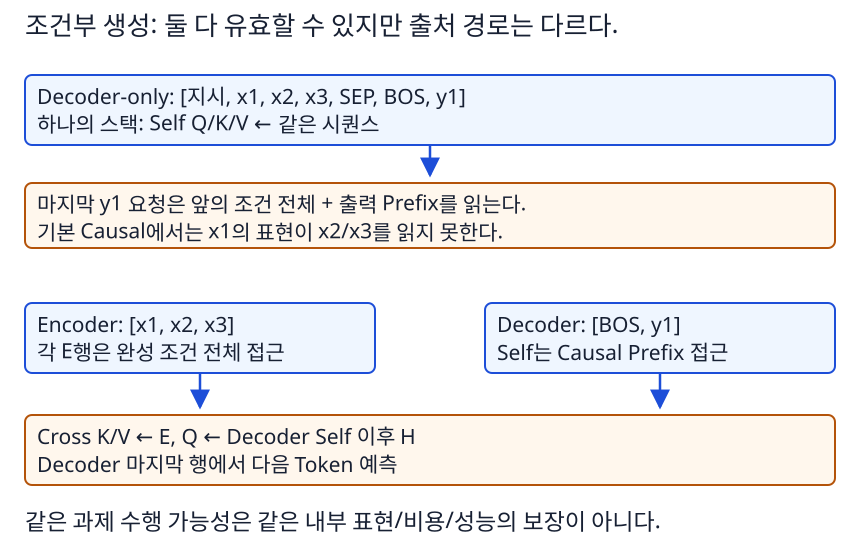{width=100% #s08-fig-options}

### 유제 10.8.4 두 유효한 설계를 설명하기 {#s08-u-prefix}

완성 문서와 질문을 입력으로 받아 한 문장의 답을 순서대로 생성하려 한다. Encoder–Decoder와 Decoder-only의 유효한 입력 배치·Mask·Q/K/V 출처·마지막 예측 위치를 각각 설계하라. 한 구조에만 가능한 과제라고 단정하지 말고 두 경로의 차이를 설명하라.

### Encoder–Decoder: 두 출처가 Decoder 안에서 만나는 곳 {#s08-cross}

Encoder 뒤에 Decoder를 붙인다는 그림만으로는 조건이 어떻게 전달되는지 알 수 없다. Decoder Self-attention이 만든 요청 표현 H가 **Encoder 출력 E를 읽는 연산**을 갖추어야 한다. E를 Decoder 입력 행에 무조건 이어 붙이거나 Self의 V만 E로 바꾸는 것으로 같은 인터페이스를 만들 수는 없다.

### 정의 10.8.5 Self·Cross·FFN을 연결하는 Post-LN Decoder {#s08-def-decoder}

이 절의 Encoder–Decoder Decoder Block을 다음 세 갱신으로 정의한다.

$$
H=\operatorname{LN}_1\bigl(D+M_{\mathrm{self}}(D;B^{\mathrm{self}})\bigr),
\tag{ 10.8.7 }\label{s08-eq-selfblock}
$$
$$
U=\operatorname{LN}_2\bigl(H+M_{\mathrm{cross}}(H,E;B^{\mathrm{cross}})\bigr),
\quad Y=\operatorname{LN}_3\bigl(U+\operatorname{FFN}(U)\bigr).
\tag{ 10.8.8 }\label{s08-eq-decblock}
$$

D/H/U/Y의 행은 모두 Decoder 입력 위치이고 폭은 $d_D$다. E는 Encoder가 반환한 $n\times d_E$의 별도 제공 표현이다. 첫 M은 D에서 Q/K/V를 만들고 둘째 M은 H에서 Q, E에서 K/V를 만든다. M에는 Head 결합과 출력 투영이 포함되어 최종적으로 요청 폭 $d_D$에 맞춘다. 이 식은 Post-LN의 실제 함수 입력과 합산을 정한다. 다른 순서의 Pre-LN Decoder를 쓴다면 함수 입력과 LN 위치를 다시 명시해야 한다.

원 Transformer는 각 Decoder 층에 Masked Self-attention, Encoder 출력을 읽는 Attention, Position-wise FFN을 두고 각각의 Residual 뒤 LN을 적용했다.[^s08-original] 현대 구조를 모두 이 식과 같다고 보지는 않는다. 예를 들어 GPT-2 보고서는 하위 Block 입력의 LN과 스택 끝 추가 LN을 기술하며, T5 논문은 하위 연산 입력의 정규화와 가산 편향을 생략한 정규화 변형을 설명한다.[^s08-gpt][^s08-t5] 이번 계산은 한 Head·Dropout 생략의 작은 Post-LN이므로 이 모델들의 전체 구현 재현도 아니다.

### 정의 10.8.6 길이와 입력 폭이 다른 Cross 인터페이스 {#s08-def-cross}

$H\in\mathbb R^{m\times d_D}$, $E\in\mathbb R^{n\times d_E}$에 대해 Cross의 투영과 반환을

$$
Q=HW_Q,\quad K=EW_K,\quad V=EW_V,
\quad S=QK^\mathsf T/\sqrt{d_k},\quad O=AV
\tag{ 10.8.9 }\label{s08-eq-cross}
$$

로 정의한다. $W_Q:d_D\times d_k$, $W_K:d_E\times d_k$, $W_V:d_E\times d_v$이고 $A:m\times n$, $O:m\times d_v$다. Q와 K의 비교 폭 $d_k$는 같아야 하지만 m/n과 $d_D/d_E$는 같을 필요가 없다. 단일 Head이면 $M_{\mathrm{cross}}=OW_O$, $W_O:d_v\times d_D$다.

활성 행의 허용 집합 $J_i=\{j:B_{ij}=1\}$가 비어 있지 않을 때 $A_{ij}=\exp(S_{ij})/\sum_{r\in J_i}\exp(S_{ir})$로 계산하고 금지 열에는0을 둔다. 비활성 Query는 별도 계약으로 A/O를0으로 한다. **O의 행 수는 Encoder 제공 위치 수 n이 아니라 Decoder 요청 수 m**이다. Cross의 직접 갱신 대상은 H이고 E를 직접 새 배열로 반환하지 않는다. E의 값이 다른 Encoder 연산이나 학습의 매개변수 변화에 따라 달라질 수 있다는 사실과 구별하자.

### 예제 10.8.7 2요청/3제공의 손계산 {#s08-ex-cross}

이번 예제는 **이미 계산된 Encoder 출력 E가 주어진 축약 사례**다. 아래 E를 원문 Embedding이라고 해석하거나 앞 예제의 E와 동일한 계산 결과라고 해석하지 않는다. Decoder의 Self 단계 이후 H와 주어진 E를

$$
H=\begin{bmatrix}1&0&2\\0&1&1\end{bmatrix}:2\times3,\quad
E=\begin{bmatrix}1&0\\0&2\\1&1\end{bmatrix}:3\times2
$$

로 두자. $d_D=3,d_E=2,d_k=d_v=2$이며

$$
W_Q=\begin{bmatrix}1&0\\0&1\\0&0\end{bmatrix},\quad
W_K=\sqrt2L I_2,\quad W_V=\begin{bmatrix}2&0\\0&1\end{bmatrix}
$$

를 사용한다. 모든 원문이 이미 제공돼 $B^{\mathrm{cross}}=\mathbf1_{2\times3}$다. 실제 투영은

$$
Q=\begin{bmatrix}1&0\\0&1\end{bmatrix},\quad
K=\sqrt2L\begin{bmatrix}1&0\\0&2\\1&1\end{bmatrix},\quad
V=\begin{bmatrix}2&0\\0&2\\2&1\end{bmatrix}.
$$

첫 요청과 셋째 제공의 내적은 $\sqrt2L$이므로 scale 뒤 L이다. 둘째 요청과 둘째 제공는 $2\sqrt2L$이므로2L이다. 전행은

$$
S=\begin{bmatrix}L&0&L\\0&2L&L\end{bmatrix},\quad
A=\begin{bmatrix}2/5&1/5&2/5\\1/7&4/7&2/7\end{bmatrix},
$$
$$
O=\begin{bmatrix}8/5&4/5\\6/7&10/7\end{bmatrix}:2\times2.
$$

둘째 요청의 반환은 $(1/7)[2,0]+(4/7)[0,2]+(2/7)[2,1]=[6/7,10/7]$다. 이 반환을 $W_O=[[1,0,0],[0,1,0]]$로 폭3에 맞추면 $M=[[8/5,4/5,0],[6/7,10/7,0]]$이다. 실제 Decoder 후속 합은

$$
H+M=\begin{bmatrix}13/5&4/5&2\\6/7&17/7&1\end{bmatrix}:2\times3.
$$

첫 합의 평균9/5, 분산14/25, 둘째 평균10/7, 분산74/147다. γ=1, β=0, ε=0.1의 LN₂를 적용하면 각각 중심화 $[4/5,-1,1/5]$와 $[-4/7,1,-3/7]$를 각 분산+ε의 제곱근으로 나눈 U를 얻는다. 반환이 Decoder 합에 사용되는 지점까지 연결됐다. 이 Attention만으로 FFN·LN₃까지 끝난 것은 아니며 다음 통합 사례에서 전 경로를 계산한다.

### 예제 10.8.8 완성 원문에 삼각형을 적용하면 {#s08-ex-wrong-tril}

위 Cross에 기계적으로 `tril(ones((2,3)))`을 적용하면 허용표가 $[[1,0,0],[1,1,0]]$가 된다. 첫 요청은 원문 첫 위치만 읽어 O₀=[2,0], 둘째 요청은 지수 [1,4]를 정규화하여 O₁=[2/5,8/5]를 반환한다. 올바른 [8/5,4/5], [6/7,10/7]와 다르다.

이 변화는 미래 번역 누출을 막은 성공이 아니다. 처음부터 제공된 원문 둘째/셋째 위치의 정상 기여를 제거했다. 특히 첫 요청은 원문 뒤쪽을 참고할 수 있어야 하는데 이를 막았다. 금지된 미래 출력과 이미 알려진 원문을 같은 시계로 취급한 오류다.

원문이 순차 도착한다면 접근을 제한할 수 있다. 원문 j의 도착 시간 $a_j$와 예측 시점 $t_i$가 있을 때 $a_j\le t_i$인 제공 표현만 허용하는 관계를 고려한다. 그러나 그 $E_j$ 자체가 미래 원문을 사용해 미리 계산됐으면, 열 제한만으로 안전하지 않다. **제공 표현의 생성 시점과 의존성도 가용 정보 계약을 지켜야 한다.** 현재까지 도착한 원문만 인코딩하거나 Encoder에서도 허용 시간 관계를 지키는 방식이 필요하다.

### 유제 10.8.5 출처와 가용 시간 {#s08-u-cross}

손계산 Cross의 셋째 Encoder 제공 위치가 아직 도착하지 않아 첫 요청에는1/2열만, 둘째 요청에는 전3열을 허용한다고 하자. 첫 A/O를 계산하고 둘째가 원 예제와 같은 이유를 설명하라. Encoder가 먼저 전체 원문을 읽어 E를 만들었다면 이 Mask만으로 스트리밍 계약을 증명할 수 있는가?

#### 이해 확인 — 반환하는 행 {#s08-check-cross}

K/V가 E에서 왔으므로 O는 새 Encoder 표현인가? E가3×2, H가2×3일 때 O를3행으로 반환하는 구현은 어떤 대응을 잃는가? [해설](SOLUTIONS.md#solution-s08-check-cross)을 확인하자.

### 두 경로를 하나의 실제 Decoder 표현으로 연결하기 {#s08-integrated}

이제 축약 E 대신 앞 Encoder Block이 실제로 반환한 식의 E를 사용하자. 원문3개 Token은 번역 생성 전에 모두 제공됐고 내용 C·위치 P를 더해 Z를 만든 뒤 Encoder를 계산했다. 원문 조건을 사용할 수 있는 시점은 번역 첫 Token을 예측하기 전이다. 출력 Prefix는 `[BOS,y1]`의 두 입력 행으로 두며 D는 위치 정보를 이미 반영한

$$
D=\begin{bmatrix}1&0&1\\0&1&2\end{bmatrix}:2\times3
$$

다. 첫 요청은 $y_1$, 둘째 요청은 $y_2$를 예측한다. 학습에서는 $y_1$을 Teacher Forcing으로 제공하고 생성에서는 앞에서 실제로 선택한 Token을 제공한다. 아래는 같은 벡터가 주어진 계산 계약을 설명한다.

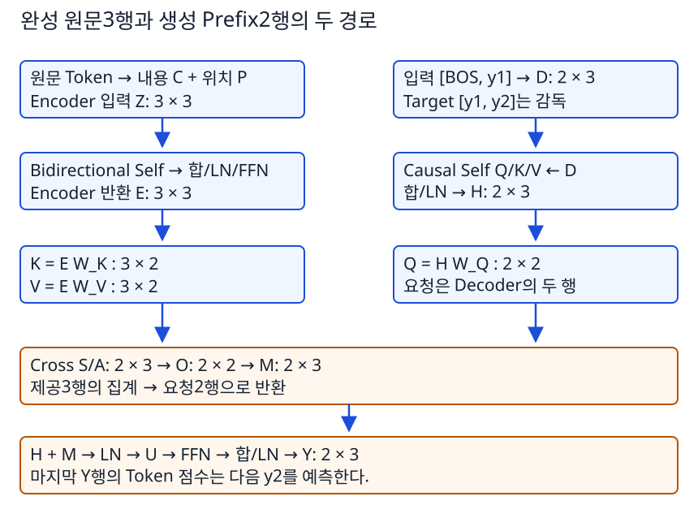{width=100% #s08-fig-flow}

### 예제 10.8.9 Decoder Self 단계와 H {#s08-ex-integrated-self}

앞과 동일한 한 Head 투영 $W_Q=[1,0,0]^\mathsf T$, $W_K=[L,0,0]^\mathsf T$, $W_V=I_3$, $W_O=\tfrac12I_3$를 사용한다. Self Mask는 $[[1,0],[1,1]]$다.

$$
Q_s=[1,0]^\mathsf T,\quad K_s=[L,0]^\mathsf T,\quad V_s=D,
\quad S_s=\begin{bmatrix}L&0\\0&0\end{bmatrix},
$$
$$
A_s=\begin{bmatrix}1&0\\1/2&1/2\end{bmatrix},\quad
O_s=\begin{bmatrix}1&0&1\\1/2&1/2&3/2\end{bmatrix}.
$$

모델 폭으로 반환한 $M_s=O_s/2$를 D에 더하면

$$
R_1=\begin{bmatrix}1.5&0&1.5\\0.25&1.25&2.75\end{bmatrix}.
$$

평균은 [1,17/12], 분산은 [1/2,19/18]이다. ε=0.1, γ=1, β=0의 LN₁을 적용하여

$$
H\approx\begin{bmatrix}0.645497&-1.290994&0.645497\\-1.085304&-0.155043&1.240347\end{bmatrix}:2\times3
$$

를 얻는다. 이 H가 다음 Cross의 요청 출처다. Self의 O나 D를 그대로 Cross Q 입력에 복사하면 위 Post-LN 정의와 다른 모델이 된다.

### 예제 10.8.10 실제 E의 Cross·FFN·최종 반환 {#s08-ex-integrated-cross}

실제 E의 폭은3이므로 축약 예제의2×2 $W_K/W_V$를 그대로 쓸 수 없다. 여기서는 다음 매개변수를 명시한다.

$$
W_Q^c=\begin{bmatrix}1&0\\0&1\\0&0\end{bmatrix},\quad
W_K^c=\sqrt2\begin{bmatrix}\ln2&0\\0&\ln3\\0&0\end{bmatrix},\quad
W_V^c=\begin{bmatrix}1&0\\0&1\\1&-1\end{bmatrix},
$$
$$
W_O^c=\begin{bmatrix}1&0&1/2\\0&1&-1/2\end{bmatrix}.
$$

모든 원문이 제공돼 B는2×3 전부1이다. Q의 비교 폭2, K의 비교 폭2, V의 값 폭2이며 실제 투영은

$$
Q_c\approx\begin{bmatrix}0.645497&-1.290994\\-1.085304&-0.155043\end{bmatrix},
$$
$$
K_c\approx\begin{bmatrix}0.189249&-1.949691\\-1.104823&1.885803\\1.217216&-0.224836\end{bmatrix},
\quad V_c\approx\begin{bmatrix}1.254892&-2.316723\\-1.213771&1.300469\\0.144713&0.952304\end{bmatrix}.
$$

예를 들어 $V_{c,0}=[E_{00}+E_{02},E_{01}-E_{02}]$이고 두 좌표가 Encoder 반환에서 나온다. 첫 요청·첫 제공 score는 $(0.645497\cdot0.189249+(-1.290994)(-1.949691))/\sqrt2\approx1.866196$이다. 실제 계산에는 표시 전 값을 쓴다.

$$
S_c\approx\begin{bmatrix}1.866196&-2.225775&0.760827\\0.068514&0.641125&-0.909474\end{bmatrix},
$$
$$
A_c\approx\begin{bmatrix}0.741953&0.012395&0.245652\\0.317566&0.563008&0.119426\end{bmatrix},\quad
O_c\approx\begin{bmatrix}0.951574&-1.468843\\-0.267571&0.110194\end{bmatrix}.
$$

첫 O 좌표는 약 $0.741953(1.254892)+0.012395(-1.213771)+0.245652(0.144713)=0.951574$이다. 작은 둘째 열 가중치도0이 아니며 정상 허용 정보다. 이 집계는2×2로 **Decoder 두 요청에 반환**된다.

$$
M_c=O_cW_O^c\approx\begin{bmatrix}0.951574&-1.468843&1.210209\\-0.267571&0.110194&-0.188882\end{bmatrix},
$$
$$
R_2=H+M_c\approx\begin{bmatrix}1.597071&-2.759838&1.855706\\-1.352875&-0.044850&1.051465\end{bmatrix}.
$$

LN₂의 평균은 약 [0.230980,-0.115420], 분산은 [4.483644,0.965965]다. 같은 ε/γ/β로

$$
U\approx\begin{bmatrix}0.638079&-1.396962&0.758883\\-1.198555&0.068351&1.130203\end{bmatrix},
$$
$$
F=\tfrac14\operatorname{ReLU}(U)\approx\begin{bmatrix}0.159520&0&0.189721\\0&0.017088&0.282551\end{bmatrix},
$$
$$
R_3=U+F\approx\begin{bmatrix}0.797599&-1.396962&0.948604\\-1.198555&0.085439&1.412754\end{bmatrix}.
$$

마지막 평균은 [0.116413,0.099880], 분산은 [1.148953,1.136593]이고 LN₃ 뒤

$$
Y\approx\begin{bmatrix}0.609526&-1.354171&0.744645\\-1.167633&-0.012986&1.180619\end{bmatrix}:2\times3
\tag{ 10.8.10 }\label{s08-eq-Y}
$$

가 반환된다. 원문 경로는 C/P→Z→Encoder E→Cross K/V→M_c→U/Y이며, Prefix 경로는 D→Self Q/K/V→H→Cross Q→U/Y다. 두 경로가 실제로 같은 Decoder Residual 합에서 만났다.

마지막 입력 행 $D_1=y_1$에 대응하는 $Y_1$을 다음 Token 점수에 연결한다. 예시 세 Token 점수 행렬을

$$
W_t=\begin{bmatrix}1&0&-1\\0&1&0\\1/2&0&1\end{bmatrix}
$$

로 두면 $Y_1W_t\approx[-0.577324,-0.012986,2.348253]$다. 큰 점수를 고르는 예시 규칙은 셋째 Token을 선택한다. 이 Token은 $y_2$의 예측이고 원문 셋째 위치의 새 표현이 아니다. 다음 입력에 무엇을 넣는지는 Token 선택과 생성 계약에 따라 정한다.

### 유제 10.8.6 후속 표현까지 직접 확인하기 {#s08-u-integrated}

통합 사례의 둘째 요청에서 Cross 반환 O_c와 W_O^c를 곱하여 M_c를 구하라. H+M_c를 계산하고 평균·분산·ε를 적용하여 U를 확인하라. ReLU·FFN·마지막 합·LN₃까지 이어서 Y₁과 세 Token 점수를 구하라. 왜 E의 둘째 행에 이 출력을 더하면 잘못인가?

### 한 번의 Mask에서 여러 층의 정보 보장으로 {#s08-dependency}

아래 성질은 Mask가 실제 초기 입력 계약과 함께 작동하는 이유를 설명한다. 수치 불변 시험은 몇 가지 입력에서의 구현 검사를 제공하지만 모든 실수 입력에 대한 성질은 별도 논증이 필요하다.

### 정리 10.8.1 Causal Block 스택의 정보 의존성 {#s08-th-causal}

Decoder 입력 행 i가 초기부터 $D_0,\ldots,D_i$의 허용 정보만으로 만들어지고, 모든 Self-attention이 원래 위치의 $j\le i$만 읽으며, Residual·LN·FFN·위치별 출력 투영이 다른 위치를 섞지 않는다고 하자. 고정된 매개변수와 위치/Mask 조건에서 각 층의 행 i는 $D_0,\ldots,D_i$에만 의존한다.

**증명.** 초기 표현은 가정상 허용 Prefix에만 의존한다. 한 층 앞의 각 행 j가 $D_0,\ldots,D_j$에만 의존한다고 가정하자. 행 i의 Q는 행 i에서, 허용 K/V는 $j\le i$의 행에서 만들어진다. 그 출처들의 의존 집합의 합집합은 $D_0,\ldots,D_i$ 안에 있다. 금지 열은 정규화의 분모와 집계에서 제외된다. 같은 행의 Residual·LN·FFN도 그 집합 밖을 새로 읽지 않는다. 다음 층에서도 같은 성질이 성립하므로 층 수에 대한 귀납으로 결론을 얻는다. $\square$

정리는 정보가 반드시 모두 보존되거나 각 허용 Token이 항상 비영 영향을 준다는 뜻이 아니다. 투영·상쇄 때문에 영향이 사라질 수 있다. 가능한 정보 의존성의 상한을 보장한다. 전체 학습 과정이 사용하는 감독 데이터와 한 번의 예측에서 읽는 입력도 구별한다.

### 정리 10.8.2 Encoder 조건을 읽는 Decoder의 의존성 {#s08-th-conditioned}

완성 원문 x가 모두 허용된 조건이고 E가 오직 x와 고정 매개변수로 만들어졌다고 하자. 위 Causal 가정에 Cross가 오직 그 E와 현재 Decoder 요청을 읽는 조건을 더하면, Decoder의 행 i는 x와 출력 입력 Prefix $D_0,\ldots,D_i$에만 의존한다.

**증명.** Encoder의 조건 출처는 x다. Self 단계는 앞 정리의 귀납 단계와 같고, Cross의 Q는 현재 허용 표현, K/V는 x에만 의존하는 E에서 나온다. Cross 집계와 행별 후속 연산의 의존 집합은 x와 해당 Prefix의 합집합 안이다. 각 Decoder 층에서도 같은 논증을 반복한다. $\square$

조건 x에 미래 Target가 몰래 포함돼 있으면 전제가 깨진다. 또한 스트리밍에서는 원문 전체 x가 아직 허용되지 않으므로 위 정리를 그대로 사용할 수 없다. 도착 시점별 허용 집합 안에서 Encoder 표현 자체의 의존성을 다시 확인해야 한다.

### 예제 10.8.11 Causal Mask 밖의 누출 경로 {#s08-ex-leak}

초기 입력을 $\widetilde D_i=D_i+\tfrac1T\sum_rD_r$로 만든 뒤 올바른 삼각 Mask를 적용했다고 하자. 미래 입력 $D_2$를 바꾸면 $\widetilde D_0$가 이미 달라진다. 요청0의 Q와 Residual 직접 경로가 그 미래 정보를 받아 후속 Y₀가 달라질 수 있다. Mask의0은 입력 생성 경로를 거꾸로 지우지 않는다.

금지 경로를 고치려면 위치별 Token/위치 입력만 쓰거나 해당 시점까지의 과거 집계로 제한한다. 과거 집계를 쓰는 새 설계라면 배열0의 입력이 미래를 읽지 않음을 다시 설명해야 한다. 모든 D를0으로 바꾸는 수정은 미래 누출은 막지만 정상적인 과거 조건도 없애므로 성공으로 인정하지 않는다. 같은 이유로 양방향 Encoder에 `[원문, 정답 번역 전체]`를 넣은 뒤 E를 Decoder가 읽게 하면 정답이 E→Cross V/QK 경로로 돌아온다.

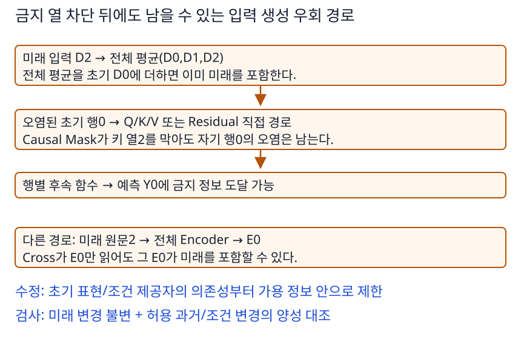{width=100% #s08-fig-leak}

### 유제 10.8.7 누출 경로를 고치되 과거를 보존하기 {#s08-u-leak}

학습 입력은 올바르게 이동했지만 모든 Decoder 입력에 전체 입력 평균을 더했다. 어느 요청이 어느 금지 Token을 어떤 경로로 읽는가? 두 가지 유효한 수정과 수정 후 미래 변경 불변/허용 과거 변경 반응의 검사 방법을 제시하라.

#### 이해 확인 — 비활성 요청 {#s08-check-inactive}

패딩 Query의 A/O를0으로 하면 D+M, LN Shift, FFN Bias도 자동0인가? 다음 층이 그 패딩 행을 키로 읽어도 되는가? [해설](SOLUTIONS.md#solution-s08-check-inactive)에서 두 계약을 분리하자.

### 새 과제에서 구조를 선택하는 사고 순서 {#s08-choice}

먼저 **예측 시점에 실제 사용할 수 있는 입력**을 문장으로 쓴다. 완성 문서인가, 지금까지의 출력인가, 별도 조건 제공자인가? 그 다음 어느 행이 요청하고 어느 집합이 제공하는지 정한다. 같은 집합이면 Self, 다른 표현 집합이면 Cross 인터페이스가 필요하다. 미래 Target와 패딩·권한 밖 입력을 어떤 관계에서 제외할지 정하고, 갱신해야 할 행과 마지막 Readout을 명시한다.

끝으로 다른 구성이 가능한지 검토한다. 분류도 Decoder-only에서 문서 뒤의 마지막 위치에 분류 Readout을 달면 문서 전체를 읽을 수 있다. 생성도 문서를 Prefix 앞쪽에 놓으면 Decoder-only로 조건화할 수 있다. 반대로 입력 전체의 **각 위치**에 양방향 문맥이 필요하다면 기본 Causal 스택의 첫 위치는 뒤쪽을 읽지 못하므로 단순 이름 교체로 충족되지 않는다. 추가 Mask·출력 위치·Readout 설계를 설명해야 한다.

| 정보 요구 | 자연스러운 구성 | 반드시 명시할 조건 |
|---|---|---|
| 완성 입력의 각 위치가 앞뒤 문맥을 사용 | Encoder-only | 유효 입력/세그먼트 접근, 위치별 반환, 과제 Readout |
| 현재 Prefix로 다음 Token 생성 | Decoder-only | 입력 이동, Causal 접근, 마지막 예측 위치 |
| 완성 조건을 별도 표현으로 공급하며 생성 | Encoder–Decoder | Encoder E, Decoder Self와 Cross, 다른 길이의 반환 |
| 조건을 먼저 놓고 같은 시퀀스에서 생성 | Decoder-only 대안 | 조건/출력 구분, 조건이 앞에 있음, 정답 출처 분리 |

이 표는 구조 후보를 찾는 경험적 설계 안내다. 정확도·비용의 보편 순위나 과제마다 하나뿐인 정답 Architecture를 주장하지 않는다. 입력·출력 폭, 계산 자원, 학습 자료에 따른 비교는 실제 조건과 실험이 필요하다.

### 예제 10.8.12 문서 분류와 문서 답변을 분리해서 설계하기 {#s08-ex-choice}

문서 전체를 보고 위험 여부 하나를 분류하고, 별도 질문에 대한 답변도 생성한다고 하자. 첫 기능은 Bidirectional Encoder E의 유효 평균에 두 범주 Readout을 붙일 수 있다. 둘째 기능은 문서·질문을 Encoder의 허용 입력으로 넣고 Decoder의 Prefix로 답변을 생성할 수 있다. 분류 정답이나 답변 정답을 Encoder 입력에 넣지 않는다.

한 Decoder-only 스택을 선택하는 대안에서는 `[문서, 질문, SEP, 답변 Prefix]`를 배치한다. 분류는 문서 뒤에 놓은 지정 위치의 Readout, 답변은 Prefix 마지막 위치의 Token 점수를 사용한다. 이 대안의 각 문서 위치가 Bidirectional E와 같은 표현이라고 주장하지 않는다. 같은 최종 기능을 수행할 수 있다는 것과 내부 조건 공급 경로가 동일하다는 것은 다르다.

#### 이해 확인 — 선택의 이유 {#s08-check-choice}

번역이 조건부 생성이라는 사실만으로 반드시 Encoder–Decoder라고 결정할 수 있는가? Encoder-only를 선택했다면 순서대로 생성하는 기능을 위해 무엇을 더 명시해야 하는가? [해설](SOLUTIONS.md#solution-s08-check-choice)을 확인하자.

### 작은 NumPy 실습에서 확인할 인터페이스 {#s08-code}

`learning-source/architectures.py`는 기존 `masking.py`, `sources.py`, `block.py`를 재사용한다. `full_allowed`는 행/열과 키 유효성을 명시하고, `shifted_inputs/check_shift`는 Token 이동을 검사한다. Decoder 구현은 아래처럼 Self와 Cross 출처를 서로 다른 호출로 드러낸다. 핵심 연산을 모델 API 하나에 숨기지 않는다.

```{.python .numberLines source-root="." source="learning-source/architectures.py" source-start="55" source-end="81" source-revision="architectures-source-v0.1"}
```

지원 범위는 CPU float64·단일2차원 시퀀스·단일 Head·서로 다른 $d_D/d_E$·비교 폭/값 폭·Boolean m×n Mask·요청별 active다. Block Batch·Dropout·학습·Tokenizer·자동 생성 루프·Cache는 구현하지 않는다. Encoder는 기존 Post-LN 함수다. LN/FFN 자체의 Batch 지원과 이 Decoder 인터페이스의 Batch 미지원은 다르다. 모든 입력은 유한 실수이고 지원 범위를 벗어난 축·비교 폭·Residual 폭·유효 빈행을 거부한다. 소스/Target 검사만으로 초기 표현의 정보 오염을 증명할 수는 없다.

활성 요청의 허용 키가 하나도 없으면 Softmax 분모가 정의되지 않으므로 오류다. 비활성 요청은 A/O를0으로 반환하지만 Block 최종0을 자동 보장하지 않는다. 필요하면 최종 반환을 Query 유효성으로 명시적으로 게이트하고 다음 층의 키에서도 패딩을 제외해야 한다. 모든 키가 패딩인 빈 조건 입력을 지원하려면 별도 null 조건 등 설계를 추가해야 하며 이 실습은 그 기능을 지원한다고 주장하지 않는다.

저장소 루트에서 실행한다.

```bash
uv run --locked --directory chapters/transformer/learning-source python demo_architectures.py
uv run --locked --directory chapters/transformer/learning-source python verify_architectures.py
```

demo는 Z→E와 D→Self→Cross→FFN→Y, 마지막 Token 점수 및 축약 Cross를 출력한다. 별도 reference는70자리 Decimal의 스칼라 곱·exp·sqrt·행별 LN/FFN으로 중간값을 다시 계산한다. 미래 변경과 허용 과거·원문 변경, 패딩, 비활성 Query, 키 재배열, 입력 오염도 검사한다. 유한 수치 시험과 앞의 일반 증명을 서로 대신하지 않는다.

\clearpage

### 절 종료 연습문제 {#s08-practice}

입력 계약→접근표→출처→반환→예측의 순서로 풀자. ★ 문제는 구조 설계·전체 Cross 계산·이동 오류·누출 수정·복수 대안의 핵심 수행을 묶는다. 설계형 답은 한 가지 이름에 한정되지 않으며 요구를 만족하는 경로와 조건을 설명해야 한다. [별도 상세 해설](SOLUTIONS.md#s08-independent-solutions)에는 모든 중간 계산·실패 경로·허용 대안과 복습 안내가 있다.

### 연습문제 10.8.1 ★ 새 조건의 전체 구조 설계 {#s08-p01}

완성된 세 개의 센서 보고서와 질문이 제공된다. 보고서는 먼저 각각 위치별 표현으로 갱신하며 서로의 정보를 읽을 수 있다. 답은 질문에 조건화하여 Token 단위로 생성한다. 보고서 정답 레이블과 미래 답변은 입력으로 사용할 수 없다. Encoder–Decoder 한 설계를 선택하여 입력 집합, 각 Block의 역할, Self/Cross 접근표, Q/K/V 출처, 반환 shape와 마지막 예측 위치를 명시하라. 질문을 Encoder에 넣는 방식과 별도 질문 조건을 먼저 인코딩하는 방식 중 한 유효한 방식을 정당화하라. 단순 이름 답은 충분하지 않다.

### 연습문제 10.8.2 유효 입력과 세그먼트 {#s08-p02}

입력 위치0/1은 문서A, 위치2는 문서B, 위치3은 패딩이다. 서로 다른 문서의 정보 접근을 금지하고 앞 세 요청은 활성, 마지막은 비활성이다. Bidirectional 허용표를 쓰라. 위치0의 Q/K/V 출처·허용 키를 설명하고, 전부1과 단순 tril이 각각 어떤 요구를 위반하는지 지적하라.

### 연습문제 10.8.3 Encoder 계산의 변형 {#s08-p03}

Encoder 예제의 Z·투영을 쓰되 첫 요청이 제공 위치0과2만 읽는다. S₀·A₀·O₀·M₀·첫 Residual 합을 계산하라. ε=0.1의 첫 LN까지 계산하고 다른 요청의 Mask 변경이 같은 층 첫 요청의 계산에 영향을 주는 조건을 설명하라.

### 연습문제 10.8.4 분류 Readout과 패딩 평균 {#s08-p04}

유효 Encoder 출력이 [[1, -1, 2], [3, 1, 0]]이고 패딩 출력은 [10, 10, 10]이다. 유효 평균 r에 다음 분류 행렬과 편향을 적용하라.

$$
W_c=\begin{bmatrix}1&0\\0&1\\1&-1\end{bmatrix},\qquad b=[0,1].
$$

 패딩을 포함한 평균으로 바꾸면 두 점수가 어떻게 달라지는가? 특별한 분류 Token이 반드시 필요한지도 논하라.

### 연습문제 10.8.5 ★ 입력–Target 이동 오류 {#s08-p05}

정답 `[7,8,9]`에 대해 개발자가 입력 `[7,8,9]`, Target `[7,8,9]`와 대각선을 포함한 Causal Mask를 썼다. BOS=0이다. 실제 금지 정보가 도달하는 경로를 설명하고 입력/Target를 수정하라. 수정 뒤 세 행의 허용 Token과 예측을 적고, 대각선을 모두 금지하는 것만으로 고치려 할 때 첫 행에 생기는 문제를 설명하라.

### 연습문제 10.8.6 Causal 집계와 양성 대조 {#s08-p06}

입력 D=[[1,0,2],[0,2,1],[2,1,0]]에 Decoder 예제의 투영을 적용하라. 행1의 S/A/O를 계산하고 미래 행2를 [8,5,-2]로 바꾼 경우 및 과거 행0을 [3,0,0]으로 바꾼 경우의 O₁을 구하라. 두 시험의 목적이 다른 이유를 설명하라.

### 연습문제 10.8.7 재배열된 원래 위치 {#s08-p07}

Query 원래 위치가 [0,1,2], Key/Value 배열의 원래 위치가 [2,0,1]이고 모두 유효다. 3×3 Causal 허용표를 쓰라. K/V를 함께 이 순서로 재배열한 경우 앞 예제 O를 보존하려면 A의 열을 어떻게 대응시켜야 하는가? 배열의 tril을 쓰면 어떤 미래/과거 오류가 생기는가?

### 연습문제 10.8.8 병렬 학습과 생성 {#s08-p08}

학습에서 `[BOS,y1,y2,y3]`을 한 번에 넣고 네 출력을 계산할 수 있다. 생성 시 `[BOS,y1]`만 있으면 어느 행의 출력으로 무엇을 예측하는가? 학습 행0이 $y_3$를 읽을 수 없는 근거를 실제 접근 집합으로 설명하고, 미래 입력이 없다는 생성 상황과 비교하라.

### 연습문제 10.8.9 폭이 다른 Cross 계약 {#s08-p09}

H:4×5, E:7×3, 비교 폭2, 값 폭6이다. W_Q/W_K/W_V, S/A/O, 단일 Head W_O와 최종 M의 shape를 모두 적으라. O를 E에 더하는 구현과 Q=EW_Q를 쓰는 구현은 각각 어느 계약에서 실패하는가?

### 연습문제 10.8.10 ★ 새로운 Cross를 처음부터 끝까지 {#s08-p10}

H=[[1,1],[2,0]], **이미 계산된 Encoder 출력** E=[[0,1],[1,0],[1,1]]이다. $W_Q=I_2,W_K=\sqrt2\ln2 I_2,W_V=[[1,2],[-1,1]]$, 전부 허용2×3 Mask를 사용하라. Q/K/V/S/A/O를 모두 구하고 $W_O=I_2$ 뒤 H+M을 구하라. ε=1/4, γ=1, β=0인 LN₂의 평균·분산·최종 U도 계산하라. 반환 행이 무엇을 뜻하는지 설명하라.

### 연습문제 10.8.11 완성 원문에 잘못된 tril {#s08-p11}

직전 문제에 $B=[[1,0,0],[1,1,0]]$을 적용하여 A/O를 다시 계산하라. 어느 원문 기여를 제거했는지 비교하고, 원문3개가 생성 전에 모두 제공되는 과제에서 그 차단을 미래 정답 방지로 정당화할 수 있는지 논하라.

### 연습문제 10.8.12 도착 시간과 표현의 생성 시간 {#s08-p12}

원문 도착 시간은 [0,2,5], Decoder 예측 시점은 [1,6]이다. 접근표를 구성하라. 그런데 Encoder의 첫 E행이 시점5 이후 전체 원문을 읽어 만들어졌다. 시점1의 요청이 E₀만 읽으면 안전한가? 실제 간접 경로를 적고 유효한 Encoder/Cross 수정 한 가지를 제시하라.

### 연습문제 10.8.13 Q/K/V를 뒤집은 인터페이스 {#s08-p13}

H:2×3, E:3×2에서 개발자가 Q=EW_Q, K=HW_K, V=HW_V로 두고 O를 Decoder 갱신이라 부른다. 각 행의 출처와 반환 대상이 어떻게 뒤집히는가? 올바른 배정과 투영 shape를 비교 폭2/값 폭1로 수정하라. 단순 전치로 해결할 수 있는가?

### 연습문제 10.8.14 ★ 미래 경로를 고치면서 과거 보존 {#s08-p14}

Decoder 입력을 이동한 뒤 $\widetilde D_i=D_i+(D_0+D_1+D_2)/3$로 만들어 Causal Self-attention에 준다. 행0의 예측이 미래 입력2에 의존하는 두 경로를 적으라. 전체 평균을 제거하거나 Causal 평균으로 대체하는 수정의 차이를 설명하라. 수정 전후의 미래 불변/허용 과거 양성 시험을 설계하고 상수0 구현을 배제하는 판정 기준을 적으라.

### 연습문제 10.8.15 Padding 키와 비활성 Query {#s08-p15}

축약 Cross 예제의 셋째 E행을 패딩, 둘째 요청을 비활성으로 지정한다. 첫 A/O와 둘째 A/O를 구하라. 활성 첫 요청의 모든 키를 금지하면 무엇을 해야 하는가? 비활성 O=0 뒤 Residual H와 LN/FFN이 비영일 수 있는 한 예를 제시하라.

### 연습문제 10.8.16 Encoder 출력과 Embedding {#s08-p16}

C+P=Z, E=Encoder(Z), H=DecoderSelf(D)인 모델에서 Cross의 K/V를 Z에서 계산했다. 원문만 읽으므로 미래 답변 누출은 없다고 한다. 정보 허용과 인터페이스 일치라는 두 관점에서 이 주장을 평가하라. 올바른 구현과, Z를 제공자로 쓰는 다른 설계를 명시적으로 채택할 경우의 설명을 구별하라.

### 연습문제 10.8.17 ★ 조건부 생성의 두 대안 {#s08-p17}

완성된 계약서와 사용자 질문이 제공되고 답변을 순서대로 생성해야 한다. Encoder–Decoder와 Decoder-only 각각에서 입력 순서·출처·허용표·정답 공급 분리·출력 Readout을 설계하라. Decoder-only에서도 모든 계약서 Token을 참고할 수 있는 요청 위치를 지정하라. 각 원문 행의 정보 의존성 차이를 설명하고 성능 우위를 주장하려면 필요한 추가 근거를 적으라.

### 연습문제 10.8.18 분류를 Decoder-only로 바꾸기 {#s08-p18}

완성 문서의 위험 여부 하나만 예측한다. 기본 Causal Decoder의 첫 입력 행을 Readout으로 쓰면 뒤 문서를 사용할 수 없다. 문서 뒤에 지정 분류 위치를 두는 대안을 설계하라. Encoder의 모든 위치 표현과 동일하지 않지만 분류 요구를 충족할 수 있는 이유를 설명하라.

### 연습문제 10.8.19 Architecture와 학습 목표 {#s08-p19}

“Encoder-only는 MLM”, “Decoder-only는 조건부 생성 불가”, “Encoder–Decoder는 항상 원 논문의 Post-LN”이라는 세 문장을 각각 교정하라. MASK 입력과 별도 Target 예시, Prefix 입력 예시, 다른 정규화 배치의 출처를 포함하되 실제 성능 비교를 추측하지 말라.

### 연습문제 10.8.20 NumPy 출처와 축 오류 {#s08-p20}

다음은 H가 요청하고 E가 제공하는 Cross 구현이다. `wq/wk/wv`는 각 올바른 출처에 맞춘 행렬이며 `scores`는 m×n이다.

```python
q = E @ wq
k = H @ wk
v = E @ wv
scores = (q @ k.T) / np.sqrt(q.shape[1])
a = np.exp(scores) / np.exp(scores).sum(axis=0, keepdims=True)
o = a.T @ v
```

출처·정규화 축·집계 축의 오류를 수정하라. Mask를 적용하는 시점과 활성 빈행의 처리도 포함하라. 같은 길이/폭이라 오류가 실행되더라도 왜 정당한 Cross가 아닌가?

### 연습문제 10.8.21 전체 통합 경로의 누락 {#s08-p21}

통합 사례에서 Cross Q를 H가 아니라 D에서 만들고 M_c를 E에 더했다. 두 오류를 각각 찾고 올바른 계산 경로를 입력부터 다음 Token 점수까지 작성하라. E를 영원히 고정된 표현이라고 불러도 되는가? 이 Forward 호출에서 직접 반환하는 배열과 학습 중 변화를 구별하라.

### 연습문제 10.8.22 층 전체의 정보 보장 {#s08-p22}

한 Attention의 미래 변경 불변 시험이 통과했다. 이후 층의 LN을 위치 축으로 계산하고 모든 Decoder 위치를 섞었다. 전체 스택도 안전하다는 주장을 반박하라. 행별 LN/FFN으로 수정하고 귀납 증명에 필요한 초기 입력·Mask·조건 제공자·추가 연산의 가정을 적으라. 실수 전체에 대한 증명과100개 수치 시험의 범위를 구별하라.

### 심화 문제

### 심화문제 10.8.1 정보 의존 집합의 합성 {#s08-c01}

각 초기 행의 의존 집합을 $\mathcal D_i^{(0)}$라 쓰자. Self의 허용 관계 B와 행별 Residual/LN/FFN을 사용할 때 다음 층의 의존 집합 상한을 합집합으로 표현하고 증명하라. Cross에서 Encoder 제공 집합 $\mathcal E_j$를 더하는 경우도 쓰라. 이를 Causal 스택·완성 원문 조건·스트리밍 누출에 각각 적용하라. 가능한 의존성과 반드시 비영 기여의 차이를 설명하라.

### 심화문제 10.8.2 입력 Prefix 내부의 전체 접근 {#s08-c02}

한 시퀀스 `[x1,x2,x3,SEP,BOS,y1,y2]`에서 완성 조건 부분0–3은 서로 전체 접근하고 생성 입력 부분4–6은 조건 전체와 자기 위치 이하 생성 입력만 읽게 하려 한다. 7×7 허용표를 구성하라. 어느 예측 위치가 $y_2$를 맞히는지, 조건 표현이 미래 출력으로 오염되지 않는 귀납 조건은 무엇인지 설명하라. 전7×7을 양방향으로 만드는 변형의 구체적 실패 경로도 제시하라.

### 심화문제 10.8.3 설계안을 반박하고 복구하기 {#s08-c03}

순차 도착하는 의료 기록을 시점별로 읽어 보고서를 생성하는 실험적 과제다. 도착한 기록만 사용할 수 있고, 이전 출력도 활용해야 하며, 미래 보고서 정답은 금지된다. “완성 원문 번역과 같으니 전체 Encoder와 전부 허용 Cross를 사용한다”는 설계안을 반박하라. 도착 시간·제공 표현의 계산 시간/의존성·Decoder Prefix·세그먼트 권한·패딩을 함께 명시한 유효한 설계 두 가지를 비교하라. 여기서는 구조 계약을 설계하며 의학적 판단이나 임상 성능을 평가하지 않는다.

### 다음 토큰을 만들 때 남는 계산 질문 {#s08-next}

완성 입력의 이해에는 유효 입력 전체를, 생성에는 이미 제공된 출력 Prefix를, 별도 조건 생성에는 Encoder의 조건 표현과 그 Prefix를 함께 사용했다. 어떤 구조를 선택했든 예측 위치가 읽을 수 있는 정보와 반환 행을 명시하면 잘못된 Mask·출처·정답 공급 경로를 찾을 수 있다.

이제 Decoder가 새 Token을 하나 더 생성했다고 하자. **새 Token을 계산할 때마다 이전 Prefix의 Key와 Value를 모두 다시 계산해야 하는가?** [10.9절](#sec-cache)에서는 이번에 추적한 각 층의 입력 표현을 출발점으로 그 질문을 다룬다.

\clearpage

\clearpage

## 10.9 다음 토큰 계산과 KV Cache 재사용 {#sec-cache}

### 이미 읽은 토큰의 계산을 왜 다시 해야 할까? {#s09-start}

문장을 이어 쓰는 Decoder는 지금까지 주어진 토큰들로 다음 토큰의 점수를 계산한다. 토큰 하나를 골라 문장 끝에 붙이면 입력이 길어진다. 가장 단순한 구현은 길어진 입력 전체를 다시 모델에 넣는다. 같은 앞부분을 두 번, 세 번 읽는 셈이다. 그런데 Causal Decoder의 과거 위치는 뒤에 붙은 새 토큰을 읽을 수 없다. 미래를 보지 못하는데, 새 미래가 생겼다는 이유로 과거 계산을 모두 되풀이해야 할까?

이 절에서는 먼저 그 되풀이를 실제 두 레이어 계산에서 확인한다. 그다음 변하지 않는 Key와 Value를 저장해 새 위치만 계산하는 방법을 도출한다. 저장했다는 사실만으로 재사용이 정당해지지는 않는다. 토큰·위치·모델·허용 정보가 바뀌면 무엇이 그대로이고 무엇을 다시 계산해야 하는지도 배워야 한다. **새 항목을 계산하는 일과 기존 항목의 유효성을 판단하는 일은 서로 다른 작업이다.**

[10.8절](#sec-architectures)의 입력/Target 이동, [10.3절](#sec-visibility)의 원래 위치와 허용 관계, [10.4절](#sec-sources)의 Q/K/V 생성원, [10.5절](#sec-heads)의 Head 결합을 재사용한다. [10.6절](#sec-position)의 위치 처리와 [10.7절](#sec-block)의 Pre-LN 경로도 연결된다. 내적은 대응 좌표의 곱을 더하고, Softmax는 허용된 제공 위치에 걸쳐 지수를 정규화한다. 행렬과 함수 합성이 낯설면 MATH-LINALG의 해당 기초를 복습하고 아래 투영으로 돌아오자.

### 선택한 토큰과 처리한 입력은 언제 같아지는가? {#s09-time}

이미 처리한 입력이 `[BOS, y1]`이고 원래 위치가 `[0,1]`이라고 하자. 마지막 입력 `y1`의 반환으로 `y2` 후보들의 점수를 얻는다. 어떤 선택 규칙으로 실제 `y2`를 골랐다고 해도, 모델이 `y2`를 입력으로 읽은 것은 아니다. 그 순간 저장된 과거 상태는 위치0과1의 것이다.

다음 계산에서는 선택한 `y2`를 위치2의 입력으로 넣는다. 이 입력이 두 레이어를 거쳐 반환을 만든 뒤에야 위치2의 Key와 Value가 저장된다. 위치2의 마지막 반환은 그다음 `y3`의 점수를 만드는 데 쓰인다. 예측 대상의 번호와 현재 처리하는 입력 위치의 번호를 한 칸 이동해 읽는 것이 핵심이다.[^s09-transformer]

| 시점 | 모델이 처리하는 입력 | 마지막 반환으로 점수를 내는 대상 | 처리 직후 저장된 위치 |
|---|---|---|---|
| 앞 단계 | `[BOS,y1]` | `y2` | 0,1 |
| 토큰 선택 | `y2` 선택만 수행 | 선택 규칙의 결과 | 여전히0,1 |
| 새 입력 처리 | 위치2의 `y2` | `y3` | 0,1,2 |

Teacher Forcing에서는 정답 입력 `[BOS,y1,y2]`가 이미 준비돼 있어 Causal Mask 아래 세 입력 위치를 병렬 처리할 수 있다. 생성에서는 아직 선택하지 않은 미래 토큰이 없으므로 이 세 번째 행이 처음부터 준비돼 있지 않다. 선택 단계와 모델 입력 처리 단계를 합쳐 부르는 구현도 있지만, 어떤 토큰의 K/V가 존재하는지 판단할 때는 두 연산을 나누어 보자.

**이해 확인1.** 위치1의 반환에서 `y2`를 선택한 직후, `y2`의 둘째 레이어 V가 존재하는가? 이를 만들기 위해 아직 필요한 경로를 쓰라. [해설](SOLUTIONS.md#s09-check1)

### 작은 Decoder의 모든 계약을 고정하기 {#s09-model}

계산을 숨기지 않도록 모델 폭2, 두 Head, 두 레이어의 Decoder를 사용한다. 두 레이어에 같은 매개변수를 넣지만 각 레이어의 입력 표현은 다르다. 따라서 같은 투영 행렬을 쓴다는 사실이 같은 K/V를 만든다는 뜻은 아니다. 아래 값은 손계산을 위해 선택한 교육용 값이며 학습된 언어모델의 실측값이 아니다.

토큰 표에서 `BOS`, `y1`, `y2`의 Embedding은 각각 `[1,0]`, `[0,1]`, `[1,1]`이다. 위치 표현은 $P_p=[0.1p,0]$이고 $H^{(0)}_p=E(x_p)+P_p$다. 위치2를 처리하면 Embedding `[1,1]`에 `[0.2,0]`을 더해 `[1.2,1]`을 얻는다. 위치를 매번0으로 시작하면 같은 토큰이라도 이 초기 표현이 달라진다.

#### 정의 10.9.1 이 절의 Pre-LN Decoder Block {#cache-block}

이 절의 Block은 Attention 전에 정규화하고, 그 반환을 더한 뒤 FFN 전에 다시 정규화하는 위치별 함수다.

$$
\begin{aligned}
z^{(\ell)}_p&=N^{(\ell)}_1(H^{(\ell-1)}_p),\\
R^{(\ell)}_p&=H^{(\ell-1)}_p+M^{(\ell)}_p,\\
U^{(\ell)}_p&=N^{(\ell)}_2(R^{(\ell)}_p),\\
H^{(\ell)}_p&=R^{(\ell)}_p+F^{(\ell)}(U^{(\ell)}_p).
\end{aligned}
\tag{ 10.9.1 }\label{cache-block-eq}
$$

$\ell=1,2$는 레이어, $p$는 원래 입력 위치다. $M$은 여러 Head의 출력을 Concat하고 $W_O$로 변환한 폭2의 Attention 반환이다. 모든 덧셈은 같은 위치의 폭2 벡터끼리 한다. 새 입력은 $H^{(0)}_2$에서 시작하며 첫 Block의 최종 $H^{(1)}_2$가 둘째 Block의 입력이다. 원 Transformer의 Post-LN 배치와 이 교육용 Pre-LN 배치는 구별한다.[^s09-transformer]

두 정규화는 이 예제에서 같은 함수 $N$이다. 평균과 분산은 **한 토큰의 두 좌표**에서만 구한다.

$$
\mu(u)=\frac{u_1+u_2}{2},\quad
\sigma^2(u)=\frac{(u_1-\mu)^2+(u_2-\mu)^2}{2},\quad
N(u)=\frac{u-\mu(u)}{\sqrt{\sigma^2(u)+1}}.
$$

$\gamma=[1,1]$, $\beta=[0,0]$, $\varepsilon=1$이다. 이 큰 $\varepsilon$은 작은 수치를 읽기 쉽게 고른 것으로 실제 모델의 권장값이 아니다. 각 레이어의 FFN은

$$
F(u)=\operatorname{ReLU}(uB_1)B_2+b_2,\qquad
B_1=\operatorname{diag}(1,-1),\quad
B_2=\operatorname{diag}(0.5,0.25),\quad b_2=[0.1,-0.1]
$$

이다. 첫 편향은0이다. Working에서는 `norm`과 `feed`에 넣을 입력을 직접 선택해 실행해도 된다. 함수가 대신하는 것은 내부 산술이며, 새 Q/K/V 계산·Head 집계·Residual 덧셈·다음 레이어 전달은 직접 수행한다. Deep에서는 평균/분산·두 행렬곱·ReLU까지 손으로 검산하자.

각 Head의 비교 폭과 값 폭은1이고 투영은 다음과 같다. 행벡터 $z=[z_1,z_2]$에 오른쪽에서 곱한다.

$$
\begin{aligned}
W_{Q,1}=W_{K,1}&=\begin{bmatrix}1\\0\end{bmatrix},&
W_{V,1}&=\begin{bmatrix}2\\0\end{bmatrix},\\
W_{Q,2}=W_{K,2}&=\begin{bmatrix}0\\1\end{bmatrix},&
W_{V,2}&=\begin{bmatrix}0\\4\end{bmatrix},&
W_O&=\begin{bmatrix}1&1\\0&1\end{bmatrix}.
\end{aligned}
$$

따라서 Head1은 $q=k=z_1,v=2z_1$, Head2는 $q=k=z_2,v=4z_2$다. 비교 폭1이라 scale은 $\sqrt{1}=1$이다. $C=[o_1,o_2]$를 결합하면 $M=CW_O=[o_1,o_1+o_2]$가 된다. Dropout은 없고 float64로 계산하며 마지막 레이어 뒤 추가 LN은 두지 않는다. 다음 토큰의 교육용 점수는

$$G=H^{(2)}W_{\mathrm{read}},\qquad
W_{\mathrm{read}}=\begin{bmatrix}1&0&-1\\0&1&1\end{bmatrix}
$$

로 정의한다. 세 열은 세 후보의 점수이고 별도 확률 또는 sampling 과제를 가정하지 않는다. 이 Readout 추가는 기존 내부 Cache 수치를 바꾸지 않는다.

### Cache가 없다면 실제로 무엇을 다시 계산하는가? {#s09-full}

#### 예제 10.9.1 길이2 Prefix의 완전 계산 {#cache-full-two}

먼저 `[BOS,y1]`만 처리하자. 초기 입력은 $H^{(0)}=[(1,0);(0.1,1)]$다. 위치0은 자기 Key 하나만 읽으므로 두 Head 모두 가중치1이다. $N([1,0])=[1,-1]/\sqrt5$이며 Head1의 V는 $2/\sqrt5$, Head2의 V는 $-4/\sqrt5$다. Concat과 $W_O$를 지나 $M_0=[0.894427,-0.894427]$를 얻는다. 이를 초기 입력에 더한 뒤 **그 합**을 두 번째 정규화에 넣는다.

위치1은 위치0과1을 함께 읽는다. $N([0.1,1])=[-0.45,0.45]/\sqrt{1.2025}$다. Head1의 Query가 두 Key를 비교하는 점수는 약 $[-0.183521,0.168399]$다. Softmax는 두 허용 지수의 합으로 나눈다. 미래 열은 없으므로 위치0의 분모에 위치1의 지수를 포함하지 않는다.


Head1의 Q/K/V와 점수·비율·출력은 다음과 같다.

| 원위치 | Q | K | V | Head 출력 |
|---|---|---|---|---|
| 0 | `[0.447214]` | `[0.447214]` | `[0.894427]` | `[0.894427]` |
| 1 | `[-0.410365]` | `[-0.410365]` | `[-0.820729]` | `[-0.112512]` |

$$S_1=\begin{bmatrix}0.200000&-0.183521\\-0.183521&0.168399\end{bmatrix},\qquad A_1=\begin{bmatrix}1.000000&0.000000\\0.412917&0.587083\end{bmatrix}.$$

Head2의 Q/K/V와 점수·비율·출력은 다음과 같다.

| 원위치 | Q | K | V | Head 출력 |
|---|---|---|---|---|
| 0 | `[-0.447214]` | `[-0.447214]` | `[-1.788854]` | `[-1.788854]` |
| 1 | `[0.410365]` | `[0.410365]` | `[1.641459]` | `[0.225024]` |

$$S_2=\begin{bmatrix}0.200000&-0.183521\\-0.183521&0.168399\end{bmatrix},\qquad A_2=\begin{bmatrix}1.000000&0.000000\\0.412917&0.587083\end{bmatrix}.$$


첫 레이어의 최종 두 반환이 둘째 레이어의 입력이다. 둘째 레이어는 그 두 반환을 새로 정규화하고 같은 행렬로 투영한다. 첫 위치의 둘째 레이어 K가 `0.847402`인 까닭은 첫 K를 다시 쓴 것이 아니라 $N(H^{(1)}_0)$의 첫 좌표를 얻었기 때문이다. 두 레이어의 입력부터 반환까지 아래에 모두 표시했다. 소수는 표시할 때만 반올림하며 뒤 계산에는 반올림 전 값을 쓴다.


레이어1의 길이2 전체 경로:

| 단계 | 위치0 | 위치1 |
|---|---|---|
| 입력 h | `[1.000000, 0.000000]` | `[0.100000, 1.000000]` |
| N(h) | `[0.447214, -0.447214]` | `[-0.410365, 0.410365]` |
| Concat C | `[0.894427, -1.788854]` | `[-0.112512, 0.225024]` |
| M | `[0.894427, -0.894427]` | `[-0.112512, 0.112512]` |
| R=h+M | `[1.894427, -0.894427]` | `[-0.012512, 1.112512]` |
| U=N(R) | `[0.812635, -0.812635]` | `[-0.490269, 0.490269]` |
| ReLU 활성 | `[0.812635, 0.812635]` | `[0.000000, 0.000000]` |
| F(U) | `[0.506317, 0.103159]` | `[0.100000, -0.100000]` |
| Block 반환 | `[2.400745, -0.791268]` | `[0.087488, 1.012512]` |


레이어2의 길이2 전체 경로:

| 단계 | 위치0 | 위치1 |
|---|---|---|
| 입력 h | `[2.400745, -0.791268]` | `[0.087488, 1.012512]` |
| N(h) | `[0.847402, -0.847402]` | `[-0.419787, 0.419787]` |
| Concat C | `[1.694804, -3.389609]` | `[0.098305, -0.196610]` |
| M | `[1.694804, -1.694804]` | `[0.098305, -0.098305]` |
| R=h+M | `[4.095549, -2.486073]` | `[0.185793, 0.914207]` |
| U=N(R) | `[0.956799, -0.956799]` | `[-0.342217, 0.342217]` |
| ReLU 활성 | `[0.956799, 0.956799]` | `[0.000000, 0.000000]` |
| F(U) | `[0.578400, 0.139200]` | `[0.100000, -0.100000]` |
| Block 반환 | `[4.673949, -2.346873]` | `[0.285793, 0.814207]` |

Head1의 Q/K/V와 점수·비율·출력은 다음과 같다.

| 원위치 | Q | K | V | Head 출력 |
|---|---|---|---|---|
| 0 | `[0.847402]` | `[0.847402]` | `[1.694804]` | `[1.694804]` |
| 1 | `[-0.419787]` | `[-0.419787]` | `[-0.839573]` | `[0.098305]` |

$$S_1=\begin{bmatrix}0.718090&-0.355728\\-0.355728&0.176221\end{bmatrix},\qquad A_1=\begin{bmatrix}1.000000&0.000000\\0.370062&0.629938\end{bmatrix}.$$

Head2의 Q/K/V와 점수·비율·출력은 다음과 같다.

| 원위치 | Q | K | V | Head 출력 |
|---|---|---|---|---|
| 0 | `[-0.847402]` | `[-0.847402]` | `[-3.389609]` | `[-3.389609]` |
| 1 | `[0.419787]` | `[0.419787]` | `[1.679146]` | `[-0.196610]` |

$$S_2=\begin{bmatrix}0.718090&-0.355728\\-0.355728&0.176221\end{bmatrix},\qquad A_2=\begin{bmatrix}1.000000&0.000000\\0.370062&0.629938\end{bmatrix}.$$


#### 유제 10.9.1 첫 위치의 출처 연결 {#cache-prefix-practice}

위 예제의 위치0에서 $R^{(1)}_0$와 $U^{(1)}_0$를 계산하라. FFN 내부를 실행 함수로 확인해도 되지만, 두 번째 정규화에 $H^{(0)}_0$를 넣는 풀이가 왜 틀렸는지 설명하라. $H^{(1)}_0$로부터 둘째 레이어의 두 K/V를 직접 투영하라. [상세 해설](SOLUTIONS.md#solution-cache-prefix-practice)

#### 예제 10.9.2 길이3으로 늘어난 뒤의 완전 재계산 {#cache-full-three}

이제 `y2`를 골라 위치2 입력으로 받았다. Cache가 없는 구현은 $H^{(0)}=[(1,0);(0.1,1);(1.2,1)]$ 세 행을 모두 각 Block에 넣는다. 첫 두 행에도 N, Q/K/V, Attention, 출력 투영, 두 합과 FFN을 다시 적용한다. 둘째 레이어에서도 첫 두 행의 새 입력을 다시 얻고 그 행들의 Q/K/V를 다시 만든다.

이 구현에서 전체 점수 배열은 $3\times3$이다. 허용 관계는 아래와 같다.

$$L=\begin{bmatrix}1&0&0\\1&1&0\\1&1&1\end{bmatrix}.$$

위치0은 여전히 위치0만, 위치1은 여전히 위치0과1만 읽는다. 따라서 첫 두 행의 결과가 길이2 실행과 그대로 이어진다. 아래 표의 $Q,K,V$는 Head별이고, 금지 점수 셀도 원 내적은 계산할 수 있지만 Softmax에는 넣지 않는다. $S$는 Mask 적용 전 점수다.


레이어1의 길이3 전체 경로:

| 단계 | 위치0 | 위치1 | 위치2 |
|---|---|---|---|
| 입력 h | `[1.000000, 0.000000]` | `[0.100000, 1.000000]` | `[1.200000, 1.000000]` |
| N(h) | `[0.447214, -0.447214]` | `[-0.410365, 0.410365]` | `[0.099504, -0.099504]` |
| Concat C | `[0.894427, -1.788854]` | `[-0.112512, 0.225024]` | `[0.115480, -0.230960]` |
| M | `[0.894427, -0.894427]` | `[-0.112512, 0.112512]` | `[0.115480, -0.115480]` |
| R=h+M | `[1.894427, -0.894427]` | `[-0.012512, 1.112512]` | `[1.315480, 0.884520]` |
| U=N(R) | `[0.812635, -0.812635]` | `[-0.490269, 0.490269]` | `[0.210645, -0.210645]` |
| ReLU 활성 | `[0.812635, 0.812635]` | `[0.000000, 0.000000]` | `[0.210645, 0.210645]` |
| F(U) | `[0.506317, 0.103159]` | `[0.100000, -0.100000]` | `[0.205323, -0.047339]` |
| Block 반환 | `[2.400745, -0.791268]` | `[0.087488, 1.012512]` | `[1.520803, 0.837181]` |

Head1의 Q/K/V와 점수·비율·출력은 다음과 같다.

| 원위치 | Q | K | V | Head 출력 |
|---|---|---|---|---|
| 0 | `[0.447214]` | `[0.447214]` | `[0.894427]` | `[0.894427]` |
| 1 | `[-0.410365]` | `[-0.410365]` | `[-0.820729]` | `[-0.112512]` |
| 2 | `[0.099504]` | `[0.099504]` | `[0.199007]` | `[0.115480]` |

$$S_1=\begin{bmatrix}0.200000&-0.183521&0.044499\\-0.183521&0.168399&-0.040833\\0.044499&-0.040833&0.009901\end{bmatrix},\qquad A_1=\begin{bmatrix}1.000000&0.000000&0.000000\\0.412917&0.587083&0.000000\\0.346717&0.318358&0.334926\end{bmatrix}.$$

Head2의 Q/K/V와 점수·비율·출력은 다음과 같다.

| 원위치 | Q | K | V | Head 출력 |
|---|---|---|---|---|
| 0 | `[-0.447214]` | `[-0.447214]` | `[-1.788854]` | `[-1.788854]` |
| 1 | `[0.410365]` | `[0.410365]` | `[1.641459]` | `[0.225024]` |
| 2 | `[-0.099504]` | `[-0.099504]` | `[-0.398015]` | `[-0.230960]` |

$$S_2=\begin{bmatrix}0.200000&-0.183521&0.044499\\-0.183521&0.168399&-0.040833\\0.044499&-0.040833&0.009901\end{bmatrix},\qquad A_2=\begin{bmatrix}1.000000&0.000000&0.000000\\0.412917&0.587083&0.000000\\0.346717&0.318358&0.334926\end{bmatrix}.$$


레이어2의 길이3 전체 경로:

| 단계 | 위치0 | 위치1 | 위치2 |
|---|---|---|---|
| 입력 h | `[2.400745, -0.791268]` | `[0.087488, 1.012512]` | `[1.520803, 0.837181]` |
| N(h) | `[0.847402, -0.847402]` | `[-0.419787, 0.419787]` | `[0.323438, -0.323438]` |
| Concat C | `[1.694804, -3.389609]` | `[0.098305, -0.196610]` | `[0.671321, -1.342642]` |
| M | `[1.694804, -1.694804]` | `[0.098305, -0.098305]` | `[0.671321, -0.671321]` |
| R=h+M | `[4.095549, -2.486073]` | `[0.185793, 0.914207]` | `[2.192124, 0.165860]` |
| U=N(R) | `[0.956799, -0.956799]` | `[-0.342217, 0.342217]` | `[0.711704, -0.711704]` |
| ReLU 활성 | `[0.956799, 0.956799]` | `[0.000000, 0.000000]` | `[0.711704, 0.711704]` |
| F(U) | `[0.578400, 0.139200]` | `[0.100000, -0.100000]` | `[0.455852, 0.077926]` |
| Block 반환 | `[4.673949, -2.346873]` | `[0.285793, 0.814207]` | `[2.647976, 0.243786]` |

Head1의 Q/K/V와 점수·비율·출력은 다음과 같다.

| 원위치 | Q | K | V | Head 출력 |
|---|---|---|---|---|
| 0 | `[0.847402]` | `[0.847402]` | `[1.694804]` | `[1.694804]` |
| 1 | `[-0.419787]` | `[-0.419787]` | `[-0.839573]` | `[0.098305]` |
| 2 | `[0.323438]` | `[0.323438]` | `[0.646876]` | `[0.671321]` |

$$S_1=\begin{bmatrix}0.718090&-0.355728&0.274082\\-0.355728&0.176221&-0.135775\\0.274082&-0.135775&0.104612\end{bmatrix},\qquad A_1=\begin{bmatrix}1.000000&0.000000&0.000000\\0.370062&0.629938&0.000000\\0.398747&0.264666&0.336587\end{bmatrix}.$$

Head2의 Q/K/V와 점수·비율·출력은 다음과 같다.

| 원위치 | Q | K | V | Head 출력 |
|---|---|---|---|---|
| 0 | `[-0.847402]` | `[-0.847402]` | `[-3.389609]` | `[-3.389609]` |
| 1 | `[0.419787]` | `[0.419787]` | `[1.679146]` | `[-0.196610]` |
| 2 | `[-0.323438]` | `[-0.323438]` | `[-1.293752]` | `[-1.342642]` |

$$S_2=\begin{bmatrix}0.718090&-0.355728&0.274082\\-0.355728&0.176221&-0.135775\\0.274082&-0.135775&0.104612\end{bmatrix},\qquad A_2=\begin{bmatrix}1.000000&0.000000&0.000000\\0.370062&0.629938&0.000000\\0.398747&0.264666&0.336587\end{bmatrix}.$$


길이2에서 이미 만든 위치0/1의 K/V가 이 표에서 똑같이 다시 등장한다. 그 행들의 Attention 비율과 반환도 같다. 새로 필요한 행은 위치2다. **기존 계산이 변하지 않는 조건을 증명할 수 있다면, 기존 K/V를 보관해 이 중복을 없앨 수 있다.** 다음 절차에서는 과거 반환 전체를 저장해 다시 전달하지도 않는다. 새 위치가 각 레이어에서 읽을 과거 K/V만 준비하고 새 위치의 Block 반환을 다음 레이어로 전달한다.

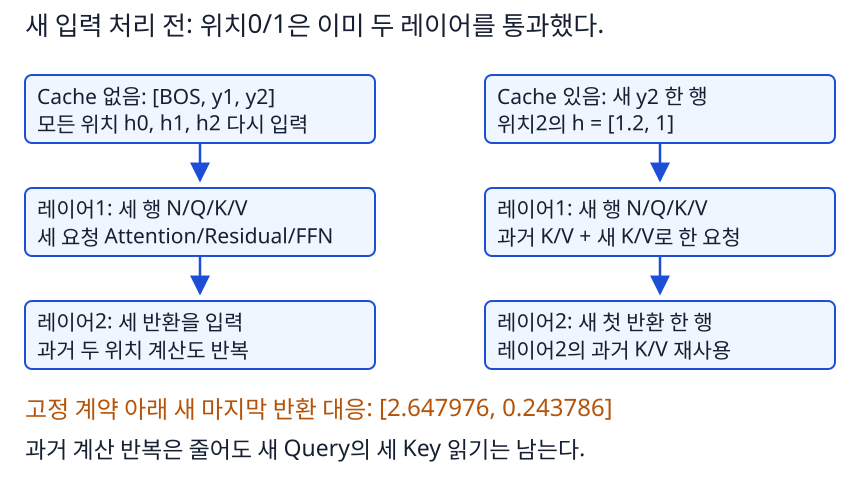{width=100% #cache-repeat-fig}

**이해 확인2.** 길이3의 Full 실행에서 처음 두 위치의 K/V와 반환이 같은 이유를 세 가지로 나누어 설명하라. ‘입력이 같아서’만으로 둘째 레이어를 설명할 수 있는가? [해설](SOLUTIONS.md#s09-check2)

### 무엇을 어디에 저장하는가? {#s09-definition}

#### 정의 10.9.2 KV Cache {#cache-content}

KV Cache는 이미 처리한 입력 위치들의 Attention Key와 Value를 레이어와 Head별로 보존하여 이후 요청에서 재사용하는 저장 내용이다. 이 절의 Pre-LN 규약에서는

$$
\begin{aligned}
z^{(\ell)}_p&=N^{(\ell)}_1(H^{(\ell-1)}_p),\\
q^{(\ell)}_{r,p}&=z^{(\ell)}_pW^{(\ell)}_{Q,r},\\
k^{(\ell)}_{r,p}&=z^{(\ell)}_pW^{(\ell)}_{K,r},\qquad
v^{(\ell)}_{r,p}=z^{(\ell)}_pW^{(\ell)}_{V,r}.
\end{aligned}
\tag{ 10.9.2 }\label{cache-qkv-eq}
$$

$\ell$은 레이어, $r$은 Head, $p$는 원래 입력 위치다. 이 기본 예제는 Absolute 위치 가산을 초기 입력에서 끝냈으므로 위 $k$를 그대로 저장한다. RoPE를 쓰면 투영 전후와 회전 전후를 뒤에서 따로 정한다. 저장 항목은 $k$와 $v$이며, 현재 Query는 새 요청을 위한 계산이다. 현대 구현도 레이어별 과거 K/V와 현재 K/V를 이어 붙이는 계약을 제공하지만, 이 절에서는 식과 코드로 그 내부를 직접 계산한다.[^s09-cache-doc]

#### 정의 10.9.3 저장 항목의 주소와 생성 계약 {#cache-address}

저장 항목의 주소는 $(\ell,r,p,\mathrm{K/V})$이고 생성 계약은 그 값의 입력·정규화·투영·위치 처리·허용 정보 경로를 정하는 조건이다. 주소가 같아도 계약이 바뀌면 같은 값이 보장되지 않는다.

실제 구현에서 필요한 정보는 Layer, Head, 원래 Token 위치, K/V 구분과 벡터 폭, 처리한 Prefix, 모델 및 입력 계약이다. 모든 레이어와 Head의 폭이 같다면 K 배열은 `(layer, head, cached_position, key_width)`, V 배열은 `(layer, head, cached_position, value_width)`로 생각할 수 있다. 여기서는 네 K와 네 V가 각각 $2\times1$이다. Batch 축은 생략했다.

폭이 다르면 이 균일 배열로 억지로 묶지 않는다. `layers[ell][heads][r]`마다 독립 K/V 배열과 위치 대응을 관리한다. K의 비교 폭과 V의 값 폭은 서로 달라도 된다. 뒤 통합 문제의 Head1 K는 $n\times2$, V는 $n\times1$, Head2 K는 $n\times1$, V는 $n\times2$다.

| 기본 저장 내용 | 기본 저장 내용이 아닌 것 |
|---|---|
| 레이어별·Head별 과거 K/V | 과거 Query 전부 |
| K/V 행과 원래 입력 위치 대응 | 과거 Attention Weight 행렬 전체 |
| 유효 Prefix와 재사용 계약 | 모든 과거 Token의 최종 Logit |
| Key/Value 폭과 유효 위치 | 다음 레이어 입력을 대신하는 임의 요약 |

특정 구현이 추가 상태를 저장할 수는 있다. 그러나 과거 Q를 별도로 보관했다는 이유로 **현재 새 Query**를 계산하지 않아도 된다는 결론은 나오지 않는다. 새 토큰은 새 요청을 만든다. 이 Cache를 Persistent Agent Memory나 Harness State로 해석하지 않는다. 서로 다른 사용자 또는 대화가 같은 길이라는 이유만으로 값의 생성원이 같아지는 것도 아니다.

#### 유제 10.9.2 폭이 다른 두 Head {#cache-shape-practice}

두 레이어 모두 Head1의 $d_k=2,d_v=1$, Head2의 $d_k=1,d_v=2$다. 처리 위치가 `[1,3]`일 때 레이어별 K/V shape를 쓰고 새 위치4 뒤의 shape를 쓰라. Concat과 $W_O$의 폭은 모델 폭2에 맞게 어떻게 연결하는가? [상세 해설](SOLUTIONS.md#solution-cache-shape-practice)

### 새 위치 한 행을 계산해 Cache에 추가하기 {#s09-incremental}

#### 정의 10.9.4 증분 Attention {#cache-append}

증분 Attention은 현재 위치 $t$의 Query 한 행을 과거와 현재의 허용 K/V에 적용하는 계산이다. 한 Head에서 위치 순으로 저장한 기본 Prefix에 대해

$$
\begin{aligned}
K^{(\ell)}_{r,\le t}&=\operatorname{Concat}_{\mathrm{position}}
(K^{(\ell)}_{r,\le t-1},k^{(\ell)}_{r,t}),\\
V^{(\ell)}_{r,\le t}&=\operatorname{Concat}_{\mathrm{position}}
(V^{(\ell)}_{r,\le t-1},v^{(\ell)}_{r,t}),\\
a^{(\ell)}_{r,t}&=\operatorname{Softmax}_{\mathrm{key}}
\left(\frac{q^{(\ell)}_{r,t}(K^{(\ell)}_{r,\le t})^\top}{\sqrt{d_{k,r}}}+m_t\right),\\
o^{(\ell)}_{r,t}&=a^{(\ell)}_{r,t}V^{(\ell)}_{r,\le t}.
\end{aligned}
\tag{ 10.9.3 }\label{cache-append-eq}
$$

Concat은 위치 축에서 과거 행 뒤에 새 행 하나를 추가한다.$m_t$는 허용 위치에0, 금지 위치에 $-\infty$인 행이다. 기본 Causal Prefix의 새 끝 위치에서는 현재까지 모든 유효 Key가 허용된다. 요청 행 수는1, 제공 위치 수는 $t+1$이다. 0부터 세는 위치 $t=2$는 길이3을 뜻한다. 요청이 하나라고 제공 Key도 하나라는 뜻이 아니다. 아직 처리하지 않은 미래 토큰의 K/V는 존재하지 않는다.

#### 예제 10.9.3 새 위치2의 첫 레이어 {#cache-new-first}

기존 입력 `[BOS,y1]`의 Cache에서 첫 레이어 Head1의 K/V는 위치0/1 순으로 $[0.447214,-0.410365]^\top$, $[0.894427,-0.820729]^\top$다. Head2의 K/V는 $[-0.447214,0.410365]^\top$, $[-1.788854,1.641459]^\top$다. 반올림 전 값은 실습 JSON의 `대표.past`에 있다.

새 입력 $h=H^{(0)}_2=[1.2,1]$에 N을 적용한다. 평균1.1, 분산0.01이므로 $z=[0.1,-0.1]/\sqrt{1.01}$이다. 각 투영을 직접 수행하면

$$
\begin{array}{c|rrr}
& q&k&v\\\hline
r=1&0.099504&0.099504&0.199007\\
r=2&-0.099504&-0.099504&-0.398015
\end{array}
$$

를 얻는다. Q도 새로 계산했지만 추가 저장하는 것은 K와 V다. 예를 들어 Head1의 새 Key를 과거 Key 두 행 뒤에 붙여 $K=[0.447214,-0.410365,0.099504]^\top$로 만든다. 새 Query로 그 세 항목을 비교한다. 아래 값은 완전 재계산의 **마지막 행**과 대응한다.

| Head | 점수(원위치0,1,2) | 비율(같은 순서) | 출력 |
|---|---|---|---|
| 1 | `[0.044499, -0.040833, 0.009901]` | `[0.346717, 0.318358, 0.334926]` | `[0.115480]` |
| 2 | `[0.044499, -0.040833, 0.009901]` | `[0.346717, 0.318358, 0.334926]` | `[-0.230960]` |


Head1의 집계는 약 $0.346717(0.894427)+0.318358(-0.820729)+0.334926(0.199007)=0.115480$이다. Head2는 이 모델의 정규화된 두 좌표가 반대 부호이고 Q/K 투영도 대응해 같은 점수를 얻는다. V가 Head1의 $-2$배라 출력도 $-2$배다. 이것은 이 예제의 대칭이며 Head들이 일반적으로 같은 가중치를 쓴다는 법칙이 아니다.

Concat $C=[0.115480,-0.230960]$를 $W_O$에 곱하면 $M=[0.115480,-0.115480]$이다. **원래 입력 h**에 이 M을 더해 $R=[1.315480,0.884520]$을 얻는다. F의 입력은 $N(R)=[0.210645,-0.210645]$이며 F 반환은 $[0.205323,-0.047339]$다. 이를 R에 더한 $H^{(1)}_2=[1.520803,0.837181]$을 둘째 레이어에 전달한다.

선택적 Deep 검산에서는 $N(R)$의 평균·분산을 직접 구하자. ReLU 이전 $U B_1=[0.210645,0.210645]$가 둘 다 양수다. 둘째 변환은 $[0.105323,0.052661]$이고 편향을 더해 F를 얻는다. 정규화된 z나 새 K를 다음 레이어에 넘기는 경로는 이 Block의 식과 다르다.

#### 유제 10.9.3 첫 레이어를 직접 완성하기 {#cache-new-first-practice}

같은 과거 Cache와 투영을 쓰되 새 Embedding을 `[0,1]`, 위치를2로 하여 $h=[0.2,1]$로 바꾼다. 새 Q/K/V, 점수, Softmax, Head 출력, C/M, R, N(R), F와 $H^{(1)}_2$를 계산하라. N/F는 함수 인터페이스를 사용해도 된다. [상세 해설](SOLUTIONS.md#solution-cache-new-first-practice)

#### 예제 10.9.4 첫 반환으로 둘째 레이어의 새 항목 만들기 {#cache-new-second}

둘째 레이어는 $H^{(1)}_2$를 입력으로 받는다. 이 입력의 평균은 약1.178992, 좌표 편차는 약 $[0.341811,-0.341811]$다. N에 통과시키면 $[0.323438,-0.323438]$이며, 이 값으로 **둘째 레이어의** Q/K/V를 투영한다.

$$
\begin{array}{c|rrr}
& q&k&v\\\hline
r=1&0.323438&0.323438&0.646876\\
r=2&-0.323438&-0.323438&-1.293752
\end{array}
$$

사용할 과거 K/V도 둘째 레이어에서 생성한 것이다. Head1의 과거 K는 $[0.847402,-0.419787]^\top$, V는 $[1.694804,-0.839573]^\top$다. 같은 토큰의 첫 레이어 값과 다른 이유를 입력 출처에서 설명할 수 있어야 한다.

| Head | 점수(원위치0,1,2) | 비율(같은 순서) | 출력 |
|---|---|---|---|
| 1 | `[0.274082, -0.135775, 0.104612]` | `[0.398747, 0.264666, 0.336587]` | `[0.671321]` |
| 2 | `[0.274082, -0.135775, 0.104612]` | `[0.398747, 0.264666, 0.336587]` | `[-1.342642]` |


C/W_O를 지난 $M=[0.671321,-0.671321]$을 둘째 레이어 입력에 더하면 $R=[2.192124,0.165860]$다. 그 합의 정규화 $U=[0.711704,-0.711704]$를 F에 넣으면 $[0.455852,0.077926]$을 얻는다. 최종 $H^{(2)}_2=[2.647976,0.243786]$이며 Readout 점수는 $[2.647976,0.243786,-2.404190]$이다. 이 점수는 이미 입력으로 처리한 `y2`가 아니라 **다음 토큰**을 위한 점수다.

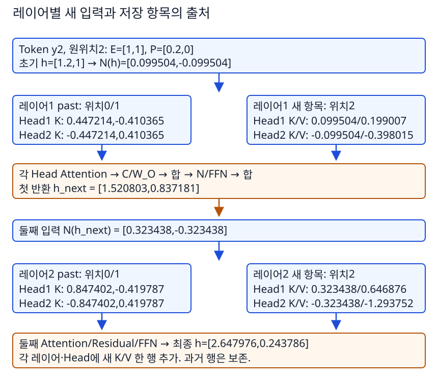{width=100% #cache-layers-fig}

#### 유제 10.9.4 둘째 레이어까지 이어 계산하기 {#cache-new-second-practice}

[유제 10.9.3](#cache-new-first-practice)의 $H^{(1)}_2$를 사용해 둘째 레이어의 N, 새 Q/K/V, 점수/비율/출력, C/M, R/U/F, 최종 반환과 점수를 계산하라. 레이어별 Cache는 각 Head당 새 행 하나씩 증가해야 한다. [상세 해설](SOLUTIONS.md#solution-cache-new-second-practice)

#### 예제 10.9.5 새 행 추가와 과거 보존 {#cache-updated}

대표 예제의 갱신 내용은 다음과 같다. 각 행 묶음에서 위치0/1은 과거 그대로, 위치2만 새 항목이다. K/V의 위치 축을 함께 확장해야 한다.

| 레이어·Head | K(위치0,1; 새2) | V(위치0,1; 새2) |
|---|---|---|
| 1·1 | `[0.447214, -0.410365]; 0.099504` | `[0.894427, -0.820729]; 0.199007` |
| 1·2 | `[-0.447214, 0.410365]; -0.099504` | `[-1.788854, 1.641459]; -0.398015` |
| 2·1 | `[0.847402, -0.419787]; 0.323438` | `[1.694804, -0.839573]; 0.646876` |
| 2·2 | `[-0.847402, 0.419787]; -0.323438` | `[-3.389609, 1.679146]; -1.293752` |


각 레이어·Head의 K/V shape는 $2\times1$에서 $3\times1$이 된다. 두 레이어와 두 Head가 각각 두 종류를 저장하므로 총 스칼라 수는16에서24로 증가한다. 과거 Query나 과거 Softmax 행렬은 이24개에 포함하지 않는다. 레이어2는 레이어1 Cache를 복사하지 않고 자기 입력으로 새 행을 생성했다.

**이해 확인3.** 새 $k^{(1)}_{1,2}=0.099504$를 둘째 레이어 Cache에 넣는 풀이의 오류를 입력 표현과 투영으로 설명하라. 두 레이어가 같은 $W_K$를 쓰는데도 왜 틀리는가? [해설](SOLUTIONS.md#s09-check3)

### 한 행의 Mask가 모든 과거를 놓칠 수 있다 {#s09-mask}

#### 예제 10.9.6 `1×3` 배열에 잘못된 삼각형을 적용한 경우 {#cache-mask-error}

새 위치2의 요청은 한 행뿐이다. `np.tril(np.ones((1,3)))`은 $[1,0,0]$을 만든다. 첫 배열 행이라는 이유로 원래 위치0의 요청처럼 처리한 것이다. 올바른 허용 행은 $[1,1,1]$이다. 잘못된 Mask는 Head1을 과거 첫 V $0.894427$만 복사하게 만들며 올바른 출력 $0.115480$과 다르다.

실제 요청 위치2와 Key 원위치 `[0,1,2]`를 비교해 `key_position <= query_position`으로 만들자. 배열이 `[2,0,1]` 순으로 재배열돼도 K/V와 위치 표지를 함께 움직이면 의미는 유지된다. Key가 패딩이면 위치 비교가 참이어도 읽지 않는다. 활성 Query의 허용 Key가 하나도 없을 때 Softmax를 계산하는 대신 입력 계약 오류를 보고한다. 이 실습은 비활성 Query의 Attention 반환을0으로 정하지만 Residual/FFN 반환까지0인 것은 아니다.

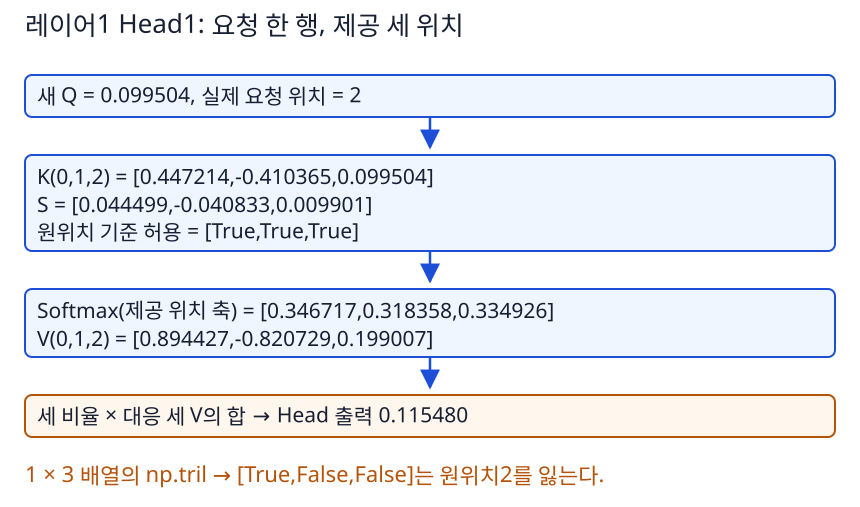{width=100% #cache-head-fig}

#### 유제 10.9.5 배열 순서와 원래 위치 {#cache-mask-practice}

저장 배열의 Key 원위치가 `[4,1,3]`, 새 Query 원위치가3이고 세 Key가 모두 유효하다. 허용 행을 쓰라. 이제 원위치1의 Key가 비활성일 때 다시 쓰라. K만 재배열하고 V는 그대로 두면 생기는 오류를 설명하라. [상세 해설](SOLUTIONS.md#solution-cache-mask-practice)

### Full과 Incremental이 같은 답을 내는 이유 {#s09-proof}

#### 정리 10.9.1 미래 추가에 대한 과거 표현의 불변성 {#cache-past-invariance}

초기 표현이 해당 Token과 고정 위치만으로 결정되고, 각 레이어의 Attention 허용 관계가 Causal이며 기존 요청의 허용 집합이 유지된다고 하자. 모델 매개변수·위치 처리·연산 함수는 고정이고, N/FFN/Residual은 위치별 결정적 함수다. 이때 끝에 미래 입력을 추가해도 모든 기존 위치의 레이어 입력·반환·K/V는 유지된다.

**증명.** 길이 $n$ 실행과 길이 $n+1$ 실행을 비교한다. 기존 $p<n$의 $H^{(0)}_p$는 같은 Token과 위치에서 만들어져 같다. 레이어 $\ell-1$의 기존 표현이 같다고 가정하면 N과 투영으로 얻는 기존 Q/K/V도 같다. 위치p가 읽는 Key 집합은 미래 위치n을 포함하지 않고 이전 실행과 같다. 같은 Query·허용 Key·Value로 점수·Softmax·집계를 하므로 $M^{(\ell)}_p$가 같다. 위치별 Residual, 두 번째 N, FFN은 같은 입력에서 같은 반환을 만든다. 따라서 $H^{(\ell)}_p$도 같다. 초기 단계와 레이어 귀납으로 모든 기존 위치에 성립한다. $\square$

이 논증은 [10.7절](#sec-block)의 레이어별 정보 의존성을 Cache 생성원에 적용한 것이다. 시퀀스 전체 평균으로 정규화하면 길이 증가가 기존 행의 평균을 바꾼다. 양방향 전처리가 미래 정보를 초기 표현에 섞어도 첫 단계의 가정이 무너진다. ‘마지막 Attention에 Causal Mask가 있다’만으로 충분하지 않다.

#### 정리 10.9.2 새 위치의 Full/Incremental 동등성 {#cache-equivalence}

앞 정리의 가정 아래 과거 Cache가 해당 Prefix의 정확한 K/V이고, 새 입력 Token·위치·허용 관계가 Full 실행과 같다고 하자. 그러면 각 레이어의 새 위치 Q/K/V, 점수·비율·Head 출력·Concat·출력 투영·Residual·N/FFN·반환과 마지막 점수는 수학적으로 같다.

**증명.** 새 위치의 초기 표현은 같다. 첫 레이어 N과 투영도 같으며, 과거 Cache는 앞 정리에 의해 Full 실행의 과거 K/V와 같다. 새 K/V를 붙인 전체 제공 집합도 같으므로 새 Query의 허용 점수 행과 가중합이 같다. 후속 위치별 함수로 얻는 새 반환이 같으므로 둘째 레이어 입력도 같다. 같은 논리를 레이어별로 반복하고 고정 Readout을 적용한다. $\square$

증명은 실수 연산의 함수 동등성이다. 실제 부동소수점에서는 다른 커널의 합산 순서, 정밀도 변경 또는 비결정 연산으로 작은 차이가 날 수 있다. 동일 함수의 수학적 보장과 실제 구현의 허용오차 대조를 구별하자. Dropout이 활성화돼 두 실행에 다른 마스크 표본을 쓰면 동일 결정적 함수라는 가정이 없다. 학습 중 optimizer가 매개변수를 바꿔도 옛 Cache는 이 정리로 재사용할 수 없다.

대표 코드에서는 새 위치의 최종 반환만 비교하지 않는다. Q/K/V부터 두 레이어의 점수·비율·집계·합·정규화·FFN·Readout까지 나란히 비교해 **처음 차이가 난 단계**를 찾는다. 유한 시험에서 몇 개 값을 확인하는 일은 위 일반 증명의 대체가 아니다.

**이해 확인4.** Full과 Incremental의 최종 Logit만 같으면 모든 Cache와 중간 계산이 옳다고 결론 내릴 수 있는가? 잘못된 경로가 최종 출력에서 가려지는 조건을 하나 제안하라. [해설](SOLUTIONS.md#s09-check4)

### 위치를 바꾸면 저장된 수치도 바뀌는가? {#s09-rope}

Absolute 가산 모델에서 $H^{(0)}_p=E(x_p)+P_p$다. 같은 토큰의 위치를 새 위치로 배정하면 $P_p$가 바뀔 수 있다. 첫 레이어 N과 K/V 투영부터 재검토해야 한다. 원래 순서와 Causal 허용 관계가 유지되면 그 앞 위치는 영향을 받지 않지만, 변경 위치를 읽는 뒤쪽의 Block 반환과 상위 레이어 입력은 영향을 받을 수 있다.

RoPE에서는 초기 입력에 위치값을 더하는 경로와 Q/K 회전 경로를 구별한다. 여기서는 순수 RoPE 변형을 위해 Absolute 가산을0으로 하고, 비교 폭2의 Head에서 행벡터 투영 $\bar q,\bar k$를 얻은 뒤 회전한다.[^s09-rope-source]

#### 정의 10.9.5 회전 Key의 저장 계약 {#cache-rope-contract}

회전 후 Key를 저장하는 계약은 위치p의 $k_p=\bar k_pR(p)^\top$를 저장하는 것이다. 회전 전 계약은 $\bar k_p$와 원래 위치p를 저장해 사용 시 회전하는 것이다.

$$
R(p)=\begin{bmatrix}\cos(p\theta)&-\sin(p\theta)\\
\sin(p\theta)&\cos(p\theta)\end{bmatrix},\qquad
q_p=\bar q_pR(p)^\top,\quad k_p=\bar k_pR(p)^\top.
$$

$\theta$는 고정 주파수이며 여러 좌표쌍이면 각각의 주파수를 사용한다. 행벡터에 전치 회전행렬을 오른쪽에서 곱하는 것은 열벡터에 $R(p)$를 왼쪽에서 곱하는 것과 같다. V는 이 기본 RoPE 공식에서 직접 회전하지 않는다. 실습의 `rope_model`은 회전 후 K 저장 계약이다.

#### 예제 10.9.7 위치 변경과 재회전 {#cache-rope-example}

$\bar k=[1,0]$, $\theta=\pi/2$라면 위치0/1/2의 회전 Key는 각각 $[1,0]$, $[0,1]$, $[-1,0]$다. 위치1에서 생성한 회전 후 K를 위치2에 그대로 쓰면 $[0,1]$을 읽게 되어 틀린다. 회전 전 K가 그대로라면 원래 위치를 수정해 $[-1,0]$으로 재회전할 수 있다. 회전 후 K만 있다면 고정된 회전 규약에서 $\bar k=k_{\mathrm{old}}R(p_{\mathrm{old}})$로 되돌린 뒤 새 회전을 적용할 수도 있다. 바탕 표현 자체가 변했다면 이 변환만으로는 부족하다.

현재 레이어 V의 입력 z가 같다면 위치 회전만 바꿔도 V는 그대로다. 그러나 바뀐 Q/K가 Attention 출력과 다음 레이어 입력을 바꾸면 다음 레이어 V도 달라질 수 있다. ‘V를 회전하지 않는다’에서 ‘모든 레이어 V가 유지된다’를 도출하지 말자.

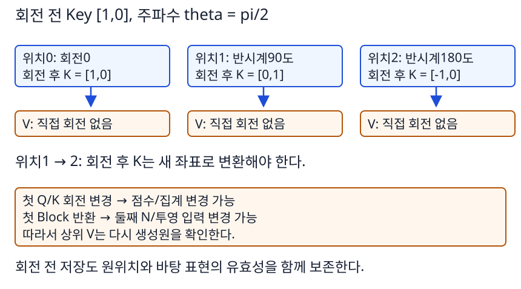{width=100% #cache-rope-fig}

선택적 Deep에서는 **모든 위치를 같은 양 $c$만큼 이동**한 순수 RoPE 모델을 생각하자. 바탕 Q/K가 같을 때

$$q_p k_j^\top=\bar q_pR(p)^\top R(j)\bar k_j^\top
=\bar q_pR(j-p)\bar k_j^\top$$

이므로 상대 위치가 유지되면 점수가 유지된다. 초기 입력·다른 위치 연산·Mask도 같고 각 레이어에 같은 조건이 이어지면 반환과 V도 유지된다. 그때도 저장된 회전 후 K의 좌표는 함께 회전해 달라질 수 있다. 원래 위치를 옮겨 놓고 옛 회전 후 K를 변환 없이 쓰는 것은 이 불변성의 적용이 아니다. Absolute 가산, 위치별 주파수 재설정 또는 길이에 따라 바뀌는 규약이 함께 있으면 해당 조건부터 다시 확인한다.

#### 유제 10.9.6 회전 전/후 저장의 차이 {#cache-rope-practice}

위 예제의 위치1을2로 바꾼다. 첫 레이어 입력은 위치와 독립이며 허용 관계는 유지한다고 하자. 회전 전 K, 회전 후 K, 같은 레이어 V, 다음 레이어 V의 재사용 판단을 각각 쓰라. [상세 해설](SOLUTIONS.md#solution-cache-rope-practice)

### 저장 항목의 유효성은 생성원을 따라 판단한다 {#s09-validity}

#### 정의 10.9.6 항목 유효성과 재사용 보장 {#cache-validity}

항목이 현재 계산에 유효하다는 것은 현재 계약으로 다시 생성할 K/V와 같은 값을 공급한다는 뜻이다. 안전한 재사용 보장은 해당 항목의 생성 경로가 유지되거나, 변경된 경로에서도 같은 값이라는 항등식을 증명할 수 있을 때 얻는다. 유한 관찰에서 숫자가 우연히 같았다는 사실은 계약상 보장과 다르다.

한 셀을 판단할 때 Layer·Head·위치·K/V를 먼저 고른다. 그 셀을 만든 레이어 입력, N, 투영과 위치 처리를 확인한다. 입력 표현이 이전 레이어 반환이면 그 반환의 Query·허용 Key·Value·출력 투영·Residual·FFN까지 거슬러 올라간다. 변경된 생성원이 닿지 않으면 재사용한다. 직접 생성 계약이 바뀌면 재계산 대상으로 삼는다. 경로는 바뀌었지만 출력이 유지되는 특별한 조건이 있으면 그 조건을 확인하거나 직접 재계산한다.

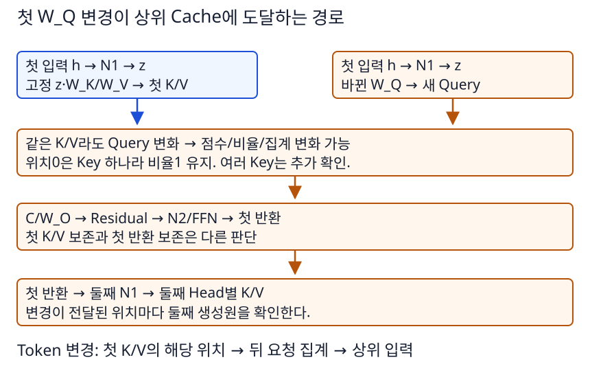{width=100% #cache-dependency-fig}

#### 예제 10.9.8 위치1의 Token만 변경 {#cache-token-change}

세 위치가 모두 저장돼 있고 원래 위치와 매개변수·Causal 허용 관계는 유지한다고 하자. 위치1의 내용만 바꾸면 첫 레이어의 위치1 초기 입력과 N/K/V가 달라질 수 있다. 첫 레이어 위치0과2의 K/V는 **각자 자기 입력만**으로 투영하므로 유지된다.

그렇지만 위치2의 첫 Attention은 변경된 위치1을 읽는다. 위치2의 첫 Block 반환이 달라질 수 있으므로 둘째 레이어 위치2의 K/V는 다시 확인해야 한다. 위치1도 같은 이유로 둘째 레이어 재계산 대상이다. 위치0은 미래1을 읽지 않으므로 두 레이어에서 유지된다. 레이어가 셋 이상이면 다시 그 변경된 반환을 읽는 위치들을 따라가야 한다.

별도 수치 반례는 첫 레이어 위치2의 K/V가 실제로 같으면서 둘째 레이어 위치2의 K/V가 실제로 달라진다. 소스의 `verify_cache.py`는 위치1 Embedding만 바꾸어 이 경로를 계산한다. 앞 레이어의 저장 셀 보존과 앞 레이어의 반환 보존은 다른 명제다.

#### 예제 10.9.9 첫 레이어 $W_Q$만 변경 {#cache-query-change}

첫 레이어 K/V의 직접 생성식에는 $W_Q$가 없다. 해당 레이어의 모든 과거 K/V는 그대로다. 그러나 Query가 달라져 Softmax 비율과 반환이 달라질 수 있으므로 둘째 레이어 K/V까지 모두 유지한다고 결론 내릴 수 없다.

여기에는 정확한 예외가 있다. 위치0은 유효 제공 Key가 자기 것 하나다. 유한 점수 하나의 Softmax는 언제나1이므로 Q만 변경해도 집계는 같은 V다. 첫 Block의 나머지 조건도 같아 위치0 반환과 둘째 레이어 위치0 K/V는 보존된다. 위치1/2는 여러 Key를 읽으므로 별도 확인이 필요하다. 점수 변화가 허용된 모든 열에 같은 상수를 더하거나 출력 투영이 변화량을 없애는 특수 경우에도 반환이 같을 수 있지만, 그 조건을 명시해야 한다.

#### 예제 10.9.10 K와 V 투영을 따로 변경 {#cache-projection-change}

첫 레이어 Head1의 $W_K$만 바꾸면 그 Head의 K는 새 투영으로 재계산한다. 같은 Head V와 다른 Head K/V의 직접 생성식은 그대로다. 그 K를 읽는 Query의 점수는 바뀔 수 있어 첫 Block 반환 이후를 다시 확인한다. 위치0은 자기 Key 하나라 점수만 바뀌어도 가중치1이고 V가 같으므로 둘째 레이어 위치0은 유지된다.

반대로 Head1 $W_V$만 바꾸면 해당 V를 재계산하며 K와 모든 Q는 그대로다. Attention 비율도 그대로지만 전달되는 값이 달라진다. 위치0도 자기 V가 달라질 수 있으므로 앞의 예외를 적용할 수 없다. 변경이 다른 Head의 **같은 레이어 투영**에 직접 닿는 것과 두 Head가 합쳐진 반환을 통해 **상위 레이어의 모든 Head 입력**에 닿는 것을 구별하자.

아래 판정표는 대표 모델의 레이어1 변경을 기본으로 한다. `r*`는 변경 Head, `a`는 변경 위치, `$p\ge a$`는 기본 Causal 아래 변경 위치를 읽을 수 있는 요청이다. ‘재계산 대상’은 기존 값과 같다고 보장할 수 없는 직접 생성 항목이며, ‘추가 확인’은 반환이 실제로 유지되는 항등식·불변 조건이 있는지 확인하거나 재계산해야 한다는 뜻이다. 위치 재배정은 순서와 허용 관계가 유지되는 경우다.

| 변경 | 확실히 유지되는 레이어1 항목 | 직접 재계산 대상 | 레이어2 항목의 판단 |
|---|---|---|---|
| 끝에 새 Token 추가 | 모든 r,p의 K/V | 새 위치의 모든 r K/V 추가 | 과거 전부 유지, 새 항목 추가 |
| Token a 변경 | 모든 r의 $p\ne a$ K/V | 모든 r의 p=a K/V | p<a 유지, $p\ge a$ 생성원 재검토 |
| Absolute 위치 a 변경 | 모든 r의 $p\ne a$ K/V | p=a의 모든 r K/V | p<a 유지, $p\ge a$ 재검토 |
| 순수 RoPE 위치 a 변경 | 같은 z의 모든 V·다른 위치K | 회전 후 K의 p=a | 바뀐 집계를 받은 위치의 K/V 재검토 |
| $W_{Q,r*}$ 변경 | 모든 r,p K/V | Q만 새로 계산 | 위치0 유지, p>0 모든 Head 재검토 |
| $W_{K,r*}$ 변경 | 다른 Head K, 모든 V | r*의 모든 p K | 위치0 유지, p>0 모든 Head 재검토 |
| $W_{V,r*}$ 변경 | 모든 K, 다른 Head V | r*의 모든 p V | 영향받은 반환의 모든 Head K/V 재검토 |
| $W_O$ 또는 FFN 변경 | 모든 r,p K/V | 해당 후속 함수 반환 | 영향받은 위치의 모든 Head 재검토 |
| Attention 전 $N_1$ 변경 | 항등식이 없는 한 보장 없음 | 모든 r,p K/V | 변경 반환의 모든 Head 재검토 |
| K/V 뒤 $N_2$ 변경 | 모든 r,p K/V | FFN 입력/후속 반환 | 영향받은 위치의 모든 Head 재검토 |
| 기존 요청 a의 허용 집합 변경 | 모든 r,p K/V | 해당 Attention/반환 | 위치a 재검토, 다른 위치는 유지 |
| 앞으로 새 요청의 접근만 변경 | 모든 기존 r,p K/V | 새 요청 Attention | 과거 유지, 새 항목은 새 경로로 생성 |
| 최종 Readout만 변경 | 모든 내부 K/V | Token 점수 | 두 레이어 모두 유지 |
| 다른 Prefix/대화 사용 | 길이만으로 보장 없음 | 공통 경로부터 확인 | 레이어별 공통 생성원 확인 필요 |

기존 요청a의 Mask를 바꿨을 때 이 두 레이어 모델에서는 레이어2 K/V의 직접 생성 입력이 달라지는 위치는a다. 레이어2의 다른 위치 **반환**은 위치a의 바뀐 K/V를 읽어 달라질 수 있다. 레이어3이 있다면 그 영향이 더 퍼진다. ‘마스크 변경은 모든 상위 위치를 곧바로 무효화한다’는 압축 규칙보다 실제 레이어 경계를 따라가야 정확하다.

LayerNorm 변경에서는 어느 N인지부터 확인한다. Pre-LN의 $N_1$은 K/V 생성 전에 있으므로 직접 영향을 준다. $N_2$는 K/V 생성 뒤에 있어 같은 레이어 Cache는 유지할 수 있지만 FFN/반환과 다음 레이어가 달라질 수 있다. Post-LN으로 배치를 바꾸면 그 모델의 실제 생성식을 다시 그려 판단해야 한다. $\gamma,\beta$ 변화가 정규화 출력에 어떻게 적용되는지도 확인한다.

Readout만 바꾸면 내부 표현의 생성원이 그대로여서 K/V는 유효할 수 있다. 그러나 Token 점수가 바뀌어 실제로 선택한 다음 Token이 달라지면, 그 뒤 생성하는 입력 Prefix가 달라진다. **같은 고정 Prefix의 Cache 유지**와 **향후 생성 경로 유지**를 혼동하지 말자.

다른 Prefix를 사용할 때는 길이 대신 내용·위치·매개변수·접근 경로를 비교한다. 공통 앞부분이 모두 같고 Causal 생성 계약도 같다면 그 공통 부분의 Cache를 재사용할 수 있다. 길이만 같거나 같은 토큰 하나가 뒤에 있다는 사실은 상위 레이어의 입력 같음을 보장하지 않는다. 여기서는 값의 유효성만 판단하며 Serving의 할당·Paging·Eviction·Batching 정책은 별도 AI-SYSTEMS에서 다룬다.

#### 유제 10.9.7 일부만 유지되는 판정표 {#cache-validity-practice}

대표 세 위치 Cache에서 첫 레이어 Head2의 $W_V$만 바꾼다. 두 레이어·두 Head·세 위치·K/V를 열거해 재사용, 직접 재계산, 추가 확인을 표시하라. 위치0을 $W_Q$ 변경 사례와 비교하라. [상세 해설](SOLUTIONS.md#solution-cache-validity-practice)

**이해 확인5.** 첫 레이어 K/V가 그대로라는 정보만으로 둘째 레이어 K/V의 유효성을 판단할 수 있는가? 두 변경안을 골라 반례와 유지 예외를 설명하라. [해설](SOLUTIONS.md#s09-check5)

### 절약한 계산과 남아 있는 계산 {#s09-cost}

KV Cache는 같은 past K/V를 다시 투영하는 일을 없애며, 올바른 증분 실행은 과거 위치의 Block 전체도 되풀이하지 않는다. 새 위치에서 N/Q/K/V, Attention, Residual, FFN과 다음 레이어는 여전히 필요하다. 특히 새 Query는 일반 Full Attention에서 과거 Key 전부를 비교하고 V 전부를 비율대로 집계한다. Cache를 쓴다는 사실이 과거 읽기를 없애는 것은 아니다.

#### 예제 10.9.11 처리 위치 수와 비교 쌍 수 {#cache-cost-example}

처음부터 길이1,2,…,N을 반복 처리한다고 하자. 활성 Causal 쌍만 실제로 계산한다고 가정하면 길이n Full 재계산의 Head당 쌍은 $n(n+1)/2$다. 새 행만 계산하면 n쌍이다. 따라서 시작부터 N까지 누적하면

$$
\sum_{n=1}^N\frac{n(n+1)}2=\frac{N(N+1)(N+2)}6,\qquad
\sum_{n=1}^N n=\frac{N(N+1)}2.
$$

N=3이면 Full의 쌍은1+3+6=10, 증분은1+2+3=6이다. 실제 코드처럼 dense $n\times n$ 원 내적을 먼저 만든 뒤 Mask하면 계산 셀은 $\sum n^2$이며 이 활성 쌍 수보다 많다. 어느 것을 세는지 반드시 명시하자.

이미 길이m을 한 번 Prefill한 상태에서 새 입력 하나를 처리하는 비교라면, 공통 Prefill 비용은 제외한다. 길이m+1 Full은 각 레이어에서 m+1개 위치의 N/투영/FFN을 다시 계산하고, 증분은1개만 계산한다. 그래도 새 Query의 m+1개 Key 비교는 남는다. 이후 T개 새 입력을 처리하는 Attention 활성 쌍 수는 각각 $\sum_{j=1}^T(m+j)(m+j+1)/2$와 $\sum_{j=1}^T(m+j)$다.

현재 길이n의 K/V 원소 수는 $\sum_{\ell,r}n(d^{(\ell)}_{k,r}+d^{(\ell)}_{v,r})$다. 대표 모델은8n개 float64 스칼라이므로 n=3에서 payload는 $24\times8=192$바이트다. 배열 객체·위치·계약 metadata는 제외했다. 매 토큰마다 payload는8개 스칼라씩 증가한다. 실습의 `np.concatenate`와 hash 검사는 투명한 교육 구현이며 그 복사/검사 비용을 GPU 시간이나 실제 Serving 처리량으로 일반화하지 않는다.

Sparse 또는 근사 Attention은 어떤 비교를 생략하거나 집계식을 바꾸는 별도 문제다. KV Cache의 재사용은 위 동등성 조건에서 원래 새 행의 집계를 유지한다. 다음 [10.10절](#sec-efficient)에서는 **반복 계산을 없애는 일과 상호작용 자체를 바꾸는 일**을 비용·정보 경로와 함께 비교한다.

**이해 확인6.** KV Cache를 쓴 길이100의 새 요청에서 비교 Key 수는1인가100인가? 과거 K/V를 다시 계산하지 않는 일과 읽지 않는 일을 구별하라. [해설](SOLUTIONS.md#s09-check6)

### 코드에서 레이어 경계를 눈으로 따라가기 {#s09-code}

`learning-source/kv_cache.py`의 핵심은 새 h를 정규화해 새 투영을 만들고, **같은 레이어·같은 Head의** 과거 배열을 붙이는 순서다. `positions_mask`는 원래 위치로 허용 관계를 만든다. 파일의 `norm/feed`는 Working 계산 도구이고 `layer` 전체를 호출해 얻은 정답을 손계산 답안 대신 제출하는 인터페이스는 아니다.

```{.python .numberLines source-root="." source="learning-source/kv_cache.py" source-start="55" source-end="85" source-revision="cache-source-v0.1"}
```

`full_prefix`는 모든 입력 행을 각 Block에 넣고 `incremental`은 새 행만 넣는다. 두 경로가 같은 내부 함수를 공유하므로 둘의 결과 일치만으로 그 내부 함수의 정확성이 보장되지는 않는다. `reference_cache.py`는 Decimal 스칼라 내적·지수·LN·FFN·회전을 독립 구현한다. 대표·새 통합·RoPE 값은 `NUMERICAL_CACHE.json`, 오류와 변경안은 `CACHE_CHECKS.json`에서 중간값까지 확인할 수 있다.

Cache 계약 검사는 입력 Prefix·원위치·모델·Head/Layer 대응이 바뀌면 재판정을 요구한다. 이 검사는 교육용 보수적 안전장치다. 모델 전체 hash가 바뀌었다고 **모든 항목이 수학적으로 무효**라는 뜻은 아니다. 항목별 유효성은 앞 생성원 분석으로 따로 판정한다. hash가 같다는 사실도 생성 코드의 정확성을 증명하지 않는다.

저장소 루트에서 기존 CPU 환경으로 실행한다.

```bash
uv run --locked --directory chapters/transformer/learning-source python demo_cache.py
uv run --locked --directory chapters/transformer/learning-source python verify_cache.py
```

유제와 새 통합 과제는 해설의 실행 예제도 이용할 수 있다. 해설 전체를 보기 전에 `norm`과 `feed`만 사용해 각 단계의 입력을 직접 연결해 보자. 원본 코드와 JSON은 반올림 전 입력을 사용한다. 인쇄 소수로 손검산하면 마지막 자리 차이를 허용하되, 서로 다른 레이어나 위치를 섞은 큰 차이를 단순 반올림으로 설명하지 말자.

\clearpage

### 절 종료 연습문제 {#s09-exercises}

새 항목 계산과 기존 값의 유효성을 모두 연습한다. ★문제는 두 수행을 연결하는 우선 과제다. 계산 도구를 써도 각 셀의 Layer·Head·원위치·K/V와 입력 출처를 답안에 남기자. 반올림 전 과거 Cache는 실습 JSON에서 제공하며 새 항목의 풀이 trace는 문제 입력으로 사용하지 않는다.

#### 연습문제 10.9.1 입력 처리와 다음 예측 ★ {#cache-ex1}

`[BOS,y1]`을 처리해 y2를 골랐다. 새 K/V를 추가하기 전후의 입력·예측 대상·Cache 위치를 시간순으로 쓰라. Teacher Forcing의 `[BOS,y1,y2]`와 생성 시점의 차이를 설명하라. [상세 해설](SOLUTIONS.md#solution-cache-ex1)

#### 연습문제 10.9.2 완전 재계산의 중복 {#cache-ex2}

대표 모델의 길이2 실행 뒤 길이3 Full 실행에서 레이어별로 반복되는 연산을 열거하라. 위치0/1의 두 레이어 입력과 K/V가 같은 이유를 쓰고, Query와 Attention Weight를 기본 Cache에 넣지 않아도 되는 이유를 설명하라. [상세 해설](SOLUTIONS.md#solution-cache-ex2)

#### 연습문제 10.9.3 Cache 크기와 축 {#cache-ex3}

세 레이어의 Head별 $(d_k,d_v)$가 모두 $(2,1),(4,3)$이고 길이가5다. 각 K/V 배열 shape, 총 원소 수와 한 토큰 증가량을 구하라. Batch2가 동일 shape를 쓸 때 payload 원소 수를 구하라. [상세 해설](SOLUTIONS.md#solution-cache-ex3)

#### 연습문제 10.9.4 새 Query와 제공 축 {#cache-ex4}

한 Head의 새 $q=[1,2]$, 과거 $K=[(1,0);(0,1)]$, $V=[2,4]^\top$다. 새 입력의 투영 원천은 $z=[1,-1]$이고 $W_K=[(1,0);(0,1)]$, $W_V=[1,2]^\top$다. 새 K/V부터 직접 계산해 붙이고 세 위치를 모두 읽는 점수·Softmax·출력을 구하라. [상세 해설](SOLUTIONS.md#solution-cache-ex4)

#### 연습문제 10.9.5 잘못된 Layer와 Head {#cache-ex5}

대표 첫 레이어의 새 Query에 둘째 레이어 과거 Cache를 넣었다. Head1의 잘못된 점수와 올바른 점수를 비교하라. 두 Head의 Cache를 서로 바꾼 경우에도 생성원/출력 차이를 설명하라. [상세 해설](SOLUTIONS.md#solution-cache-ex5)

#### 연습문제 10.9.6 K/V 위치 대응 {#cache-ex6}

$q=1,K=[0,\log2]^\top,V=[2,8]^\top$다. 가중치·출력과 V만 순서를 바꾼 출력을 계산하라. K/V/원위치를 함께 바꿨을 때 출력이 유지되는 이유를 쓰라. [상세 해설](SOLUTIONS.md#solution-cache-ex6)

#### 연습문제 10.9.7 원위치와 삼각형 Mask ★ {#cache-ex7}

원위치4의 새 Query와 Key 원위치 `[1,3,4]`가 있다. 올바른 행과 `np.tril`로 얻는 행을 비교하라. 새 위치를0으로 다시 시작했을 때 초기 표현·RoPE·허용 관계에 각각 생길 수 있는 오류를 쓰라. [상세 해설](SOLUTIONS.md#solution-cache-ex7)

#### 연습문제 10.9.8 두 레이어 전체의 새로운 계산 ★ {#cache-ex8}

대표와 다른 모델을 제공한다. Token ID0/1/2의 Embedding은 `[0,1]`, `[1,-1]`, `[-1,0.5]`다. 기존 Token은 `[2,0]`, 원위치는 `[1,3]`이고 새 Token1을 원위치4에 처리한다. 위치 가산은 $P_p=[0,0.2p]$다. 아래 Head 투영은 두 레이어에서 같고, LN·출력 투영은 서로 다르다.

$$
\begin{aligned}
W_{Q,1}&=\begin{bmatrix}1&0.5\\0&1\end{bmatrix},&
W_{K,1}&=\begin{bmatrix}0.5&0\\1&1\end{bmatrix},&
W_{V,1}&=\begin{bmatrix}1\\-1\end{bmatrix},\\
W_{Q,2}&=\begin{bmatrix}0.5\\1\end{bmatrix},&
W_{K,2}&=\begin{bmatrix}1\\-0.5\end{bmatrix},&
W_{V,2}&=\begin{bmatrix}1&0\\0.5&1\end{bmatrix}.
\end{aligned}
$$

두 레이어의 $N_1$은 각각 $\gamma=[1,0.8]$, $[0.9,1]$이고 $\beta=0,\varepsilon=1$이다. $N_2$는 둘 다 $\gamma=1,\beta=0,\varepsilon=1$이다. $W_O^{(1)}=[(1,0);(0,0.5);(0.5,1)]$, $W_O^{(2)}=0.7W_O^{(1)}$다. FFN은 두 레이어에서

$$B_1=\begin{bmatrix}1&0&-1\\0&1&1\end{bmatrix},\quad
B_2=\begin{bmatrix}0.2&0\\0&0.3\\-0.1&0.1\end{bmatrix},\quad
b_1=0,\ b_2=[0,0.05]$$

이고 Readout은 대표와 같다. Dropout은 없다. **입력으로 제공하는 과거 Cache**는 다음 표와 `새통합.past`의 반올림 전 값이다.

| 레이어·Head | 원위치1 K / V | 원위치3 K / V |
|---|---|---|
| 1·1 | `[0.194295, 0.518119] / [-1.165767]` | `[0.187409, 0.499756] / [-1.124451]` |
| 1·2 | `[-0.906708] / [-0.388589, 0.518119]` | `[-0.874573] / [-0.374817, 0.499756]` |
| 2·1 | `[0.479469, 0.871762] / [-1.656347]` | `[0.475091, 0.863802] / [-1.641223]` |
| 2·2 | `[-1.220466] / [-0.348705, 0.871762]` | `[-1.209322] / [-0.345521, 0.863802]` |


(가) 새 초기 입력을 계산하고 두 레이어 각각의 h/z, Head별 새 Q/K/V, 허용 점수와 비율, 출력, C/M, R/U/F/반환을 완결하라. (나) 최종 점수와 새 Cache shape를 쓰라. (다) Full Prefix 실행과 전 중간값을 대조하고 과거 K/V 보존을 확인하라. (라) 두 Head의 비교·값 폭이 달라도 같은 Block에서 연결되는 이유를 쓰라. [상세 해설](SOLUTIONS.md#solution-cache-ex8)

#### 연습문제 10.9.9 동등성 대조의 범위 {#cache-ex9}

연습문제8의 최종 반환만 비교하는 검사를 개선하라. 각 레이어에서 비교할 중간 배열과 축을 나열하고, 공통 내부 함수의 오류를 찾기 위해 별도 스칼라 기준이 필요한 이유를 설명하라. [상세 해설](SOLUTIONS.md#solution-cache-ex9)

#### 연습문제 10.9.10 과거 Token 변경의 레이어별 반례 ★ {#cache-ex10}

대표 세 위치에서 위치1의 Embedding만 `[0.1,2]`로 바꾼다. 두 레이어·두 Head·세 위치 K/V의 재사용/재계산 대상을 생성원으로 판별하라. 첫 레이어 위치2 K/V는 같지만 둘째 레이어 위치2 K/V는 다른 수치 반례를 실행하거나 계산하라. [상세 해설](SOLUTIONS.md#solution-cache-ex10)

#### 연습문제 10.9.11 Prefix 중간 위치 재배정 {#cache-ex11}

대표 위치1의 Absolute 위치를 바꾸되 토큰 순서와 기존 Causal 허용 집합은 유지한다. 첫 레이어와 둘째 레이어 K/V의 영향 범위를 쓰라. 이제 위치 순서까지 바뀌면 같은 답을 유지할 수 있는지 판단하고 필요한 추가 조건을 쓰라. [상세 해설](SOLUTIONS.md#solution-cache-ex11)

#### 연습문제 10.9.12 RoPE 저장 규약 {#cache-ex12}

$\bar k=[2,1],\theta=\pi/2$의 위치0/1/2 회전 Key를 계산하라. 위치1→2 변경에서 회전 전/후 Cache와 V의 유효성을 구별하라. 상위 레이어의 바탕 표현이 달라졌을 때 재회전만으로 충분한지 설명하라. [상세 해설](SOLUTIONS.md#solution-cache-ex12)

#### 연습문제 10.9.13 $W_Q$ 변경의 유지 예외 {#cache-ex13}

대표 첫 레이어 Head1의 $W_Q$를1.7배 한다. 레이어1 K/V, 레이어2 위치0, 레이어2 위치1/2를 각각 판정하라. 위치0 보존의 이유를 지수값과 무관한 식으로 증명하라. [상세 해설](SOLUTIONS.md#solution-cache-ex13)

#### 연습문제 10.9.14 K와 V 투영 변경 {#cache-ex14}

첫 레이어 Head1의 $W_K$만 바꾸는 경우와 $W_V$만 바꾸는 경우를 비교하라. 같은 레이어의 반대 종류·다른 Head, 상위 레이어의 모든 Head를 나누고 위치0 예외를 설명하라. [상세 해설](SOLUTIONS.md#solution-cache-ex14)

#### 연습문제 10.9.15 출력 투영과 FFN {#cache-ex15}

첫 레이어 $W_O$ 또는 FFN을 바꾸면 어느 K/V가 직접 유지되는가? 둘째 레이어 생성원과 연결하고, 변화량이 $W_O$의 영공간에 들어가는 등 추가 조건으로 반환이 유지될 수 있는 경우를 설명하라. [상세 해설](SOLUTIONS.md#solution-cache-ex15)

#### 연습문제 10.9.16 두 LayerNorm을 구별하기 {#cache-ex16}

첫 레이어 $N_1$의 $\gamma$ 변경, $N_2$의 $\gamma$ 변경, $N_1$의 $\beta$ 변경을 각각 비교하라. 어느 직접 생성식에 들어가는가? 정규화 매개변수 변화가 해당 투영의 영공간에 있을 때 어떤 추가 보장이 필요한가? [상세 해설](SOLUTIONS.md#solution-cache-ex16)

#### 연습문제 10.9.17 기존 요청과 새 요청의 Mask {#cache-ex17}

첫 레이어 기존 위치2의 허용 집합을 `{0,2}`로 바꾼 경우와, 앞으로 위치3의 접근만 `{1,2,3}`으로 정한 경우를 비교하라. 기존 레이어1/2 K/V와 새 항목을 구별하라. 셋째 레이어가 있다면 변경 영향이 어디로 더 퍼질 수 있는가? [상세 해설](SOLUTIONS.md#solution-cache-ex17)

#### 연습문제 10.9.18 유효성 매트릭스 직접 작성 ★ {#cache-ex18}

대표 Cache의 셀 주소 $(\ell,r,p,K/V)$를 열로 두고, `Token1 변경`, `Head2 W_V 변경`, `$N_2$ 변경`, `기존 Query2 Mask 변경`, `Readout 변경`, `새 입력 추가`를 행으로 둔다. 같은 셀을 묶어도 되지만 각 묶음의 주소를 명시해 재사용/재계산/추가 확인/새 추가를 채우고 근거를 쓰라. [상세 해설](SOLUTIONS.md#solution-cache-ex18)

#### 연습문제 10.9.19 최종 Readout과 생성 경로 {#cache-ex19}

모델 내부는 고정이고 Readout만 변경했다. 이미 처리한 `[BOS,y1]`의 K/V와 다음 선택 Token의 관계를 설명하라. 두 Readout이 서로 다른 y2를 선택했다면 그 뒤 Prefix Cache를 계속 공통으로 사용할 수 있는 범위를 쓰라. [상세 해설](SOLUTIONS.md#solution-cache-ex19)

#### 연습문제 10.9.20 다른 Prefix의 공통 앞부분 {#cache-ex20}

두 입력 `[BOS,a,b]`, `[BOS,a,c]`는 같은 모델·위치·기본 Causal 규약이다. 어느 위치까지 두 레이어 Cache를 공통 재사용할 수 있는가? 입력 길이가 같다는 사실만으로 전체 재사용하는 주장을 반박하라. [상세 해설](SOLUTIONS.md#solution-cache-ex20)

#### 연습문제 10.9.21 패딩·비활성·실행 조건 {#cache-ex21}

Key 원위치 `[0,1,2]`에서 위치1은 패딩이고 현재 요청2는 활성이다. 허용 행을 쓰라. 비활성 Query의 Attention0이 최종 반환0을 보장하는지 판단하라. Dropout, 시퀀스 전체 정규화, 정밀도 변경이 각각 동등성의 어느 가정을 바꾸는지 쓰라. [상세 해설](SOLUTIONS.md#solution-cache-ex21)

#### 연습문제 10.9.22 남는 비용과 연결 질문 {#cache-ex22}

길이4 Prefill 뒤 새 입력2개를 처리한다. Prefill을 제외한 Head당 활성 Causal 쌍 수를 Full 재계산/증분으로 비교하라. 대표 두 레이어의 최종 Cache 원소 수와 float64 payload를 구하라. 어느 비교와 저장 비용이 여전히 남는지 설명하라. [상세 해설](SOLUTIONS.md#solution-cache-ex22)

### 선택적 Deep — 조건과 반례를 더 정확하게

#### 심화문제 10.9.1 일반 레이어 수의 증명 {#cache-deep1}

L레이어 Decoder에 대해 기존 K/V 불변성과 새 위치 전체 반환 동등성을 서로 다른 귀납으로 증명하라. 위치별 함수·허용 정보·Prefix 계약을 가정에 포함하고, 시퀀스 평균 정규화로 가정이 깨지는 반례를 만들라. [상세 해설](SOLUTIONS.md#solution-cache-deep1)

#### 심화문제 10.9.2 생성원 의존 그래프 {#cache-deep2}

L레이어 기본 Causal 모델에서 Token a 변경과 레이어1 기존 Query a의 Mask 변경의 전파를 비교하라. 각 레이어의 K/V 생성 입력과 반환을 노드로 두고, 두 변경이 왜 서로 다른 속도로 위치 범위를 넓히는지 설명하라. [상세 해설](SOLUTIONS.md#solution-cache-deep2)

#### 심화문제 10.9.3 RoPE 동시 이동과 저장 좌표 {#cache-deep3}

순수 RoPE 모델에서 모든 위치를c만큼 옮겼을 때 바탕 K/V와 회전 후 K 및 반환의 관계를 레이어 귀납으로 증명하라. 허용 관계·주파수·초기 입력 조건을 명시하고, 하나의 위치만 옮기는 반례와 비교하라. [상세 해설](SOLUTIONS.md#solution-cache-deep3)

### 다음 읽기

새 입력을 처리할 때는 그 레이어의 입력으로 Q/K/V를 만들고, 그 레이어의 과거 K/V와 집계한 뒤 Block 반환을 다음 레이어에 넘긴다. 재사용을 판단할 때는 저장 셀의 이름보다 그 셀을 만든 표현과 연산을 따라간다. 두 질문을 모두 스스로 해결할 수 있는지 연습문제8과18에서 확인하자.

Cache가 과거 Block의 반복 계산을 줄여도 새 Query의 과거 읽기는 계속 늘어난다. 다음 [10.10절](#sec-efficient)의 질문은 “이미 계산한 것을 재사용하는 것 외에, 읽는 연결이나 집계 방식 자체를 바꾸면 비용과 정보 경로는 어떻게 달라지는가?”다.

\clearpage

## 10.10 Efficient Attention의 비용과 정보 경로 {#sec-efficient}

[10.9절](#sec-cache)에서는 과거 Key와 Value를 저장해 같은 입력을 다시 처리하는 일을 줄였다. 그러나 새 Query는 저장된 과거 Key를 여전히 읽는다. 길이가 길어지면 저장한 정보를 반복 생성하는 비용과 별개로, 읽고 비교하고 섞는 비용이 커진다. 그 비용까지 줄이려면 어떤 일을 덜 해야 할까?

한 방법은 최근 몇 위치처럼 읽을 수 있는 제공 위치를 제한하는 것이다. 다른 방법은 여러 Query–Key 쌍의 계산을 작은 특징 공간의 합으로 다시 표현하는 것이다. 앞 방법은 **직접 연결을 생략**하고, 뒤 방법은 **상호작용을 표현하는 대수와 계수**를 바꿀 수 있다. 같은 비용 감소라는 말로 묶기 전에, 무엇을 계산하고 어떤 정보가 어느 층에서 도달하며 출력은 어떻게 달라지는지를 각각 살펴보자.

[10.2절](#sec-scoring)의 내적·Scaling·행별 Softmax·Value 가중합과 [10.3절](#sec-visibility)의 접근 허용 관계를 재사용한다. 여러 층의 정보 전달은 [10.7절](#sec-block)의 “한 Block의 반환이 다음 Block의 Q/K/V 생성에 들어간다”는 경로와 연결된다. 행렬곱의 결합법칙은 MATH-LINALG의 행렬곱 기초를 복습하면 된다. 행렬곱의 결합법칙을 복습한 뒤, 아래 좌표 전개에서 같은 합을 다른 순서로 계산하는 이유를 확인하자.

### 먼저 무엇의 비용을 세는가? {#s10-cost}

길이 $n$의 같은 시퀀스를 한 Head로 처리하자. $Q,K\in\mathbb R^{n\times d_k}$, $V\in\mathbb R^{n\times d_v}$이고 $d_k$는 비교 폭, $d_v$는 반환에 섞을 값의 폭이다. 이번 비용 분석의 출발점은 **이 세 배열이 이미 주어진 상태**다. 입력에서 이 배열을 만드는 비용은 뒤에서 따로 더한다.

#### 정의 10.10.1 허용 관계와 상호작용 수 {#efficient-allowed}

허용 관계는 Query 위치 $i$가 Key 위치 $j$를 읽을 수 있는지를 나타내는 Boolean 행렬이다.

$$
B\in\{0,1\}^{n\times n},\qquad
J_i=\{j:B_{ij}=1\},\qquad E=\sum_{i=1}^n|J_i|.
\tag{ 10.10.1 }\label{efficient-edge-eq}
$$

행 $i$는 요청 위치, 열 $j$는 제공 위치이며 원래 위치는1부터 센다. $E$는 허용된 Query–Key 쌍 수다. 구현이 실제로 계산한 점수 셀 수와는 다를 수 있다. 모든 활성 요청에 $J_i\ne\varnothing$를 가정한다.

점수 하나는 $d_k$개 곱을 더한 $s_{ij}=q_i^\top k_j/\sqrt{d_k}$다. 행별 Softmax는 허용된 열에서만 지수를 더해 분모를 만들고, 그 계수로 $d_v$개 좌표의 Value를 섞는다.[^s10-transformer] 허용 쌍만 계산하면 내적 곱셈은 $Ed_k$회, Value 집계 곱셈은 $Ed_v$회다. 이 셈에서는 Scaling과 나눗셈, 지수 계산을 곱셈 수에 섞지 않는다. 내적의 덧셈은 $E(d_k-1)$회, Value 집계의 덧셈은 $\sum_i(|J_i|-1)d_v=(E-n)d_v$회다. 행 최대값 검색·지수·분모 합·나눗셈은 통상 $O(E)$ 작업으로 따로 기록한다.

양방향 Full은 $J_i=\{1,\ldots,n\}$이므로 $E=n^2$다. Causal Full은 $J_i=\{1,\ldots,i\}$이므로 $E=1+2+\cdots+n=n(n+1)/2$다. 두 수 모두 $n$이 커질 때 $n^2$ 차수다. Causal이라고 자동으로 선형이 되는 것은 아니다.

#### 예제 10.10.1 허용10쌍과 Dense16셀은 같은 수인가? {#efficient-cost-four}

$n=4,d_k=2,d_v=3$이라 하자. Causal 허용 쌍은10개다. 허용 쌍만 계산하면 점수 내적 곱셈20회와 Value 곱셈30회, 합계50회다. 내적 덧셈10회, Value 집계 덧셈18회도 별도로 셀 수 있다.

반면 먼저 Dense $QK^\top$를 만들고 위쪽 삼각형을 Mask하는 구현은 점수16셀에32회 곱셈을 수행할 수 있다. Dense $AV$까지 수행하면 값이0인 미래 계수에도 일반 행렬곱의48회 곱셈을 수행할 수 있어 합계80회가 된다. 계산 결과의 허용 정보는 같아도 산술 경로가 다르다. “Causal10쌍이므로 어떤 코드든 점수10셀만 계산한다”는 결론은 나오지 않는다.

주요 상호작용 산술은 전체 길이의 모든 요청을 처리할 때 $O(n^2d_k+n^2d_v)$다. 이 식은 이미 주어진 Q/K/V의 비교와 집계 범위다. 모델 폭 $d$의 입력에서 Q/K/V를 만들면 한 Head의 투영 곱셈은 $nd(2d_k+d_v)$회다. $h$개 Head는 각 Head의 범위를 더하고, 이어 붙인 폭 $hd_v$에서 모델 폭 $d$로 되돌리는 출력 변환은 $nhd_vd$회다. Residual·LayerNorm·FFN은 그 밖의 작업이다. 예를 들어 중간 폭 $d_f$의 두 FFN 행렬곱에는 대략 $2ndd_f$회 곱셈이 추가된다. 작은 Window만 바꾸어도 이 바깥 비용은 남는다.

점수와 가중치를 모두 저장하는 Dense 구현에서는 각 배열에 $n^2$개 수가 필요하다. 둘을 동시에 저장할 때와 한 공간을 재사용할 때도 다르다. 그러나 Full이라는 수학적 정의가 항상 전체 점수·가중치 행렬을 메모리에 저장하라고 요구하지는 않는다. 정확한 Softmax 결과를 유지하며 일부씩 처리하는 구현도 있다. 여기서는 메모리 접근·GPU Kernel 내부 구현을 확대하지 않고, **명시적 행렬 저장의 크기와 연산 정의를 구별**한다. 입출력 Q/K/V/O와 훈련용 중간 상태의 저장은 별도다.

**이해 확인1.** $n=8$의 Causal 허용 쌍 수와 Dense 점수 셀 수를 각각 구하라. 두 수의 비를 실행 시간 배율이라고 바로 읽을 수 있는가? [해설](SOLUTIONS.md#s10-check1)

#### 유제 10.10.1 포함 범위를 바꾸어 계산하기 {#efficient-paired-cost}

$n=6,d_k=3,d_v=2$다. Causal 허용 쌍만 계산한 점수/Value 곱셈 수를 각각 구하라. Dense 점수와 Dense Value 집계를 수행한 경우도 구하라. 모델 폭4에서 단일 Head Q/K/V를 만드는 투영 비용을 추가하되 Softmax·출력 변환·FFN은 제외했다고 명시하라. [해설](SOLUTIONS.md#solution-efficient-paired-cost)

### 읽는 집합을 줄이면 무엇이 달라지는가? {#s10-local}

#### 정의 10.10.2 현재 위치를 포함하는 Causal Local Window {#efficient-local}

폭 $w$의 Causal Local Attention은 현재와 최근 $w-1$개 위치만 허용하는 관계다.

$$
B^{\mathrm{local}}_{ij}=\mathbf1[\max(1,i-w+1)\le j\le i],\qquad w\in\mathbb N,\quad w\ge1.
\tag{ 10.10.2 }\label{efficient-local-eq}
$$

$i,j$는1부터 세는 원래 위치이며 $w$는 **자기 위치를 포함**한다. Python의 행 번호는 $i-1$, 열 번호는 $j-1$다. Key 배열을 재배열하면 열 번호 자체로 Causal 또는 Local 조건을 만들 수 없고 대응하는 원위치를 비교해야 한다. 이 정의는 연속된 원위치1…$n$을 가정한다.

#### 예제 10.10.2 길이4에서 지운 세 직접 연결 {#efficient-mask-four}

Full Causal의 제공 집합은 $\{1\},\{1,2\},\{1,2,3\},\{1,2,3,4\}$다. 폭2 Local의 제공 집합은 $\{1\},\{1,2\},\{2,3\},\{3,4\}$다. 실제 Boolean Mask를 쓰면 다음과 같다.1은 `True`,0은 `False`다.

$$
B^{\mathrm{full}}=\begin{bmatrix}1&0&0&0\\1&1&0&0\\1&1&1&0\\1&1&1&1\end{bmatrix},\qquad
B^{\mathrm{local}}=\begin{bmatrix}1&0&0&0\\1&1&0&0\\0&1&1&0\\0&0&1&1\end{bmatrix}.
$$

Full은10쌍, Local은7쌍이다. 사라진 $(i,j)$는 $(3,1),(4,1),(4,2)$다. 정보 화살표로는 $1\to3,1\to4,2\to4$를 지웠다. 위치4의 Query가 위치3의 Key를 읽으면 위치3의 Value가 위치4의 갱신에 들어가므로 화살표는 **제공3에서 요청4로** 향한다.

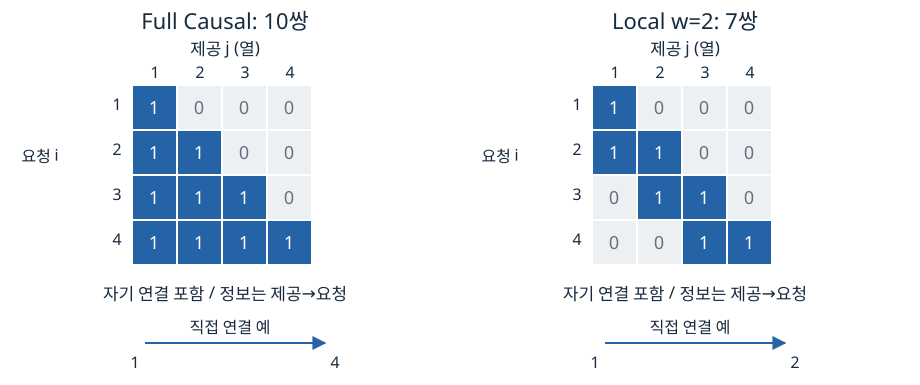{width=100% #efficient-mask-fig}

#### 정리 10.10.1 Local의 쌍 수 {#efficient-pair-count}

$m=\min(n,w)$라 두면 허용 쌍 수는

$$
E_{\mathrm{local}}=\sum_{i=1}^n\min(i,w)=nm-\frac{m(m-1)}2.
\tag{ 10.10.3 }\label{efficient-count-eq}
$$

**증명.** $n\ge w$이면 처음 $w$행의 길이가1,2,…,$w$로 증가하고 이후 $n-w$행은 길이 $w$다. 합은 $w(w+1)/2+(n-w)w=nw-w(w-1)/2$다. $n<w$이면 모든 행이 자기 과거 전체를 읽어 합이 $n(n+1)/2$다. 두 경우를 $m$으로 합치면 위 식이 된다. $w=1$이면 $n$개의 자기 연결만 남는다.

허용 쌍만 계산하는 Window 또는 Sparse 구현에서 주요 산술은 $O(nw(d_k+d_v))$로 상한을 쓸 수 있고, 정확한 쌍 수에는 위 식을 사용한다. $w$를 고정하면 길이 $n$에 선형이다. $w=\lfloor n/2\rfloor$처럼 함께 커지면 $nw$가 다시 $n^2$ 차수가 된다. Dense 배열에 Mask만 씌워서는 같은 산술 감소가 보장되지 않는다.

#### 예제 10.10.3 같은 Q/K/V에서 분모까지 다시 계산하기 {#efficient-nonuniform}

비균일한 점수로 차이를 보자. 비교 폭1, 값 폭1이고

$$
Q=\begin{bmatrix}1\\1\\1\\1\end{bmatrix},\quad
K=\begin{bmatrix}0\\\log2\\\log3\\\log4\end{bmatrix},\quad
V=\begin{bmatrix}1\\2\\3\\4\end{bmatrix}.
$$

모든 요청의 기본 점수는 $[0,\log2,\log3,\log4]$이고 Scaling은1이다. 지수를 취하면 $[1,2,3,4]$다. Causal 허용 집합별로 분모와 출력이 달라진다.

| 요청 | Full 허용 지수와 분모 | Full 계수와 출력 | Local 허용 지수와 분모 | Local 계수와 출력 |
|---|---|---|---|---|
|1| $[1]$,1 | $[1]$,1 | $[1]$,1 | $[1]$,1 |
|2| $[1,2]$,3 | $[1,2]/3$, $5/3$ | $[1,2]$,3 | $[1,2]/3$, $5/3$ |
|3| $[1,2,3]$,6 | $[1,2,3]/6$, $14/6$ | $[2,3]$,5 | $[2,3]/5$, $13/5$ |
|4| $[1,2,3,4]$,10 | $[1,2,3,4]/10$,3 | $[3,4]$,7 | $[3,4]/7$, $25/7$ |

위치3에서는 Full 분자가 $1\cdot1+2\cdot2+3\cdot3=14$이지만 Local은 위치1을 빼서 $2\cdot2+3\cdot3=13$이다. 분모도6에서5로 줄어 출력이 $7/3\approx2.333333$에서 $2.6$으로 바뀐다. 위치4는 Full 분자30/분모10으로3, Local 분자25/분모7로 약3.571429다. 보존한 위치3·4의 기본 점수는 같지만 계수는 $0.3,0.4$에서 $3/7,4/7$로 커졌다.

Full의 위치4 계수에서 앞 두 항만0으로 만들면 $[0,0,0.3,0.4]$이고 합은0.7이다. 그 값으로 집계한2.5는 올바른 Local 출력이 아니다. 제거한 뒤 허용 지수 합7로 다시 나누어야 한다. Sparse 출력은 정의한 Sparse 연산의 정확한 결과일 수 있지만, Full의 근사값으로 얼마나 가까운지는 별도 문제다. 모든 Sparse 설계에 공통인 근접 오차 보장은 없다.

#### 유제 10.10.2 삭제와 재정규화 {#efficient-paired-output}

마지막 요청의 점수는 $[\log2,0,\log3,\log4]$, 값은 $[4,1,2,0]$다. Full Causal과 폭2 Local의 분모·계수·출력을 계산하라. Full 계수의 앞 두 항만 지웠을 때 생기는 오답도 구하라. [해설](SOLUTIONS.md#solution-efficient-paired-output)

**이해 확인2.** 어떤 예제에서 모든 Value가7이라 Full과 Local 출력이 모두7이었다. 허용 관계와 정규화 방식도 일반적으로 같은가? [해설](SOLUTIONS.md#s10-check2)

### 한 층에서 못 읽으면 끝까지 못 읽는가? {#s10-paths}

Sparse의 중요한 변화는 총 쌍 수만으로 설명되지 않는다. 위치4가 초기 위치1의 단서를 필요로 한다면, 한 층에서 그 위치를 직접 읽을 수 있는지와 다른 위치를 거쳐 뒤층에 도달하는지를 따로 물어야 한다. 모든 위치의 한 층 계산은 **이전 층의 표현을 읽는 동시 갱신**이다. 같은 층에서 방금 갱신한 위치2를 위치3이 다시 읽는 순차 계산을 가정하지 않는다.

#### 정의 10.10.3 층별 가능한 초기 입력 의존 집합 {#efficient-dependency}

각 층의 Mask를 $B^{(\ell)}$라 할 때 초기 입력 의존 집합은 다음 재귀식으로 정의한다.

$$
D_i^{(0)}=\{i\},\qquad
D_i^{(\ell)}=D_i^{(\ell-1)}\ \cup\!
\bigcup_{j:B^{(\ell)}_{ij}=1}D_j^{(\ell-1)}.
\tag{ 10.10.4 }\label{efficient-dependency-eq}
$$

$\ell$은 Attention 단계 수이며 $D_i^{(\ell)}$는 $\ell$층의 위치 $i$에 구조상 영향을 줄 수 있는 초기 위치들의 집합이다. 자기 집합은 Query의 생성원과 Residual 경로를 포함한다. 위치별 LN/FFN은 새 위치 간 연결을 더하지 않는다고 가정한다. 별도 Cross Attention·시퀀스 전체 정규화·입력 오염이 있으면 그 의존 경로도 추가해야 한다. 이 집합은 실제 수치 영향의 충분조건이 아니다.

#### 예제 10.10.4 폭2 Local의 세 단계 {#efficient-three-layers}

길이4·폭2 Mask를 모든 층에서 쓰면 집합은 다음과 같다.

| 위치 | 초기 | 1층 뒤 | 2층 뒤 | 3층 뒤 |
|---|---|---|---|---|
|1| {1} | {1} | {1} | {1} |
|2| {2} | {1,2} | {1,2} | {1,2} |
|3| {3} | {2,3} | {1,2,3} | {1,2,3} |
|4| {4} | {3,4} | {2,3,4} | {1,2,3,4} |

2층의 위치4는 이전 층의 위치3·4를 읽는다. 이전 위치3은 초기2·3, 이전 위치4는 초기3·4에 의존할 수 있으므로 합집합은2·3·4다. 초기1은 아직 없다. 세 번째 Attention 단계에서야 $1^{(0)}\to2^{(1)}\to3^{(2)}\to4^{(3)}$ 경로가 완성된다. Full Causal이면 $1^{(0)}\to4^{(1)}$ 직접 경로가 있다.

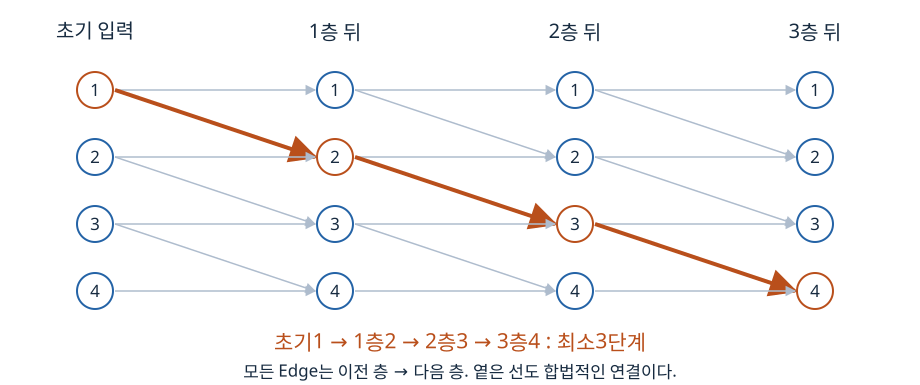{width=100% #efficient-layers-fig}

#### 정리 10.10.2 Local Causal의 최소 단계 {#efficient-minimum-layer}

연속 위치, 고정 $w>1$, 자기 경로를 유지하는 Local Causal에서 초기 위치 $a<b$가 위치 $b$에 도달할 수 있는 최소 Attention 단계 수는

$$L_{\min}=\left\lceil\frac{b-a}{w-1}\right\rceil.$$

**증명.** 한 단계에서 정보는 최대 $w-1$칸 앞으로 이동한다. $L$단계의 최대 이동이 $L(w-1)$이므로 $b-a\le L(w-1)$이 필요하다. 반대로 $w-1$칸 이하의 이동들로 $b-a$를 나누면 각 이동은 허용 Edge이며 위 개수로 경로를 구성할 수 있다. 더 많은 층은 자기 경로로 기다릴 수 있다. $a=b$의 최소는0이고, $w=1$에서는 다른 위치로 갈 수 없다. 미래 $a>b$에서 과거 $b$로는 Causal 경로가 없다.

#### 예제 10.10.5 경로가 있어도 값이 사라지는 반례 {#efficient-zero-influence}

폭2 Local을 세 층 쌓아도 모든 층의 $W_V=0$이면 Attention 반환이0이다. 위치별 Residual·FFN만 남으므로 위치4는 초기1의 변화에 반응하지 않을 수 있다. “경로가 있다”는 말은 그 경로를 이용할 수 있다는 구조적 가능성이다. 투영의 영공간, 출력 변환의 상쇄, 활성화의0 영역, 정규화 등이 실제 기여를 지울 수 있다.

반대로 가능한 실제 기여를 확인하는 작은 모델도 만들 수 있다. 모든 점수를0으로 두고 Identity Value를 이웃 평균하며 Residual은 생략하자. 초기 값 $[1,0,0,0]$은 한 층 뒤 $[1,1/2,0,0]$, 두 층 뒤 $[1,3/4,1/4,0]$, 세 층 뒤 $[1,7/8,1/2,1/8]$이다. 위치4의 $1/8$은 초기1이 세 단계를 거쳐 기여한 값이다. 이 손계산은 학습된 Transformer가 같은 단서를 반드시 사용한다는 실증은 아니다.

#### 유제 10.10.3 길어진 Window의 경로 {#efficient-paired-path}

$n=7,w=3$의 위치7에 대해1층·2층·3층 뒤의 초기 의존 집합을 구하라. 초기1→최종7의 최소 단계와 한 가능한 경로를 쓰라. 모든 $W_V=0$일 때도 이 경로가 비영 수치 기여를 보장하는지 설명하라. [해설](SOLUTIONS.md#solution-efficient-paired-path)

**이해 확인3.** 그래프에서 “요청4가 제공3을 읽는다”를 $4\to3$으로 그렸다. 정보 전달 그림으로 사용할 때 무엇을 고쳐야 하는가? [해설](SOLUTIONS.md#s10-check3)

### 먼 연결을 골라 추가하면 어떻게 되는가? {#s10-global}

Local만이 Sparse의 전부는 아니다. Longformer는 주변 Window와 과제에 따라 지정한 Global 위치를 결합했다. 문서용 양방향 Global은 해당 위치가 전체를 읽고 다른 위치들도 그 위치를 읽는 대칭 관계다. 원문은 Global과 Local의 별도 투영도 사용한다.[^s10-longformer] Big Bird는 Local·Random·Global 연결을 조합한다.[^s10-bigbird] 이 이름들을 기억하는 것보다, 실제로 받은 Mask가 어느 방향의 정보를 어떤 층에서 전달하는지를 계산하는 것이 먼저다.

아래는 두 연구의 실제 모델 전체가 아니라, Global의 **방향과 시간**을 연습하기 위해 만든 별도 Causal 패턴이다. 논문 Window 폭의 관례를 이번 $w$와 동일하다고 가정하지 않는다.

#### 예제 10.10.6 위치3을 Causal 중계점으로 쓰기 {#efficient-global-five}

$n=5,w=2$의 Local에 중계 위치 $g=3$을 추가하자. 위치3은 자기 과거1·2·3을 읽는다. $i\ge3$의 요청은 위치3을 추가로 읽을 수 있다. $i<3$의 요청은 미래3을 읽지 않는다. 이미 있는 Edge는 중복해서 세지 않는다.

$$
J_1=\{1\},\quad J_2=\{1,2\},\quad J_3=\{1,2,3\},\quad
J_4=\{3,4\},\quad J_5=\{3,4,5\}.
$$

총11쌍이며 Local9쌍에서 $(3,1),(5,3)$의 두 쌍을 추가했다. Full Causal15쌍보다 적다. 직접 정보 화살표는 모든 자기 연결과 $1\to2,1\to3,2\to3,3\to4,3\to5,4\to5$다. 위치5는 초기1을 한 층에 직접 읽지는 못하지만 $1^{(0)}\to3^{(1)}\to5^{(2)}$로 두 층에 도달할 수 있다. Local만 쓰면 네 단계가 필요하다.

| 요청 | 1층 뒤 가능한 초기 위치 | 2층 뒤 가능한 초기 위치 |
|---|---|---|
|1| {1} | {1} |
|2| {1,2} | {1,2} |
|3| {1,2,3} | {1,2,3} |
|4| {3,4} | {1,2,3,4} |
|5| {3,4,5} | {1,2,3,4,5} |

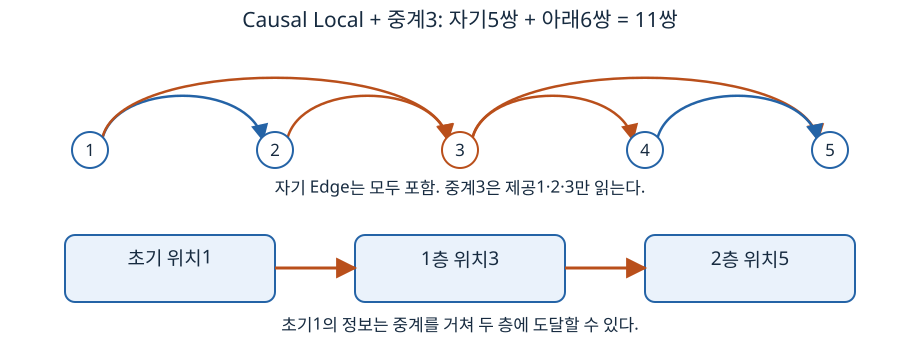{width=100% #efficient-global-fig}

출력도 계산하자. $Q=K=0$인 폭1 점수와 $V=[2,4,8,16,32]^\top$라면 허용 위치를 균등 평균한다. Full은 $[2,3,14/3,30/4,62/5]$다. Local은 $[2,3,6,12,24]$이고 이 Global 패턴은 $[2,3,14/3,12,56/3]$이다. 위치5에서 Global은3·4·5의 **이전 층** 값을 평균해 약18.666667을 만든다. 같은 층에 방금 만든 위치3의 평균 $14/3$을 대신 넣으면 다른 연산이 된다.

Global 위치 하나가 있으므로 한 단계에 모두 연결됐다는 설명은 틀리다. 초기1은 위치3의 첫 반환에 들어가고, 그 반환에서 만든 다음 층의 K/V가 위치5에 제공될 때 도달한다. 위치3이 앞에 고정되어 있으면 자신보다 뒤의 새 입력을 계속 요약하는 자동회귀 중계점도 아니다. 뒤의 토큰을 읽을 수 없기 때문이다.

#### 예제 10.10.7 양방향 Global을 그대로 가져온 누출 {#efficient-global-leak}

위 패턴에서 위치3의 제공 집합만 $\{1,2,3,4,5\}$로 바꾸자. 미래5의 값이 첫 층 위치3에 들어간다. 다음 층 위치4가 위치3을 읽으면 $5^{(0)}\to3^{(1)}\to4^{(2)}$ 경로로 위치4의 미래가 전달된다. 마지막 층의 Mask만 하삼각이면 된다는 설명은 이 오염을 막지 못한다.

실제 균등 평균 모델에서 $v_5=32$일 때 잘못된 첫 위치3의 값은 $62/5=12.4$다. 다음 위치4는 첫 위치3과 첫 위치4(12)를 평균해12.2다. $v_5$만320으로 바꾸면 첫 위치3은70, 다음 위치4는41이 된다. 합법적인 패턴의 두 층 위치4는 두 경우 모두 $((14/3)+12)/2=25/3$다. 수정은 중계3의 합을 $j\le3$으로 제한하고, 모든 층·입력 생성원에서도 같은 정보 조건을 지키는 것이다.

Random 또는 선택된 Edge도 제공 $j$와 요청 $i$를 확인해 $j\le i$를 보장해야 한다. 한 요청에 먼 과거 Edge를 몇 개 추가하면 단층 접근은 늘지만, Random이라는 이름만으로 모든 쌍의 짧은 경로나 실제 학습 성공을 보장하지 않는다. Local과 겹친 Edge도 한 번만 센다.

Block Sparse는 토큰 쌍을 작은 블록 단위로 선택한다. 크기 $b$의 완전한 블록 $t$개라면 최대 $tb^2$셀을 계산하지만, Causal 경계의 대각 블록에는 금지된 미래 셀이 있을 수 있다. 블록 안 전체를 계산하고 Mask할지 허용 셀만 계산할지에 따라 실제 산술이 달라진다. **블록 수와 허용 토큰 쌍 수를 구별**해야 한다.

#### 유제 10.10.4 안전한 중계와 실제 층 수 {#efficient-paired-global}

위 Global 예제에서 초기2가 위치5에 도달하는 최소 단계와 경로를 쓰라. 초기4는 위치2에 도달할 수 있는가? 위치3이 미래5를 읽도록 고친 뒤 마지막 층만 Causal로 유지하면 충분한지도 설명하라. [해설](SOLUTIONS.md#solution-efficient-paired-global)

### 모든 쌍을 작은 합으로 표현할 수 있을까? {#s10-kernel}

Sparse에서는 제공 집합을 줄였다. 이제는 많은 제공 위치를 남긴 채 여러 Query가 공유할 수 있는 합을 만들고 싶다. 원 Softmax의 지수 계수는 Query마다 달라서 단순히 과거 Value 합 하나로 처리할 수 없다. 대신 특징 내적형 비정규화 가중치를 정의하면 분자의 곱을 좌표별로 풀어 **Key와 Value를 먼저 합치는 순서**로 바꿀 수 있다.

#### 정의 10.10.4 정규화된 특징 내적형 Attention {#efficient-kernel}

특징맵 $\phi$의 폭을 $r$이라 하고, 특징 내적형 Attention을 다음과 같이 정의한다.

$$
w_{ij}=\phi(q_i)^\top\phi(k_j),\quad
w_{ij}\ge0,\quad d_i=\sum_j w_{ij}>0,\qquad
o_i=\frac{\sum_j w_{ij}v_j}{d_i}.
\tag{ 10.10.5 }\label{efficient-kernel-eq}
$$

$\phi(q_i),\phi(k_j)\in\mathbb R^r$는 열벡터, $v_j\in\mathbb R^{d_v}$이고 $o_i$도 값 폭 $d_v$다. 이 정의의 합은 우선 전체 제공 위치를 포함한다. 실제 비음수 조건은 **내적 가중치**에 관한 것이다. 특징 좌표를 모두 비음수로 택하면 충분하지만 그것이 모든 가능한 Kernel 표현의 필요조건은 아니다. 이번 실행 코드는 검사하기 쉬운 충분조건인 좌표별 비음수를 계약으로 사용한다.

비음수여도 분모가 양수라는 보장은 없다. 요청 특징 $[1,0]$, 유일한 제공 특징 $[0,1]$이면 내적0, 분모0이다. 출력은 정의되지 않는다. 분모에 임의의 작은 수를 더하는 구현은 별도로 정의한 연산이며 이 식의 정확한 계산과 구별한다. 음수 가중치를 허용하면 합1의 계수가 있어도 볼록 가중합 성질은 사라질 수 있다.

원 Scaled Dot-Product Softmax의 비정규화 가중치는 $\exp(q_i^\top k_j/\sqrt{d_k})$다. 특징 내적이 이 함수를 정확히 나타낸다면 같은 정규화 결과를 만들 수 있고, 근사한다면 해당 근사 조건과 오차 분석이 필요하다. 하지만 임의의 작은 특징맵이 자동으로 그 지수를 재현하지는 않는다. Katharopoulos 외는 특징 내적을 결합법칙으로 재배치하고, $\operatorname{ELU}(x)+1$인 양의 특징맵을 사용하는 Linear Attention도 제시했다.[^s10-linear] 좌표별로 음수 $x$는 $e^x$, 비음수 $x$는 $x+1$이 되므로 양수다. 이는 특징 내적형 Kernel을 정의하며 원 지수 Softmax와 일반적으로 다른 함수다.

#### 정의 10.10.5 제공 특징과 Value의 누적 상태 {#efficient-state}

전체 제공 집합의 상태를 다음 두 합으로 정의한다.

$$
S=\sum_j\phi(k_j)v_j^\top\in\mathbb R^{r\times d_v},\qquad
z=\sum_j\phi(k_j)\in\mathbb R^r.
\tag{ 10.10.6 }\label{efficient-state-eq}
$$

$\phi(k_j)v_j^\top$는 외적이다. 그 $(a,c)$좌표는 Key 특징의 $a$좌표와 Value의 $c$좌표를 곱한 값이다. $S$는 특징 좌표마다 값을 모으고, $z$는 같은 제공 집합의 특징만 더해 정규화에 쓰인다. Value를 더한 $S$만 보존하고 $z$를 빼면 정의한 비율을 계산할 수 없다.

#### 정리 10.10.3 같은 Kernel의 직접 합과 인자 분해 합 {#efficient-associativity}

위 가중치 조건 아래

$$
o_i=\frac{\phi(q_i)^\top S}{\phi(q_i)^\top z}
\tag{ 10.10.7 }\label{efficient-factor-eq}
$$

는 [정의 10.10.4](#efficient-kernel)와 같은 출력이다.

**증명.** 출력 좌표 $c$의 분자는

$$
\begin{aligned}
\sum_jw_{ij}v_{jc}
&=\sum_j\left(\sum_{a=1}^r\phi(q_i)_a\phi(k_j)_a\right)v_{jc}\\
&=\sum_{a=1}^r\phi(q_i)_a\left(\sum_j\phi(k_j)_av_{jc}\right)
=(\phi(q_i)^\top S)_c.
\end{aligned}
$$

유한합의 순서를 바꾸었으며 Query 특징은 제공 인덱스 $j$와 무관하므로 합 밖으로 꺼낼 수 있다. 분모도 $\sum_j\sum_a\phi(q_i)_a\phi(k_j)_a=\sum_a\phi(q_i)_az_a$다. 양의 같은 분모로 나누므로 각 좌표가 같다. 행벡터를 모은 $\Phi_Q,\Phi_K$로 쓰면 분자는 $(\Phi_Q\Phi_K^\top)V=\Phi_Q(\Phi_K^\top V)$다. 이는 같은 Kernel의 연산 재배치이며, 원 Softmax와의 동등성을 별도로 증명한 것은 아니다.

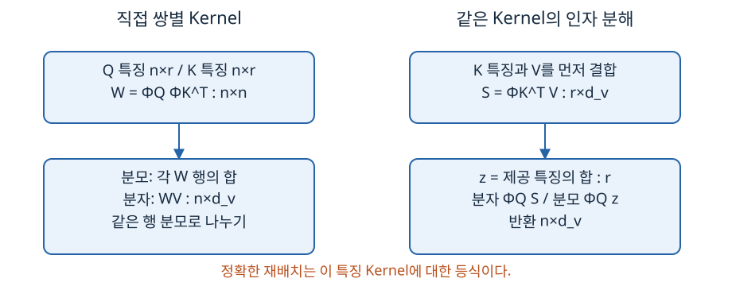{width=100% #efficient-factor-fig}

$r$이 작은 경우 오른쪽은 $n\times n$ 가중치 배열을 명시적으로 만들 필요가 없다. $S$ 생성에는 $nrd_v$회 곱셈, 모든 Query 분자에는 다시 $nrd_v$회, 분모에는 $nr$회 곱셈이 든다. 이번 정확한 곱셈 수는 $2nrd_v+nr$이다. $z$ 합과 외적 누적의 덧셈, 좌표별 나눗셈 $nd_v$회는 별도로 기록한다. 주요 결합 비용은 $O(nrd_v+nr)$이며 **Q/K/V 생성, 특징맵 계산, 출력 변환, Head·FFN 비용은 제외**했다. $r,d_v$가 고정될 때 $n$에 선형이고, $r\propto n$이면 그런 결론을 유지할 수 없다.

상태만 저장하면 $rd_v+r$개의 수다. 모든 특징을 저장하면 $2nr$, 반환을 저장하면 $nd_v$도 필요하고 훈련용 상태·Gradient는 별도다. Prefix 상태 전부를 관찰용으로 저장하는 학습 코드의 총메모리와 추론에서 현재 상태만 유지하는 크기도 다르다. 상호작용 곱셈이 적다는 사실만으로 특정 하드웨어의 실행 시간이 짧다고 단정할 수 없다.

#### 예제 10.10.8 네 특징을 직접 비교하고 먼저 합치기 {#efficient-kernel-four}

교육용 특징과 값은 다음과 같다. Q/K의 원 배열 대신 특징을 이미 제공한다.

$$
\Phi_Q=\Phi_K=\Phi=\begin{bmatrix}1&0\\0&1\\1&1\\2&1\end{bmatrix},\qquad
V=\begin{bmatrix}1\\2\\3\\4\end{bmatrix}.
$$

마지막 Query 특징 $[2,1]^\top$는 네 Key 특징과 각각 내적2,1,3,5를 만든다. 분모는11, 계수는 $[2,1,3,5]/11$이며 출력은

$$o_4=\frac{2\cdot1+1\cdot2+3\cdot3+5\cdot4}{11}=\frac{33}{11}=3.$$

이제 Key와 Value를 먼저 합치자. 각 외적은 값 폭1이므로 $[1,0]^\top$, $[0,2]^\top$, $[3,3]^\top$, $[8,4]^\top$다. 따라서

$$S=\begin{bmatrix}12\\9\end{bmatrix},\quad z=\begin{bmatrix}4\\3\end{bmatrix},\quad
\phi(q_4)^\top S=2\cdot12+9=33,\quad \phi(q_4)^\top z=2\cdot4+3=11.$$

직접 계산과 인자 분해 계산이 같은3을 얻는다. $z$를 빠뜨리면33을 반환하며 가중치 합1의 평균이 아니다. $z$를 행 방향으로 더해 $[1,1,2,3]$을 만들면 폭4가 되어 요청 특징 폭2와 맞지 않는다.

전체 비정규화 내적 행렬도 확인할 수 있다.

$$W=\Phi\Phi^\top=\begin{bmatrix}1&0&1&2\\0&1&1&1\\1&1&2&3\\2&1&3&5\end{bmatrix}.$$

전체 제공 위치를 포함해도 첫 요청의 제공2 계수는0이다. “전역 합에 모든 행이 들어간다”와 “모든 Value가 모든 요청에 양의 계수로 기여한다”는 다른 말이다. 이 입력에서는 $S=3z$이므로 네 전역 출력이 우연히 모두3이다. 이 특별한 수치 관계가 일반적인 상수 출력을 뜻하지는 않는다.

#### 예제 10.10.9 같은 네 수에 다른 정규화를 적용하기 {#efficient-softmax-different}

위 마지막 행의 **주어진 수** $[2,1,3,5]$에 별도로 Softmax를 적용해 보자. 이 비교에서는 다시 $\sqrt2$로 나누지 않는다. 이미 주어진 점수의 두 정규화 방식을 비교하기 때문이다.

$$
a^{\mathrm{soft}}=\frac{[e^2,e^1,e^3,e^5]}{e^2+e^1+e^3+e^5}
\approx[0.041371,0.015219,0.112457,0.830953].
$$

출력은 약 $0.041371\cdot1+0.015219\cdot2+0.112457\cdot3+0.830953\cdot4=3.732992$다. Kernel의 마지막 계수 $[0.181818,0.090909,0.272727,0.454545]$와 다르다. 같은 순서로 큰 점수에 더 큰 비중을 주어도 비율이 다르면 출력이 달라진다. 이 예는 어떤 특징맵이 일반적인 Scaled Dot-Product Softmax를 오차 보장 아래 근사했다는 연구 결과가 아니다.

더 단순한 반례로 특징맵을 Identity로 두고 $q=1,k_1=1,k_2=2$라 하자. 내적 가중치는 $[1,2]$라 비율2이고, 지수 가중치는 $[e,e^2]$라 비율 $e$다. 원 Softmax와 같지 않다. 양의 특징이나 작은 폭만으로 지수 함수와의 동등성을 보장할 수 없다.

#### 예제 10.10.10 다른 Query/Key 특징과 값 폭2 {#efficient-two-values}

Query와 Key의 특징맵이 달라도 같은 폭 $r$의 내적을 사용하면 재배치는 가능하다. 다음 특징은 손계산용으로 주어진 별도 입력이다.

$$
\Phi_Q=\begin{bmatrix}1&2\\2&1\\1&1\end{bmatrix},\quad
\Phi_K=\begin{bmatrix}1&1\\2&0\\0&3\end{bmatrix},\quad
V=\begin{bmatrix}2&-1\\0&4\\3&2\end{bmatrix}.
$$

$r=2,d_v=2$이고 첫 요청의 가중치는 $[3,2,6]$다. 분모11에 대해 분자는 $3[2,-1]+2[0,4]+6[3,2]=[24,17]$이므로 출력은 $[24/11,17/11]$이다. 음수 Value 좌표는 허용된다. 비음수 조건은 가중치에 붙는다.

인자 분해에서는

$$
S=\begin{bmatrix}2&-1\\2&-1\end{bmatrix}
+\begin{bmatrix}0&8\\0&0\end{bmatrix}
+\begin{bmatrix}0&0\\9&6\end{bmatrix}
=\begin{bmatrix}2&7\\11&5\end{bmatrix},\qquad z=\begin{bmatrix}3\\4\end{bmatrix}.
$$

첫 요청이 $[1,2]S=[24,17]$, $[1,2]z=11$을 만들므로 두 좌표가 모두 일치한다. 다른 두 요청은 $[15/10,19/10]$, $[13/7,12/7]$다. Query/Key 특징맵을 각각 $\phi,\psi$로 쓰면 $w_{ij}=\phi(q_i)^\top\psi(k_j)$이며 상태는 $S=\sum_j\psi(k_j)v_j^\top,z=\sum_j\psi(k_j)$다. 같은 폭·비음수 내적·양의 분모 조건은 여전히 필요하다.

#### 유제 10.10.5 분모와 shape까지 검산하기 {#efficient-paired-factor}

요청 특징 $[1,2]$, 제공 특징 $[1,0],[1,1]$, Value $[2,-1],[0,3]$다. 직접 가중치·분모·출력과 $S,z$를 각각 계산하라. $r,d_v$와 각 shape를 쓰고, $z$ 없이 계산한 오답을 구하라. [해설](SOLUTIONS.md#solution-efficient-paired-factor)

**이해 확인4.** 모든 특징 좌표가0 이상이다. 그러면 모든 요청 분모가 양수라는 결론이 성립하는가? 가장 작은 반례를 만들라. [해설](SOLUTIONS.md#s10-check4)

### 미래를 아직 읽지 않고 누적하기 {#s10-prefix}

전체 시퀀스의 $S,z$는 비Causal 입력에서 공유할 수 있다. 생성에서는 현재보다 뒤의 Key/Value를 사용할 수 없다. 미래 Token이 아직 존재하지 않는 순차 생성뿐 아니라, 정답 입력을 병렬 준비한 훈련에서도 앞 요청이 뒤 입력을 읽으면 안 된다. 같은 인자 분해 식을 쓰면서 **어느 시점까지 합에 들어갔는가**를 바꾸어야 한다.

#### 정의 10.10.6 현재 입력을 포함하는 Causal Prefix 상태 {#efficient-prefix}

원위치 순서대로 읽는 Causal Kernel 상태는 다음과 같다.

$$
\begin{aligned}
S_i&=\sum_{j\le i}\phi(k_j)v_j^\top,&z_i&=\sum_{j\le i}\phi(k_j),\\
S_0&=0,&z_0&=0,\\
S_i&=S_{i-1}+\phi(k_i)v_i^\top,&z_i&=z_{i-1}+\phi(k_i),\\
o_i&=\frac{\phi(q_i)^\top S_i}{\phi(q_i)^\top z_i}.&&
\end{aligned}
\tag{ 10.10.8 }\label{efficient-prefix-eq}
$$

$i$는 원래 위치이며 특징·Value가 원위치 순서로 정렬되어 있다고 가정한다. 현재 입력의 Q/K/V를 만든 뒤, 현재 K/V 항을 상태에 **먼저 추가**하고 현재 Query를 적용한다. 자기 위치도 허용하는 Decoder 규약이다. 추가 전에 출력하면 $j<i$만 읽어 다른 연산이 되고 위치1의 분모는0일 수 있다. 출력 직후 상태에는1…$i$만 존재하며 다음 입력 $i+1$은 아직 없다.[^s10-linear]

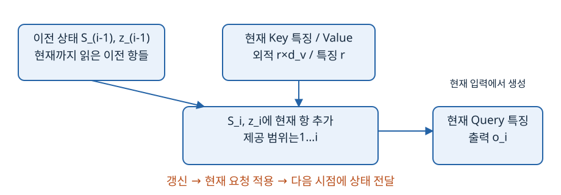{width=100% #efficient-prefix-fig}

#### 예제 10.10.11 S와 z를 한 행씩 만들기 {#efficient-prefix-four}

[예제 10.10.8](#efficient-kernel-four)의 특징/값을 원위치 순서로 읽으면 다음과 같다. 값 폭1이라 $S_i$는 두 좌표의 열벡터다.

| 위치 | 현재 외적 | $S_i^\top$ | $z_i^\top$ | 요청 분자/분모 | 출력 |
|---|---|---|---|---|---|
|1| $[1,0]^\top$ | $[1,0]$ | $[1,0]$ |1/1|1|
|2| $[0,2]^\top$ | $[1,2]$ | $[1,1]$ |2/1|2|
|3| $[3,3]^\top$ | $[4,5]$ | $[2,2]$ |9/4|2.25|
|4| $[8,4]^\top$ | $[12,9]$ | $[4,3]$ |33/11|3|

위치2의 요청 특징은 $[0,1]$이라 과거1의 특징 $[1,0]$과 내적0이다. Causal 제공 집합1·2 중 계수는 $[0,1]$이며 출력2다. 위치3의 직접 가중치는 $[1,1,2]$이고 $1\cdot1+1\cdot2+2\cdot3=9$, 분모4다. 각 Prefix를 직접 제한 합으로 계산해도 표와 같다.

원래 Softmax Full Causal도 같은 위치에서 별도로 계산해 보자. 여기서는 **원 Q=K=Φ, 비교 폭2**라고 정해 실제 점수를 $\Phi\Phi^\top/\sqrt2$로 만든다. 앞의 “주어진 점수 $[2,1,3,5]$를 그대로 정규화”한 비교와 Scaling 계약이 다르다.

| 요청 | 허용된 Scaled 점수 | Full Softmax 출력 | Kernel Prefix 출력 | 잘못된 전체 Kernel 합 출력 |
|---|---|---|---|---|
|1| $[1]/\sqrt2$ |1|1|3|
|2| $[0,1]/\sqrt2$ |1.669762|2|3|
|3| $[1,1,2]/\sqrt2$ |2.255235|2.25|3|
|4| $[2,1,3,5]/\sqrt2$ |3.493038|3|3|

예를 들어 위치2 Softmax 계수는 $[1,e^{1/\sqrt2}]/(1+e^{1/\sqrt2})\approx[0.330238,0.669762]$이고 출력1.669762다. Prefix Kernel은 미래를 차단하지만 원 Softmax 계수를 보존하지 않는다. 마지막 위치에서 Prefix와 전역 Kernel의 합이 같다는 사실도 앞 위치의 안전성을 뜻하지 않는다.

#### 예제 10.10.12 미래 변경과 허용 과거 변경을 함께 시험하기 {#efficient-future-change}

$v_4$만4에서40으로 바꾸자. 위치1·2·3의 Prefix 상태에는 네 번째 항이 없어 출력 $[1,2,2.25]$가 그대로다. 마지막 상태는 $S_4=[84,45]^\top,z_4=[4,3]^\top$가 되어 출력 $213/11\approx19.363636$이다.

잘못된 전역 합을 모든 요청에 쓰면 같은 새 상태에서 앞 출력도 $[21,15,129/7,213/11]$로 바뀐다. 위치1이21로 바뀐 것은 미래 Value4가 이미 전역 $S$에 들어갔기 때문이다. 같은 $z$가 유지돼도 분자만으로 누출이 발생한다.

이번에는 허용 과거 $v_1$을1에서10으로 바꾸고 $v_4$는4로 되돌리자. Prefix 출력은 $[10,2,18/4,51/11]$이다. 위치3·4는 바뀌며 위치2는 가중치0이므로 유지된다. 미래 변경 불변 시험만 통과하는 상수 반환 코드를 정답이라고 인정할 수 없다. 허용 정보에 반응하는 양성 대조와 직접 합 대조도 함께 필요하다. 반응하지 않은 위치2는 이 예제의0 계수로 설명된다.

#### 정리 10.10.4 Prefix의 정보 접근 불변성 {#efficient-causal-invariant}

각 위치의 Q/K/V·특징 생성이 그 위치까지 허용된 입력만 사용하고, 모든 이전 층도 Causal이며, 상태가 위 규약대로 갱신되면 위치 $i$의 Kernel 출력은 $i$보다 뒤의 입력 변경에 불변이다.

**증명.** 초기 상태는 미래에 의존하지 않는다. $S_{i-1},z_{i-1}$가1…$i-1$까지만 의존한다고 가정하자. 새 항은 현재까지 허용된 입력으로만 생성되므로 이를 더한 $S_i,z_i$도1…$i$까지만 의존한다. 현재 Query 특징 역시 같은 정보 범위에 있으므로 그 상태와의 내적·나눗셈 출력은 미래에 의존하지 않는다. 이 귀납을 시점과 층에 적용한다. 분모 양수·고정 연산 규약을 가정한다. 이미 미래로 오염된 특징을 넣으면 상태 갱신만 올바르게 해도 보장이 성립하지 않는다.

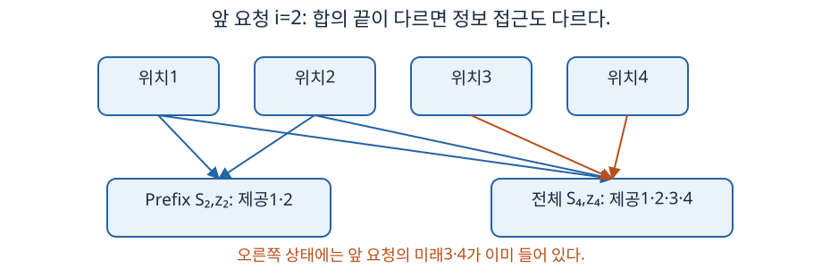{width=100% #efficient-global-prefix-fig}

일반적인 Query별 Sparse Mask를 하나의 전역 $S,z$에 그대로 씌울 수는 없다. 제공 집합이 요청마다 다르면 $S_i=\sum_{j\in J_i}\phi(k_j)v_j^\top,z_i=\sum_{j\in J_i}\phi(k_j)$가 필요하다. Prefix는 집합이 한 항씩 늘어나므로 효율적인 재사용이 가능하다. Local Kernel에서는 새 항을 더하고 Window 밖 오래된 항을 빼는 별도 갱신을 구성할 수 있지만, 임의 Mask가 항상 같은 효율을 갖지는 않는다. 특징/Mask 결합 조건을 확인하지 않고 “어떤 Sparse와도 한 번의 전역 합으로 처리된다”고 주장하면 안 된다.

#### 유제 10.10.6 현재 항을 넣는 시점 {#efficient-paired-prefix}

특징은 순서대로 $[1,1],[2,0],[0,1]$, Value는2,3,6이고 Query 특징도 같은 순서다. $S_i,z_i$, 분자/분모와 세 출력을 구하라. 현재 항을 추가하기 전에 요청을 계산하는 코드가 위치1에서 만드는 문제를 설명하라. [해설](SOLUTIONS.md#solution-efficient-paired-prefix)

**이해 확인5.** Prefix 갱신 순서는 올바르지만 두 번째 층의 Key가 미래를 읽은 첫 층 표현에서 만들어졌다. 앞 출력의 미래 불변성이 보장되는가? [해설](SOLUTIONS.md#s10-check5)

### 세 방법과 Cache의 절감 지점 {#s10-compare}

[10.9절](#sec-cache)의 KV Cache는 원래 Full Softmax를 수행하는 데 필요한 과거 K/V를 항목별로 보존한다. 고정 모델·위치·입력·Causal 경로 등 재사용 조건 아래 완전 재계산과 같은 결과를 얻는 것이 목적이다. 새 요청은 여전히 $t$개의 과거/현재 Key를 읽어 $O(t(d_k+d_v))$의 비교·집계를 수행한다. 과거를 저장했다고 새 요청이 Key 하나만 읽는 것은 아니다.

Causal Kernel의 $S_i,z_i$는 다른 Attention 식에 필요한 **압축된 합**을 보존한다. 고정 $r,d_v$이면 한 Head의 상태 $rd_v+r$는 길이와 무관하다. 일반 Full Softmax의 과거 항목별 K/V인 $i(d_k+d_v)$와 저장 내용이 다르다. 특징 합에서 개별 과거 K/V를 일반적으로 복원하거나 원 Softmax를 정확히 계산할 수 있다는 보장은 없다. 여러 층과 Head는 각각 자기 상태를 가져야 하고 특징/Value 폭이 늘어나면 상태도 커진다.

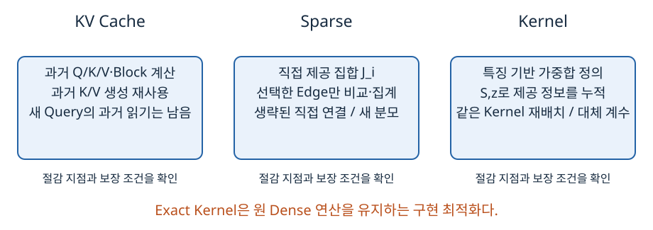{width=100% #efficient-savings-fig}

| 비교 항목 | Full Attention | Sparse Attention | Kernel/Factorized Attention |
|---|---|---|---|
| 허용 관계 | 전체 또는 Causal 등 정의된 전체 관계 | 선택한 Edge | Kernel 내적과 별도 접근 조건 |
| 직접 연결 | 허용된 모든 쌍 | 선택한 쌍만 | 허용 집합 안의 특징 내적;0 가중치 가능 |
| 주요 산술 | $n^2(d_k+d_v)$ 중심 | $E(d_k+d_v)$ 중심 | $nr(d_v+1)$ 중심 |
| 원래 Full 출력 | 비교 기준 | 일반적으로 다름 | 같은 지수 Kernel 조건 없으면 다름 |
| 다층 정보 | 전체 연결/접근 조건 | 층별 도달 경로 필요 | 특징의 생성원·누적 범위 필요 |
| 추가 저장 | 행렬 저장 여부에 따라 다름 | 희소 인덱스·계수·입출력 등 | $S,z$·특징·입출력 등 |

Sparse의 **생략**은 [예제 10.10.2](#efficient-mask-four)의 세 직접 연결에서 보았다. Kernel의 **대체**는 [예제 10.10.9](#efficient-softmax-different)의3과3.732992에서 보았다. 동일 Kernel의 **연산 재배치**는 [정리 10.10.3](#efficient-associativity)의 정확한 항등식이다. 오차를 분석한 특징맵이면 원 Softmax의 근사라고 말할 수 있지만, 여기서 주어진 특징에는 그런 오차 보장을 부여하지 않는다. 이 세 의미를 분리해야 출력 차이의 원인을 설명할 수 있다.

작은 $n=4,d_k=d_v=1,r=2$에서는 Full Causal 허용 쌍 산술20회, Local14회, Factorized Kernel24회 곱셈이다. Kernel도 이 작은 입력에서는 곱셈이 더 많다. 길이가 커지면 고정 폭의 차수 이점이 나타날 수 있지만, Big-O 표 하나에서 실제 실행 시간·메모리 배율을 읽을 수는 없다. 실제 코드의 메모리 배치, 특징 생성 비용, 희소 인덱스 처리, 병렬 처리와 하드웨어를 별도로 측정해야 한다.

Exact Attention Kernel Optimization은 다른 경계다. FlashAttention은 정확한 Dense Attention을 유지하며 메모리 접근과 계산 순서를 최적화하는 대조 사례다.[^s10-flash] 이 경우 직접 관계를 지우거나 다른 Kernel로 대체하지 않는다. 수학적 동일성과 부동소수점의 비트 단위 동일성도 구별한다. GPU 타일링 전체 구현, Serving의 KV Cache Paging/Eviction, 일반 Accelerator Runtime 최적화는 이 절의 상호작용 분석 범위 밖이다.

#### 유제 10.10.7 요구와 보장을 맞추기 {#efficient-paired-design}

요구A는 “고정 Full Softmax Decoder 결과를 유지하면서 과거 재계산을 줄인다”, 요구B는 “최근3개 입력만 직접 읽는다”, 요구C는 “주어진 양의 특징 Kernel을 Prefix 합으로 처리한다”다. Cache·Sparse·Kernel 중 해당 설계와 남는 비용/바뀐 출력을 설명하라. 정확한 Dense 결과를 유지하는 메모리 접근 최적화는 어느 요구와 구별해야 하는가? [해설](SOLUTIONS.md#solution-efficient-paired-design)

**이해 확인6.** $r=n/2$이고 $d_v$가 고정이다. $O(nrd_v+nr)$를 그대로 길이에 선형이라고 설명할 수 있는가? [해설](SOLUTIONS.md#s10-check6)

### 수식과 실행 코드를 연결하기 {#s10-code}

[Learning Source 안내](learning-source/README.md)의 Python3.12·NumPy2.2.6·uv CPU 환경을 사용한다. `efficient.py`는 Boolean Mask, 허용 쌍별 Softmax, 층별 도달 집합, Kernel 직접 합·인자 합·Prefix와 비용을 구현한다. 핵심 구현을 아래에 발췌했다. 앞부분의 입력 검사 함수가 필요하므로 이 발췌만 따로 실행하는 대신 완전한 파일과 `demo_efficient.py`를 실행하자. 실행 환경과 예상 출력은 Learning Source에 있다.

Kernel 코드는 좌표별 비음수 특징을 검사하고, Value의 음수는 허용한다. `sum(axis=0)`은 Key의 제공 위치를 합쳐 특징 폭 $r$을 남긴다. `outer`는 $r\times d_v$의 현재 항을 만들며, 각 요청에 전달한 상태는 복사해 저장한다. 이 관찰용 상태 목록은 모든 Prefix를 보존하므로 고정 크기의 스트리밍 저장이라고 부르면 안 된다. 현재 상태만 유지하려면 목록 추가를 생략한다. 유한한 입력도 큰 누적·내적에서 float64 범위를 넘을 수 있다. 실행 코드는 비유한 상태/출력을 거부하며 모든 실수 범위의 수치 안정성을 보장하지 않는다.

```{.python .numberLines source-root="." source="learning-source/efficient.py" source-start="142" source-end="148" source-revision="efficient-source-v0.1"}
```

```{.python .numberLines source-root="." source="learning-source/efficient.py" source-start="151" source-end="166" source-revision="efficient-source-v0.1"}
```

`demo_efficient.py`는 Full/Local/Global과 Prefix의 중간 상태를 `NUMERICAL_EFFICIENT.json`으로 남긴다. `solution_efficient.py`는 다른 특징/값 폭을 계산한다. `verify_efficient.py`는 NumPy 결과를 `reference_efficient.py`의 Decimal70 스칼라 Softmax·Fraction 직접 합과 대조하고, 그래프를 시간 확장 경로 열거로 따로 확인한다. 이런 유한 시험은 모든 입력에 관한 정리의 증명이나 학습효과의 실증과는 다르다.

그래프 코드에서도 한 층의 모든 집합을 만든 뒤 다음 층으로 옮긴다. 입력 배열을 제자리 변경하거나, 계산 중인 같은 층의 갱신 값을 즉시 읽으면 단계를 잘못 줄인다. 실제 코드의 행·열은0부터, 본문의 원위치는1부터 세므로 이 대응도 확인하자.

### 다음 질문으로 {#s10-next}

이제 어떤 설계를 받더라도 먼저 허용된 쌍과 실제 계산 셀을 구별하고, 그다음 계수와 출력, 층별 정보 경로를 계산할 수 있다. Kernel이라면 어떤 특징과 분모를 쓰는지, 합을 어떤 시점까지 포함하는지도 확인해야 한다. 앞 절의 Cache는 그 계산에 필요한 과거를 재사용하는 별도 조건이었다.

다음 [10.11절](#sec-integration)에서는 입력 표현·위치·접근 관계·Head·Block·구조 선택·Cache·효율을 작은 전체 모델과 종합 문제로 연결한다. 새로운 이름을 더 외우는 대신, 주어진 정보 요구에 맞는 모델이 끝까지 같은 계약으로 계산되는지 확인하는 것이 다음 과제다.

\newpage

### 절 종료 연습문제 {#s10-practice}

★는 비용·연결·대수·Causal 수행을 함께 회수하는 필수 문제다. 한 문제의 성공만으로 전체 이해를 확정하지 말고, 틀린 유형의 해설에서 복습 위치와 원인을 확인하자. 여기서 Q/K/V와 특징은 투영 완료 배열이다. 따로 요구하지 않으면 곱셈 수에는 점수/Value 또는 상태 생성/요청 적용만 넣고 Scaling·지수·나눗셈·투영·FFN은 제외한다.

#### 연습문제 10.10.1 허용 쌍과 실제 셀 {#efficient-ex01}

$n=9,d_k=4,d_v=2$다. 양방향 Full, 허용 쌍만 계산한 Causal Full, Dense 두 행렬곱 뒤 Causal Mask의 쌍/셀과 곱셈 수를 구하라. 세 결과 중 어떤 수가 실행 시간의 직접 비율을 뜻하지 않는지 설명하라. [해설](SOLUTIONS.md#solution-efficient-ex01)

#### 연습문제 10.10.2 ★ Window의 양쪽 경계 {#efficient-ex02}

$n=5,w=3$의 제공 집합·Boolean Mask·쌍 수를 쓰라. $w=8$과 $w=1$의 쌍 수도 구하고 $n<w$를 처리하는 일반식을 제시하라. [해설](SOLUTIONS.md#solution-efficient-ex02)

#### 연습문제 10.10.3 폭이 길이와 함께 늘어날 때 {#efficient-ex03}

$d_k,d_v$는 고정이다. $w=4$, $w=\lfloor\sqrt n\rfloor$, $w=\lfloor n/2\rfloor$의 충분히 큰 $n$에서 주요 산술 차수를 비교하라. 선형이라는 설명이 성립하는 조건을 쓰라. [해설](SOLUTIONS.md#solution-efficient-ex03)

#### 연습문제 10.10.4 ★ 새로운 Softmax 재정규화 {#efficient-ex04}

비교 폭1, 마지막 $q=1$, $K=[0,\log3,\log2,\log4]^\top$, $V=[2,0,5,-1]^\top$다. Full Causal과 $w=2$ Local의 점수·허용 지수·계수·출력, 사라진 직접 관계를 구하라. Full 계수에만0을 넣은 오답도 구하라. [해설](SOLUTIONS.md#solution-efficient-ex04)

#### 연습문제 10.10.5 같은 값이 숨기는 차이 {#efficient-ex05}

모든 Value가 같은 벡터 $c$일 때 Full·Local·정규화 Kernel의 출력이 $c$가 되는 조건을 증명하라. 이 관찰로 일반적인 함수 동등성을 결론 내릴 수 없는 이유와, 차이를 드러낼 새 Value를 제안하라. [해설](SOLUTIONS.md#solution-efficient-ex05)

#### 연습문제 10.10.6 ★ 층별 의존 집합 {#efficient-ex06}

$n=6,w=2$에서 위치4·6의1층·2층·3층 의존 집합을 구하라. 초기1→위치6의 최소 단계는 몇 개인가? 미래6→위치2의 경로도 판단하라. [해설](SOLUTIONS.md#solution-efficient-ex06)

#### 연습문제 10.10.7 ★ 층마다 다른 새 Sparse Graph {#efficient-ex07}

길이5의 제공 집합은 다음과 같다. 각 층의 Edge 수와 Causal 여부를 확인하고, 둘째 층 모든 위치의 초기 의존 집합을 구하라.

| 요청 | 첫 층 제공 | 둘째 층 제공 |
|---|---|---|
|1| {1} | {1} |
|2| {1,2} | {2} |
|3| {1,3} | {2,3} |
|4| {2,4} | {3,4} |
|5| {4,5} | {3,5} |

 초기1이 최종5에 도달하는 경로와, 초기2가 최종5에 도달하지 못하는 이유를 쓰라. [해설](SOLUTIONS.md#solution-efficient-ex07)

#### 연습문제 10.10.8 경로와 실제 활성화 {#efficient-ex08}

초기1→최종4의 경로는 있지만 Value 변환에 $\operatorname{ReLU}(-x)$가 들어간다. 경로 중 해당 입력이 항상 양수인 작은 스칼라 예를 만들어 실제 기여가0일 수 있음을 보이라. 경로가 없는 경우와 어떤 결론이 다른가? [해설](SOLUTIONS.md#solution-efficient-ex08)

#### 연습문제 10.10.9 ★ Global 미래 누출 고치기 {#efficient-ex09}

길이5의 Global 위치2가 모든1…5를 읽고, 다음 층 위치3이2·3을 읽는다. 미래5의 변경이 위치3에 전달되는 층 경로를 쓰라. 생성의 Causal 조건을 지키는 두 제공 집합으로 수정하고, 초기1→최종3의 합법적인 경로는 보존하라. [해설](SOLUTIONS.md#solution-efficient-ex09)

#### 연습문제 10.10.10 블록의 허용 셀 {#efficient-ex10}

길이6을 크기2의 세 블록으로 나눈다. 요청 블록은 자기 블록과 바로 앞 블록을 읽으며 자기 블록 안은 Causal이다. 전체 토큰 제공 집합과 허용 쌍 수를 구하라. 선택한 블록의 모든 셀을 먼저 계산한다면 점수 셀 수는 얼마인가? [해설](SOLUTIONS.md#solution-efficient-ex10)

#### 연습문제 10.10.11 ★ 새 특징과 값 폭2의 직접/인자 합 {#efficient-ex11}

요청 특징 $[2,1]$, 제공 특징 $[1,0],[1,2],[0,1]$, Value $[1,2],[3,0],[-1,4]$다. 가중치·분모·직접 출력, 모든 외적과 $S,z$, 인자 출력 및 shape를 독립 계산하라. [해설](SOLUTIONS.md#solution-efficient-ex11)

#### 연습문제 10.10.12 서로 다른 특징맵 {#efficient-ex12}

$\phi(q)=[1,q]$, $\psi(k)=[1,2k]$, $q=2$, $k=1,3$, $v=4,-2$다. 비음수 조건을 확인하고 Kernel 출력과 $S,z$를 구하라. 일반식에서 상태에 $\phi(q)$를 미리 넣을 수 없는 이유를 설명하라. [해설](SOLUTIONS.md#solution-efficient-ex12)

#### 연습문제 10.10.13 분모0과 음수 {#efficient-ex13}

(a) 요청 $[0,0]$, 제공 $[1,1]$; (b) 요청 $[1,0]$, 제공 $[0,2]$; (c) 요청 $[1]$, 제공 $[-1],[2]$, Value1,3이다. 각 분모와 정의 조건을 확인하라. (c)의 출력이 Value 범위를 벗어나는지도 계산하라. 임의 $\varepsilon$을 더하는 수정은 같은 연산인가? [해설](SOLUTIONS.md#solution-efficient-ex13)

#### 연습문제 10.10.14 곱셈 순서와 축 오류 {#efficient-ex14}

$\Phi_Q:4\times2$, $\Phi_K:5\times2$, $V:5\times3$이다. 잘못된 코드 `Phi_Q @ Phi_K @ V`와 `z = Phi_K.sum(axis=1)`를 수정하라. 분자·상태·분모·반환의 shape를 모두 쓰라. [해설](SOLUTIONS.md#solution-efficient-ex14)

#### 연습문제 10.10.15 정확성과 대체 {#efficient-ex15}

$q=1,k=1,2$, Value0,1이다. Identity 특징 Kernel과 $d_k=1$의 원 Softmax 계수/출력을 비교하라. 직접 Kernel과 인자 Kernel이 같다는 검사가 원 Softmax 동등성을 증명하지 않는 이유를 쓰라. [해설](SOLUTIONS.md#solution-efficient-ex15)

#### 연습문제 10.10.16 ★ 잘못된 전역 합을 Prefix로 고치기 {#efficient-ex16}

같은 Query/Key 특징이 $[1,0],[1,1],[0,2]$, Value2,4,8이다. 전체 상태 하나로 계산한 세 출력을 구한 뒤 올바른 $S_i,z_i$·세 출력을 계산하라. 미래 $v_3$만80으로 바꾼 앞 두 출력도 비교하라. [해설](SOLUTIONS.md#solution-efficient-ex16)

#### 연습문제 10.10.17 누적 갱신의 두 오류 {#efficient-ex17}

오류A는 현재 Query를 $S_{i-1},z_{i-1}$에 적용한 뒤 현재 항을 추가한다. 오류B는 $S_i$에 현재 항을 두 번 더하고 $z_i$에는 한 번 더한다. 유일한 현재 특징 $[1]$, Value3으로 두 오류와 정답을 비교하고 순서를 수정하라. [해설](SOLUTIONS.md#solution-efficient-ex17)

#### 연습문제 10.10.18 특징 폭과 저장 범위 {#efficient-ex18}

$n=100,d_k=8,d_v=4,r=3,w=5$다. Full Causal/Local의 쌍 수·곱셈 수와 Factorized의 곱셈 수·현재 상태 크기, Full K/V Cache 수를 구하라. 모든 Prefix 상태를 저장할 때와 현재 상태만 저장할 때도 비교하라. [해설](SOLUTIONS.md#solution-efficient-ex18)

#### 연습문제 10.10.19 일반 Mask와 전역 합 {#efficient-ex19}

두 요청의 제공 집합은 $\{1,2\}$, $\{2,3\}$다. 제공 특징은 모두 $[1]$, 값은1,3,9다. 하나의 전역 상태로 두 요청을 계산한 값과 올바른 값들을 구하라. Window 누적에서 추가·제거할 항을 쓰라. [해설](SOLUTIONS.md#solution-efficient-ex19)

#### 연습문제 10.10.20 ★ 같은 시퀀스의 세 연산 {#efficient-ex20}

길이3, $Q=[1,1,1]^\top,K=[0,1,2]^\top,V=[1,2,0]^\top$이고 비교 폭1이다. Kernel은 $\phi(x)=[1,x+1]$로 Q와 K를 변환한다. Full Causal·폭2 Local·Causal Kernel의 각 출력을 구하라. 쌍 수와 주요 곱셈 수, 직접 허용 관계, 초기1→최종3의 최소 층 수를 비교하라. 특징 생성 비용은 제외하되 제외 사실을 쓰고, 출력 보존·미래 차단·실행 시간에서 보장되는 것과 보장되지 않는 것을 설명하라. [해설](SOLUTIONS.md#solution-efficient-ex20)

#### 연습문제 10.10.21 ★ 네 절감 기법의 설계 선택 {#efficient-ex21}

요구는 (a) 원 Full Softmax 출력 보존과 과거 K/V 재사용, (b) 먼 과거의 직접 읽기 금지, (c) 명시한 특징 Kernel의 고정 폭 Prefix 상태, (d) 원 Dense 결과를 유지하는 메모리 접근 개선이다. KV Cache·Sparse·Factorized·Exact Kernel Optimization을 배정하고 각각의 조건과 남는 비용/한계를 설명하라. 단일 기술이 네 보장을 모두 준다고 주장하는 설계를 비판하라. [해설](SOLUTIONS.md#solution-efficient-ex21)

#### 연습문제 10.10.22 측정 주장의 근거 {#efficient-ex22}

“Window를 줄여 $E$가 절반이므로 메모리도 절반, GPU 실행 시간도 절반, 정확도도 같다”는 보고를 받았다. 네 주장 중 주어진 정보만으로 확인할 수 있는 것을 고르고, 나머지에 필요한 정의·구현·실측·평가 조건을 쓰라. 논문 한 데이터셋의 결과를 모든 과제로 확대하지 않는 보고 문장을 작성하라. [해설](SOLUTIONS.md#solution-efficient-ex22)

### 더 깊이 생각할 문제

#### 심화문제 10.10.1 서로 다른 Window 폭 {#efficient-deep01}

층별 폭이 $w_1,\ldots,w_L$이고 각 층에 자기 연결이 있다. 위치 $b$의 초기 의존 집합을 $\sum_{\ell}(w_\ell-1)$로 표현하고 증명하라. 층 순서가 달라도 이 Local 규약의 집합이 같은 이유와 일반 Sparse Graph에서는 순서가 중요할 수 있는 반례를 제시하라. [해설](SOLUTIONS.md#solution-efficient-deep01)

#### 심화문제 10.10.2 특징 Rank와 Causal Mask {#efficient-deep02}

비Causal 정규화 행렬 $A=D^{-1}\Phi_Q\Phi_K^\top$의 rank가 최대 $r$임을 증명하라. 이 명제를 임의 Causal Mask 뒤에도 그대로 적용할 수 없는 이유를 $r=1$, 모든 특징1인 길이3 Prefix 평균 행렬로 보이라. [해설](SOLUTIONS.md#solution-efficient-deep02)

#### 심화문제 10.10.3 Prefix 불변성과 양성 대조 {#efficient-deep03}

미래 변경 불변성을 상태 귀납으로 증명하고 특징 생성원이 미래에 의존하면 깨지는 반례를 쓰라. “항상0을 출력”하는 코드가 미래 시험을 통과해도 올바른 Kernel 구현이 아닌 이유와 이를 거부할 시험을 제시하라. [해설](SOLUTIONS.md#solution-efficient-deep03)

#### 심화문제 10.10.4 비용 비교의 임계 조건 {#efficient-deep04}

길이 $n$의 Causal 허용 쌍만 계산한다. Full 곱셈 수는 $n(n+1)(d_k+d_v)/2$, Factorized는 $nr(2d_v+1)$이다. 양의 폭에서 Factorized 곱셈이 더 적은 $n$의 조건을 도출하라. 특징 생성 비용이 위치당 $c_\phi$회 곱셈이라 추가되는 경우를 비교하고, 이 부등식이 GPU 속도·모델 정확도를 판정하는지 설명하라. [해설](SOLUTIONS.md#solution-efficient-deep04)

\clearpage

## 10.11 전체 모델 구현과 종합 적용 {#sec-integration}

### 하나의 입력이 다음 토큰이 되기까지 {#s11-start}

지금까지는 필요한 정보를 골라 섞는 연산과 그 연산을 배치하는 방법을 배웠다. 이제 원문을 읽고 새 출력을 만드는 일을 맡겨 보자. 원문 전체는 이미 주어졌지만 출력은 한 토큰씩 결정된다. 첫 출력을 고르기 전에는 출력의 정답을 알 수 없다. 두 번째 출력을 고를 때에는 원문과 첫 번째 출력만 사용할 수 있다. 이 요구에서 모델의 구조와 계산을 함께 도출해야 한다.

원문 전체를 위치별 문맥 표현으로 만들고, 출력의 현재 표현이 그 원문 표현을 읽게 하면 어떨까? 원문에는 양방향 Self-attention을, 출력에는 Causal Self-attention을 두고, 두 표현 집합을 Cross-attention으로 연결하면 된다. **Encoder–Decoder는 이 요구에 맞는 한 설계다.** 원문을 출력 앞에 조건 입력으로 넣는 Decoder-only도 가능하다. 두 설계는 사용할 수 있는 정보가 비슷하더라도 그 정보를 표현하고 공급하는 계산이 같지는 않다.

이 절에서는 먼저 손으로 정한 작은 Encoder–Decoder를 입력 식별자부터 다음 토큰 선택까지 실행한다. 이어서 별도 Decoder-only를 PyTorch로 학습한다. 첫 모델의 숫자는 계산을 설명하기 위한 인공 매개변수이고, 둘째 모델의 숫자는 실제 학습한 매개변수에서 나온 관찰값이다. 두 모델을 혼동하지 않으면서 같은 질문을 던지자. 어떤 표현에서 Q/K/V가 만들어지고, 어느 위치를 읽으며, 반환이 어디로 전달되는가?

[10.2절](#sec-scoring)의 행별 Softmax, [10.3절](#sec-visibility)의 원위치와 허용표, [10.5절](#sec-heads)의 Head 결합, [10.7절](#sec-block)의 블록 순서가 계산의 뼈대다. 입력과 예측 대상이 헷갈리면 [정보 요구](CHAPTER.md#s08-contract), 저장한 K/V가 헷갈리면 [선택과 처리](CHAPTER.md#s09-time)으로 돌아가자. 위치 표현과 효율화의 비교는 각각 [10.6절](#sec-position)·[10.10절](#sec-efficient)에서 배운 조건을 사용한다.

### 요구를 먼저 읽고 구조를 정하기 {#s11-requirements}

#### 예제 10.11.1 완성된 조건에서 출력 만들기 {#integration-choice}

조건 입력은 세 토큰 $x_0,x_1,x_2$다. 출력은 $y_1,y_2,\ldots$이며, $y_t$를 고를 때 조건 전체와 $y_1,\ldots,y_{t-1}$을 사용할 수 있다. 출력 정답 전체를 조건에 넣는 전처리는 금지한다.

Encoder-only로 조건을 읽는 것만으로는 출력의 앞부분을 매 단계 입력받는 경로가 생기지 않는다. 한 번의 분류라면 Encoder와 분류 Readout으로 충분하지만, 이번 요구에는 출력 이력을 반영하는 생성 경로가 필요하다. 별도 Encoder $E$를 만들고 Decoder가 그것을 읽게 하는 설계에서는 Encoder의 각 위치가 세 조건 토큰을 모두 읽는다. Decoder 입력은 $[\mathrm{BOS},y_1,\ldots]$다. 입력 위치0의 반환이 $y_1$을, 위치1의 반환이 $y_2$를 예측한다. Decoder Self에서는 $j\le i$만 허용하고 Cross에서는 조건의 유효 세 열을 모두 허용한다.

Decoder-only 대안은 $[x_0,x_1,x_2,\mathrm{SEP},\mathrm{BOS},y_1,\ldots]$를 한 시퀀스로 두는 것이다. 출력 위치는 조건과 앞 출력을 모두 읽고 뒤 출력을 읽지 못한다. 일반 Causal Mask라면 조건의 앞 위치가 조건의 뒤 위치를 읽지는 못한다. 조건 구간만 양방향으로 만드는 별도 Prefix Mask도 설계할 수 있지만, 그 허용 관계를 명시해야 한다. 이 대안의 K/V는 한 스택의 위치별 표현에서 나오며, 별도 Encoder의 E와 동일하다고 볼 수 없다.

#### 유제 10.11.1 출력 길이가 정해지지 않은 센서 기록 {#integration-u-choice}

유효 센서 토큰4개가 모두 주어졌고 설명 토큰을 종료 기호까지 생성한다. 패딩 센서 열1개도 배열에 들어 있다. Encoder–Decoder와 Decoder-only 설계를 각각 쓰고, 출력 두 번째 토큰 예측의 가용 정보·Q/K/V 출처·패딩 처리·입력/Target 대응을 명시하라. [해설](SOLUTIONS.md#solution-integration-u-choice)

### 대표 계산: 표의 토큰에서 Encoder 반환으로 {#s11-flagship}

이제 구조명을 실제 연산으로 바꾸자. 손계산 모델은 모델 폭3, Encoder 한 블록과 Decoder 한 블록이다. Encoder Self와 Decoder Self는 한 Head의 비교 폭1·값 폭3이고, Cross는 한 Head의 비교 폭2·값 폭2다. 여러 Head의 전체 경로는 뒤의 학습 모델에서 실행한다. 아래는 [예제 10.8.9](#s08-ex-integrated-self)·[예제 10.8.10](#s08-ex-integrated-cross)의 Post-LN 계산을 토큰 표와 두 생성 단계로 확장한 모델이다. 학습된 번역 의미나 자연어 능력을 붙이지 않는다.

조건 ID는 $[0,1,2]$다. 조건 Embedding 표와 위치표를 각각

$$
T_x=\begin{bmatrix}1&0&1\\0&1&1\\1&1&0\end{bmatrix},\qquad
P_x=\begin{bmatrix}0&0&1\\0&1&0\\1&0&0\end{bmatrix}
$$

로 정한다. 출력 어휘는 BOS=0, A=1, B=2, C=3이며 BOS는 예측 후보에서 제외한다. 출력 Embedding 표는 별도로

$$
T_y=\begin{bmatrix}1&0&1\\0&1&1\\1&1&0\\1&0&0\end{bmatrix},\qquad P_y(p)=[0,0,p]
$$

다. 입력 ID를 표의 행으로 바꾼 다음 해당 원위치의 벡터를 더한다. 조건 입력은 $Z=T_x[[0,1,2]]+P_x=[[1,0,2],[0,2,1],[2,1,0]]$다. 조건과 출력의 ID0이 같아도 서로 다른 표의 행이므로 같은 의미를 강제하지 않는다.

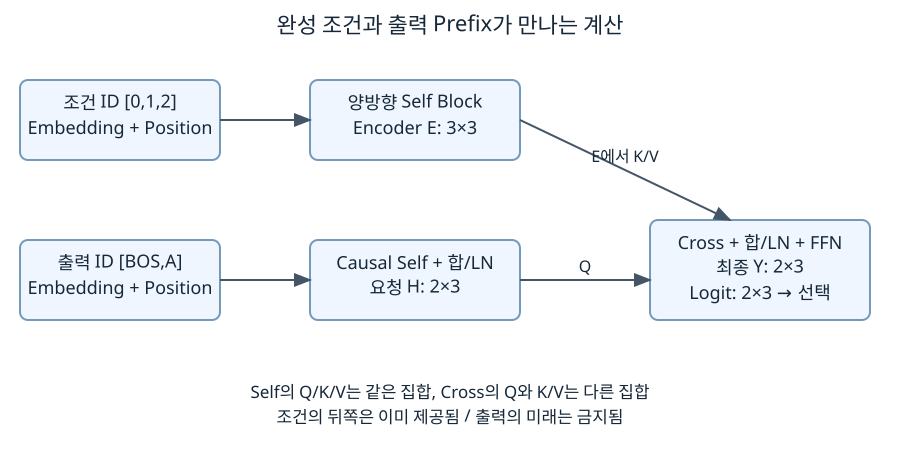{width=100% #integration-flow-fig}

#### 정의 10.11.1 손계산용 전체 Post-LN 모델 {#integration-hand-model}

손계산 모델의 Encoder와 Decoder를 다음 합성으로 정의한다.

$$
\begin{aligned}
E&=N\bigl(U+\tfrac14\operatorname{ReLU}(U)\bigr),\quad
 U=N\bigl(Z+M_e(Z)\bigr),\\
H&=N\bigl(D+M_s(D)\bigr),\\
C&=N\bigl(H+M_c(H,E)\bigr),\\
Y&=N\bigl(C+\tfrac14\operatorname{ReLU}(C)\bigr),\qquad G=YW_{\rm read}.
\end{aligned}
\tag{ 10.11.1 }\label{integration-hand-eq}
$$

$N$은 각 행의3좌표 평균과 모집단 분산을 쓰는 LN이며 $\varepsilon=0.1,\gamma=1,\beta=0$이다. $M_e,M_s$는 $W_Q=[1,0,0]^\top,W_K=[\ln2,0,0]^\top,W_V=I_3,W_O=I_3/2$를 쓰는 Attention 반환이다. Encoder는 모든 조건 열, Decoder Self는 자신의 현재/과거 입력 열을 허용한다. $M_c$는 아래 Cross 투영을 쓴다. FFN은 첫 행렬 $I_3$, 둘째 행렬 $I_3/4$, 두 편향0으로 ReLU 뒤 폭3을 반환한다. 실제 Dropout은 생략한다.

$$
W_Q^c=\begin{bmatrix}1&0\\0&1\\0&0\end{bmatrix},\quad
W_K^c=\sqrt2\begin{bmatrix}\ln2&0\\0&\ln3\\0&0\end{bmatrix},\quad
W_V^c=\begin{bmatrix}1&0\\0&1\\1&-1\end{bmatrix},\quad
W_O^c=\begin{bmatrix}1&0&1/2\\0&1&-1/2\end{bmatrix},
$$
$$
W_{\rm read}=\begin{bmatrix}1&0&-1\\0&1&0\\1/2&0&1\end{bmatrix}.
$$

Readout은 최종 Decoder의 각 행을 A/B/C 순서의3개 Logit으로 바꾼다. 두 입력 행이면 G는2×3이다.

#### 예제 10.11.2 조건의 세 위치가 실제로 섞이는 과정 {#integration-encoder-path}

Encoder의 $Q=[1,0,2]^\top$, $K=[\ln2,0,2\ln2]^\top$, $V=Z$다. 비교 폭1이므로 Scaling은1이다. $S$의 세 행은 $[\ln2,0,2\ln2]$, $[0,0,0]$, $[2\ln2,0,4\ln2]$다. 지수 행은 각각 $[2,1,4]$, $[1,1,1]$, $[4,1,16]$이므로

$$
A_e=\begin{bmatrix}2/7&1/7&4/7\\1/3&1/3&1/3\\4/21&1/21&16/21\end{bmatrix},\quad
O_e=\begin{bmatrix}10/7&6/7&5/7\\1&1&1\\12/7&6/7&3/7\end{bmatrix}.
$$

첫 요청은 제공0의 $[1,0,2]$를 $2/7$, 제공1을 $1/7$, 제공2를 $4/7$만큼 가져온다. 어느 내용을 섞는지는 V, 어느 비율인지는 Q/K와 Softmax가 결정한다. $O_eW_O=O_e/2$를 원래 Z에 더하고 LN→FFN→합→LN을 적용한다. 모든 반환을 학습 소스에서 확인할 수 있으며 E의 실제 값은 뒤의 연결 표에 수록한다.

### Decoder의 한 요청을 끝까지 계산하기 {#s11-decoder-path}

이미 제공된 출력 입력 $[\mathrm{BOS},A]$를 처리하자. 위치0·1에서 $D=[[1,0,1],[0,1,2]]$다. 이 두 행은 다음 A/B/C 후보의 Logit을 만들며, 둘째 행은 **A를 입력으로 읽은 뒤 다음 출력을 고르는 행**이다. 이 인공 모델이 반드시 A 다음 특정 정답을 맞히도록 학습된 것은 아니다.

#### 예제 10.11.3 Self→Cross→최종 Logit {#integration-decoder-step}

Self 허용표는 $[[1,0],[1,1]]$다. Q/K는 D의 첫 좌표를 읽어 $Q_s=[1,0]^\top$, $K_s=[\ln2,0]^\top$를 만든다. 둘째 Query의 허용 점수는 $[0,0]$이어서 계수는 $[1/2,1/2]$다. 따라서 $O_{s,1}=[1/2,1/2,3/2]$, 반환 $M_{s,1}=[1/4,1/4,3/4]$다. Residual은 $[1/4,5/4,11/4]$이고 평균 $17/12$, 분산 $19/18$이다. 정규화하면 $H_1\approx[-1.085304,-0.155043,1.240347]$을 얻는다.

Cross의 Q는 이 H, K/V는 E에서 만든다. 두 요청·세 제공이므로 Q는2×2, K/V는3×2, S/A는2×3이다. 둘째 요청의 점수는 약 $[0.068514,0.641125,-0.909474]$이고 계수는 $[0.317566,0.563008,0.119426]$이다. 제공1의 비율이 가장 크지만 나머지 두 원문 위치도 집계에 기여한다. 둘째 O는 약 $[-0.267571,0.110194]$이고 $W_O^c$를 곱해 $[-0.267571,0.110194,-0.188882]$로 바꾼다. 요청 수는2로 유지하고 폭만3으로 돌려놓는다.

이 값을 H에 더한 다음 LN을 적용한 $C_1\approx[-1.198555,0.068351,1.130203]$에 FFN을 적용한다. $F_1\approx[0,0.017088,0.282551]$를 더해 마지막 LN을 거치면 $Y_1\approx[-1.167633,-0.012986,1.180619]$다. Readout은 다음 세 Logit을 반환한다.

$$G_1\approx[-0.577324,-0.012986,2.348253]\quad\text{(A, B, C 순서)}.$$

Argmax 선택은 C이므로 선택한 Target ID는3이다. Softmax를 다시 취하면 어휘 확률도 만들 수 있지만 Argmax 순서는 변하지 않는다. Attention의 Softmax는 **제공 위치 축**, 어휘 Softmax는 **어휘 후보 축**이다. 둘을 같은 축으로 구현하면 다른 계산이 된다.

아래 표는 입력부터 출력까지 실제 반환을 잇는다. Encoder E0·E1·E2는 E의 각 행이며, 나머지는 마지막 요청 행의 좌표다. 전체 shape는 반환 행렬의 크기다. 표시 소수는 반올림이며 후속 연산에는 전체 정밀도의 값을 쓴다.

|실제 반환|전체 shape|좌표1|좌표2|좌표3|
|---|---|---|---|---|
|Encoder E0|3×3|0.193060|-1.254892|1.061831|
|Encoder E1|3×3|-1.127073|1.213771|-0.086698|
|Encoder E2|3×3|1.241730|-0.144713|-1.097017|
|Decoder H|2×3|-1.085304|-0.155043|1.240347|
|Cross O|2×2|-0.267571|0.110194|-|
|Cross 뒤 LN|2×3|-1.198555|0.068351|1.130203|
|FFN 반환|2×3|0.000000|0.017088|0.282551|
|최종 Y|2×3|-1.167633|-0.012986|1.180619|

#### 예제 10.11.4 방금 고른 C를 새 입력으로 읽기 {#integration-second-step}

C를 골랐다는 사실만으로 C의 표현이 계산되지는 않는다. 출력 Prefix를 $[0,1,3]$으로 바꿔 위치2에서 $T_y[3]+P_y(2)=[1,0,2]$를 입력해야 한다. Self의 새 요청은0·1·2를 읽는다. 새 반환을 Q로 만들어 같은 E의 세 위치를 Cross에서 읽고, 합/LN/FFN/LN을 다시 거친다. 이 손계산 구현은 매번 Prefix 전체를 계산한다.

실제 새 최종 행은 $Y_2\approx[0.259632,-1.284078,1.024446]$, 다음 Logit은 $[0.771855,-1.284078,0.764814]$다. 이번에는 A의 점수가 C보다 약0.007041 높아 A를 고른다. 입력은 세 행이지만 출력 후보는 세 열이며 서로 다른 차원이다. 선택한 ID열은 $[\mathrm{BOS},A,C,A]$이고 마지막 A는 아직 모델 입력으로 처리하지 않았다.

이 모델에서 Encoder를 두 번 계산한 것은 간단한 구현 선택이다. 고정 조건과 고정 Encoder라면 E를 보관할 수 있고, Cross의 고정 K/V도 별도로 보관할 수 있다. 뒤의 Decoder-only Cache 구현에는 별도 Cross Cache가 없으므로 이 보관까지 구현했다고 읽지 않는다.

#### 유제 10.11.2 최종 표현과 어휘 후보의 구별 {#integration-u-readout}

새 반환 $y=[1,-1,2]$와 위 $W_{\rm read}$를 사용한다. Logit 세 값을 계산하고 선택 Token ID를 쓰라. 선택 직후와 그 Token을 처리한 직후의 입력 길이·Cache 상태가 어떻게 다른지 설명하라. [해설](SOLUTIONS.md#solution-integration-u-readout)

### 원 논문의 연결과 구현 선택을 구별하기 {#s11-original}

원 Transformer의 Encoder는 Self-attention과 위치별 FFN을, Decoder는 Causal Self-attention·Encoder–Decoder Attention·FFN을 연결한다. 각 하위 연산의 반환에 Residual을 더하고 LayerNorm을 적용하는 Post-LN 배치를 사용한다. 출력 입력을 한 칸 이동하고 Causal Mask를 적용해 아직 예측할 출력의 내용이 보이지 않게 한다.[^s11-original]

위 손계산은 이 연결을 작은 값으로 보여 준다. 원 논문의6층·모델 폭512·8Head·FFN 폭2048·Sinusoidal Position·Embedding Scaling과 공유·Dropout·Label Smoothing·번역 학습을 재현한 것은 아니다. 뒤의 PyTorch 모델은 별도 **Pre-LN·학습 가능한 Absolute Position·2층·2Head·마지막 LN**을 택한다. 이 선택들은 계산을 관찰하기 쉽게 고른 모델 구성이다. 모든 Decoder-only가 같은 위치 표현·활성화·정규화 배치를 쓴다는 뜻은 아니다.

실행 파일의 `EncoderDecoder`도 별도 작은 Pre-LN 구현이다. Encoder에서는 두 하위 연산, Decoder에서는 Self→Cross→FFN의 세 하위 연산 각각 앞에서 정규화한다. Cross K/V는 Encoder 반환 E에서 만들고 Cross Q는 Self Residual H를 정규화한 값에서 만든다. Decoder의 마지막 Y를 그대로 Vocabulary Projection에 넣는다. 따라서 손계산 Post-LN 모델·이 Pre-LN 모델·뒤의 마지막 LN을 둔 Decoder-only는 **서로 다른 정확한 경로**다. 이 구별이 곧 [10.7절](#sec-block)의 배치 순서를 전체 구조에 적용하는 일이다.

### 학습할 수 있는 Decoder-only 만들기 {#s11-train-model}

네 기호0·1·2·3이 순환하는 짧은 열을 다음 토큰 예측 과제로 삼자. 이미 주어진 Prefix 뒤에서 이어지는 기호를 생성하므로 별도 조건 Encoder 없이 Causal Decoder-only로 충분하다. 학습할 Token Embedding과 위치표, 두 개의 블록, 마지막 정규화와 어휘 투영을 직접 연결한다. 행렬 연산과 자동미분은 PyTorch를 쓰되 `nn.Transformer`로 내부 계산을 감추지 않는다.

#### 정의 10.11.2 실행 모델의 Pre-LN 경로 {#integration-trained-block}

레이어 $\ell$의 반환과 최종 Logit을 다음과 같이 정의한다.

$$
\begin{aligned}
H_p^{(0)}&=T[x_p]+P[p],\\
Z^{(\ell)}&=N_1^{(\ell)}(H^{(\ell-1)}),\\
R^{(\ell)}&=H^{(\ell-1)}+M^{(\ell)}(Z^{(\ell)}),\\
U^{(\ell)}&=N_2^{(\ell)}(R^{(\ell)}),\\
H^{(\ell)}&=R^{(\ell)}+\operatorname{ReLU}(U^{(\ell)}B_1^{(\ell)}+b_1^{(\ell)})B_2^{(\ell)}+b_2^{(\ell)},\\
G&=N_f(H^{(2)})W_{\rm vocab}.
\end{aligned}
\tag{ 10.11.2 }\label{integration-trained-eq}
$$

$p$는0부터 세는 실제 입력 위치, $T$는4×8 Token 표, $P$는32×8 위치표다. $\ell=1,2$이고 모델 폭8·Head2·각 비교/값 폭4다. $B_1$은8×16, $B_2$는16×8, $W_{\rm vocab}$는8×4다. 두 레이어는 같은 형식이지만 서로 다른 매개변수를 가진다. LN은 각 토큰의 마지막8좌표를 정규화하며 학습 가능한 γ/β와 ε=$10^{-5}$를 쓴다. Block의 반환 자체에 LN을 붙이지 않고, 스택 마지막에서 $N_f$를 한 번 적용한다.

PyTorch `nn.Linear`는 수식의 오른쪽 곱셈 W를 `weight.T`로 저장한다. Q/K/V 모듈은 각각8→8을 계산한 뒤 마지막 좌표를2Head×4로 나눈다. Head 순서대로 이어 붙인8좌표에 출력 투영8→8을 적용한다. `Attention.forward(receiver, provider, allowed)`에서 Self는 두 출처에 같은 Z를 넣는다. Cross 구현에서는 서로 다른 집합을 넣는다.

| 단계 | Full Prefix 길이 n의 shape | 새 토큰1개 Decode, 과거 길이 n의 shape |
|---|---|---|
|Token ID| $b\times n$ | $b\times1$ |
|Embedding·초기 H| $b\times n\times8$ | $b\times1\times8$ |
|새 Q/K/V| $b\times2\times n\times4$ | $b\times2\times1\times4$ |
|사용할 전체 K/V| $b\times2\times n\times4$ | $b\times2\times(n+1)\times4$ |
|점수·계수| $b\times2\times n\times n$ | $b\times2\times1\times(n+1)$ |
|Concat·블록 반환| $b\times n\times8$ | $b\times1\times8$ |
|어휘 Logit| $b\times n\times4$ | $b\times1\times4$ |

기본 Decoder 실습은 패딩 없는 Token열만 받는다. `Attention`은 batch별 키 제한을 포함한 허용표를 받을 수 있고, 별도 Encoder–Decoder는 `source_valid`로 원문 패딩 키를 제외한다. 패딩 요청 행까지 포함하는 일반 학습 배치의 Loss 제외·비활성 요청 정책은 이번 기본 Decoder 인터페이스에 숨겨 구현하지 않는다. 전부 금지된 요청은 오류로 거부한다.

#### 예제 10.11.5 수식에서 Head와 Mask 코드로 {#integration-code-attention}

다음은 실제 구현의 투영·Mask·정규화·Concat 부분이다. `allowed`의 True는 허용이고 `softmax(..., dim=-1)`의 마지막 축은 Key다. 과거 길이 n에 새 요청 한 행을 처리할 때 Mask가1×1이면 n개의 과거 제공 위치가 빠진다. Model 호출부는 실제 Query 위치 n과 Key 위치0…n을 비교해1×(n+1)을 만든다.

```{.python .numberLines source-root="." source="learning-source/integrated_transformer.py" source-start="34" source-end="62" source-revision="integrated-source-v0.1"}
```

한 요청에서 Head1과 Head2의 계수는 서로 다른 Q/K에서 나온다. 계수 두 개를 먼저 평균하거나 점수를 합해 공통 Softmax를 만들면 두 개의 독립 Attention을 구현한 것이 아니다. `transpose(1,2)` 뒤의 `reshape`는 각 요청의 Head 출력을 같은 행으로 이어 붙이는 과정이다. 위치 행을 이어 붙이는 Concat과 구별하자.

#### 유제 10.11.3 길이가 다른 Cross를 이 구현에 넣기 {#integration-u-shapes}

받는 표현은2×8, 제공 표현은5×8이며 batch1, Head2다. Q/K/V·점수·Head 반환·Concat·출력 투영의 shape를 실제 구현 순서로 쓰라. 한 제공 위치가 패딩이라면 허용표의 어느 축을 False로 만드는가? [해설](SOLUTIONS.md#solution-integration-u-shapes)

### 실제로 배우는 것은 무엇인가? {#s11-training}

길이9인 네 기호열을 준비한다. 첫 열은 $[0,1,2,3,0,1,2,3,0]$이고 나머지는 시작 기호가1·2·3이다. 각 열의 앞8개가 입력, 뒤8개가 Target다. 첫 열의 입력 $[0,1,2,3,0,1,2,3]$에서 위치0 반환은 Target1을, 위치7 반환은 Target0을 예측한다. 입력 자체를 같은 행의 정답으로 복사하는 과제가 아니다.

#### 정의 10.11.3 다음 토큰의 평균 손실 {#integration-loss}

이 실습의 손실(loss)은 각 학습 행에서 정답 토큰의 음의 로그 확률을 평균한 값이다.

$$
L=-\frac1{bn}\sum_{a=1}^b\sum_{p=0}^{n-1}
\log\frac{\exp G_{a,p,t_{a,p}}}{\sum_{c=0}^3\exp G_{a,p,c}}.
\tag{ 10.11.3 }\label{integration-loss-eq}
$$

여기서 $b=4,n=8$, $t_{a,p}$는 해당 입력 다음 위치의 정답 ID다. Causal Mask는 위치 p가 미래 입력을 읽지 못하게 하지만, Loss에는 각 행의 정답 ID가 필요하다. 정답을 Loss 함수에 전달하는 일과 정답을 모델의 입력 표현에 섞는 일은 다른 정보 경로다. `cross_entropy`는 Logit에서 안정적으로 이 손실을 계산하므로 모델 출력에 미리 어휘 Softmax를 적용하지 않는다.[^s11-pytorch]

Gradient는 이 손실이 매개변수의 작은 변화에 어떻게 반응하는지 나타낸다. `zero_grad`로 이전 누적을 지우고, `backward`로 현재 입력의 미분을 구하며, `optimizer.step`으로 매개변수를 갱신한다. 손계산 매개변수를 정한 앞 모델과 달리 여기서는 Embedding·위치표·투영·LN·FFN·어휘 변환이 모두 갱신된다. Cache는 고정된 모델의 추론에 쓰는 상태이므로 학습 중에 저장해 다음 갱신 뒤로 넘기지 않는다.

```{.python .numberLines source-root="." source="learning-source/integrated_transformer.py" source-start="210" source-end="244" source-revision="integrated-source-v0.1"}
```

#### 예제 10.11.6 CPU에서 실행한 학습과 생성 {#integration-learning-result}

Python3.12.2·PyTorch2.2.2, CPU float64·한 스레드·Seed17·Adam 학습률0.015·80회 갱신으로 실행했다. 갱신 전 전체 학습 데이터 Loss는1.488008054이고, 80회 갱신을 마친 뒤 **같은 데이터에서 다시 계산한** Loss는0.001998089다. 매개변수 전체 변화의 L2 크기는7.499158186이었다. 마지막 갱신 직전의 Loss와 갱신 후 Loss를 같은 숫자로 부르지 않는다.

학습 후 각 시작열에서 다음 기호를 예측했고, Prefix $[0,1]$에서 Argmax로 여섯 기호 $[2,3,0,1,2,3]$을 생성했다. 이는 작은 교육용 Synthetic Dataset의 주기 관계를 학습한 결과다. 자연어 이해, 새로운 분포에서의 일반화, 실제 언어모델 성능을 입증하지 않는다. 길이32 밖 위치는 정의하지 않았고, 사용하지 않은 위치표 행의 일반화도 확인하지 않았다.

저장소 루트에서 다음 명령을 실행한다. 기존 Full Pilot의 고정 환경을 실행 의존성으로 사용하되 파일럿 원본은 수정하지 않는다. 최초 환경 설치에는 패키지 다운로드가 필요할 수 있지만 데이터·대형 모델·상용 API는 필요 없다.

```bash
uv run --locked --directory chapters/transformer/torch-env \
  python ../learning-source/demo_integrated.py
uv run --locked --directory chapters/transformer/torch-env \
  python ../learning-source/verify_integrated.py
```

운영체제·PyTorch 빌드·BLAS가 다르면 표시 마지막 자리가 달라질 수 있다. 같은 CPU 환경에서 전체 실행을 재현하고, Full/Incremental은 같은 모델·정밀도·추론 조건에서 허용오차 $2\times10^{-11}$로 비교한다. 관찰 JSON에는 전체 벡터와 학습 기록을 남긴다.

### 학습한 모델의 한 위치를 실제로 따라가기 {#s11-trained-trace}

#### 예제 10.11.7 입력2의 첫 Head와 다음 레이어 {#integration-trained-trace}

학습을 마친 모델에 $[0,1,2]$를 넣자. 위치2의 토큰 ID2는 학습된 Token 표의 행을 읽고, 위치표의 행2를 더한다. 초기 폭8 벡터의 첫 세 좌표는 약 $[0.194237,1.018618,-1.030833]$이고 나머지도 같은 표 덧셈으로 나온다. 첫 LN 뒤의 Z가 첫 레이어 Q/K/V의 유일한 입력 출처다.

첫 Head의 새 Q/K/V는 다음과 같다.

$$\begin{aligned}
q&\approx[0.366663,0.891237,-1.619134,-0.301157],\\
k&\approx[-0.425446,-0.594348,1.275102,-0.624706],\\
v&\approx[1.259123,-0.027591,0.619582,0.910543].
\end{aligned}$$ 비교 폭4의 제곱근2로 나누어 위치0·1·2와 비교한 점수는 $[1.158026,-1.861532,-1.281063]$이고, 계수는 $[0.880233,0.042975,0.076792]$다. 현재 Token2를 처리하지만 이 Head는 과거 위치0에 큰 비율을 준다. 이 비율에 고정적인 언어 의미를 부여하지 않는다.

두 Head의 반환은 다음과 같다.

$$\begin{aligned}
o_1&\approx[-0.145504,-1.007300,-0.133270,-0.715705],\\
o_2&\approx[-0.951558,-0.930211,0.331756,1.569320].
\end{aligned}$$ 두 폭4를 이어 붙이고8×8 출력 투영을 적용한 M을 초기 H에 더한다. 이 Residual R를 둘째 LN에 넣어 FFN 입력 U를 만든다. FFN 반환 F를 R에 더한 **첫 블록 최종 반환**이 둘째 레이어의 입력이다. 둘째 레이어 K/V는 첫 레이어 K/V를 그대로 복사하지 않는다.

\clearpage

|위치2 반환|좌표1|좌표2|좌표3|
|---|---|---|---|
|1층 Z|-0.847453|0.407020|-2.455485|
|1층 R|-0.252283|1.057090|-0.552990|
|1층 U|-0.958234|0.255220|-1.345218|
|1층 F|0.844184|1.370893|0.297639|
|1층 최종 반환|0.591902|2.427982|-0.255352|
|2층 Z|-0.527591|1.251046|-1.001559|
|2층 R|0.181244|2.505238|-0.454046|
|2층 U|-0.741385|1.479567|-1.060321|
|2층 F|-1.034687|1.967465|0.430588|
|2층 최종 반환|-0.853443|4.472702|-0.023458|

표에는 폭8 벡터의 첫3좌표를 표시했다. 나머지5좌표도 같은 식으로 계산하며 관찰 JSON에서 확인한다.

스택 마지막 LN 뒤 어휘 투영의 위치2 Logit은 $[-1.411693,-2.369021,-1.478314,5.749868]$이다. 따라서 다음 기호는3이다. 다음 토큰 선택은 이 마지막 Logit을 쓰며, 이전 위치들의 Logit을 평균하지 않는다. 학습에서는 각 위치에 별도 Loss를 붙였지만, 생성에서는 현재까지의 마지막 입력 위치로 한 다음 토큰을 고른다.

### Prefill과 한 토큰 Decode {#s11-cache}

#### 정의 10.11.4 이 모델의 레이어별 추론 상태 {#integration-cache}

이 모델의 Cache는 이미 처리한 입력 위치0…n−1에서 각 레이어가 만든 K/V와 그 위치·Token ID를 보유하는 상태다.

$$
\mathcal C_n=\bigl((K^{(\ell)}_{0:n},V^{(\ell)}_{0:n})_{\ell=1,2},\ [0,\ldots,n-1],\ [x_0,\ldots,x_{n-1}]\bigr).
\tag{ 10.11.4 }\label{integration-cache-eq}
$$

$0:n$은 Python과 같은 끝 제외 표기다. 각 K/V는 $b\times2\times n\times4$이며, Absolute Position을 더한 표현을 각 레이어 앞에서 정규화한 뒤 투영한 값이다. RoPE 회전 전/후 Key를 저장하는 구현은 아니다. 기본 Cache는 패딩 없는 연속 위치·변하지 않은 입력·고정 매개변수·같은 batch의 Append만 지원한다. Token/위치/접근을 수정하려면 해당 생성원을 재평가해야 한다.

#### 정리 10.11.1 새 위치의 Full/Incremental 동등성 {#integration-cache-equal}

고정 모델, 같은 Token과 원위치, 같은 Causal 접근, 위치별 LN/FFN, 같은 정밀도와 결정적 추론에서 Full Prefix와 과거 K/V를 재사용한 Incremental의 새 위치 반환·Logit은 실수 산술에서 같다. 유한 정밀도에서는 연산 배치의 차이로 작은 반올림 차이가 생길 수 있다.

**증명.** 미래 위치는 과거 위치의 허용 집합에 없다. 첫 레이어의 과거 입력과 위치별 정규화·투영은 새 입력 추가로 바뀌지 않는다. 따라서 저장 K/V는 Full의 과거 K/V와 같다. 새 위치의 입력도 같으므로 Q와 새 K/V가 같고, 같은 순서의 전체 K/V와 허용표로 계산한 점수·계수·Head·출력 투영이 같다. 두 Residual과 위치별 LN/FFN은 같은 새 반환을 만든다. 이 반환이 둘째 레이어의 새 입력이고 과거 반환은 그대로이므로 같은 논증을 적용한다. 마지막 LN과 어휘 투영까지 같아진다. Dropout이나 시퀀스 전체 통계, 미래를 읽는 전처리가 있으면 이 귀납의 전제가 깨진다.

#### 예제 10.11.8 선택만 한 토큰은 아직 저장되지 않는다 {#integration-cache-trace}

Prefill은 $[0,1]$의 두 입력을 한꺼번에 처리한다. 각 레이어 K/V shape는1×2×2×4이고 보유 원위치는0·1이다. 마지막 Logit에서2를 고른 직후에도 shape는 그대로다. Decode 호출은 선택한2만 입력으로 받고, 위치2의 $T[2]+P[2]$부터 두 레이어를 계산한다. Query shape1×2×1×4, 전체 K/V shape1×2×3×4, 점수 shape1×2×1×3이다. 새 Block 반환과 Logit은 위 Full $[0,1,2]$의 마지막 행과 일치한다.

실행 비교는 두 batch 조건의 길이5에서 매 위치·두 레이어의 입력/Z/Q/새K/새V/전체K/전체V/점수/계수/Head/Concat/M/R/U/F/반환/마지막LN/Logit을 대조했다. 398개 비교의 최대 절대오차는 약 $1.8874\times10^{-15}$였다. 과거 K/V는 새 Append 뒤에도 원래 Tensor 값이 유지됐다. Logit 하나만 맞았다는 이유로 두 레이어 Cache를 승인하지 않는다.

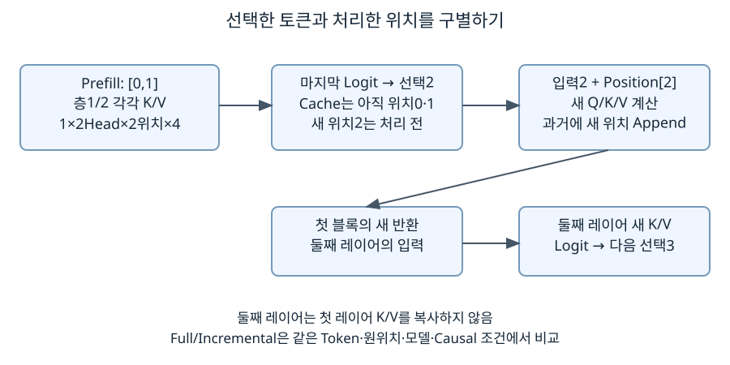{width=100% #integration-cache-fig}

```{.python .numberLines source-root="." source="learning-source/integrated_transformer.py" source-start="247" source-end="263" source-revision="integrated-source-v0.1"}
```

생성 함수는 여섯 번째 선택을 반환할 때 그 마지막 Token을 다시 처리하지 않는다. 그래서 생성 전체 $[0,1,2,3,0,1,2,3]$에 비해 Cache의 처리 입력은 마지막3을 뺀 $[0,1,2,3,0,1,2]$이고 보유 위치는0…6이다. 다음 생성을 이어가려면 마지막 선택3을 위치7에서 처리해야 한다.

### 무엇을 바꾸면 Cache를 버려야 하는가? {#s11-validity}

같은 shape라고 같은 Cache는 아니다. 첫 레이어 $K^{(1)}_p$는 $N_1^{(1)}(T[x_p]+P[p])W_K^{(1)}$에서 나온다. 그 Token·위치·LN·K 투영이 바뀌면 다시 계산해야 한다. 첫 레이어 Q만 바꾸면 그 레이어 K/V 생성식은 그대로일 수 있지만 Attention 반환이 달라져 **둘째 레이어 입력**이 달라질 수 있다. FFN 변경도 첫 레이어 K/V를 직접 바꾸지 않고 후속 레이어의 생성원을 바꿀 수 있다. [10.9절](#sec-cache)의 항목별 판정이 여기서 필요하다.

구현은 매개변수의 일반적인 Optimizer/in-place 변경을 감지해 기존 Cache를 보수적으로 거부한다. 이는 필요한 최소 항목만 골라 재사용하는 분석보다 좁은 인터페이스다. Cache Tensor를 직접 편집하거나 `.data`로 매개변수 변경 검사를 우회해서는 안 된다. Cache는 변조를 검증하는 보안 저장 형식이 아니다. 기본 모델에서 허용 관계는 바꿀 수 없는 Causal 계약이며, 이를 Local 등으로 바꾸는 새 구현은 기존 Cache의 생성원도 다시 검토해야 한다.

미래 Token을 바꿔도 앞 위치의 Logit·반환·K/V가 같다는 시험과, 허용 과거 Token을 바꾸면 뒤 출력이 실제로 달라지는 양성 대조를 함께 수행한다. 언제나0을 반환하는 잘못된 코드도 미래 불변 시험만은 통과할 수 있기 때문이다. 별도 SDPA 기준과 좌표별 내적·지수·합 대조를 더해 실제 Attention 연산도 확인한다.

#### 유제 10.11.4 첫 레이어의 반환만 바꾼 경우 {#integration-u-validity}

첫 레이어 FFN의 마지막 편향만 바꾸었다. 첫 레이어 K/V, 첫 레이어 반환, 둘째 레이어 K/V, 최종 Logit 중 무엇이 직접 또는 간접적으로 바뀔 수 있는가? 편향의 모든 좌표에 같은 상수를 더해 둘째 레이어 LN이 그 이동을 없애는 특수 경우도 설명하라. [해설](SOLUTIONS.md#solution-integration-u-validity)

### 같은 학습 Head에서 효율화 비교하기 {#s11-efficiency}

#### 예제 10.11.9 비용과 원래 출력의 보존은 다른 질문이다 {#integration-efficiency}

학습 모델의 입력 $[0,1,2,3,0]$, 첫 레이어 첫 Head의 **같은 Q/K/V**를 고정한다. 길이5·비교 폭4·값 폭4다. Full Causal은15쌍, 현재 포함 폭2 Local은9쌍이다. 생략 쌍은 원위치1부터 세어 $(3,1),(4,1),(4,2),(5,1),(5,2),(5,3)$이다. 마지막 요청은 Full에서 다섯 위치, Local에서4·5만 읽는다. 남긴 원점수는 같지만 Softmax 분모는 다시 계산한다.

별도 Kernel은 $\phi(q)=[1,\max(q_0,0)]$, $\phi(k)=[1,\max(k_0,0)]$의 폭2 특징을 쓴다. 이는 비교 폭4의 원 내적을 지수 Kernel로 근사한다고 보장한 특징맵이 아니다. 각 허용 $j\le i$에 대해 $c_{ij}=\phi(q_i)^\top\phi(k_j)>0$를 계산하고 $a_{ij}=c_{ij}/\sum_{j\le i}c_{ij}$로 정규화한다. 제공 집합은 Full처럼 모든 과거를 유지하지만 계수 정의가 바뀐다.

$$
S_i=\sum_{j\le i}\phi(k_j)v_j^\top\in\mathbb R^{2\times4},\qquad
z_i=\sum_{j\le i}\phi(k_j)\in\mathbb R^2,\qquad
\widetilde o_i=\frac{\phi(q_i)^\top S_i}{\phi(q_i)^\top z_i}.
\tag{ 10.11.5 }\label{integration-factor-eq}
$$

현재 항을 S/z에 추가한 뒤 요청을 계산한다. 유한합의 결합법칙으로 직접 Kernel 합과 같은 값이지만 원 Softmax와의 동일성은 보장하지 않는다.[^s11-linear] 실제 마지막 반환은 다음과 같다.

|방법|좌표1|좌표2|좌표3|좌표4|
|---|---|---|---|---|
|Full|0.933336|1.255967|0.469568|0.166742|
|Local|0.581637|1.086927|0.612472|0.588396|
|별도 Kernel|0.623852|0.424570|0.345302|-0.167445|

Full과 Kernel은 제공1…5, Local은4·5를 읽는다. Kernel의 계수는 Full과 다르다.

허용쌍만 계산한다고 가정한 Score/Value 좌표 곱셈 수는 Full $15(4+4)=120$, Local $9(4+4)=72$다. Factorized는5위치에서 상태 생성과 읽기 $5\cdot2(2\cdot4+1)=90$회다. 특징 생성·Q/K/V 투영·출력 변환·지수·나눗셈·FFN을 제외했다. 관찰용 Dense 배열 저장이나 실행 시간은 이 셈과 다르다. 이 실험은 CPU 시간이나 GPU 속도 우위를 측정하지 않았다.

같은 폭2 Local을 여러 층에 쓰면 초기1의 정보가 위치5에 도달하는 데 최소4 Attention 단계가 필요하다. Full은1단계다. 이 실험은 한 Head 출력만 비교했으므로 학습 모델 전체의 성능 손실을 측정하지도, 모든 층을 이 Kernel로 바꾸어 학습하지도 않았다. KV Cache는 이 세 연산 중 Full의 정의를 유지하면서 과거 투영·표현 재계산을 줄인다. 정확한 Dense Attention의 메모리 접근 최적화도 별개로 원 Softmax 정의를 유지할 수 있다.

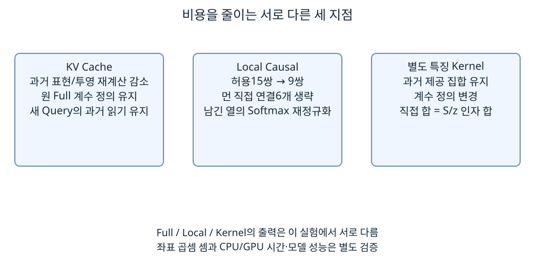{width=100% #integration-efficiency-fig}

#### 유제 10.11.5 짧은 열에서 비용이 역전될 때 {#integration-u-efficiency}

$n=3,d_k=d_v=4,r=2$다. Causal Full과 현재 포함 폭2 Local의 쌍 수·좌표 곱셈 수, Factorized 상태 생성/읽기의 곱셈 수를 구하라. Kernel이 더 적은 곱셈을 쓰는지와 원 Softmax 동일성·실행 시간에 대해 무엇을 말할 수 있는지 구별하라. [해설](SOLUTIONS.md#solution-integration-u-efficiency)

\clearpage

### 절 종료 연습문제 {#s11-practice}


풀이를 보기 전에 입력·출처·허용표·중간값·반환을 직접 남기자. 계산이 막힌 지점만 해당 절을 복습한다. 뒤의 종합 Checkpoint는 이름을 나열하는 대신 새로운 입력에서 여러 연산을 연결한다. 선택 문제에는 유효한 대안을 이유와 함께 제시할 수 있다.

#### 연습문제 10.11.1 ★ 조건과 예측 대상 {#integration-ex01}

길이6의 완료 보고서를 읽어 하나의 등급을 분류한다. 이어서 같은 보고서와 이전 설명을 조건으로 길이 미정의 설명을 생성한다. 두 과제의 유효 구조·Readout·가용 정보를 설계하라. 등급 분류용 Encoder 하나만으로 설명 이력을 처리하는 경로가 생기는지 설명하라. [해설](SOLUTIONS.md#solution-integration-ex01)

#### 연습문제 10.11.2 학습 입력과 Target {#integration-ex02}

정답 출력은 $[A,C,B]$, 시작 입력은 BOS다. Teacher Forcing 입력·각 행의 Target·각 요청의 허용 입력 집합을 쓰라. 정답 전체 평균을 모든 Embedding에 더하는 전처리에서 최초 누출 경로를 찾고 수정하라. [해설](SOLUTIONS.md#solution-integration-ex02)

#### 연습문제 10.11.3 짧은 계산에서 두 Softmax 축 {#integration-ex03}

Q=$[[1],[0]]$, K=$[[0],[\ln3]]$, V=$[[2,0],[0,4]]$, 모든 Key 허용이다. S/A/O와 차원을 구하라. Readout $W=[[1,0,-1],[0,1,1]]$의 Logit과 각 요청의 Argmax 후보를 계산하라. Attention Softmax와 어휘 Softmax의 축·역할을 설명하라. [해설](SOLUTIONS.md#solution-integration-ex03)

#### 연습문제 10.11.4 받은 집합과 제공 집합 {#integration-ex04}

요청 X는3×4, 조건 E는2×6이다. Head 하나의 비교 폭2·값 폭3, 반환 폭4로 Cross를 구성하라. 각 투영 행렬·중간값·$W_O$의 shape와 출처를 쓰고, 반환이 E의 두 행을 갱신한다는 주장을 진단하라. [해설](SOLUTIONS.md#solution-integration-ex04)

#### 연습문제 10.11.5 LayerNorm과 저장 생성원 {#integration-ex05}

Pre-LN 첫 레이어에 $h=[2,0,-2]$가 들어간다. $\varepsilon=1,\gamma=1,\beta=0,W_K=I_3$다. 평균·분산·Z·K를 구하라. Token 입력에 상수 $[5,5,5]$를 더했을 때 K와 Residual 직접 경로가 각각 어떻게 되는가? [해설](SOLUTIONS.md#solution-integration-ex05)

#### 연습문제 10.11.6 위치와 배열 순서 {#integration-ex06}

Query 원위치4, Key 배열 원위치 $[4,1,3,2]$이고 원위치3은 패딩이다. Full Causal 및 현재 포함 폭2 Local 허용 행을 쓰라. 배열 끝 두 열을 허용하는 구현이 틀린 이유를 설명하라. [해설](SOLUTIONS.md#solution-integration-ex06)

#### 연습문제 10.11.7 ★ 생성 루프의 한 칸 {#integration-ex07}

Prefill $[2,3,0]$에서 선택한 다음 기호는1이다. 현재 Cache의 위치·Token 수, 다음 호출의 입력·위치·예측 대상, 갱신 뒤 K/V shape를 쓰라. batch1·Head2·Head 폭4·레이어2다. 선택만 한1의 K/V를 이미 저장했다는 로그를 수정하라. [해설](SOLUTIONS.md#solution-integration-ex07)

#### 연습문제 10.11.8 새 위치에0을 부여한 증분 실행 {#integration-ex08}

Absolute 표 $P[p]=[p,0]$, Token 표 $T[0]=[0,1]$이다. Prefix 길이2 뒤의 Token0을 Full에서는 위치2, Incremental에서는 위치0으로 처리했다. 두 초기 H를 계산하라. 이후 Logit 우연 일치만으로 위치 계약을 승인할 수 있는가? [해설](SOLUTIONS.md#solution-integration-ex08)

#### 연습문제 10.11.9 Block과 스택 마지막 정규화 {#integration-ex09}

주어진 Block은 $r=h+M(N_1(h)),y=r+F(N_2(r))$이고 스택 뒤 $G=N_f(y)W$를 쓴다. 오류 구현은 $y'=N_2(r+F(r))$를 반환하고 마지막 LN을 생략했다. M/F에 들어간 표현·Residual·반환의 차이를 설명하고 정확한 호출 순서로 고쳐라. [해설](SOLUTIONS.md#solution-integration-ex09)

#### 연습문제 10.11.10 손실 감소의 판정 범위 {#integration-ex10}

작은 주기열에서 Loss가1.5에서0.002로 내려가고 학습 데이터 정답률이100%였다. 확인된 사실과 확인되지 않은 일반화를 나누어 설명하라. 학습 전후 Loss를 비교할 입력·모드·파라미터 시점, 새로운 과제 평가에 필요한 데이터를 제안하라. [해설](SOLUTIONS.md#solution-integration-ex10)

#### 연습문제 10.11.11 인자 상태와 원위치 {#integration-ex11}

Causal Kernel의 제공 특징은 $[[1,0],[1,1],[0,1]]$, Query 특징은 같은 행들, Value는 $[2,0,4]$다. 위치2까지의 상태 S/z와 출력, 위치3을 처리한 뒤의 상태·출력을 구하라. 위치2 Query에 전체 상태를 쓰면 어떤 값이 나오는가? [해설](SOLUTIONS.md#solution-integration-ex11)

#### 연습문제 10.11.12 검증의 양성 대조 {#integration-ex12}

미래 입력 변경 시험을 통과한 코드가 모든 Logit을0으로 반환했다. 이를 거부할 독립 기준·허용 과거 변경·중간값·Loss/Parameter Update 검사 네 가지를 설계하라. 과거 변경에 반응하지 않은 사례가 언제나 구현 결함인지도 설명하라. [해설](SOLUTIONS.md#solution-integration-ex12)

### 종합 Checkpoint: 새로운 조건에서 전체 경로 다시 만들기 {#s11-checkpoint}

아래 열 과제는 구조 선택부터 수치 계산·누출 진단·증분 실행·효율·설계를 연결한다. 공식·N/F 계산 함수는 열어 두어도 좋지만 완성된 예제표와 해설은 가려 둔다. 스스로 계산한 기록을 해설과 비교한 뒤 틀린 경로만 다시 수행한다.

#### 연습문제 10.11.13 ★ A. 조건 입력의 구조 설계 {#integration-cp-a}

조건은 완성된 제품 기록5개이며 배열에는 패딩1개가 더 있다. 출력 입력은 BOS와 앞 설명2개, 표현 폭4다. 미래 설명은 금지하고 모든 유효 조건은 허용한다. (가) Encoder–Decoder의 두 Self·Cross 허용표를 쓰라. (나) Decoder-only로 직렬화한 대안을 만들고 조건 Prefix의 내부 접근을 선택하라. (다) 두 계산을 항상 같은 E/K/V로 볼 수 없는 이유를 쓰라. (라) Cross 비교 폭2·값 폭3이면 각 출처·중간값·출력 투영의 크기를 쓰라. [해설](SOLUTIONS.md#solution-integration-cp-a)

#### 연습문제 10.11.14 ★ B. 새 두 Head를 계산해 결합하기 {#integration-cp-b}

$X=[[2,0],[0,1],[1,2]]$, Head1 $W_Q=W_K=[1,0]^\top,W_V=[2,0]^\top$, Head2 $W_Q=W_K=[0,1]^\top,W_V=[0,3]^\top$, $W_O=[[1,-1],[1/2,1]]$다. Mask는 모든 Key 허용이다. (가) 각 Head의 Q/K/V·S·A·O 전행을 구하라. (나) Head1→2 순서 Concat과 출력 투영 전행을 구하라. (다) $S_1+S_2$의 공통 Softmax를 쓰는 구현이 왜 다른가? (라) 요청 $D=[[1,-1],[0,2]]$가 X를 조건으로 읽는 Cross의 Q 출처·점수/반환 크기를 구성하라. [해설](SOLUTIONS.md#solution-integration-cp-b)

#### 연습문제 10.11.15 ★ C. 원위치와 입력 생성원의 누출 {#integration-cp-c}

Query 원위치는0·1이고 각 반환은 다음 Token을 예측한다. Key 배열 원위치는 $[2,0,1,3]$, 원위치3은 패딩이다. Q=$[[1],[0]]$, K=$[[\ln5],[0],[\ln2],[0]]$, V=$[[100],[2],[4],[999]]$다. (가) 올바른 B/S/A/O를 계산하라. (나) 배열 삼각 Mask 뒤 Softmax에0을 곱하는 두 오류를 수정하라. (다) 미래 Key/Value를 바꿀 때 무엇이 같아야 하는가? (라) 입력 자체에 미래 Target의 평균을 더했다면 Mask 수정만으로 충분한가? [해설](SOLUTIONS.md#solution-integration-cp-c)

#### 연습문제 10.11.16 D. 위치 의존성과 성립 조건 {#integration-cp-d}

내용 $q=[2,1]^\top,k=[1,-1]^\top$, 비교 폭2, 투영은 Identity다. Absolute $P[p]=[p/2,0]^\top$, Relative $b_{j-i}=-|j-i|/3$, RoPE $R_p=R(p\pi/2)$다. (가) $i=0,j=1$의 세 점수를 도출하라. (나) 함께 $i=2,j=3$으로 이동했을 때 점수를 구하라. (다) RoPE의 상대 회전 식이 성립하는 조건과 V까지 불변이라는 주장, Mask를 대체한다는 주장을 구별하라. [해설](SOLUTIONS.md#solution-integration-cp-d)

#### 연습문제 10.11.17 ★ E. Residual에서 반환까지 {#integration-cp-e}

Pre-LN의 입력 $h=[1,-1]$, 주어진 $M(N_1(h))=[1/2,1/4]$다. $N(u)=(u-\mu)/\sqrt{\sigma^2+1}$, γ=1·β=0이며 $F(u)=\operatorname{ReLU}(u\operatorname{diag}(1,-1))\operatorname{diag}(1/4,1/2)$다. (가) R·평균·분산·$N_2(R)$·FFN 선형/활성/반환·최종 y를 계산하라. (나) $N(h+M(h))$로 시작하는 Post-LN 코드와 다른 함수 입력을 쓰라. (다) 출력 폭이 맞는다는 검사만으로 두 배치를 같은 모델이라고 승인할 수 있는가? [해설](SOLUTIONS.md#solution-integration-cp-e)

#### 연습문제 10.11.18 ★ F. 새 Token의 두 레이어 계산 {#integration-cp-f}

교육용 별도 모델 폭2·Head2·레이어2다. Token 표는 $[[0.8,0.2],[-0.2,1.1],[1.4,0.3]]$, $P[p]=[0.1p,0]$다. 각 레이어는 $N(u)=(u-\mu)/\sqrt{\sigma^2+1}$, Head1 $q=k=z_1,v=2z_1$, Head2 $q=k=z_2,v=4z_2$, $W_O=[[1,1],[0,1]]$을 쓴다. $F(u)=\operatorname{ReLU}(u\operatorname{diag}(1,-1))\operatorname{diag}(1/2,1/4)+[0.1,-0.1]$이고 Pre-LN 반환은 $h+M+F(N(h+M))$다. 마지막 추가 LN은 없으며 $W_{\rm read}=[[1,0,-1],[0,1,1]]$이다.

과거 입력 ID는 $[0,1]$·위치0·1이다. 아래 표는 과거 K/V이며 표시값으로 손계산할 때 소수 $10^{-5}$ 정도의 오차를 허용한다. 실제 검산은 전체 정밀도를 쓴다.

|레이어·Head|과거 K(위치0·1)|과거 V(위치0·1)|
|---|---|---|
|1층 Head1|$[0.287348,-0.514496]$|$[0.574696,-1.028992]$|
|1층 Head2|$[-0.287348,0.514496]$|$[-1.149392,2.057983]$|
|2층 Head1|$[0.726420,-0.664927]$|$[1.452839,-1.329854]$|
|2층 Head2|$[-0.726420,0.664927]$|$[-2.905679,2.659709]$|

새 ID2를 위치2에서 처리한다. (가) 초기 H와 각 레이어의 새 Z/Q/K/V·점수·계수·Head·Concat·M·R·U·F·반환을 계산하라. (나) 레이어/Head별 과거와 새 K/V를 구별해 갱신 상태를 쓰라. (다) 최종 Logit과 후보 선택을 구하라. (라) Prefix 전체 재계산과 같은지 비교하고 그 성립 조건을 설명하라. N/F 내부 산술을 함수로 실행해도 되지만 입력·투영·레이어 전달은 직접 구성해야 한다. [해설](SOLUTIONS.md#solution-integration-cp-f)

#### 연습문제 10.11.19 G. 변경안별 Cache 생성원 {#integration-cp-g}

F의 모델에서 다음 변경은 각각 독립이다. (1) Token ID1 변경, (2) 위치2의 Absolute 표 변경, (3) 첫 레이어 $W_Q$만 변경, (4) 첫 레이어 FFN 마지막 편향 변경, (5) 첫 레이어의 요청2가 위치1을 읽지 못하도록 변경, (6) 마지막 Readout만 변경. 각 레이어/위치의 K/V 중 식상 유지 가능한 항목과 재계산이 필요할 수 있는 항목을 쓰라. 위치0의 유일한 Key·LN 이동 불변 등 예외와, 코드의 보수적 전체 Cache 거부를 최소 판정과 구별하라. [해설](SOLUTIONS.md#solution-integration-cp-g)

#### 연습문제 10.11.20 ★ H. Full/Local/Kernel의 새 비교 {#integration-cp-h}

길이4, 비교/값 폭1, Q는 모두1, K=$[0,\ln2,\ln3,\ln4]^\top$, V=$[2,-1,0,4]^\top$다. 별도 Kernel은 Query/Key 공통 특징을 다음 행렬로 쓴다.

$$\Phi=\begin{bmatrix}1&0\\0&1\\1&1\\2&1\end{bmatrix}.$$

 (가) Full Causal과 폭2 Local의 마지막 계수·출력·허용쌍·생략쌍을 계산하라. (나) Kernel 마지막 직접 합과 S/z 합을 계산하라. (다) 위치2의 Causal Kernel 출력과 잘못된 전역 상태 출력을 비교하라. (라) 세 방법의1→4 최소 층 수와 좌표 곱셈 수를 비교하라. 특징 생성·지수/나눗셈·투영·FFN은 제외한다. (마) Cache로 무엇이 보존되며 어떤 비용이 남는가? [해설](SOLUTIONS.md#solution-integration-cp-h)

#### 연습문제 10.11.21 ★ I. 전체 모델 코드의 최초 오류 {#integration-cp-i}

다음은 위 Pre-LN Decoder를 구현하려다 잘못 작성한 순서다. 입력은 batch1·새 Token1개, 과거 길이2·두 레이어·Head2·폭8이다. (1) `position = arange(1)` (2) `z = h` (3) `q = q_proj(z)`를1×1×8 그대로 둠 (4) `k,v = cache.layers[0]`를 두 레이어에서 공유 (5) 현재 K/V를 붙이지 않고 `allowed = tril(ones(1,1))` (6) `softmax(scores, dim=-2)` (7) `joined = heads.reshape(1,1,8)` (8) `h = norm(h + attention(h)); h = h + ffn(h)` (9) `logits = vocab(h)`로 반환한다.

(가) 최초로 계약을 어긴 단계와 이후 독립 오류를 각각 설명하라. (나) 각 단계의 올바른 입력 출처·shape·위치·Mask·블록/마지막LN을 의사코드로 고쳐라. (다) Head 축이1×2×1×4일 때7번이 우연히 맞을 수 있는 조건과 여러 요청에서의 오류를 구별하라. (라) Logit 비교만으로 못 찾을 결함과 이를 겨냥한 시험을 제안하라. [해설](SOLUTIONS.md#solution-integration-cp-i)

#### 연습문제 10.11.22 J. 계산·정보·재사용을 함께 설계하기 {#integration-cp-j}

완성 조건 길이20, 생성 출력 최대50, CPU 추론이며 먼 조건의 단서가 첫 출력에도 필요하다. 기본값은 정확한 Full Softmax이고 생성 중 매개변수는 고정이다. (가) 유효 구조와 Token/Position/입력–Target/Readout 계약을 설계하라. (나) Self·Cross·조건 Prefix의 가용 정보와 누출 검사, 레이어별 Cache와 생성 루프를 쓰라. (다) 메모리·연산이 부족하면 Local·Kernel·정확한 실행 최적화 중 어느 선택이 무엇을 바꾸는지 정당화하라. (라) 수학적 동등성·실측 시간·과제 성능을 따로 검증할 계획을 쓰라. 하나의 구조명이나 모든 기법을 동시에 쓰겠다는 답 대신 실제 보존 조건과 한계를 제시한다. [해설](SOLUTIONS.md#solution-integration-cp-j)

### 더 깊이 생각할 문제

#### 심화문제 10.11.1 생성 전체의 누적 비용 {#integration-deep01}

1…N개 입력을 한 토큰씩 처리하고 모든 과거를 읽는다. Head 비교/값 폭은 고정이며 투영/FFN도 위치당 고정 비용이다. 매번 Full Prefix를 다시 처리한 누적 Attention 쌍 수와 Cache를 사용한 누적 새 Query 쌍 수를 정확한 합으로 구하라. 마지막 선택을 아직 처리하지 않은 경우의 범위, K/V 저장 $O(N)$와 새 Query의 읽기 $O(N)$를 함께 설명하라. [해설](SOLUTIONS.md#solution-integration-deep01)

#### 심화문제 10.11.2 학습 중 Cache와 Gradient {#integration-deep02}

학습 스텝 t에서 만든 과거 K/V를 detach한 뒤 매개변수를 갱신하고, 스텝 t+1에서 그대로 사용했다. 순방향의 생성원과 미분 경로가 각각 어떻게 달라지는가? 매개변수 고정·부분 Gradient가 의도된 별도 학습법과 일반 전체 Prefix 학습을 구별하고, 추론 Cache의 동등성 증명을 그대로 적용할 수 없는 이유를 설명하라. [해설](SOLUTIONS.md#solution-integration-deep02)

\needspace{22\baselineskip}

### 다시 전체 계산으로 돌아오기 {#s11-exit}

조건을 읽는 표현과 갱신되는 표현을 정하면 Q/K/V의 출처를 정할 수 있다. 허용 위치에서 점수를 정규화하면 필요한 내용을 가져오고, Head 결합과 블록 갱신은 그 내용을 다음 레이어가 읽을 표현으로 바꾼다. 그 마지막 표현에서 어휘 점수를 내고 Token을 골라 입력에 추가하면 생성이 이어진다. 같은 과거 표현이 유지되는 조건에서 K/V를 재사용할 수 있고, 직접 연결이나 집계 계수를 바꾸면 효율과 정보 경로를 함께 다시 검토해야 한다.

구조 선택이 막혔다면 [정보 요구](CHAPTER.md#s08-contract), 누출이면 [10.3절](#sec-visibility), Head 결합이면 [10.5절](#sec-heads), Block 반환이면 [10.7절](#sec-block), 위치/Cache이면 [10.6절](#sec-position)·[10.9절](#sec-cache), 비용과 생략 경로이면 [10.10절](#sec-efficient)에서 해당 계산만 복습하자. 해설을 읽은 뒤 가리고 새 조건으로 다시 수행해 보자.

다음에는 더 큰 데이터에서 어떤 예측 능력을 배우고 어떻게 평가할지 LLM의 학습·평가 질문으로 이어진다. 같은 계산을 실제 장치에서 효율적으로 실행하고 Cache를 할당·퇴거하는 문제는 AI-SYSTEMS에서, 입력 조건을 다른 매체로 넓히는 문제는 MULTIMODAL에서 다룰 수 있다. 작은 주기열의 성공이 그 질문들에 대한 답까지 주지는 않는다.

\clearpage

## 부록 A. 전체 구현 부록 {#s11-appendix}

핵심 모델·학습·생성은 아래 한 파일에 완전히 수록한다. `demo_integrated.py`는 출력과 관찰 JSON 저장을, `verify_integrated.py`는 별도 기준·전 중간값 대조를 담당한다. 이 두 보조 파일의 전체 인쇄 없이도 아래 모델과 `train`, `generate`로 학습·생성을 실행할 수 있다. 같은 고정 환경에서 파일을 import한 뒤 `model, result = train()`과 `generate(model, torch.tensor([[0,1]]))`를 호출한다.

```{.python .numberLines source-root="." source="learning-source/integrated_transformer.py" source-start="1" source-end="263" source-revision="integrated-source-v0.1"}
```

\clearpage

## 부록 B. 구현 부록 — 가중 집계 전체 {#s01-appendix}

핵심 연산 모듈 전체다. NumPy만 사용하며 학습된 언어모델을 구현한 파일은 아니다. 교육용 점수 변환과 집계가 어떻게 수식에 대응하는지 읽어 보자. 실제 실행 입력은 `demo.py`, 별도의 스칼라 기준과 조건 검사는 `verify.py`에 있다.

```{.python .numberLines source-root="section-10-1" source="learning-source/aggregate.py" source-start="1" source-end="72" source-revision="section-source-v0.1"}
```

\clearpage

## 부록 C. 구현 부록 — Scaled dot-product attention 전체 {#s02-appendix}

비차단 2차원 입력을 처리하는 모듈 전체다. 핵심 네 연산과 별도의 입력 조건을 함께 읽을 수 있다. Mask를 사용하는 계산은 [10.3절](#sec-visibility)에서 연결한다. `demo_scoring.py`에 입력과 출력이 있고, 별도 기준 계산은 `verify_scoring.py`에 있다.

```{.python .numberLines source-root="." source="learning-source/scoring.py" source-start="1" source-end="34" source-revision="scoring-source-v0.1"}
```

\clearpage

## 부록 D. 구현 부록 — Mask를 아는 Attention 전체 {#s03-appendix}

아래 모듈 전체에서 실제 위치 비교, 입력 계약, 허용 열 정규화와 집계를 함께 읽을 수 있다. 예제 입력은 `demo_masking.py`, 독립 기준은 `verify_masking.py`에 있다. 2차원 교육 연산을 전체 언어모델 구현으로 확대 해석하지 말자.

```{.python .numberLines source-root="." source="learning-source/masking.py" source-start="1" source-end="42" source-revision="masking-source-v0.1"}
```

\clearpage

```{.python .numberLines source-root="." source="learning-source/masking.py" source-start="43" source-end="61" source-revision="masking-source-v0.1"}
```

\clearpage

## 부록 E. 구현 부록 — 투영과 출처 배정의 전체 원본 {#s04-source}

본문의 핵심 호출과 동일한 소스다. 아래 전체 함수가 기존10.3 `masking.py`를 재사용한다. 도해·계산·실행 출력과 대응해 읽고, 입력 출처의 정확성은 호출자가 확인한다.

```{.python .numberLines source-root="." source="learning-source/sources.py" source-start="1" source-end="48" source-revision="sources-source-v0.1"}
```

\clearpage

\clearpage

## 부록 F. 구현 부록 — Head별 계산과 결합의 전체 원본 {#s05-source}

본문 발췌와 같은 파일이다. `sources.py`의 `matrix/project`, `masking.py`의 `masked_attention`은 앞 절의 원본을 수정 없이 재사용한다. 비활성 질의는 각 A/O를0으로 반환하고 편향 없는 $W_O$ 뒤의 Y도0이다. 이 계약은 확률분포를 정의한 것이 아니며, 편향·residual을 추가한 전체 Block의 출력0을 뜻하지 않는다.

```{.python .numberLines source-root="." source="learning-source/heads.py" source-start="1" source-end="43" source-revision="heads-source-v0.1"}
```

\clearpage

\clearpage

## 부록 G. 구현 부록 — 위치 계산 함수의 전체 원본 {#s06-source}

아래 코드는 위 발췌와 같은 출판 revision의 핵심 위치 함수 전체다. 대표 입력 생성 보조 함수 `comparison_inputs`는 Learning Source의 같은 파일에 있다. 안전한 행/위치/폭을 검사하는 부분도 계산의 조건이다. 기존 `sources.py`의 `matrix/project`와 `masking.py`의 score/허용 정규화는 수정 없이 재사용한다. 이 구현은 b표에 없는 상대 위치를 임의로 잘라 쓰지 않고 오류로 알린다. 실제 모델의 구간 배정은 별도 설계다.

```{.python .numberLines source-root="." source="learning-source/position.py" source-start="1" source-end="111" source-revision="position-source-v0.1"}
```

\clearpage

\clearpage

## 부록 H. 핵심 구현 원본 {#s07-appendix}

다음은 LN·FFN·Residual과 두 배치의 전체 구현이다. 앞 절 MHA는 `heads.py`에서 재사용하고 대표 매개변수와 실행기는 Learning Source에 있다. 마지막 특징 축·출력 폭·두 합·반환 위치를 원본 줄과 함께 확인하자.

```{.python .numberLines source-root="." source="learning-source/block.py" source-start="1" source-end="136" source-revision="block-source-v0.1"}
```

\clearpage

## 부록 I. 실습 핵심 소스 {#s08-source}

다음 코드는 실행 파일의 실제 원본이다. 호출자가 제공하는 Mask의 의미와 입력 데이터의 가용성은 코드 실행 이전에도 확인해야 한다.

```{.python .numberLines source-root="." source="learning-source/architectures.py" source-start="1" source-end="91" source-revision="architectures-source-v0.1"}
```

\clearpage

## 미주 {#chapter-notes}
\hypertarget{s07-notes}{}
\hypertarget{s08-notes}{}
\hypertarget{s09-notes}{}
\printendnotes

[^architecture]: 참고문헌 [1](#ref-transformer), §3.1과 Figure 1. Encoder의 표현을 Decoder가 참고하는 원래 Transformer 구성. 이 절은 전체 구조를 소개만 하며 Block이나 생성 계산을 완성하지 않는다.

[^roles]: 참고문헌 [1](#ref-transformer), §3.2: 질의와 키의 적합성으로 값들의 가중합을 계산하는 Attention 역할. 본문 비율·언어 상황은 저자의 교육용 사례다.

[^projection]: 참고문헌 [1](#ref-transformer), §3.2.2–3.2.3: 역할별 학습된 투영과 서로 다른 출처. 본문 한 좌표·두 좌표 행렬은 실제 학습 매개변수가 아닌 교육 수치다.

[^explanation]: 참고문헌 [2](#ref-explanation), §4–5는 실험한 모델에서 가중치와 설명 사이의 단순 동일시를 문제 삼는다. 참고문헌 [3](#ref-not-not-explanation), §2–4는 설명 정의·검증 방식에 따른 조건을 논의한다. 특정 연구의 실험 결과를 모든 모델의 모든 가중치가 무의미하다는 주장으로 일반화하지 않는다.

[^s02-formula]: 참고문헌 [1](#ref-transformer), §3.2.1, 식 (1). 내적·$1/\sqrt{d_k}$·Softmax·값 집계의 구성이 원 논문의 정의다. 본문 행렬은 저자가 정한 교육 수치다.

[^s02-variance]: 참고문헌 [1](#ref-transformer), §3.2.1 각주 4(HTML판은 각주 1). 독립·평균 0·분산 1 성분의 분산 $d_k$를 제시한다. 본문은 가정을 명시하여 도출하고 조건을 제거한 별도 반례를 제공했다. 실제 학습 벡터 분포의 보편적 법칙으로 인용하지 않는다.

[^s02-gradient]: 참고문헌 [1](#ref-transformer), §3.2.1은 큰 내적과 Softmax의 작은 기울기 영역을 scaling의 동기로 설명한다. 두 위치의 수치·미분 비교는 이 책의 직접 계산이며 학습 실험의 성능 결과가 아니다.

[^s02-stable]: 참고문헌 [4](#ref-softmax), §1의 식 (1.2), (1.4)와 §4.2. 최대값 이동의 대수적 동등성과 부동소수점 오차 분석은 구별한다. 본문에서는 동등성을 증명하고 float64의 작은 사례를 실행한다. 논문의 모든 정밀도·오차 상계를 재현한 것은 아니다.

[^s03-causal]: 참고문헌 [1](#ref-transformer), §3.1 Decoder와 §3.2.3. 미래 접근 차단과 출력 embedding의 한 위치 이동을 함께 적용하여 알려진 출력만으로 다음 위치를 예측한다. 본문의 BOS/대상 표는 그 대응을 작게 풀어 쓴 저자 예제다.

[^s03-api]: 참고문헌 [5](#ref-torch-sdpa-214)·[6](#ref-torch-mha-214)의 Boolean `attn_mask` 및 `key_padding_mask` 설명. 2026-10-14 확인한 PyTorch2.14 문서에 한정한다. 실제 NumPy 실습에서 PyTorch를 실행하거나 특정 kernel의 빈행 동작을 검증한 것은 아니다.

[^s03-negative]: 참고문헌 [1](#ref-transformer), §3.2.3은 Softmax 입력에서 금지 연결을 무한한 음수로 설정하는 방식을 설명한다. 허용 집합 정규화·빈행의 정의 불가·본 구현의 오류/비활성 계약은 본문에서 별도로 도출하거나 명시한 설계다.

[^s04-self]: 확립된 연구의 구조 설명. Vaswani 외, *Attention Is All You Need* (2017), §2 및 §3.2.3의 같은 표현 집합 내부 Attention을 확인했다. [원문](https://arxiv.org/html/1706.03762v7#S3.SS2.SSS3). 이 절의 작은 수치·기여표·증명·문제는 저자 구성이다.

[^s04-policy]: 같은 논문 §3.2.3의 Encoder Self-attention과 Decoder의 미래 위치 차단을 구별한다. Mask의 구체적 계약과 국소/다층 보장 경계는 앞 절을 따른다.

[^s04-cross]: 같은 논문 §3.2.1–3.2.3에서 dot-product 집계, 별도 투영, Decoder 질의/Encoder 키·값의 읽기 방향을 확인했다. 서로 다른 입력 폭을 허용한 일반 shape와 단순 R 갱신은 이 절의 대수적 일반화이며 원 논문 전체 Block의 재현이 아니다.

[^s05-original]: 확립된 연구의 구조 설명. Vaswani 외, *Attention Is All You Need* (2017), §3.2.1–3.2.2, 식(1)과 MultiHead/Head 식을 확인했다. 서로 다른 학습 투영·독립 집계·Concat·출력 투영이 근거다. 이 절의 수치·일반 차원·블록 분해·순열 증명은 저자 구성이다. [원문](https://arxiv.org/html/1706.03762v7#S3.SS2.SSS2).

[^s05-roles]: Voita 외(2019), 초록과 §4–6은 특정 번역 모델의 Head 역할과 pruning을 분석한다. 역할 분화의 관찰은 그 조건에서의 연구 결과이며 독립 투영의 정의로부터 모든 Head의 언어적 분화를 도출하지 않는다. 이 절은 성능 수치를 재현하거나 모든 모델에 일반화하지 않는다. [원문](https://aclanthology.org/P19-1580/).

[^s05-width]: Vaswani 외(2017), §3.2.2의 균등 폭·Head 수 선택을 확인했다. 입력 폭의 균등 분할과 모든 Head의 같은 폭은 이 절의 일반 정의에 강제하지 않는다. 대수적으로 가능한 설계와 특정 API가 지원하는 설계도 구별한다.

[^s05-source]: 같은 논문 §3.1·§3.2.3의 Encoder Self, Decoder Self, Encoder–Decoder Attention과 미래 차단을 확인했다. 편향·dropout·residual·정규화·FFN을 생략한 본문 계산은 전체 원 모델을 재현한 것이 아니다.

[^s06-absolute]: 확립된 연구의 제안 설명. Vaswani 외, *Attention Is All You Need* (2017), §3.5의 입력 가산·같은 폭·sin/cos 주파수 식을 확인했다. 학습 위치 표와 고정 함수는 구별한다. 본문 인공 표·네 항 전개·수치·반례는 저자 구성이다. [원문](https://arxiv.org/html/1706.03762v7#S3.SS5).

[^s06-shaw]: Shaw, Uszkoreit, Vaswani (2018), §3.1 식(3)–(4), §3.2 식(5)–(7): 상대 키/값 벡터와 clipping, 원문의 $j-i$ 규약. 여기의 $p_Q-p_K$ 스칼라 표를 그 논문의 원래 공식이라고 귀속하지 않는다. [원문](https://aclanthology.org/N18-2074.pdf).

[^s06-t5]: Raffel 외 (2020), *JMLR* 21(140), §2.1, p.5: logit에 더하는 학습 스칼라, Head별 매개변수와 상대 위치 구간 설명. 본문은 작은 표를 사용해 작동 지점만 설명한다. 해당 모델의 scale/전체 구조까지 재현한 것은 아니다. [원문](https://jmlr.csail.mit.edu/papers/volume21/20-074/20-074.pdf).

[^s06-rope]: Su 외, *RoFormer* (arXiv 최초2021, 확인본 v5는2023), §3.2.1 식(12)–(13), §3.2.2 식(14)–(16), §3.4.2 식(34). 투영 Q/K의2차원 회전·짝수 차원 블록·주파수·좌표별 구현을 확인했다. 본문은 열벡터 규약으로 상대각을 직접 증명하고 행배열 코드와 연결한다. [원문](https://arxiv.org/html/2104.09864v5#S3.SS2).

[^s06-decay]: 같은 확인본 §3.4.3 식(35)–(37)과 그림2는 특정 주파수의 합과 상계 분석을 제시한다. 임의 q/k의 각 내적이 거리별로 단조 감소한다는 보장과 구별한다. 본문의 단일 활성 쌍 반례와 전체 모델/길이 성능의 조건 구별은 저자의 수학적 검토다. 논문의 실험 성능을 이 실습으로 재현했다고 주장하지 않는다.

[^s07-ln]: Ba·Kiros·Hinton (2016), §3 식(3), §3.1 식(4). 동일 사례의 은닉 좌표 통계와 학습 가능한 gain/bias를 확인했다. 여기서는 Transformer 행별 특징 축에 적용한다. 원문의 ε 없는 설명식과 이 절의 양의 ε 안정화 구현을 구별한다.

[^s07-ffn]: Vaswani 외 (2017), §3.3 식(2). 위치마다 동일 함수, 두 선형 변환 사이 ReLU, 입력/반환 모델 폭과 중간 폭의 구별이다. 이 절의 작은 폭/매개변수는 저자가 선택했다.

[^s07-post]: Vaswani 외 (2017), §3.1의 LayerNorm(x+Sublayer(x)), §3.2.2의 Concat·출력 투영, §5.4 Residual Dropout. 여기서는 Dropout 없이 Post-LN 순서를 계산한다.

[^s07-pre]: Xiong 외 (2020), 그림1, §3, 표1의 두 배치와 Final LayerNorm 행. 이 절의 Pre-LN은 한 Block의 두 Residual 반환이며 전체 스택 뒤 별도 최종 LN은 포함하지 않는다. 논문은 Pre-LN을 선행 변형으로 다루며 자신들이 처음 발명했다고 하지 않는다.

[^s07-research]: \hypertarget{note-s07-research}{}Xiong 외 (2020), §3.3의 단순화·초기화 조건과 정리1, §4의 실험. 초기화 기울기 분석/지정 학습 조건의 관찰을 일반 정확도 보장으로 확장하지 않는다. 두 행 인공 예제는 학습 실험이 아니다.

[^s08-original]: Vaswani 외(2017), *Attention Is All You Need*, §3.1·§3.2.3·§3.3·§3.4. 원 Encoder/Decoder 하위 연산, Post-LN, 출력 이동과 Mask, Q/K/V 공급 및 Token 점수 연결에 대한 확립된 연구. [원문](https://arxiv.org/abs/1706.03762).

[^s08-bert]: Devlin 외(2018; 확인본 v2, 2019), *BERT: Pre-training of Deep Bidirectional Transformers for Language Understanding*, §3·§3.1·§3.2와 그림1/2. Bidirectional Encoder, [CLS] 및 별도 사전학습 목표의 대표 연구 사례. 이 절의 MASK-only 예시는 실제 BERT의 전체 변형 비율을 재현하지 않는다. [원문](https://arxiv.org/abs/1810.04805).

[^s08-gpt]: Radford 외(2019), *Language Models are Unsupervised Multitask Learners*, §2·§2.3. 과제/조건/출력을 시퀀스로 표현하는 방식과 GPT-2의 정규화 배치 설명. 모든 GPT 계열의 세부 구조나 과제 성능으로 일반화하지 않는다. [보고서](https://cdn.openai.com/better-language-models/language_models_are_unsupervised_multitask_learners.pdf).

[^s08-t5]: Raffel 외(2020), *Exploring the Limits of Transfer Learning with a Unified Text-to-Text Transformer*, JMLR 21(140), §2.1·§3.2.1·그림3/4. T5의 두 스택, 정규화 변형과 fully-visible/Causal/Prefix Mask 비교. 본문은 정보 경로 설명을 사용하며 비교 실험의 우위를 다른 조건에 확대하지 않는다. [논문](https://jmlr.org/papers/v21/20-074.html).

[^s09-transformer]: Vaswani 외(2017), *Attention Is All You Need*, §3.1의 자기회귀 구조/입력 이동, §3.2.1–3.2.3의 Q/K/V·Head·Causal Mask, §3.3의 위치별 FFN. 원 논문은 Post-LN이며 이 절의 Pre-LN 예제와 구별한다. <https://arxiv.org/html/1706.03762v7>

[^s09-cache-doc]: Hugging Face, *How caching works*, “Cache class”의 레이어별 K/V 결합과 위치 계약. API의 현행 구현 사례로 참고하며 이 절의 일반 동등성은 본문의 가정과 증명으로 도출한다. 2026-10-14 확인. <https://huggingface.co/docs/transformers/main/cache_explanation>

[^s09-rope-source]: Su 외(2021), *RoFormer*, §3.2.1–3.2.2 식12–16의 Q/K 좌표쌍 회전과 상대 위치 관계. 재사용 항목의 유효성은 이 절에서 해당 생성식으로 직접 도출한다. <https://arxiv.org/html/2104.09864v5>

[^s10-transformer]: Vaswani 외, *Attention Is All You Need*, NeurIPS 2017, §3.2.1 식1·§3.2.3·§4 표1. Q/K 점수와 Softmax/Value 집계의 기준이다. 이 절의 정확한 곱셈 셈과 인공 값은 아래 교육 규약에서 직접 도출했다. https://arxiv.org/abs/1706.03762.

[^s10-longformer]: Beltagy, Peters, Cohan, *Longformer: The Long-Document Transformer*, arXiv:2004.05150, 2020, 열람본 v2 §3.1·그림2·Global Attention/Linear Projections for Global Attention. 문서용 양방향 Global/Local과 별도 투영을 확인했다. 본문의 위치3 Causal 중계는 별도 교육 설계이며 원 모델 재현이 아니다. https://arxiv.org/abs/2004.05150.

[^s10-bigbird]: Zaheer 외, *Big Bird: Transformers for Longer Sequences*, NeurIPS 2020, §2·그림1·§3. Local·Random·Global 조합과 이론의 가정 범위를 확인했다. 보편 근사 가능성 같은 이론은 이번 작은 수치에서 원 Full 출력 동일성이나 모든 과제의 정확도 보존을 보장하지 않는다. https://arxiv.org/abs/2007.14062.

[^s10-linear]: Katharopoulos, Vyas, Pappas, Fleuret, *Transformers are RNNs: Fast Autoregressive Transformers with Linear Attention*, PMLR119, 2020, pp.5156–5165, §3.1–3.3 식3–12. 특징 내적·결합법칙·ELU+1·Causal 누적의 근거다. 본문의 유리수/소수 수치는 손계산용이며 원 논문의 처리량이나 정확도 실험을 재현하지 않았다. https://proceedings.mlr.press/v119/katharopoulos20a.html.

[^s10-flash]: Dao, Fu, Ermon, Rudra, Ré, *FlashAttention: Fast and Memory-Efficient Exact Attention with IO-Awareness*, NeurIPS2022, 초록·§1의 정확한 Attention/IO 개선. 상호작용을 바꾸는 이 절과 구현 최적화의 경계를 설명하기 위해서만 인용한다. https://arxiv.org/abs/2205.14135.

[^s11-original]: Vaswani 외 (2017), *Attention Is All You Need*, NeurIPS, §3.1–3.5·그림1·식1. 원 논문의 Self/Cross·Post-LN·출력 입력 이동·위치/Embedding 설계와 교육용 축소 모델을 구별한다. <https://arxiv.org/abs/1706.03762>.

[^s11-pytorch]: PyTorch2.2.2 실행 환경의 `torch.nn.LayerNorm`·`functional.cross_entropy`의 실제 정의 및 공식 문서. LayerNorm의 마지막 좌표·모집단 분산·ε/γ/β와 Logit/정수 Target의 평균 Cross Entropy를 적용했다. <https://docs.pytorch.org/docs/stable/generated/torch.nn.LayerNorm.html>, <https://docs.pytorch.org/docs/stable/generated/torch.nn.CrossEntropyLoss.html>. 실행 결과는 이 절의 Synthetic Dataset 실측이며 문서의 모델 성능 실험값이 아니다.

[^s11-linear]: Katharopoulos 외 (2020), *Transformers are RNNs: Fast Autoregressive Transformers with Linear Attention*, PMLR119, pp.5156–5165, §3.1–3.3. 특징 내적의 인자 재배치와 Causal 상태 누적을 참고했다. 본문의 r=2 특징맵은 별도 교육용 선택이며 지수 Kernel의 근사 보장을 가져오지 않는다. <https://proceedings.mlr.press/v119/katharopoulos20a.html>.

\clearpage

## 참고문헌 {#chapter-references}

\begingroup\raggedright

1. \hypertarget{ref-transformer}{}Ashish Vaswani 외. *Attention Is All You Need*. NeurIPS 2017. arXiv:1706.03762, §3.1–3.2.3. https://arxiv.org/abs/1706.03762

2. \hypertarget{ref-explanation}{}Sarthak Jain, Byron C. Wallace. *Attention is not Explanation*. NAACL-HLT 2019, 3543–3556. §4–5. DOI:10.18653/v1/N19-1357. https://aclanthology.org/N19-1357/

3. \hypertarget{ref-not-not-explanation}{}Sarah Wiegreffe, Yuval Pinter. *Attention is not not Explanation*. EMNLP-IJCNLP 2019, 11–20. §2–4. DOI:10.18653/v1/D19-1002. https://aclanthology.org/D19-1002/

4. \hypertarget{ref-softmax}{}Pierre Blanchard, Desmond J. Higham, Nicholas J. Higham. *Accurately computing the log-sum-exp and softmax functions*. IMA Journal of Numerical Analysis 41(4), 2021, 2311–2330. DOI:10.1093/imanum/draa038. §1, §4.2. 저자 원고(2020-05-15): https://eprints.maths.manchester.ac.uk/2765/3/paper_nomarks.pdf

5. \hypertarget{ref-torch-sdpa-214}{}PyTorch contributors. *torch.nn.functional.scaled_dot_product_attention*. PyTorch2.14 공식 문서, Boolean Mask 의미와 `attn_mask` 인수. 확인2026-10-14. https://docs.pytorch.org/docs/2.14/generated/torch.nn.functional.scaled_dot_product_attention.html

6. \hypertarget{ref-torch-mha-214}{}PyTorch contributors. *MultiheadAttention.forward*. PyTorch2.14 공식 문서, `key_padding_mask`와 `attn_mask` 인수. 확인2026-10-14. https://docs.pytorch.org/docs/2.14/generated/torch.nn.MultiheadAttention.html

7. \hypertarget{ref-heads}{}Elena Voita, David Talbot, Fedor Moiseev, Rico Sennrich, Ivan Titov. *Analyzing Multi-Head Self-Attention: Specialized Heads Do the Heavy Lifting, the Rest Can Be Pruned*. ACL 2019, 5797–5808. DOI:10.18653/v1/P19-1580. [원문](https://aclanthology.org/P19-1580/).

8. \hypertarget{ref-shaw}{}Peter Shaw, Jakob Uszkoreit, Ashish Vaswani. *Self-Attention with Relative Position Representations*. NAACL-HLT2018, Volume2, 464–468. DOI:10.18653/v1/N18-2074. §3.1–3.2. [원문](https://aclanthology.org/N18-2074/).

9. \hypertarget{ref-t5}{}Colin Raffel 외. *Exploring the Limits of Transfer Learning with a Unified Text-to-Text Transformer*. JMLR21(140), 2020, 1–67. §2.1. [원문](https://jmlr.csail.mit.edu/papers/v21/20-074.html).

10. \hypertarget{ref-rope}{}Jianlin Su 외. *RoFormer: Enhanced Transformer with Rotary Position Embedding*. arXiv:2104.09864, 2021; 확인본 v5, 2023. §3.2·§3.4.2–3.4.3. [원문](https://arxiv.org/abs/2104.09864).

11. \hypertarget{ref-layernorm}{}Ba, Jimmy Lei, Jamie Ryan Kiros, Geoffrey E. Hinton. 2016.\newline
  *Layer Normalization*. arXiv:1607.06450. 확인본 v1. [원문](https://arxiv.org/abs/1607.06450).

12. \hypertarget{ref-pre-ln}{}Xiong, Ruibin, Yunchang Yang, Di He, Kai Zheng, Shuxin Zheng, Chen Xing, Huishuai Zhang, Yanyan Lan, Liwei Wang, Tie-Yan Liu. 2020.\newline
  *On Layer Normalization in the Transformer Architecture*. ICML, PMLR 119, 10524–10533. [원문](https://proceedings.mlr.press/v119/xiong20b.html).

13. \hypertarget{ref-bert}{}Devlin, Jacob, Ming-Wei Chang, Kenton Lee, Kristina Toutanova. 2018.\newline
  *BERT: Pre-training of Deep Bidirectional Transformers for Language Understanding*. arXiv:1810.04805, 확인본 v2(2019). [원문](https://arxiv.org/abs/1810.04805).

14. \hypertarget{ref-gpt2}{}Radford, Alec 외. 2019.\newline
  *Language Models are Unsupervised Multitask Learners*. OpenAI 연구 보고서. [원문](https://cdn.openai.com/better-language-models/language_models_are_unsupervised_multitask_learners.pdf).

15. \hypertarget{ref-cache-doc}{}Hugging Face. *How caching works*. 레이어별 K/V와 Cache 위치 계약. 확인2026-10-14. <https://huggingface.co/docs/transformers/main/cache_explanation>.

16. \hypertarget{ref-longformer}{}Beltagy, Peters, Cohan (2020). *Longformer: The Long-Document Transformer*. arXiv:2004.05150. <https://arxiv.org/abs/2004.05150>

17. \hypertarget{ref-bigbird}{}Zaheer 외 (2020). *Big Bird: Transformers for Longer Sequences*. NeurIPS. <https://arxiv.org/abs/2007.14062>

18. \hypertarget{ref-linear}{}Katharopoulos, Vyas, Pappas, Fleuret (2020). *Transformers are RNNs: Fast Autoregressive Transformers with Linear Attention*. PMLR119, 5156–5165. <https://proceedings.mlr.press/v119/katharopoulos20a.html>

19. \hypertarget{ref-flash}{}Dao, Fu, Ermon, Rudra, Ré (2022). *FlashAttention: Fast and Memory-Efficient Exact Attention with IO-Awareness*. NeurIPS. <https://arxiv.org/abs/2205.14135>

20. \hypertarget{ref-torch-ln-loss}{}PyTorch. *LayerNorm; CrossEntropyLoss*. 공식 API 문서. <https://docs.pytorch.org/docs/stable/generated/torch.nn.LayerNorm.html>, <https://docs.pytorch.org/docs/stable/generated/torch.nn.CrossEntropyLoss.html>

\par\endgroup

## 다음 계산을 검증하기 {#chapter-exit}

이제 요구에서 읽을 정보를 정하고, 각 위치의 표현이 다음 Logit으로 바뀌는 경로를 적을 수 있는지 확인하자. 종합 Checkpoint의 새 행렬·누출·두 레이어 Cache·효율 비교를 독립적으로 풀고, 구조만 맞춘 답과 실제 계산이 맞는 답을 구별하자. 다음에는 이 계산을 긴 시퀀스와 실제 학습·서빙 조건에 연결하면서 무엇을 측정하고 어떤 가정을 다시 확인해야 하는지 질문할 수 있다.

